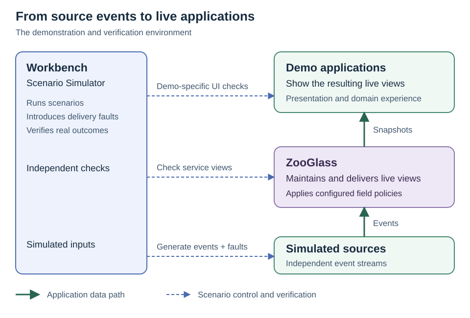

# ZooGlass

### Configurable live views from independent event sources

[](https://github.com/sproates/zooglass/actions/workflows/ci.yml)

ZooGlass maintains live views when source reports arrive late, conflict, go missing
or are corrected. Applications configure how contributions are mapped, selected
and combined. ZooGlass applies those rules, retains the resulting state and serves
snapshots through HTTP and WebSocket subscriptions.

A view includes more than values: it exposes the selected sources, publication
sequences, known delivery gaps and freshness status. Consumers can distinguish
what has been reported from what is missing, stale or still waiting for required
contributions.

For example, order, payment and stock systems can use different identifiers for
the same order. A configured view maps their contributions together, while a
smaller tracking view waits for its required inputs. In a sports view, a goal
correction can change the scorer, or a withdrawal can change the total; another
view can deliberately retain the first report. These policies are implemented in
the runtime and exercised by [acceptance tests](docs/verification/capability-delivery.md).

ZooGlass is under active development. The capabilities below are implemented;
the [roadmap](ROADMAP.md#further-direction) also sets out our plans for deterministic
timeline simulation, performance measurement, clustering and high availability.
These are future work, not current guarantees.

## What ZooGlass handles

| Application problem | Delivered capability |
| --- | --- |
| Reports arrive out of order or are retried | Per-field sequence ordering, bounded history and identified publications with retained retry outcomes. |
| Sources use different keys or disagree | Explicit entity mappings and configured source priority, with provenance for selected contributions. |
| Inputs are missing or a source goes quiet | Required-contribution gates, partial views, sequence-gap tracking, source watermarks and receipt-age freshness. |
| Facts are corrected or withdrawn | Retained fact revisions, active-fact collections and sums; separate views can select different revision policies. |
| The service restarts | In-memory or SQLite storage, with durable state, publication identities and outcomes recovered in SQLite mode. |
| Viewers reconnect or cannot keep up | Fresh subscription snapshots and bounded per-connection queues, with overflow disconnection or latest-state coalescing. |
| Access changes while a viewer is connected | Application-supplied access decisions, tenant ownership and active grant enforcement, including revocation. |

The [capability delivery record](docs/verification/capability-delivery.md) links
each behaviour to its configuration, contract and executable evidence. Start with
the [runtime guide](zooglass/README.md) for interfaces and the
[publication guide](zooglass/docs/publications.md) for source identities and view
definitions. Progress, freshness, storage and protected deployment have dedicated
guides linked from those pages.

Applications still own source integration, meaningful identities, domain policy,
permission decisions, presentation and operations. ZooGlass supplies the configured
reconciliation and delivery machinery. The
[developer-value comparison](docs/developer-value.md) explains that boundary using
a working vehicle example.

## Try a live demo

With **JDK 25** and **Node.js 26** installed, run these commands from the repository
root:

```sh
cd workbench
npm ci
npm run prepare:service
npm run demo -- vehicle-tracker --continuous
```

Open the URL printed by the command. Six simulated cars move around Gibraltar
while their reports encounter delays, duplicates, loss and interruptions. Open a
second browser or reconnect a viewer to see current-state snapshots. Ctrl+C stops
the demo and its owned processes.

`prepare:service` explicitly builds the Java service. Demo startup uses that
prepared JAR and compiles the TypeScript viewer; it does not trigger a Java build.
The continuous demo opens in your own browser and needs no Playwright browser
installation. See the [walkthrough](workbench/docs/continuous-driving.md) for setup,
map-provider details, private-LAN access and limitations.

The [interactive vehicle demos](demos/vehicle-tracker/README.md) provide Step,
Play, Pause and Reset controls for inspecting scripted scenarios. They demonstrate
a subset of the runtime: the map's older-report labels are application observation
age, not a demonstration of every runtime freshness or completeness policy.
Order and Sports experiences are the next demo programme; their detailed plans
are accepted, while combined delivery to `main` remains pending. See the
[roadmap](ROADMAP.md) for their scope and the wider direction.

## How the project fits together



ZooGlass is the runtime. Demo applications make its behaviour visible. Workbench
generates controlled inputs and faults, then checks results through real service
and client interfaces. In an application deployment, your sources and consumers
replace the demo systems; Workbench is development and verification tooling.

| Component | Role |
| --- | --- |
| [`zooglass/`](zooglass/README.md) | Java 25 / Spring Boot runtime: reconciliation, retained state, access enforcement and snapshot delivery. |
| [`workbench/`](workbench/README.md) | TypeScript / Node.js 26 scenario runner: scripted inputs, delivery faults, client actions and observable checks. |
| [`demos/`](demos/vehicle-tracker/README.md) | Browser applications consuming ZooGlass views, with domain-specific presentation. |
| [`docs/`](docs/what-is-zooglass.md) | Product explanation, designs, contracts and verification records. |

Workbench's scenarios have a defined action order and can be run repeatedly. Its
real-process execution does not make network delivery, service scheduling or
wall-clock timing deterministic. The
[timeline guide](workbench/README.md#timeline-order-and-real-time) explains that
distinction. We plan to develop Workbench into a deterministic timeline simulator,
with an explicit controlled-time execution contract; see the
[roadmap](ROADMAP.md#further-direction). The [architecture guide](docs/diagrams/README.md) shows the implemented
vehicle-demo stack and its boundaries.

## Guarantees and limits

- Reconnecting consumers receive current snapshots, not a replay of every missed
  transition. Independent views do not form an atomic multi-view read.
- A source watermark can confirm gaps within its declared scope. Silence alone
  proves neither missing events nor source failure; receipt age is not observation age.
- Source priority is configured explicitly. A stale primary does not automatically
  yield to a fresh backup. Supported mappings and aggregates are not arbitrary joins
  or a general query engine.
- Identity, history, gap and fact state have configured bounds. Runtime view
  registration has no historical backfill.
- SQLite recovery is single-instance recovery. Protected deployment requires the
  documented TLS, tenant and operator boundaries; access revocation cannot retract
  data a client has already received.

See the [delivery evidence and boundaries](docs/verification/capability-delivery.md#boundaries)
and [protected deployment guide](zooglass/docs/protected-deployment.md) before
choosing a deployment or relying on a particular guarantee.

## Verification and contributing

Java tests verify runtime strategies, transaction boundaries, persistence, crash
recovery and delivery contracts. Workbench scenarios exercise real source and
client interfaces; browser checks verify rendering, connection behaviour and
protected-data clearing. Demos illustrate behaviour, while the tests provide
correctness evidence.

The [testing guide](docs/testing.md) describes the layers and commands.
[CONTRIBUTING.md](CONTRIBUTING.md) covers setup, checks and review expectations.
Report suspected vulnerabilities privately using [SECURITY.md](SECURITY.md).

## Licence

ZooGlass is licensed under the [MIT licence](LICENSE).
Copyright (c) 2026 Ian Sproates.
