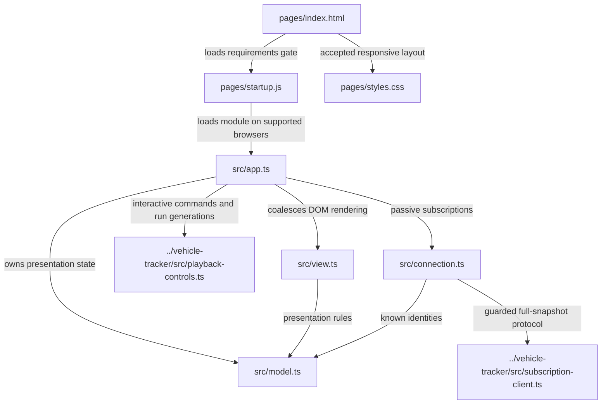

# Sports browser source map

Each box is a source file. Solid arrows are imports or labelled asset loads.
Paths are relative to `demos/live-sports/` except
the shared snapshot client. The accepted `prototype/` remains a separate static
reference; live pages never load its fixtures.

`model.ts` retains at most nine complete view/entity snapshots. Its presentation
rules filter baseline facts from scorer lists, gate scores against both fields'
retirement floors/counts and compare explicit market basis with observed source
progress. It neither adds scores nor reconciles revisions.

`connection.ts` owns bounded reconnect timing and visibility/page lifecycle. It
uses the same subscription client as Order and Fleet, and waits for all nine
initial snapshots before calling the connection live. A new connection replaces
whole snapshots; versions are not compared across connection generations.

`app.ts` binds selection and navigation, batches repaint requests and polls a
separate bounded notice feed. `view.ts` retains keyboard focus and open details
through repainting, renders supplied fields, and labels saved or transitional
state. Failure details stay in terminal output; the page reports the stopped run.

See the [Workbench host map](../../../workbench/docs/source-map.md#sports-continuous-browser)
for service/source ownership. No browser source publishes events or owns producer
state. Closing a viewer does not stop the synthetic matches.

In interactive mode, the shared `playback-controls.ts` module keeps command state
separate from data subscriptions. A Reset generation closes the old data client,
clears retained snapshots, and subscribes afresh when the replacement run is ready.
Controls never supply match values. Continuous pages omit the controls panel.
