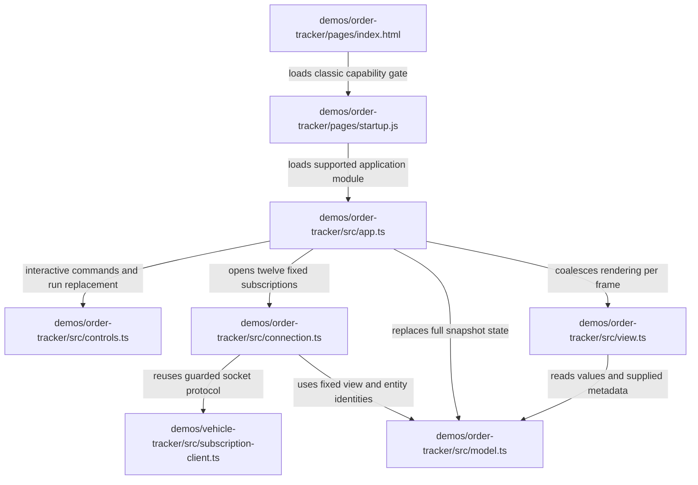

# Order browser source map

The page displays complete ZooGlass snapshots. It never chooses a source winner,
reorders publications, computes freshness or reconstructs missing events.
Paths below are relative to the repository root. Boxes are source files; arrows
name the dependency's purpose.

`model.ts` retains only the latest snapshot for each of twelve view/entity pairs.
New connection generations require fresh baselines; their versions are never
compared with the old connection. Empty or waiting snapshots replace old values.
`view.ts` uses snapshot freshness and missing ranges directly and compares cycle
labels only to explain synthetic slot reuse. It restores keyboard focus and open
disclosures across updates.

`connection.ts` owns one shared protocol client per connection attempt. It retries
transport failures every 1.5 seconds, bounds baseline acquisition to ten seconds,
ignores superseded callbacks and suspends connections while the page is hidden.
Invalid snapshots stop visibly rather than retrying indefinitely. The unprotected
viewer retains clearly labelled saved snapshots during disconnection. Protected
access and service restart are separate delivery work.

The existing subscription module remains at its vehicle path for compatibility.
Its `onSnapshot` callback and observations carry data, status, provenance,
publication sequences and version. Existing vehicle `onView` callbacks still
receive data only. The Order TypeScript build includes that one imported module
and preserves relative module paths under `dist/`; the host serves exact routes.

`app.ts` separately polls the bounded simulator notice feed. Notices describe
scheduled deliveries, not runtime conclusions, and never feed the snapshot model.
`controls.ts` maintains a separate, bounded control connection only in interactive
mode. It sends Step/Play/Pause/Reset commands and displays checked progress.
A changed run generation clears the snapshot model and closes its old data client;
new subscriptions start when the replacement run is ready. Controls never provide
view values. No playback controls are present in continuous mode.

The [Workbench source map](../../../workbench/docs/source-map.md#order-service-and-browser-composition)
shows service/process ownership and the read-only data proxy. The accepted static
prototype remains in `prototype/` as a visual reference.
