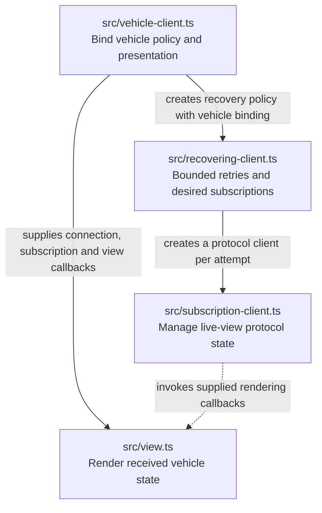
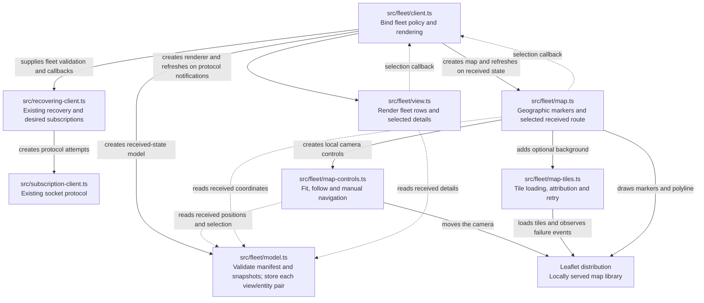
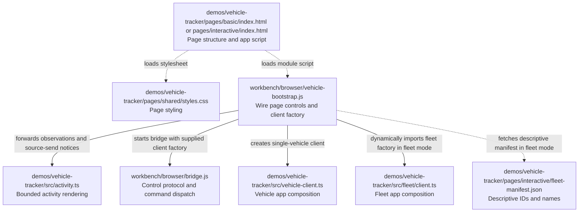
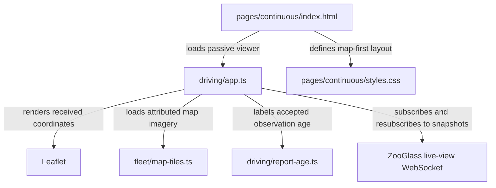

# Vehicle tracker source map

The vehicle tracker is the browser UI for a ZooGlass demo. Its TypeScript
modules separate vehicle-specific policy, subscription handling, rendering and
bounded recovery and run diagnostics.
Workbench supplies the scenario and controls; vehicle values come from ZooGlass
snapshots.

Each rectangular box below is a source file. Solid arrows point from a module to
a dependency and explain what it uses that dependency for. Dotted arrows show
asset loading or supplied callbacks, explicitly labelled. This is a static source
map, not the order in which messages arrive.

## The app modules

Paths in this diagram are relative to `vehicle-tracker`.

The dotted callback arrow is not an import: `subscription-client.ts` accepts a
`ClientBinding`. `vehicle-client.ts` supplies that binding using functions from
`view.ts`, so protocol handling does not need to know about vehicle rendering.

| Module                                                    | Responsibility                                                                                                                                                                                                |
| --------------------------------------------------------- | ------------------------------------------------------------------------------------------------------------------------------------------------------------------------------------------------------------- |
| [`vehicle-client.ts`](../src/vehicle-client.ts)           | Create the subscription client, restrict subscriptions to `car-17` and the `live-map`/`trip-history` views, and bind protocol notifications to the renderer. Start here to understand the app's composition.  |
| [`recovering-client.ts`](../src/recovering-client.ts)     | Own desired subscriptions, retry delays, attempt generations, cancellation and the wall-clock recovery deadline. Require all first snapshots before reporting recovery.                                       |
| [`subscription-client.ts`](../src/subscription-client.ts) | Own the WebSocket, connection generations, active subscriptions and pending acknowledgements. Execute connect/disconnect/subscribe/unsubscribe commands, report observations and notify the supplied binding. |
| [`view.ts`](../src/view.ts)                               | Validate received positions for rendering, retain the displayed latest position and history, and update the map, route, history list and connection/subscription status.                                      |

The subscription client rejects unexpected acknowledgements and ignores messages
from an old socket. The recovery wrapper adds an explicitly armed retry interval;
without it, unexpected transport loss remains fatal. The renderer distinguishes retained data
from a current subscribed snapshot. It does not manufacture expected scenario
results or own the socket.

[`activity.ts`](../src/activity.ts) renders the latest 100 diagnostic entries. It
receives actual browser observations and successful source-send notices from the
bootstrap; it does not drive the vehicle views or infer service processing from
a send. Its state lives for one page lifetime, so reset starts a new trace.

## Fleet presentation

The `--fleet` variant uses the same transport and recovery modules. Its additional
modules are grouped under `src/fleet/`; the short single-vehicle fixtures continue
to use `vehicle-client.ts` and `view.ts`.

[`model.ts`](../src/fleet/model.ts) holds each pair's subscription, receipt and
current/retained state. Complete snapshots replace previous fields; invalid
payloads cannot partially overwrite accepted state. Waiting for history and
receiving an explicit empty array are distinct. No ordering is recalculated in
the client; ZooGlass supplies the view contents.

[`view.ts`](../src/fleet/view.ts) updates all fleet rows and the selected detail.
Selection never calls the transport. [`client.ts`](../src/fleet/client.ts) rejects
unknown view/entity pairs and binds actual receipts to this model and renderer.
Closing that client releases its map, control listeners and tile timers. A run
replacement creates a fresh model and renderer, clearing rows, history and
selection before accepting new snapshots.
The descriptive `fleet-manifest.json` contains only IDs and names. It cannot
supply coordinates, operational values or history.

## How Workbench starts the page

The browser app is composed by Workbench. In external mode the bridge registers
one viewer lease per browser; the bootstrap shows its role and a target selector.
The fleet model, selection and data client remain local to that page. The transport
host enforces controller authority; disabling a button is only presentation.
Paths below are relative to the repository root. The `.js` modules are authored JavaScript; `vehicle-client.ts` and
its dependencies compile to JavaScript served by the host.

[`index.html`](../pages/basic/index.html) supplies the DOM and loads `/vehicle-bootstrap.js`.
The [bootstrap](../../../workbench/browser/vehicle-bootstrap.js) wires page buttons
and run status to the [bridge](../../../workbench/browser/bridge.js), and passes it
a vehicle-client factory. In fleet mode it loads the fleet module and manifest
and map configuration before starting the same bridge. The bridge dispatches commands to that supplied client
and reports observations over Workbench's control connection; it does not import
the vehicle implementation itself.

On the Node side,
[`vehicle-browser.ts`](../../../workbench/src/demos/vehicle/vehicle-browser.ts)
selects the page, scripts and stylesheet and supplies them to the shared browser
host. Its [fleet-assets.ts](../../../workbench/src/demos/vehicle/fleet-assets.ts)
dependency loads fleet modules, map configuration, local test tiles and the
installed Leaflet distribution. The host admits only the configured image origin;
map rendering stays in the demo app. This asset binding is separate from imports executed inside the browser.
The app's data socket reaches ZooGlass through the host's data proxy, while the
control connection carries Workbench commands and observations.

## Where orchestration and verification belong

The app code above displays the demo. Scenario scheduling, service/browser
ownership and independent page checks live in
[`workbench/src/demos/vehicle/`](../../../workbench/src/demos/vehicle).
In particular, the [page observer](../../../workbench/src/demos/vehicle/vehicle-observer.ts)
checks the rendered result without importing `view.ts` or reusing its projection
function. The [fleet observer](../../../workbench/src/demos/vehicle/fleet-observer.ts)
checks fleet rows and the currently selected history without changing selection.
Unselected histories receive protocol checks; the fleet browser test selects
each vehicle independently to verify the resulting detail. Expected results stay outside the app.

For the surrounding modules, see the [Workbench source map](../../../workbench/docs/source-map.md).
For the service that produces the views, see the [ZooGlass source map](../../../zooglass/docs/source-map.md).
The [demo README](../README.md) explains how to run it and interpret its display.
Update this map when module responsibilities, bindings or bootstrap paths change.

The [map guide](fleet-map.md) explains tile configuration and geographic verification.

## Continuous viewer

The six-car demonstration has its own entry point. It does not import the
Workbench command bridge or require a browser controller.

Six position records and six markers are retained. The map initially frames the
whole route area so cars do not drive out of the default viewport. Report age is
calculated from the accepted observation timestamp, independently of notices and
socket activity. The eight-second threshold is a demo policy, not source-health
inference by ZooGlass. No history subscription is created.
