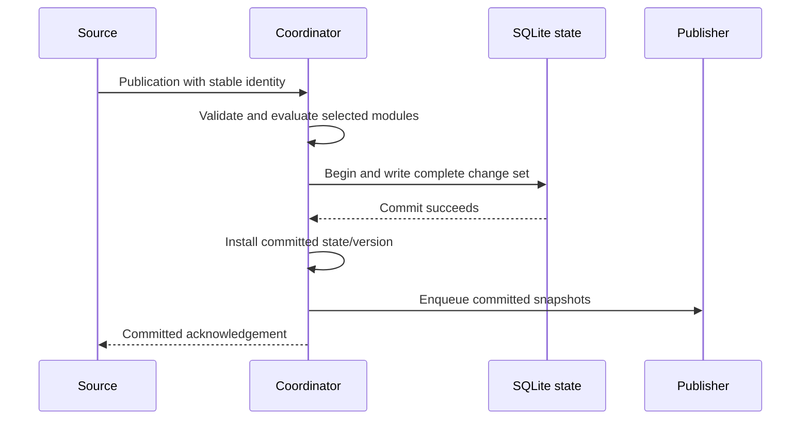
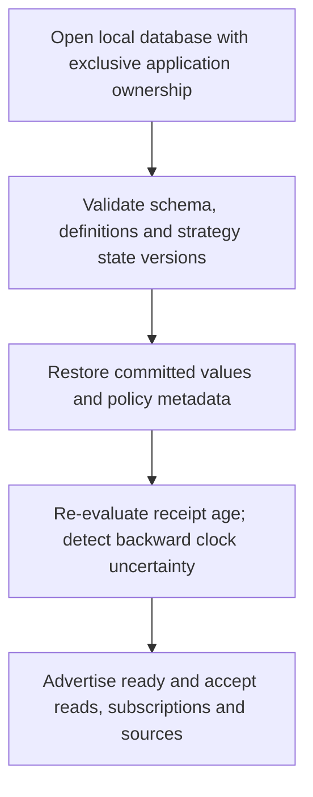

# Behaviour contracts and safe combinations

Companion to [strategy modules](strategy-modules.md). These are selected design
choices for review. They distinguish the compatibility-preserving first slice
from the richer contracts introduced afterwards.

## Compatibility and configuration lifecycle

The first module extraction preserves current `/events`, `/views`, `/views/live`
and JSON ordering configuration exactly. It does not add identity requirements,
change decimal sequence comparison or claim durable acknowledgement.

Richer behaviour uses an explicitly versioned contract (`contractVersion: 2` in
configuration and separate `/v2` endpoints). Existing definitions are not silently
converted. A runtime definition is immutable after registration. Changing policy
requires a new view ID, with no historical backfill in this programme. In durable
mode, a conflicting startup definition for an existing ID is a startup error;
identical definitions are idempotent. Reject unknown modes, fields and parameters.

Source contracts and view configuration are validated as a whole before activation.
Unknown source references, ambiguous identity mappings or unsupported combinations
fail configuration, rather than falling back to arrival replacement. Event errors
produce structured outcomes identifying the failed contract and correlation key;
logs must not dump arbitrary payloads. Current legacy logging can be replaced in
the ingress slice without changing the initial extraction.

## Source identity and ordering

For version 2, a source declares an immutable stream epoch and entity key scope.
The initial contract uses positive integer publication sequences, at most
`9007199254740991`, scoped to `(sourceId, epoch, sourceEntityId)`. Retries preserve
sequence and content; different publications have different sequences. Incrementing
an epoch is an explicit configured reset, not something an event can do to evade
ordering. Data from an unknown epoch is rejected. Retiring an epoch closes its
views or starts explicitly new view identities; it cannot silently reset existing
state. The first implementation requires stopping ingestion for this change.

A version-2 publication contains source, epoch, source entity, type, publication
sequence and payload. Fact revisions additionally carry `birthSequence`, `revision`
and `operation` (`create`, `revise`, `retract`). The fact key is source/epoch/entity/
birthSequence; create requires birthSequence equal to publicationSequence and
revision 1. Revising/retracting requires a known retained fact and a greater
revision; every new revision is also a new publication. The same fact cannot move
to another entity. These fields distinguish delivery identity from fact identity.

Duplicate classification compares the publication identity and canonical structured
content, including fact metadata. Object key order is immaterial. Equal identity
and equal content is unchanged; equal identity and conflicting content is rejected
and reported. A smaller obsolete fact revision changes no fact even if its
publication sequence is new. Missing or malformed identity rejects the envelope
before any state change. This stronger contract is not inferred from legacy
sequence-only events.

Each source keeps its own ordering domain. Before source-priority selection,
latest/history processing compares only that source's contribution. Independent
sources' sequence numbers are never used to choose between their values. Arrival
replacement remains a deliberate choice for inputs whose arrival order is useful.

For example, a source declaration can state `(courier, epoch-1, order-key)` uses
contiguous per-entity publication sequences beginning at 1. Receiving 40 then 42
creates a provisional gap only if earlier progress establishes that scope; a
watermark through 42 can confirm 41 missing. A fleet-wide sequence without that
per-entity promise instead uses untracked progress. The runtime records all valid
publications in the declared stream, including types that do not match a view.
Watermark envelopes contain the same source/epoch/entity scope and an integer
`throughSequence`; they do not contain a replacement domain payload.

Identity admission is runtime-wide within the source scope. Late application is
per-view/field: the same admitted publication can be ignored by one target and
incorporated by another. A duplicate publication is not reapplied to views created
after its original processing; newly defined views see new publications only.
Per-target outcomes and the runtime admission record commit together.

## Supported choices and defaults

Defaults are conservative and visible in the effective configuration. Version 2
requires explicit positive bounds for retained identities, facts, entities and
pending gaps; there is no hidden unlimited history mode. Exhaustion produces an
explicit limit outcome rather than silently losing required metadata.

| Concern | Initial choices | Default and limits |
| --- | --- | --- |
| Entity resolution | `envelopeEntity`, `lookupEntity` | Envelope key. Lookup uses configured per-source key → canonical ID mappings; unknown/ambiguous mappings reject without buffering. Mapping changes need a new definition; retroactive joins are excluded. |
| Contribution interpretation | `arrival`, `latestBySequence`, `historyBySequence` | Explicit per-field choice in v2. History is received history, not proof of completeness. Legacy omission still means arrival. |
| Multi-source conflict | `independentFields`, `sourcePriority` | Independent named fields. Priority is an explicit total ordering of sources; select the highest-ranked source with a present contribution, regardless of receipt time. Freshness does not secretly trigger fallback. |
| Progress | `untracked`, `contiguousSequence` | Untracked reports unknown completeness. Contiguous mode requires a starting sequence and scoped watermark promise. |
| Late event behind progress | `acceptLate`, `rejectBehindWatermark` | Accept within retention by default, expose a broken progress promise if applicable. Reject mode requires contiguous progress. Neither reconstructs missing data. |
| Freshness | `unspecified`, `receiptAge` | Unspecified until a positive threshold is supplied. Receipt age uses local accepted receipt time and is labelled as such, not source health or event-time freshness. |
| Partial publication | `publishPartial`, `requireContributions` | Publish partial with missing field names. Required-input mode withholds until named contributions are present; no hidden timeout or stale-as-absent rule. |
| Fact revision | `firstFact`, `latestFactRevision` | First fact rejects attempts to alter it; latest revision supports replacement/retraction within retained facts. |
| Derived numeric result | `sumActiveFacts` | Opt-in sum of one configured numeric property of retained active facts. Missing/non-numeric values reject that publication. No scripts, arbitrary joins or general expression language. |
| Recovery | `freshSnapshot` | Always recover current published state, not missed transitions. Cursor replay is outside the initial scope; configuration requesting it is rejected. |
| Slow client | `disconnectOnOverflow`, `coalesceLatestState` | Disconnect at configured message/byte bounds. Coalescing only for full current-state snapshots, never ordered deltas/control responses. |
| Storage | `memory`, `sqlite` | Explicit runtime choice; memory acknowledgements say applied, durable acknowledgements say committed. |

Illustrative v2 field fragment, separate from today's accepted JSON:

```json
{
  "name": "deliveryStatus",
  "inputs": ["courier-primary.status", "courier-backup.status"],
  "update": { "mode": "latestBySequence" },
  "conflict": { "mode": "sourcePriority", "sources": ["courier-primary", "courier-backup"] },
  "freshness": { "mode": "receiptAge", "staleAfterMs": 10000 }
}
```

The enclosing source registry supplies identity/sequence contracts and bounds.
Selection constructs `LatestBySequence` for each source's retained contribution,
`SourcePriority` for the visible field and `ReceiptAgeFreshness` for its metadata.
This is a composable set of named modules, not one module with every concern.

## Compatibility rules

| Combination | Decision and observable result |
| --- | --- |
| One feed → latest and history views | Supported, separate field states, one ingestion path. Late 41 changes history but not latest 42. |
| Two unrelated source sequences → one latest comparison | Reject. Use independent fields or explicit source priority over independently ordered candidates. |
| Priority selection + bounded latest per source | Supported. Retracting the winning contribution exposes the next ranked present source. Staleness remains visible and does not change rank. |
| Source priority + merged history/derived facts | Reject in the initial set. Keep source-specific histories or derive from one declared source. This avoids an undefined cross-source order. |
| Required inputs + silent source | Candidate state continues; publication remains withheld. Expose waiting metadata without fabricating the missing field. Changing policy needs a new definition. |
| Gap detection on feed-global/non-contiguous IDs | Reject contiguous configuration. Use untracked progress; a numerical jump alone is not an entity gap. |
| Revision support + sequence-current replacement | Reject for correction-aware facts. Use retained fact records and their active projection; a correction can target an older fact. |
| Revision support + reject-behind-watermark | Watermark checks publication sequence, not fact birth. A new publication may revise an old retained fact; a delayed publication behind the boundary follows the chosen late policy. |
| Coalescing + full snapshot of retained history | Supported when the contract promises current retained state, not delivery of every intermediate transition. Queue only the newest pending snapshot for the same subscription. |
| Coalescing + ordered event replay | Reject. Replay is not implemented in the selected initial contract. |
| Durable acknowledgement + memory storage | Reject configuration. Never describe an in-memory application result as committed across restart. |

Coalescing must not move a replacement ahead of other messages: remove the older
eligible pending snapshot and append the newer one. Never coalesce acknowledgement,
revocation, errors or across subscription generations. A snapshot larger than the
byte bound yields a bounded error/close rather than bypassing the bound.

## Progress, retention and corrections

A contiguous source promises publications 1…N for each configured entity scope.
A watermark W promises that publications through W will no longer arrive.
The store records compact received ranges and unresolved gaps, subject to explicit
bounds. A watermark may advance past a missing sequence; that gap becomes confirmed
missing under the source promise, not reconstructed. Progress from another source
cannot close it. A backwards watermark is rejected. An excessive range/retained
state request fails with a limit outcome rather than allocating an unbounded set.

A late publication behind W either is rejected, or is accepted under `acceptLate`
and sets a persistent `sourceContractViolated` flag. Completeness cannot then be
claimed from that epoch's promise. Clearing that condition requires an explicit
epoch reinitialisation, not quietly advancing another watermark. Timeouts can mark
receipt age stale; timeout-based completeness and event-time watermarks are later
choices, not part of this first progress contract.

Retained publication identities use a configured sequence window and a persisted
lower admission floor. Once a publication falls below the floor it is rejected as
outside retention, even if its identity record has been evicted. A source retry beyond that window receives an explicit
outside-retention outcome, not a promise of its original acknowledgement. This prevents an
old retry becoming a new effect after metadata deletion. The floor never decreases.
An independent maximum unresolved-gap count rejects overflow without pretending
completeness; gaps below the retention floor remain reported as expired missing
ranges rather than being described as repaired.

Correction views additionally configure a maximum active-fact count and a minimum
accepted birth-sequence floor. Active facts needed for an ongoing result are not
silently evicted to make space: capacity rejects new facts until an explicit
retention/retirement operation. Retired facts and tombstones are removed only with
an atomic advance of that floor; later create/revise/retract attempts below it are
rejected, regardless of their new publication sequence. Retained collection
summaries change visibly when facts are retired and are labelled as retained-window
results. No all-time aggregate is promised by a truncated fact window.

Each accepted revision recomputes the affected bounded collection and sum in the
same change set. First delivery is a create; a revise arriving before create is
rejected as unknown fact, with a retryable outcome. A greater revision can arrive
before an intermediate revision because it carries full replacement content.
Retraction retains a revision tombstone until retirement. Resurrection requires a
higher valid revision of a retained fact, and is an explicit supported operation,
not a duplicate old create. No historical UI animation or downstream business
transaction is reversed by this mechanism.

## Durable state and commit boundary

Choose single-instance SQLite on a local filesystem for the first durable mode,
with WAL and `synchronous=FULL`. SQLite documents the transaction synchronisation
and local-host WAL constraints in its [pragma reference](https://www2.sqlite.org/pragma.html)
and [WAL guide](https://sqlite.org/wal.html). This avoids implementing a bespoke
journal recovery protocol. A network database, replication and failover are outside
this slice. Pin and review the Java driver when implementing storage; that package
choice must not weaken this contract.

| Persisted together | Why |
| --- | --- |
| Versioned definitions, source contracts and mapping configuration | Reconstruct the same strategy selection and identity rules. |
| Field/contribution state, fact revisions and tombstones | Recover the visible value and the decision history needed for future events. |
| Publication identities/content fingerprints and admission floors | Retried events cannot become new effects after restart or retention expiry. |
| Progress ranges, missing/expired ranges, watermarks and violation flags | Recovery must not erase uncertainty or strengthen a broken source promise. |
| Receipt timestamps, candidate and last published state, publication eligibility and monotonically increasing commit version | Recover stale/partial state and consistent snapshots. |

One source envelope commits all affected views and metadata in one transaction.
State registration and retirement operations are transactional too. Stage changes
without mutating published memory, commit, install the committed state, enqueue
snapshots and then acknowledge the source. Snapshot reads are held behind the
coordinator during installation; subscribers never read uncommitted candidate state.
Required-input withholding updates candidate state but does not expose its values
through the published snapshot endpoint; status metadata explains what is missing.
Socket writes remain outside this lock. A failed enqueue affects that client, not
the committed source outcome. If installing state after a successful commit fails,
stop serving and restart from the database; do not continue with divergent memory.



Crash before commit: no change is recovered and no committed acknowledgement was
sent. Crash after commit but before acknowledgement: retry receives an idempotent
committed result, without reapplying effects. Crash after commit but before client
delivery: the client reconnects and receives the recovered snapshot. No guarantee
requires persistence of browser socket queues.



Schema/config mismatch, corruption or unavailable storage prevents readiness;
never fall back silently to empty memory. A commit with an uncertain result stops
new writes until recovery resolves it. The single instance owns the database for
its lifetime; a second instance fails to start. Bound entity/fact state through
admission limits, run WAL checkpoints and keep reads short; disk-full fails writes
explicitly. SQLite's transaction guarantees assume functioning filesystem sync;
local crash tests verify process termination, not arbitrary defective hardware.

Receipt age uses a supplied clock for deterministic tests. Persist wall-clock receipt
time for restart, use elapsed time while running, and expose `ageUnknown` if clock
rollback makes the recovered age unreliable. Recompute freshness on startup before
serving and on scheduled threshold crossings even without a new source event.

## Delivery and access boundary

The initial recovery choice is fresh snapshot, including an explicit empty snapshot
for a known view with no published entity. A v2 subscription acknowledges the
selected recovery mode, then sends its snapshot/version under the same coordination
boundary used for commits. Later updates have greater committed versions. HTTP
reads are individually consistent but do not form a cross-view transaction.
Browser recovery requests a new subscription; no cursor is accepted as replay.

Authorisation follows delivery correctness and precedes final demo acceptance.
Use an application-owned policy integration; the initial service enforcement scope
is view and entity, not field filtering. Reads, subscription setup and write-time
release check a current policy generation. Revocation/expiry invalidates membership
and queued payloads through the same enforcement boundary. A write already released
to the transport cannot be recalled; this boundary and a finite invalidation bound
must be specified in the existing authorisation design before that implementation.
Unavailable policy decisions deny access. The initial strategy slice uses only
synthetic local data and does not add an identity provider as a prerequisite.
