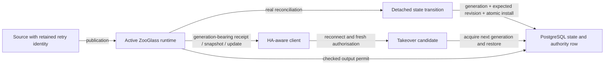

# Clustering and high availability

Status: accepted design, 28 November 2026. Storage, serving, client recovery and
the fault harness are implemented on the clustering integration branch. The
[finite qualification](../../workbench/docs/ha-qualification.md) passed on its
review branch. Integration merge and main promotion remain pending.

## The first outcome

A ZooGlass process can fail after accepting a publication. Another process should
recover the accepted state, recognise retries and serve a fresh authorised view.
The former owner must not resume and overwrite that work.

Start with **one active owner and one takeover candidate for one complete runtime**,
using PostgreSQL as the authoritative state and ownership store. This delivers a
first HA profile, not horizontal throughput scaling or HA support for every
existing configuration. Memory and SQLite remain supported standalone modes.
Choosing a new HA backend does not reopen SQLite optimisation or imply that
PostgreSQL has already demonstrated better performance.

The first programme has five implementation slices. After qualification, stop and
assess. Adding more runtime combinations, sharding or database failover is a
separate decision, not an automatic continuation of this plan.

## Alternatives and decision

| Approach                                                        | What it provides                                                                      | Cost and limitation                                                                                 | Recommendation                                          |
| --------------------------------------------------------------- | ------------------------------------------------------------------------------------- | --------------------------------------------------------------------------------------------------- | ------------------------------------------------------- |
| Shared PostgreSQL authority and state                           | Atomic ownership checks and state commits; a standby restores the same accepted state | Adds an external database and a dependency on its durability and single-primary operation           | First implementation                                    |
| ZooGlass state replicated through an existing consensus library | A possible route to a self-contained replicated service                               | Still needs application command ordering, state snapshots, membership, upgrades and clock semantics | Defer; do not implement a consensus algorithm ourselves |
| Independent SQLite files or a shared SQLite filesystem          | Existing single-process recovery                                                      | Neither establishes replicated ownership or safe failover                                           | Reject as a clustering architecture                     |
| Partition runtimes across active instances                      | Potential throughput distribution                                                     | Requires placement, cross-partition semantics and movement in addition to failover                  | Separate later design                                   |

PostgreSQL row locks provide the transaction boundary proposed here. Database
replication and database-primary fencing remain separate operational duties;
choosing PostgreSQL alone does not fulfil them. See its documentation on
[row locking](https://www.postgresql.org/docs/18/explicit-locking.html),
[replication](https://www.postgresql.org/docs/18/warm-standby.html) and
[database failover](https://www.postgresql.org/docs/18/warm-standby-failover.html).
The precise server patch, JDBC driver and container digest must be pinned in the
first implementation slice; this design uses PostgreSQL 18 semantics as its reference.

## Scope and admission

Name the first deployment profile `ha-static-v1`. Its initial qualification is
limited to two ZooGlass instances and one authoritative PostgreSQL primary.

Admit static arrival, latest and bounded history fields; envelope entity mappings;
source-priority selection; partial or required contributions; and the existing
bounded delivery strategies. Use up to three sources, two views and four fields
in total, with at most three fields per view. Retain existing stream, identity,
history and queue capacity checks. Both open-demo and application-policy access
must be qualified. The acceptance fixtures below exercise these combinations;
this is not a claim about arbitrary composition of future strategies.

Require unspecified freshness, untracked progress and immutable configuration.
Reject receipt-age freshness, tracked progress, facts, retirement and runtime
view registration. Configuration rejection happens before acquiring ownership;
unsupported controls fail before any mutation. There is no fallback to standalone
mode. Existing standalone configurations and protocols are unchanged.

Each candidate supplies the same canonical configuration identity, runtime ID,
tenant binding and protocol/schema version. Initial creation atomically records
these once. Thereafter the database copy is authoritative and a mismatch prevents
candidacy. Reordering equivalent definitions may normalise identically, but changed
source epochs, mappings, limits or policies do not. There is no startup-superset
extension or `POST /views` in this profile. This avoids silently dropping a
configuration that another owner accepted.

Receipt-age freshness is excluded because process monotonic clocks cannot be
compared across hosts. Reusing the existing SQLite restart algorithm would not
establish that contract. A future design must choose authoritative receipt time
or an explicit cross-host uncertainty policy. Lease time is not receipt time.

## Guarantees and dependencies

The guarantees below assume one non-Byzantine PostgreSQL authority whose committed
history does not move backwards, functioning durable commits, trusted runtime
instances and compatible binaries. Network delay, process pause, termination,
connection loss and uncertain commit responses are in scope. Malicious database
administrators, corrupted hardware and simultaneously writable database primaries
are outside the guarantee.

| Boundary             | Required behaviour                                                                                                                                                               |
| -------------------- | -------------------------------------------------------------------------------------------------------------------------------------------------------------------------------- |
| Accepted publication | A success receipt follows a committed state transaction. A surviving service process does not substitute for that commit.                                                        |
| Owner change         | The generation advances atomically at the same database boundary used by state mutations and read/output permits.                                                                |
| Former owner         | It cannot commit a new mutation or obtain a new permit after the ownership transaction wins. Cached state alone never grants permission.                                         |
| Lost receipt         | The result remains uncertain to the sender. Retry the same identity; retained committed outcomes remain duplicates with their original version and targets.                      |
| Retention            | Existing identity floors and capacity rules still apply. Failover does not provide unbounded deduplication.                                                                      |
| Viewer recovery      | Connections and access grants do not migrate. Reconnect, reauthorise and obtain a fresh snapshot.                                                                                |
| Backend unavailable  | Stop new commits and output permits. Previously committed receipts or permitted frames may still arrive under the in-flight boundary below. Never switch to local memory/SQLite. |
| Recovery time        | Measure takeover and reconnect time under the qualified faults. No fixed production failover-time promise follows from a lease duration.                                         |

Initial evidence qualifies **ZooGlass-process failover while the authoritative
database remains available**. A single database is still a failure dependency.
Surviving database-host loss requires a separately qualified durable deployment,
including synchronous replication, promotion that preserves acknowledged commits
and prevention of concurrent writable primaries. Asynchronous promotion does not
support a zero-loss claim. Restoring an older backup requires an operator-led new
runtime incarnation and client reset; it is not transparent failover.

## Ownership and commit protocol

Introduce cohesive ownership and PostgreSQL modules around the real runtime.
The existing `StateStore.install` boundary alone is insufficient: reads, duplicate
receipts, subscription opening and queued delivery also need authority checks.

Persist one authority row per runtime: runtime incarnation, owner attempt ID,
monotonically increasing generation, lease deadline, active/recovering state,
configuration identity and installed state revision. Owner attempt IDs are new
for every process/candidacy attempt. Generations are exact bounded integers;
exhaustion fails closed rather than wrapping. Carry their wire representation as
decimal strings so JavaScript cannot round them.

All acquisition, renewal, installation and output-permit transactions lock this
same row in a consistent order. Use the writable primary, never a replica for
these checks. Take the database time sample after acquiring the row lock; a
transaction-start timestamp may already be stale after waiting. PostgreSQL
[distinguishes these clocks](https://www.postgresql.org/docs/18/functions-datetime.html).
A backwards database-clock step can delay takeover and a forward step can cause
an early ownership change; generation checks still enforce safety. No liveness
bound is claimed under arbitrary clock changes.

1. **Acquire:** lock the row, verify profile/identity, and require no owner or an
   expired lease. Increment the generation, record the new attempt and recovering
   state, and commit. Only this transaction decides the winner.
2. **Recover:** read and validate the complete committed image for that generation.
   Build the coordinator without serving traffic. Renew only while the same
   attempt/generation remains current. Mark active in a checked transaction after
   recovery succeeds. Lost authority discards the candidate's restored cache.
3. **Mutate:** under the local coordinator, prepare the production transition.
   Lock the authority row, validate active attempt/generation and unexpired lease,
   compare the expected state revision, write the complete state delta and new
   revision, then commit. Only then install the detached image and expose success.
   A concurrent takeover must serialise before or after that transaction.
4. **Renew:** compare the current attempt/generation and an unexpired deadline in
   the locked transaction. An expired owner cannot simply renew its old generation;
   it must reacquire and recover. Heartbeats are scheduling hints, not write permits.
5. **Lose authority:** stop admission, invalidate local work generations, discard
   queued frames and close owned sockets best-effort. The database checks provide
   safety even when this cleanup is delayed by a paused process.

A write conflict, lost connection or uncertain commit stops that instance serving
until it reacquires and reloads. Do not retry a possibly committed transition
against its stale in-memory image. A new owner restores the actual committed
result and the source retries its original identity.

Bound connection acquisition, lock wait, statements and idle transactions. A
paused transaction can delay takeover while it holds a lock; server-side timeouts
are necessary and must be exercised. Do not hold a database transaction open
while waiting for a client socket, policy service or arbitrary listener.

## State and runtime boundaries

Preserve complete common `StateImage` content: source-local candidates (including
hidden losing values), selected data and provenance, stream receipts and original
target/field outcomes, identity floors, history and commit versions. Do not create
a snapshot-only store that loses retry or selection evidence. Unsupported progress,
fact and time metadata must be rejected or validated as their admitted empty/default
forms, not silently discarded.

Reuse production reconciliation and recovery validators, extracting SQLite-specific
configuration checks where necessary. The transaction also binds configuration,
tenant and schema identity. A new backend must report a truthful committed receipt
reason; the current durable-path `sqlite` reason cannot be reused for PostgreSQL.
Specify and test `postgresql` for new committed receipts while retained duplicates
keep `alreadyCommitted` and their original outcomes.

No application log/checkpoint subsystem is added in this phase. PostgreSQL state
is authoritative; a standby reconstructs it on acquisition. Ordinary database
backup remains an operator responsibility, not a source of automatic rollback.
Schema migration and configuration replacement require a stopped cluster in this
first profile. Mixed-version rolling upgrades are not admitted.

These are proposed responsibilities, not existing source files. Keep ownership,
store selection, transition logic and transport admission separate. Do not spread
backend or owner checks through individual reconciliation strategies.

## Reads, output and the network boundary

A role flag, cached lease or load-balancer health check is not authority to serve.
Before a snapshot response, duplicate receipt, subscription opening or queued
frame is admitted for output, validate its owner generation against the locked
primary row. New snapshot/opening capture checks that the local cache revision
equals the authoritative revision under the coordinator; a mismatch forces
recovery or refusal, never a cached response labelled current.

Keep **content revision** separate from the **authority revision checked at
output admission**. Both refer to the global installed `StateImage` revision.
A view's last-change version and a receipt's original commit version remain their
existing separate metadata; an unchanged view can legitimately have an older
view version in a snapshot captured from the current global revision.
An immutable queued frame may contain revision 7 while the
same owner has already committed revision 8. That frame remains valid under the
existing FIFO/delivery policy. It must have been created from an actual committed
transition or a checked snapshot capture by that same owner generation. At
handoff, validate the attempt/generation and require the authority revision to
be at least its content revision. Do not silently discard history, coalesce a
FIFO queue or rewrite the frame's content revision to the newer authority value.
A typed internal frame provenance must be minted only by those committed/capture
paths; arbitrary cached values do not acquire that status.

An originally committed receipt can retain its older publication version and
outcomes. A current owner may serve it after checking authority and the retained
identity evidence. That is distinct from admitting an old owner's queued frame.
After an uncertain commit or failed local installation, invalidate the cache and
recover before capturing any new response.

Each permit is specific to one immutable response/frame and cannot be cached for
future work. It records runtime incarnation, serving generation, content revision
and checked authority revision. Mutation success is authorised by its checked
commit; a later resend requires a new permit. Authority loss cancels pending work
when observed. A stale owner cannot obtain a new permit, even for previously
committed content, and a permit cannot be reused for a different frame.

**A permit check and delivery to a remote client cannot be atomic.** A process
can pause after the check, or bytes can already be in a network buffer. Data
admitted before takeover may arrive afterwards. This proposal guarantees ordered
state commits and output admission, not the disappearance of old bytes or an
instantaneous global view change.

Clustered receipts and frames therefore carry an HA envelope with runtime
incarnation, serving generation, content revision and checked authority revision,
separate from original
publication commit metadata. HTTP supplies equivalent metadata with the response.
The standalone wire format remains unchanged. Cluster clients negotiate the HA
protocol before data is sent; clients without that support are refused in HA mode.
The exact envelope and error schema must be written and independently reviewed
before slice 3 implementation begins, including protocol negotiation and every
inactive/unsupported response. They are part of that slice, not a post-code
documentation task.

An HA-aware client accepts one connection generation at a time, ignores callbacks
from replaced sockets and rejects a lower serving generation after it has observed
a higher one for that incarnation. A higher generation requires fresh admission
and a fresh baseline before updates. It must not compare counters across runtime
incarnations. A client that has not yet observed takeover can still receive
previously admitted old data; document that limit rather than calling it fencing.
Strict suppression of all old output after takeover would require a different
end-to-end egress contract and is not promised here.

Owner authority supplements policy-grant checks. Policy I/O stays outside runtime
and database locks; protected native handoff still rechecks the current grant.
An authority permit does not extend a grant or authorise a different resource.
Refused or inactive nodes return bounded unavailable outcomes and no private
snapshot; liveness and serving readiness remain distinct.

The proposed [HA client protocol](ha-client-protocol.md) specifies negotiation,
frames, refusal outcomes, client recovery and proxy readiness for slice 3.
It is a contract checkpoint, not a claim that these interfaces are implemented.

## Deployment and reconnect

Qualify both two explicit candidate addresses and one stable viewer address through
an owned, pinned HAProxy fixture. Use the same reusable client recovery logic for
both, with bounded reconnect/backoff. Applications using the stable address do not
manage cluster membership. No membership service or custom gateway is required.
The proxy routes new connections to serving-ready nodes; routing is not a safety
mechanism and existing connections may outlive its decision.

For protected viewers, use TCP TLS passthrough and terminate TLS at ZooGlass.
Validate certificates for both the stable hostname and direct candidate hostnames
against the configured trusted CA. Keep forwarded-header trust disabled. Readiness
probes use verified HTTPS and a dedicated credential, separate from operator and
policy credentials. Specify the minimal viewer-listener readiness route and its
authentication/error contract before implementation; it returns no private state
or ownership details. It checks current authority within a bound. A timeout or
non-success removes a backend from routing, but an old positive result never
substitutes for an authority check on subsequent work.

Do not replay application requests in the proxy. Clients reconnect, reauthorise,
obtain a fresh baseline and reject delayed HTTP results and old WebSocket callbacks.
Producers retain identities for explicit retries after uncertain acknowledgements.
A passthrough proxy with no ready backend produces bounded connection failure; it
need not manufacture an HTTP error inside a TLS session it does not terminate.

Protected source/control sockets currently use the loopback operator listener.
Preserve that boundary. The initial protected qualification runs a trusted source
fixture alongside each service instance and retries the same retained identities
through the new owner's local listener. Moving a real application's source spool
between hosts is an application responsibility that must be documented; this plan
does not expose operator ingress publicly or implement a real-system adapter.
Viewer TLS, fresh policy checks and separate operator credentials remain required.

Expose safe role/availability diagnostics and an authenticated administrative
view of current ownership, without publishing database credentials or tenant IDs
in routine logs. Readiness must fail closed when authority cannot be checked.
Set explicit retry, connection and transaction bounds in deployment settings;
record tested values rather than presenting them as universal recovery promises.

## Five implementation slices and stop conditions

Use `integration/clustering-ha` for incomplete HA work. Each slice gets its own
reviewed PR into that branch; only the complete qualified profile is proposed for
main. The integration workflow was accepted with this design. Each merge still
requires owner approval.

| Slice                          | Concrete result                                                                                                              | Gate before continuing                                                                                                                                                                    |
| ------------------------------ | ---------------------------------------------------------------------------------------------------------------------------- | ----------------------------------------------------------------------------------------------------------------------------------------------------------------------------------------- |
| 1. PostgreSQL static store     | Pinned local fixture, strict profile admission, complete common state persistence, truthful receipts and recovery validation | Real-backend parity for arrival/latest/history, hidden candidates, required contributions, retained retries/floors, invalid state/config and ambiguous commit; standalone tests unchanged |
| 2. Ownership                   | Generation/lease row, acquire/recover/activate states, atomic checked mutation and read/output-permit APIs                   | Two competing real connections cannot both win; stale mutation/read permits fail, expired renewals fail, paused transactions are bounded; no lease-only bypass                            |
| 3. Client continuity           | Reviewed HA wire contract, checked frame permits, HA-aware reconnect fixture, protected admission and readiness              | Delayed old frames cannot replace a new-generation baseline; original duplicate outcomes preserved; old grants/sockets never migrate; unsupported clients/config fail clearly             |
| 4. Fault evidence              | Reusable real two-process PostgreSQL harness and independent assertions                                                      | Fixed fault cases below pass; deliberately removed generation/revision checks are detected; harness cancellation and cleanup are demonstrated                                             |
| 5. Qualification and promotion | Finite recorded run, operator/runbook documentation, limits, final review and main promotion PR                              | All contract cases pass with retained evidence; no unresolved safety finding; owner accepts the measured capability                                                                       |

Plan for five slice PRs plus one final promotion PR after this design PR. Slice
sizes are estimates, not a deadline. A need for a new guarantee, extra profile,
replication system or indefinite qualification campaign returns to design rather
than silently adding slices. If output fencing cannot meet the stated admission
contract, stop before promoting anything as HA.

## Finite qualification

Use real prepared ZooGlass artifacts, two processes and a pinned PostgreSQL fixture.
Tests must not build Java. Pause, terminate or partition a named process/connection
at explicit barriers; capture transaction outcome, generation and externally
observed receipts/snapshots. Assert authored expected state and original receipt
identities, not agreement between two implementations of the same proposed model.

Freeze a manifest containing these fourteen cases before the qualification run:

1. Simultaneous acquisition and initial empty state, with exactly one active owner.
2. Normal publication and orderly owner handover, with retained receipt and view.
3. Termination before commit: no falsely acknowledged work, safe same-identity retry.
4. Commit followed by lost receipt: takeover returns the original retained outcome.
5. Acknowledged work followed by process kill: all accepted state survives takeover.
6. Isolated former owner still reachable by clients: stale writes and new output
   permits fail after takeover; no cache-only success.
7. Pause immediately before a write check, and separately after an output permit:
   stale mutation rejected; delayed permitted data obeys the documented client boundary.
   Also queue revision 7, commit revision 8 and verify same-owner FIFO delivery
   preserves revision 7 rather than dropping or relabelling it. Capture an
   unchanged view at a newer global revision without rewriting its view version.
8. Paused lock holder and expired lease: server-side timeout releases the blocked
   acquisition path; expired generation cannot renew and resume serving.
9. Required contributions, hidden source-priority candidates and history across
   takeover, with independent expected data/provenance and commit versions.
10. Retention floor, conflicting retry, configuration/tenant/schema mismatch and
    unsupported controls: unchanged rejection and no partial state installation.
11. Protected reconnect, refused/unavailable policy and expired grant: no migrated
    authorisation, no snapshot leakage, fresh baseline only after new admission.
12. Backend outage and recovery, candidate restart and harness cancellation:
    fail closed, recover exact committed state, clean up owned resources.
13. Open-demo deployment through the stable proxy address: terminate the owner,
    reconnect to the successor, obtain a fresh snapshot and continue updates.
    Retry retained publications and verify their original outcomes. Reject delayed
    HTTP results and old WebSocket callbacks after the new baseline.
14. Protected deployment through the stable TLS proxy address: terminate the owner
    and verify a different instance, higher generation, fresh policy decision and
    fresh baseline. Include denied/expired access without snapshot leakage,
    backend outage/recovery, no-ready routing, invalid probe credentials and
    certificate rejection. Keep protected source retries on local trusted fixtures.
    In a separate bounded substep, leave the former owner alive and reachable while
    the proxy retains its last positive health result. After the successor acquires
    authority, route new work to that former owner and require refusal despite
    stale routing. Previously admitted bytes retain the documented in-flight limit.
    Check delayed HTTP results and WebSocket callbacks against the new baseline.

The frozen manifest must enumerate each case's bounded substeps, fault barriers,
expected outcomes and profile combinations. Map open-demo and protected access
explicitly to those steps: case 11 covers protected admission/reconnect, case
12 covers protected backend loss and case 14 covers protected proxy deployment;
other cases use open-demo unless the manifest
states otherwise. Include every admitted field/mapping/contribution/delivery
choice in that coverage map, and reject a missing combination or unsupported
expansion before calling the qualification complete.

Run each top-level script once with the fault barriers and once with deliberate
additional process pauses: 28 executions. Compound cases contain several authored
observations; 28 is a workload bound, not a count of atomic faults or statistical
proof. Add two negative controls that bypass generation validation
and cached-state revision validation; both must fail their invariant check. Record
real recovery durations without turning this into a throughput campaign. Failure
requires a fix and rerun of affected cases, not an unbounded repeat count. Retain
small manifests/hashes in the repository and larger evidence as release assets.

The two proxy scripts supplement the direct cases; do not double the full matrix.
Record the pinned proxy configuration, verified TLS topology, bounded substeps,
backend identities, deadlines and owned-resource cleanup. Publish a reproducible
deployment guide. This qualifies service-process failover with the proxy and
PostgreSQL available, not proxy redundancy, database HA or physical-host/network
availability. These checks fit the existing client, harness and qualification
slices; no additional implementation slice is introduced.

Workbench may orchestrate the real interfaces and capture faults. Its current
deterministic profiles do not model two owners or PostgreSQL. A fake authority
backend may test local contract ordering, but is not PostgreSQL or cluster evidence.
This programme does not claim deterministic multi-node replay; that extension
requires a separate accepted design. Real-process qualification is mandatory here.

## Acceptance decision

Accepting this design chooses the PostgreSQL-backed first profile, the limited
process-failure claim, the permitted in-flight-output boundary, the six-PR
integration/promotion workflow and the finite evidence set. It does not promise
all-feature HA, automatic database failover, zero interruption, multi-region
availability, horizontal scaling or a new maximum throughput figure.
