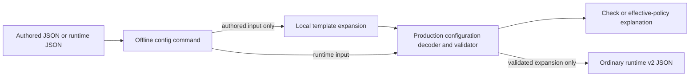

# Simpler configuration authoring

Status: proposed design, pending acceptance. No authoring commands or template
format described here are implemented. Baseline: main `7316002`, including the
[configuration guide](../../zooglass/docs/configuration.md).

## What should improve

A configuration should be easier to maintain and easier to check without hiding
its behaviour. The current JSON already exposes useful policy choices. We should
keep those choices visible, reduce genuine repetition and give authors feedback
before they start a service.

The proposal adds an optional offline authoring format with local field templates,
and `config check`, `config expand` and `config explain` commands backed by the
production configuration parser. Expanded output is ordinary `contractVersion: 2`
JSON. The service, SQLite recovery and Workbench continue to consume that existing
contract. An author can keep using it directly.

This is one design PR followed by **three implementation and verification PRs**.
It does not include a DSL, interactive wizard, editor extension or runtime template
support. Further authoring capabilities need a separate decision.

## Where the complexity comes from

The [orders example](../../zooglass/docs/examples/configuration/orders-memory.json)
contains mapping, required contributions, courier ranking, contiguous progress and
receipt-age policies. Those are meaningful choices. Omitting their declarations
would make the example shorter by making its behaviour harder to review.

The [sales example](../../zooglass/docs/examples/configuration/sales-sqlite.json)
repeats one source/type and three fact settings for two projections. Both projections
must still name their update mode, and the total must name the numeric property,
but changing their common settings should require one edit.

| Approach | Benefit | Cost and decision |
| --- | --- | --- |
| More runtime defaults or inferred policies | Fewer required declarations | Can silently choose storage, retention or ordering. Do not add these defaults. |
| Guided creation and checking of existing JSON | Less copying and faster feedback | Does not remove repetition from maintained files. Keep checking/explanation; defer a wizard. |
| Local templates expanded offline | One declaration for genuinely shared settings, reviewable output | Adds a small authoring contract and an expansion step. Proposed with no overrides or inheritance. |
| YAML, expressions or a DSL | Potentially more concise authoring | Adds syntax, tooling and ambiguity before we know it is needed. Deferred. |

## Concrete before and after

Today, the two sales fields each repeat:

```json
{
  "sourceId": "sales",
  "type": "sale",
  "facts": {
    "revision": "latestFactRevision",
    "maxRetainedFacts": 100,
    "minimumBirthSequence": 1
  }
}
```

The proposed [complete authored example](examples/configuration-authoring/sales-example.md)
uses a flat root with `"format": "zooglass-config/v1"`, the existing runtime
settings, and this template:

```json
"fieldTemplates": {
  "sale": {
    "sourceId": "sales",
    "type": "sale",
    "facts": {
      "revision": "latestFactRevision",
      "maxRetainedFacts": 100,
      "minimumBirthSequence": 1
    }
  }
}
```

Its view still declares each projection explicitly:

```json
"fields": {
  "items": {"use": "sale", "mode": "activeFacts"},
  "total": {"use": "sale", "mode": "sumActiveFacts", "property": "amount"}
}
```

Counting the complete example with identical compact JSON formatting gives 522
bytes today and 463 proposed, a reduction of 59 bytes, approximately 11%. With
consistent two-space formatting it is 41 versus 40 lines. The useful improvement
is maintaining five shared settings once rather than twice; line count is not the
acceptance criterion. These are source-document measurements, not usability-study
or runtime-performance results.

The orders example remains ordinary runtime JSON. An authored format is optional,
and this proposal does not claim every configuration becomes smaller.

## Authoring contract

`zooglass-config/v1` is an authoring version. It is distinct from runtime
`contractVersion: 2` and Workbench timeline document versions.

| Element | Contract |
| --- | --- |
| Root discriminator | Exactly `format: zooglass-config/v1`. `contractVersion` is forbidden alongside it. Ordinary runtime JSON retains its existing discriminator. |
| Runtime settings | Same names and semantics as runtime v2: storage, three root limits, sources, views and optional delivery. Required storage, limits and source epochs remain explicit. |
| `fieldTemplates` | Required nonempty object of nonblank names to field-setting objects. Names are exact and case-sensitive. Every declared template must be used. |
| Template settings | Only `sourceId`, `type`, `inputs`, `conflict`, `late`, `freshness` and `facts`. Input shorthand/expanded rules remain the runtime's rules. |
| Excluded template settings | `mode`, `property` and `use` are forbidden. No nested references. |
| Referencing field | Only `use`, required `mode` and optional `property`. `use` names one local template. No extra field settings, even if identical to the template. |
| Inline field | Existing runtime field grammar, with no `use`. Inline and referencing fields may coexist in a view. |
| Resolution | Copy the referenced settings into a fresh field object, then add that use site's mode/property. There are no overlapping keys to merge. Validate the resulting full configuration with production code. |

Undefined references, unused templates, unknown keys, duplicate JSON keys,
unsupported versions, null template entries and invalid combinations are errors.
A template must be valid at **every** use. For example, a fact template used with
`arrival` fails; it is not silently stripped of fact settings. Two uses do not
share mutable runtime state: expansion creates ordinary independent fields.

References are document-local. No file includes, environment substitution,
expressions, inheritance, override precedence, remote references or cross-file
imports are supported. An author needing a different policy writes a second
explicit template or an inline field.

### Exact expansion

Expansion removes `format` and `fieldTemplates`, inserts `contractVersion: 2`, and
replaces field references. It does not invent optional policies, normalise epochs,
choose capacities, sort semantic arrays or add a database path. Source/view order,
priority order and array contents are preserved. Existing runtime defaults continue
to apply where their settings were omitted; `explain` shows them.

Use the Java JSON representation and production numeric/string validation. Do not
round-trip settings through JavaScript numbers: `delivery.maxQueuedBytes`, for
example, admits signed 64-bit integers beyond JavaScript's exact integer range.
Duplicate keys, malformed Unicode and trailing documents must be rejected before
expansion. New and existing parsing paths must share these strictness rules.

The same input bytes and tool version produce identical UTF-8 output, including
formatting and final newline. Object-key formatting is deterministic; arrays keep
their order. Do not claim that differently written equivalent source files have
the same hash. Golden output tests freeze the chosen formatter before delivery.

Tool input and expanded output are each bounded to 16 MiB of UTF-8. Enforce the
expanded limit incrementally, before materialising an oversized result. Existing
production JSON depth/number/string constraints remain in force. Exceeding a tool
bound is reported separately from invalid runtime configuration; the bound does
not change what the existing service loader accepts.

## Commands and feedback

Commands dispatch from the prepared production JAR before Spring starts, following
the existing offline-command pattern. They never prepare or build artifacts.
The following interface is proposed:

```sh
java -jar zooglass/target/zooglass.jar config check views.json
java -jar zooglass/target/zooglass.jar config explain sales.authored.json
java -jar zooglass/target/zooglass.jar config expand sales.authored.json --output sales.runtime.json
```

`check` and `explain` accept ordinary runtime v2 or authored v1 input, selected only
by the explicit discriminator. They do not guess from filenames or retry one parser
when another rejects the document. `expand` requires authored input.

- **Check:** parse, resolve if needed and call the production validator. Report
  configuration validity, selected storage and input format. State that deployment,
  existing-database compatibility and timeline eligibility were not checked.
- **Expand:** validate first, then write a complete ordinary runtime configuration
  to the requested new file. Refuse existing destinations; no force/overwrite flag.
  Report input-byte SHA-256, output-byte SHA-256 and `toolJarSha256`, the
  SHA-256 of the exact prepared production JAR running the command. A human
  version label may accompany that digest but cannot replace it. Consumers
  use the output only after successful command completion. A failed write cleans
  up only the file created by this invocation; do not promise crash-atomic output.
- **Explain:** show effective inputs, update/fact policy, source priority order,
  entity mapping, progress, late handling, freshness, publication gate, bounds and
  delivery. Identify declarations inherited from templates and defaults supplied
  by production decoding. This explains configured policy, not actual event decisions.

Default output is readable text. `--json` gives a versioned
`zooglass-config-report/v1` report with operation, input format, validity and
structured diagnostics; expansion metadata includes its hashes. Freeze that report
schema and golden examples in the first implementation PR. Exit 0 means the
requested operation completed successfully, 1 means invalid input or processing/I/O
failure, and 2 means invalid command usage. A failed validation produces no output
configuration. Do not print credentials, file contents or full stack traces by default.

A diagnostic includes a stable code, relevant JSON path and a useful reason.
Where a reused field is invalid, retain the expanded field path and originating
use/template paths. Add context at the shared production validation boundary;
do not infer paths by parsing exception text or maintain a parallel rules engine.
Report the narrowest context actually known; a root or field path is valid when
no more specific path is available. Syntax errors without a meaningful JSON path
identify the input and line/column. Stable codes and paths belong to the offline
report API. Sharing diagnostics must preserve existing runtime acceptance/rejection
and HTTP/startup error and redaction contracts; it must not cause incidental wire
changes or expose previously hidden details.

For the sales example, `explain` should make it easy to see that both projections
use source `sales`, type `sale`, latest revisions and retention 100, while `items`
returns a collection and `total` sums `amount`. It must also show that late events
are accepted and freshness is unspecified, because those are effective defaults.

## Ownership and compatibility



Keep parsing/expansion, CLI I/O and presentation in cohesive modules. A small
production inspection facade can expose validated configuration and provenance to
the command without exposing coordinator internals. The runtime parser remains
the authority for strategy compatibility and defaults. A concrete source map is
part of implementation; this diagram shows the proposed responsibilities.

No command constructs a coordinator, opens a database, binds a listener, calls a
policy service or registers a view. `storage: sqlite` is valid without supplying
a database path to these commands, because deployment is a separate check.

The service must continue rejecting `format`, `fieldTemplates` and `use` in its
runtime input. Pass expanded JSON to `--zooglass.config`. Keep authored input and
reviewed output together when that suits the deployment process; never compile
implicitly at startup. Generated output is a reviewable artifact, not a signature
or an automatic deployment approval.

SQLite compares the expanded runtime configuration using its existing rules. A
template edit can change several view definitions at once and make restart
incompatible. Explain that consequence; do not migrate state or declare an existing
database compatible without opening and checking it through the existing process.
No changes to the stored schema or source/view identity rules are proposed.

Workbench receives the exact expanded configuration file. Its configuration hash,
source/artifact identity and admission checks retain their meaning; no authoring
hash replaces a runtime hash. Template expansion does not admit unsupported
timeline features. Historical evidence and archives are unchanged.

## Delivery and acceptance

After acceptance of this design, use normal main-based branches and reviewed PRs.
There is no integration branch or automatic merge permission for this work.

1. **Production-backed check and explain.** Add offline dispatch, shared inspection
   and structured diagnostics for ordinary runtime JSON; freeze report schema and
   defaults/provenance presentation. Include its valid/invalid input, report and
   no-side-effect tests in this PR. No authoring-format acceptance in the service.
2. **Local field templates and expansion.** Add the authored grammar, bounded exact
   expansion, references/provenance and non-overwriting output. Extend check/explain
   to authored input. Include the complete authored sales example and all grammar,
   bounds, no-overwrite, exact-number and deterministic-output tests in this PR.
3. **Finite verification and adoption guide.** Verify expansion equivalence and
   service/restart behaviour, negative controls and deterministic output. Document
   the commands, limits, exact authored-to-runtime workflow and how existing direct
   JSON remains available. Do not require a new qualification campaign or migrate
   all demos to templates.

Acceptance is finite:

- The proposed sales example expands to configuration equivalent under production
  decoding to the existing example, including all capacities and delivery settings.
  Do not reuse the timeline static comparison whitelist, which ignores some bounds.
- The two modes and sum property remain explicit at their use sites; the five
  shared settings occur once. Orders remains valid unchanged.
- Fresh process invocations produce identical expanded bytes. A signed-64-bit
  boundary value remains exact. Priority and view ordering remain unchanged.
- Missing references, unused templates, forbidden overrides, recursive references,
  duplicate keys, coercion, invalid strategies and expansion overflow fail with
  meaningful diagnostics. Error cases do not publish an output configuration.
- Existing service validation agrees with `check` for the same runtime inputs.
  Ordinary runtime JSON is not rewritten by check or explain.
- No-side-effect tests establish that invalid/valid inspection neither opens SQLite
  nor starts HTTP/WebSocket/policy clients. Existing files cannot be overwritten.
- Existing sales creation/correction/withdrawal and SQLite restart/retry checks pass
  using expanded output. Existing ordinary-orders checks still pass. Tests consume
  explicitly prepared artifacts; they never trigger builds.
- Explain/report golden tests match production defaults and template origins. An
  unsupported timeline configuration is not labelled timeline-compatible merely
  because service checking succeeds.

This delivers less repeated configuration and earlier, clearer feedback. It does
not remove the need to understand storage, source identity and policy choices,
and it makes no promise that a terse configuration is automatically a safe one.
