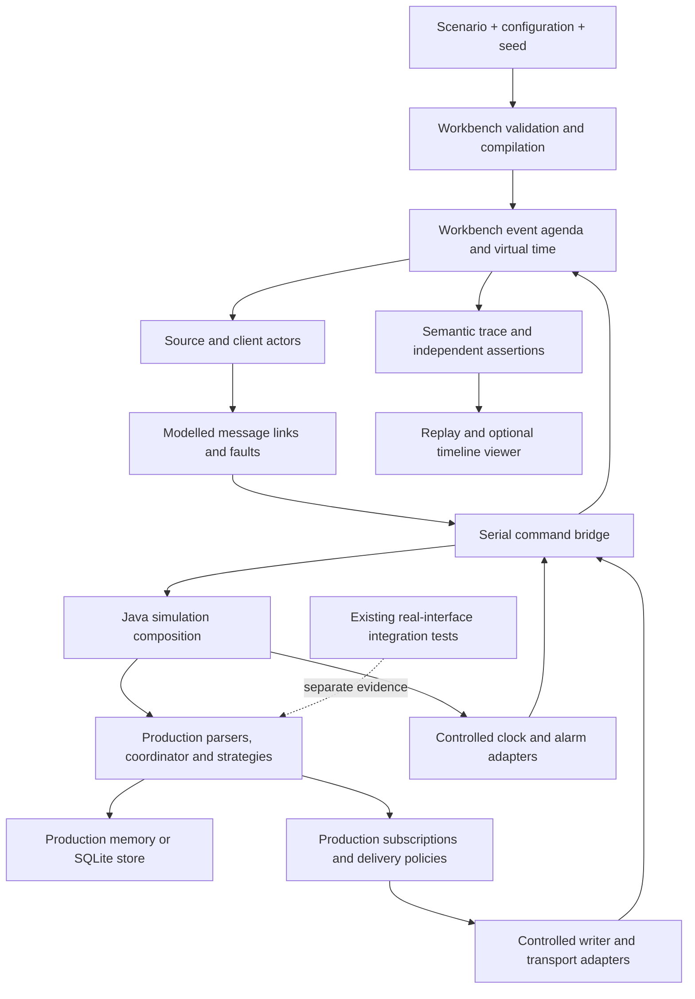

# Workbench deterministic timeline simulation

Status: accepted design, 13 November 2026. The POC branch now contains shared
clock/alarm and writer seams plus a fixed-fixture controlled host and agenda.
See the [bounded proof](../../workbench/docs/timeline-proof.md) for execution,
validation and limits. The complete simulator described below is not delivered.
The existing `simulate` command still prints an ordered trace; `integrate` still
runs against real processes and sockets.

## The outcome we want

When a scenario fails, we should be able to rerun it and stop immediately before
the same failure. Waiting longer, running on a quieter machine or opening a
browser should not change which event the simulated system sees next.

We propose a discrete-event simulator which owns time, event scheduling and the
modelled communication between sources, ZooGlass and clients. It executes the
actual Java reconciliation and delivery policies. Workbench generates inputs,
chooses when they arrive and checks the results; it does not calculate
substitute ZooGlass views.

The reproducibility promise is:

> Given the same validated scenario, runtime configuration, initial state, seed,
> simulator contract and executable artifacts, a supported run produces the same
> ordered semantic trace and assertion results, regardless of host speed or
> presentation pacing.

This promise applies inside an explicit simulation boundary. It is not a claim
that Java thread scheduling, TCP, browsers, SQLite file layouts or physical
crash recovery become deterministic. We continue to test those through real
interfaces. A simulated success is correctness evidence for the modelled
execution, not a throughput result or proof that every concurrent execution is
safe.

The first complete release covers a single unprotected ZooGlass instance, real
configured reconciliation, virtual receipt age, bounded delivery, source and
viewer faults, exact replay and restart between committed turns. Protected
access and mid-transaction physical crashes remain outside that release.

## What exists and what is missing

Audit baseline: public main `0850980`. The Order and Sports delivery branch adds
useful scenarios but is not required to define the execution contract.

| Current code                                                                                                                                                                                                                                                                         | What it already gives us                                                              | What must change for simulation                                                                                                              |
| ------------------------------------------------------------------------------------------------------------------------------------------------------------------------------------------------------------------------------------------------------------------------------------ | ------------------------------------------------------------------------------------- | -------------------------------------------------------------------------------------------------------------------------------------------- |
| [playback.ts](../../workbench/src/scenario/playback.ts)                                                                                                                                                                                                                              | Stable ordering by `simulationTime`, then declaration order; initial clients at zero. | A live event agenda for derived work, deadlines, faults and cancellation.                                                                    |
| [simulate.ts](../../workbench/src/cli/simulate.ts)                                                                                                                                                                                                                                   | Validates a fixture and prints its intended actions.                                  | An explicit execution mode with real outcomes, rather than implying this trace executed anything.                                            |
| [integrate.ts](../../workbench/src/cli/integrate.ts) and [scenario-session.ts](../../workbench/src/execution/scenario-session.ts)                                                                                                                                                    | Real-interface checks, serial action dispatch and awaited receipts.                   | Keep this integration path. Wall-clock waits and `--fast` are not a virtual clock.                                                           |
| [ViewCoordinator](../../zooglass/src/main/java/io/zooglass/runtime/ViewCoordinator.java)                                                                                                                                                                                             | Serialises admission, commits, snapshots and listener enqueueing.                     | A controlled environment for time and wakeups; preserve its transaction boundaries.                                                          |
| [ReceiptClock](../../zooglass/src/main/java/io/zooglass/runtime/ReceiptClock.java)                                                                                                                                                                                                   | Separates durable wall time from process-local monotonic time.                        | Inject it with scheduler-controlled samples throughout the supported path.                                                                   |
| [FreshnessRuntime](../../zooglass/src/main/java/io/zooglass/runtime/FreshnessRuntime.java)                                                                                                                                                                                           | Plans deadlines and runs the real expiry transitions.                                 | Replace its internally constructed scheduled executor with an injected alarm driver. A fake clock alone leaves real timer races.             |
| [SnapshotBroadcaster](../../zooglass/src/main/java/io/zooglass/delivery/SnapshotBroadcaster.java), [OutboundWriter](../../zooglass/src/main/java/io/zooglass/delivery/OutboundWriter.java) and [OutboundQueue](../../zooglass/src/main/java/io/zooglass/delivery/OutboundQueue.java) | Subscription baselines, bounded queues, overflow and coalescing policies.             | Make writer progress explicit without duplicating queue policy. The current blocking `take()` loop cannot run on a deterministic event loop. |
| [SqliteState](../../zooglass/src/main/java/io/zooglass/runtime/SqliteState.java)                                                                                                                                                                                                     | Stages state and commits SQLite before installing it.                                 | Use the same store at completed-turn restart boundaries. Native I/O duration stays outside simulated time.                                   |
| [GrantRenewals](../../zooglass/src/main/java/io/zooglass/access/GrantRenewals.java) and the access transports                                                                                                                                                                        | Real timers, policy requests and guarded network handoffs.                            | A later design must control all those boundaries before protected execution can claim determinism.                                           |

Current map/set iteration is also relevant. For example,
[FreshnessDeadlines](../../zooglass/src/main/java/io/zooglass/runtime/FreshnessDeadlines.java)
collects due fields in sets. A stable input schedule is insufficient if their
iteration changes the order in which effects are handed to clients.
`SubscriptionIndex.recipients()` also exposes a copied map whose iteration order
must not become recipient scheduling order. Any collection which influences
scheduling must have an explicit order in the common runtime path. Sorting a
finished trace must never conceal a different execution order.

## Keep one runtime and two execution environments

Workbench remains TypeScript. ZooGlass remains Java. A small Java simulation
host composes the production runtime with controlled adapters; it does not boot
an HTTP server. Workbench starts that host from an explicitly prepared artifact
and sends one command at a time over a private, framed process channel.



The normal server keeps its existing clocks, networking and execution model. The
proposed adapters expose environmental effects, not alternate strategy
implementations. No public HTTP operation will set service time, drain a queue
or force a scheduler decision. Simulation is a separate executable entry point
with no listener and no normal-server configuration switch.

Use the same production envelope parser and application/receipt path for source,
progress and fact-retirement messages. Where a Spring handler currently combines
parsing, application and sending, extract that common operation and have both
adapters call it. Reuse subscription admission, baseline construction and queue
policy in the same way. Calling only `ViewCoordinator.apply()` would miss enough
of the observable contract that it is not the complete simulator.

Refactor the writer into bounded, resumable steps: select a queued frame, begin
handoff, and handle completion or failure. The production driver schedules these
steps on its ordinary executor and real transport. Include session close and
failure paths: `SnapshotBroadcaster.requestClose()` currently starts a virtual
thread directly, so changing only the writer executor would leave a hidden path.
The simulation driver waits for explicit scheduler turns. Preserve the current
distinction between queued frames and one frame already owned by the writer; a
simulated slow consumer must exercise the real queue budget and coalescing
implementation.

This is a focused seam, not a universal actor framework, plugin system or
rewrite of ZooGlass as a TypeScript model. If the common writer cannot be
separated without changing observable production behaviour, resolve that design
problem before claiming deterministic delivery support.

## The execution contract

### Time is data

Use non-negative integer milliseconds for simulation time, bounded by
JavaScript's safe-integer range. Reject overflow in parsing, additions and
duration conversion. There is no automatic wall-clock advance. The scheduler
jumps directly to the next event time; it never sleeps to make a deadline become
due.

Keep four concepts separate:

- **Simulation time** is global elapsed scenario time and never goes backwards.
- **Runtime monotonic time** is simulation time minus that runtime generation's
  start time. It resets on restart, just as the current process-local clock
  does.
- **Runtime wall time** is a configured epoch plus simulation time plus explicit
  wall-clock adjustments. A backwards adjustment does not rewind the agenda.
- **Source observation time** is publication payload data. It need not match
  receipt time and never schedules execution implicitly.

A clock sample during one synchronous turn returns the same before/after
monotonic value. Modelling a pause between clock reads is a separate future
fault; we do not manufacture such a pause from host execution latency. SQLite
recovery sees the configured wall time at restart and uses its real recovery
rules.

Host clocks are allowed only for diagnostics, optional display pacing and a
watchdog. A watchdog expiry is an infrastructure failure, not a simulated
timeout or a scenario assertion failure. Host time must never choose a retry,
stamp a receipt, mark a field stale or break a scheduling tie.

### A turn has a defined end

A scheduler turn dispatches one root action, runtime task or message delivery.
The runtime runs its synchronous transition to completion and returns a batch of
observable effects and newly scheduled work. No other turn overlaps it. Waiting
for the Java response stops the simulation clock.

A completed turn means the command and its synchronous state commit have
finished, all effects from that turn are in the response, and the Java host is
idle. It does not mean that every emitted frame has reached a client. Writer
progression, network delivery and receipt arrival are separate agenda entries.

The Java host must not run background semantic work while idle. Timers register
opaque task IDs with the bridge; a task runs only when Workbench dispatches it.
There is no hidden `setTimeout`, scheduled executor, common-pool completion or
worker thread updating simulated state. Effects are enumerated in stable order.
A held writer is represented by state, never by blocking the command channel.
Task/connection IDs use deterministic generation-local counters, not UUIDs,
object addresses or host process IDs. Cancellation identifies the task
generation so a replaced deadline cannot wake later under the same ID.

### Ordering at the same timestamp

Use a total agenda key `(timeMs, round, phase, ordinal)`:

| Phase | Work                                                            |
| ----- | --------------------------------------------------------------- |
| 0     | Explicit lifecycle, wall-clock and link-state changes.          |
| 1     | Runtime deadlines, source retry timers and due scheduled tasks. |
| 2     | Source/client actions and message deliveries.                   |

Root actions at a timestamp start in round zero. Within a phase, declaration
order is stable; subsequently allocated ordinals are monotonically increasing.
Work created for the current timestamp always enters the next round, regardless
of phase. Work scheduled for a future timestamp starts in round zero. This
prevents a callback from inserting itself before its cause or starving other
same-time root actions by recursion. Several publications declared at the same
timestamp therefore form a burst before their derived writer turns; even
zero-latency links can expose queue pressure. That is intentional. Use separate
timestamps when a scenario needs a writer to drain between publications. Version
one has no implicit “drain after every publication” rule. Timer registration and
cancellation are effects of a turn, processed in their returned order before
dispatching the next turn.

The next timestamp is the earliest agenda event, assertion barrier or run
horizon, so assertion-only times and `untilMs` advance the clocks even when no
action is queued. Time does not advance beyond a timestamp until all executable
rounds there are drained. Assertions declared `atMs: T` run after that drain.
They do not wait for future deliveries or make the system progress merely
because an expected value has not appeared. An assertion is an observation, not
an event-selection rule.

A clock/link/stop/start action at a deadline therefore runs before a timer in the
same round. A due expiry runs before a same-round publication. This defines one
legal modelled schedule, not every production race. Explore the other boundary
with explicit times immediately before/after it, or a separately versioned
schedule policy later. Version one has no random tie-breaking scheduler.

Runtime operations which already reconcile due expiry, including snapshot reads,
retain that behaviour. An assertion may read only after due tasks settle; if a
read unexpectedly creates overdue effects, report an adapter invariant failure.
Do not allow polling reads to repair a missing alarm driver. Snapshot reads are
recorded runtime commands, including their effects; only the comparison with the
expected value is pure. Process assertions in declaration order and settle any
permitted read-response delivery before the next comparison. An expiry
transition created by a read after timestamp settlement fails the alarm-driver
invariant.

Declare limits for turns, rounds per timestamp, queued events, pending messages,
trace bytes and run horizon. Zero-time cycles, counter overflow and exhausted
limits stop with a reproducible `limit-exceeded` result and the last event
chain. No queue silently drops work because the host is short of memory.

### State at the end of a run

Every run has a finite `untilMs`. Process all eligible work and assertions
through that time, then record pending future work and resource counts. No work
due at or before the horizon may remain. Future freshness alarms or periodic
source events are allowed only as the scenario's declared end condition;
unexpected outstanding receipts or held frames fail that condition. Infinite
live operation is a sequence of explicitly bounded runs, not an unbounded
simulation job.

Pause leaves virtual time unchanged. Resume continues the same agenda. Step runs
one complete turn; “next checkpoint” drains to the next declared assertion time.
Reset starts from the recorded initial state and seed. Initial implementation is
CLI-first. A future timeline UI observes the trace; its rendering speed cannot
advance simulation or provide an assertion barrier.

## Communication and fault semantics

There are separate source-to-runtime, receipt-to-source and runtime-to-client
links. The first two are FIFO directions of one bidirectional source connection,
sharing a connection ID and generation. Closing it invalidates undelivered work
in both directions; already committed publications stay committed. Directional
stalls are explicit model actions, not separate WebSocket connections. Each
message has an immutable identity, origin event, connection generation, send
time, delivery state and exact payload. A source publication identity remains
`(sourceId, epoch, sourceEntityId, publicationSequence)`; delivery attempt IDs
do not change it.

Within a healthy connection, a logical FIFO link preserves frame order. A delay
of an already sent frame also delays later frames on that connection. Model
out-of-order source data by buffering reports **before sending**, or by using
separate links/connections, rather than pretending TCP reordered complete
frames. An application-level duplicate is a second send of the same publication.
It does not mean the transport invented a second WebSocket frame.

| Fault/action                | Precise effect                                                                                                                                                                                                                  |
| --------------------------- | ------------------------------------------------------------------------------------------------------------------------------------------------------------------------------------------------------------------------------- |
| Delay before send           | Keep an application publication in the source actor; later publications can be sent first if the scenario says so.                                                                                                              |
| Drop before send            | The runtime receives nothing. A later source watermark may establish the gap.                                                                                                                                                   |
| Delay link delivery         | Hold delivery and preserve that connection's FIFO ordering. No runtime change until ingress.                                                                                                                                    |
| Lose acknowledgement        | Apply the publication normally, then prevent its receipt reaching the source by closing that bidirectional source connection. Invalidate both directions and retry through a fresh generation with identical publication bytes. |
| Duplicate/retry publication | Preserve identity and payload; check the actual retained-identity outcome, including recorded targets and version. A memory restart can admit it anew. A conflicting payload is a separate intentional identity-conflict action. |
| Disconnect/reconnect viewer | Invalidate the old connection generation and its pending delivery. Reconnect goes through real subscription/baseline logic. No replay buffer is invented.                                                                       |
| Stall writer handoff        | Keep one frame in flight and let the real queue accumulate updates. Release or fail the handoff at a declared time.                                                                                                             |
| Source silence              | Schedule no reports for a bounded interval. Receipt-age expiry comes from the runtime's timer, not an injected stale label.                                                                                                     |
| Stop/start service          | Explicit phase-zero actions bound downtime. Stop invalidates runtime-owned tasks and old connections; start creates a new generation at its declared time. External actors and their timers continue.                          |

Do not label arbitrary post-send frame loss as normal WebSocket behaviour. If a
future lossy message transport is added, give it a separate named contract.
Fault rules declare their boundary, direction, selector, active time interval
and occurrence count. Overlapping rules at one boundary are rejected unless an
explicit composition order is supplied. Use half-open intervals
`[fromMs, toMs)`.

A source actor has an explicit maximum attempt count, retry interval and receipt
timeout. At a receipt/timeout tie, the phase rule makes timeout run first; an
extra retry of a retained publication must not apply it twice. Record
late receipts and ignore those from obsolete connection generations. Do not base
retry decisions on how long the child process took to answer a command.

### Randomness which we can explain

Explicit faults are the default for small regressions. Generated campaigns take
an explicit 256-bit seed, represented as 64 hexadecimal digits. If the CLI
chooses a seed, write and display it before executing any turn.

Random decisions are keyed by
`(seed, scenarioId, ruleId, actorId, eventId, connectionGeneration, direction, attempt, drawLabel, drawIndex)`,
using a versioned SHA-256 counter derivation. Encode components as
length-prefixed UTF-8, integers as canonical decimal strings, and include a
domain/version prefix. Use rejection sampling for bounded integers; never depend
on `Math.random()`, Java's default random source or floating-point probability
comparisons. Probabilities use integer numerator/denominator pairs. Publish
cross-language test vectors for the encoding and range sampler.

This lets a receipt-loss rule keep the same draws when an unrelated actor gains
an event. Renaming a rule or event intentionally changes its random stream. The
expanded fault decisions, including rejected draws, are part of the trace. A
seed alone is not a replay artifact without the scenario, configuration and
versions.

## The private process protocol

Workbench starts one prepared Java simulation executable per runtime generation.
Both ends exchange length-prefixed UTF-8 JSON frames on stdin/stdout;
diagnostics go to stderr. Start with a 16 MiB per-frame cap, included in the
manifest, and fail explicitly on overflow. Larger batching can be designed
later. Do not use a socket listener or allow the normal server to expose these
controls.

The handshake supplies protocol and capabilities versions, Java/runtime artifact
identity, supported storage and features, with no runtime created yet. The first
initialisation command supplies clocks and configuration before constructing the
coordinator; its response returns recovered effects and the initial task set. No
wall-clock sample is taken before that command. A scenario requiring unsupported
capability is rejected before execution, including protected access, real
browser actions and any uncontrolled timer dependency.

Each command carries `turnId`, `runtimeGeneration`, `timeMs`, wall/monotonic
clock values, and one operation: ingress, subscription change, snapshot read,
writer step, timer task, or lifecycle control. Each response echoes that
identity and contains the result, ordered outputs, timer/task registrations and
cancellations, and bounded diagnostic counters. Unknown task IDs, duplicate
command IDs, decreasing simulation time or decreasing monotonic time within a
generation, or mismatched generations are fatal protocol errors. Validate
monotonic time against that generation's start; it begins at zero. Wall-clock
rollback is permitted only through a recorded adjustment action. A generation's
recorded `initialize` turn constructs the runtime only after clocks,
configuration and initial store are installed. Every later command installs its
clock sample atomically before invoking runtime code.

The pipe is a synchronisation mechanism, not the simulated network. Its speed or
chunking cannot affect the logical result. Commands are never retried
implicitly: if the process dies without completing a turn, that run is an
infrastructure failure. A supported abrupt stop occurs only after an
acknowledged turn, so the simulator knows which state transitions completed.

Runtime changes needed for this protocol are proposed work. The existing
prepared server JAR does not currently provide it. Add an explicit preparation
command for the simulation artifact; execution and tests must never invoke a
Java build.

### Run results do not blur failures

| Final result          | Meaning and replay treatment                                                                                                                                                                              |
| --------------------- | --------------------------------------------------------------------------------------------------------------------------------------------------------------------------------------------------------- |
| `passed`              | All scheduled checks and end conditions passed within the supported boundary; complete semantic trace can be verified by replay.                                                                          |
| `assertion-failed`    | A reproducible completed failure against independent expected behaviour. Keep the semantic prefix and failure record for replay.                                                                          |
| `limit-exceeded`      | A configured deterministic bound stopped the run. Reproduce the same failure; never count it as a pass or silent truncation.                                                                              |
| `validation-rejected` | Unsupported/invalid scenario, feature, fixture or manifest; no runtime execution. Retain the precise validation reason.                                                                                   |
| `invalid-execution`   | Unexpected process/native I/O failure, protocol violation, adapter invariant failure or host watchdog expiry. Keep diagnostics and any semantic prefix, but do not certify a completed deterministic run. |

Expected malformed publications, policy rejections and injected transport
failures are ordinary semantic outcomes, not harness failures. Their scenario
assertions can pass or fail. An incomplete artifact has no valid final result
and cannot be promoted to `passed` by inspection. Invalid executions remain
failures to investigate; classifying a scheduler bug as invalid does not make it
acceptable for release.

## Storage, restart and protected operation

Start with production memory storage. Add production SQLite to the same
interface once event and delivery determinism are established. A run begins with
an empty store, or a hashed immutable fixture copied into its own work
directory. A SQLite fixture must be a clean, closed database or a complete
declared database/WAL bundle; copying a live database file alone is invalid. Do
not share a writable database between runs.

SQLite operations execute synchronously within a turn. Filesystem time and
SQLite page/WAL layout are not part of the semantic trace. A successful commit
followed by lost receipt and a between-turn restart should reproduce the
runtime's durable receipt and recovery semantics. Compare canonical logical
state, not database bytes.

A restart consists of explicit `service-stop` and `service-start` actions with
their own declared times. Both run in phase zero, ordered by declaration when
they share a timestamp. Stop may be orderly, closing the production store, or
abrupt, terminating the host without normal close after an acknowledged turn.
It invalidates that runtime's tasks, alarms and writer callbacks, all its old
connection generations and their undelivered messages. External source/client
actors, retained publications and their scheduled timeouts/retries survive.

While stopped, simulation time and external actors continue normally. Connection
and send requests return the modelled `connection-unavailable` outcome without
IPC or automatic startup. For a source, reconnecting and sending belong to one
publication attempt: connection failure ends it without sending, consumes
exactly one attempt and follows the declared retry policy. A runtime snapshot
assertion observes `runtime-unavailable`, not an empty or cached view. Stop
followed by start at the same timestamp is allowed; a stop while already stopped
or a start while running is a validation error.

Only the declared start action creates the next generation. Its initialise turn
installs wall time for that start timestamp and monotonic zero before reopening
the store and running production recovery. Returned tasks follow the ordinary
round rules: work due now enters the next round; future work starts in round
zero at its due time. Same-time source retry timers follow the phase-zero
lifecycle actions and observe the resulting availability. Host shutdown/startup
duration does not advance virtual time; an unexpected host failure is
`invalid-execution`.
An in-memory restart loses state; SQLite retains committed state.

For a literal acceptance case, use empty initial storage, one receipt-age field,
zero-latency links and one publication with a 30 ms freshness threshold. Allow
at least three source attempts: a 10 ms receipt timeout triggers an immediate retry;
an unavailable attempt retries 30 ms later.

| Time | Action and required observation |
| --- | --- |
| 10 | Commit the publication as version 1 and lose its receipt. Retain the exact publication bytes in the source. |
| 11 | Abruptly stop the service. Invalidate its alarm due at 40 and all old connections; retain the source timeout due at 20. |
| 20 | The timeout triggers a retry. Observe `connection-unavailable`, no IPC and no startup. Schedule the next attempt for 50. |
| 50 | Start the new generation before the retry timer. SQLite recovery marks the retained value stale as version 2; the identical retry returns the original version-1 duplicate receipt without refreshing age. With memory storage, the retry is newly applied as version 1, fresh at 50 and due to expire at 80. |

Assert that no runtime reconciliation or delivery occurred between completed
stop and start, and no old-generation callback or frame was delivered after
startup. Adding an unrelated assertion at 25 must not change recovery time,
retained retry timing or these outcomes.

Mid-commit termination, torn writes, disk-full behaviour, OS socket buffering
and native durability under physical power loss remain real integration/crash
tests. Unexpected native I/O errors invalidate a run as infrastructure failures.
Do not turn them into a seeded scenario result. A future storage-fault model
must name its commit boundary and retain comparison against those existing
tests.

Protected runtime configuration is rejected in the first release. It must never
be silently downgraded to unprotected execution. A later extension needs
controlled access-policy responses, admission deadlines, grant renewal timers,
generation leases and writer handoff checks. Real TLS and policy-server failures
continue to need their own tests even after that extension.

## Scenario format and existing commands

Introduce a versioned `timeline-simulation/v1` format alongside current
fixtures. It references the existing full runtime configuration contract rather
than growing another partial strategy language in Workbench. A scenario declares
stable IDs, clock epoch, storage/initial state, bounded actors and links, seed,
explicit actions, fault rules, assertions, limits and end conditions. Unknown
keys and unsupported operations are validation errors.

For example, this **illustrative fragment** refers to a view configured with
receipt-age freshness of 50 ms and to a source actor with a retained
publication:

```json
{
  "format": "timeline-simulation/v1",
  "id": "lost-receipt-and-expiry",
  "clock": { "epochMillis": 1700000000000 },
  "seed": "0000000000000000000000000000000000000000000000000000000000000001",
  "untilMs": 200,
  "actions": [
    {
      "id": "send-1",
      "atMs": 100,
      "kind": "source-send",
      "publication": "report-1"
    },
    {
      "id": "retry-1",
      "atMs": 120,
      "kind": "source-retry",
      "publication": "report-1"
    }
  ],
  "assertions": [
    {
      "id": "fresh-before",
      "atMs": 149,
      "kind": "field-freshness",
      "viewId": "positions",
      "entityId": "car-1",
      "field": "position",
      "equals": "fresh"
    },
    {
      "id": "stale-at",
      "atMs": 150,
      "kind": "field-freshness",
      "viewId": "positions",
      "entityId": "car-1",
      "field": "position",
      "equals": "stale"
    }
  ]
}
```

The complete fixture also supplies zero-latency links, the full publication,
configuration and a fault which loses the first receipt and reconnects before
the retry. Expected result: one applied contribution at 100, a duplicate receipt
on retry, and expiry at 150. Retrying must not refresh receipt age. A second
fixture places a new publication at 150: the due expiry runs first, then the new
value becomes fresh. Hand-written expected versions and status transitions must
accompany both fixtures; merely observing the final value cannot prove the
ordering.

Proposed commands, unavailable today:

```sh
npm run simulate -- --execute scenarios/simulation/lost-receipt.json --out artifacts/run-1
npm run simulate -- --replay artifacts/run-1
npm run simulate -- --compare artifacts/run-1 artifacts/run-2
```

Keep `npm run simulate -- scenario.json` print-only for compatibility, and label
its output “planned actions, not executed”. Keep `integrate` and
`integrate --fast` as real-interface modes. No existing command quietly changes
meaning.

Provide an explicit converter for the supported subset of legacy scenarios. It
preserves source identities and declared order, emits stable IDs, and reports
any behaviour which needs a different assertion time or link model. Old checks
interleaved with same-time actions cannot be silently converted into
settled-timestamp checks. Unsupported fixtures stay on the integration path.
Domain demos migrate only when useful; their current playback remains usable
while the simulator is built.

## Trace, assertions and replay

A run directory contains an immutable manifest, expanded scenario/configuration,
initial-state identity, append-only semantic JSONL trace and a final result.
Record scenario/schema/scheduler/randomness/protocol versions, source revision,
executable hashes, dependency lock identity, Java/Node/SQLite versions, platform
and locale. The initial guarantee is for a matching supported environment
manifest. Extend it to cross-platform equality only after a declared
qualification matrix passes.

Each semantic record includes event ID, causal parent, agenda key, actor and
runtime or connection generation. Record scheduled/delivered/dropped messages,
original publication identity, runtime receipts, observable state transitions,
timer lifecycle, client observations and assertion outcomes. Preserve observable
versions, progress, freshness, targets, provenance and frame order; these are
not diagnostic noise. Assertions must include full relevant envelopes and
explicit absence checks, with hand-authored expectations at important
boundaries. Expected state must not be computed by calling the same projection
under test. The first release hashes the semantic trace, not a purported
complete internal state. Equal visible snapshots cannot prove equal hidden
receipt windows, pending candidates or retained facts; probe those with
independent subsequent operations and explicit assertions.

Canonical encoding sorts object keys by a specified Unicode code-point order,
preserves array order, uses UTF-8 and a fixed escaping policy, and rejects
duplicate object keys and non-finite numbers. Keep payload numbers lossless
across the bridge: use raw JSON text plus a lossless token parser for
canonicalisation, rather than round-tripping every value through JavaScript
`number`. Canonical decimal values remove insignificant trailing zeros,
normalise negative zero and specify exponent expansion bounds. The proposed
canonical number spelling is plain decimal without exponents: `1.0` and `1e0`
both become `1`, `-0` becomes `0`, and `0.0100` becomes `0.01`. Limit the
expanded representation to 4,096 digits and JSON nesting to 64; keep these
limits in the format version. Add encoding test vectors before traces become a
compatibility contract. Enforce byte/digit/depth limits, rejecting oversized
values rather than rounding them. Queue byte accounting uses actual
production-encoded frame bytes, not canonical trace bytes.

Log wall durations, absolute paths, PIDs, native stack traces and memory
observations in a separate diagnostic stream. They are useful for performance
investigation but cannot change the semantic hash. Do not strip actual runtime
timestamps, generation values or business fields to make two executions match.

Replay has two explicitly different operations:

- **Inspection** reads a saved trace without executing ZooGlass and cannot pass
  a runtime test.
- **Verification replay** starts the same artifacts and initial state, reruns
  the scenario/seed, checks each decision and effect against the saved trace,
  and stops at the first divergence. Recorded results are never injected as
  runtime outputs.

A baseline run and candidate runtime with different artifact hashes may be
compared as a differential experiment, but that is not exact replay. Compare
equivalent schema versions and report changed output paths and causal events.
Save the full original fixture and seed even when later tools minimise a
failure. A record with no valid final result is incomplete, never a passing run.

## Implementation boundaries and delivery sequence

The names below are proposed modules, not existing APIs. Keep the production
source maps accurate when each seam is implemented; this diagram describes only
the plan.

| Area                                                          | Responsibility                                                                                          |
| ------------------------------------------------------------- | ------------------------------------------------------------------------------------------------------- |
| `workbench/src/simulation/scenario.ts`                        | New grammar, capability validation, stable IDs and legacy conversion.                                   |
| `workbench/src/simulation/scheduler.ts`                       | Agenda, virtual time, cancellation, stepping and bounds.                                                |
| `workbench/src/simulation/actors.ts`, `links.ts`, `faults.ts` | Source/client state, connection ordering, deterministic fault decisions. No view reducer.               |
| `workbench/src/simulation/runtime.ts`                         | Prepared Java host lifecycle and strict turn protocol.                                                  |
| `workbench/src/simulation/trace.ts`, `replay.ts`              | Lossless canonical records, artifacts and divergence reporting.                                         |
| Java runtime environment seam                                 | Receipt clock and alarm registration, shared by production and simulation composition.                  |
| Java delivery driver seam                                     | Resumable writer, genuine queues/subscriptions, controlled versus native handoff.                       |
| Separate Java simulation entry point                          | Compose the real runtime and controlled adapters, capability handshake and command loop. No web server. |

### Prove the architecture before expanding it

The first implementation milestone is a small, end-to-end proof gate. It must
run actual Java ingress, reconciliation, freshness and subscription delivery
under Workbench's clock and agenda, and replay their outputs. A standalone
scheduling library, print-only trace, mocked runtime or final-snapshot
comparison does not pass this gate.

Keep the milestone to at most two reviewable implementation PRs: one for the
shared runtime clock/writer seams and one for the minimal executable vertical
slice. Both are part of the same proof, and the first PR alone does not
establish determinism. If that scope cannot be made reviewable, revisit the
design before starting a long infrastructure sequence. Do not start a general
fault language, campaign tooling, demo migration, simulator UI or SQLite
extension until the gate passes and its evidence has been reviewed.

Use one unprotected, memory-backed configuration, one source and two
subscribers. One subscriber has a controlled stalled writer, exercising the real
queue; the other receives ordinary baselines and updates. Start with literal
publications, one keyed seeded receipt-loss choice, an explicit retry actor and
a small semantic transcript. Use two fixed, hand-authored scenarios: receipt
loss/freshness and stalled delivery. No domain-specific demo code is needed.
Include lossless-number and stable-collection-order vectors in this milestone,
before generalising the format or relying on hashes.

The gate must demonstrate all of the following:

1. **Virtual time controls the production runtime.** Freeze simulated time while
   the host waits longer than the configured receipt-age threshold. No value
   becomes stale. Advance to threshold minus one, then threshold, and observe
   the actual expiry transition and subscriber frame without waiting on wall
   time. Also jump over an hour of simulated inactivity without an hour-long
   sleep. Disable the alarm driver in a negative control: a snapshot read must
   not rescue the test. Check expiry followed by a new publication at the same
   deadline, including both intermediate transitions and their versions.
2. **Delivery is inside the boundary.** Hold one writer handoff, publish enough
   updates to exercise the real configured overflow or coalescing policy, and
   release/fail the handoff at a scheduled turn. The healthy subscriber
   continues. Same-time inputs deliberately exercise the documented burst
   ordering. Compare baseline ordering, queue/in-flight ownership and
   completion/ failure cleanup through both normal and simulated drivers at
   controlled barriers now. Broader demo parity must not be the first check of
   this shared writer refactor.
3. **Faults cause real outcomes.** A seeded decision loses the receipt after a
   commit. The source timeout schedules an identical retry. Expect the runtime's
   duplicate result, original version and unchanged receipt age. A different
   seed which does not lose the receipt produces a meaningfully different trace.
4. **Replay is execution.** Re-run from scratch in 100 fresh Node/JVM process
   pairs with fixed seeds, different deliberate bridge delays and fast/paced
   presentation. Semantic traces must match for equal manifests/inputs. Compare
   newly generated receipts and client observations, not outputs copied from the
   first run. Tampering with a saved expected effect must produce a
   first-divergence failure.
5. **The oracle catches wrong behaviour.** Hand-write expected receipts,
   versions, freshness and client frames. In a separate negative-control build,
   deliberately break one runtime rule such as duplicate suppression or expiry
   and require a named receipt, state or frame assertion failure after the
   scenario executes, even when that faulty build repeats its wrong result
   perfectly. Artifact-hash rejection, startup failure or manifest mismatch
   cannot pass this negative control; run it against its own valid manifest.
6. **Nothing runs outside a turn.** Audit and instrument the supported runtime
   composition for clock reads, timer dispatch, writer/close callbacks and state
   transitions. Reject an uncontrolled executor or callback; test a long idle
   host pause and different fresh-JVM iteration orders. Merely hashing sorted
   final snapshots is insufficient evidence.

A mismatch, uncontrolled semantic callback, hidden wall-clock dependency, fake
queue/strategy implementation, unreplayable failure or missed negative control
fails the gate. A command which needs a real worker/socket to make semantic
progress also fails, as does an unexplained production behaviour change caused
by extracting the shared driver. Stop feature expansion, keep the
counterexample, and fix or revise the boundary. Do not relax assertions, scrub
semantic fields from the trace or rename an integration runner to make the gate
pass. The gate is early evidence for this architecture, not a promise that
unimplemented features are covered.

### Extend the proved boundary in useful increments

After the proof gate, propose five further focused PRs, splitting only where the
change needs it. Their acceptance extends the proof; each new asynchronous or
clock-dependent path must meet the same repeatability tests before being
supported.

1. **Versioned grammar and trace contract.** Complete validation, canonical
   numeric encoding/test vectors, stable actor/link IDs, limits and supported
   feature reporting. The proof's private fixture syntax must not become an
   accidental permanent format. Keep a readable transcript and first-divergence
   report.
2. **Reusable faults and verification replay.** Generalise the proven fixed
   fault to bounded source retries, link failures and keyed seeded decisions.
   Add the declared manifest and complete-artifact checks; prove all same-time
   boundaries.
3. **SQLite and between-turn restart.** Explicit stop/start downtime, surviving
   external retries, real storage/recovery, lost committed acknowledgement,
   memory-state loss, wall-clock changes and stale callback rejection. Preserve
   existing physical crash tests.
4. **Representative scenarios and parity.** Fleet ordering, Order contributions,
   Sports revisions and retirement; use accepted demo configurations once their
   combined delivery is available. Independent expectations and real-interface
   companions, with no browser UI rewrite.
5. **CLI, documentation and acceptance.** Explicit execution/replay/inspection,
   failure artifacts, bounded campaigns, supported manifest matrix and fresh
   setup with prepared artifacts. Publish the guarantee only after the matrix
   below passes.

Legacy conversion and a timeline viewer are follow-ups, not prerequisites for
the first deterministic release. The initial CLI needs run, replay and compare;
pause, step and reset semantics above constrain later interactive controls. Keep
existing integration/demo commands unchanged throughout.

This gives an initial estimate of two proof PRs and five completion PRs after
design acceptance. It is a scope estimate, not a time commitment. Order/Sports
examples depend on their combined delivery; the proof does not. Do not merge
unrelated demo branches as a side effect of this design.

## Acceptance that earns the description

| Check                           | Required evidence                                                                                                                                                                                                                      |
| ------------------------------- | -------------------------------------------------------------------------------------------------------------------------------------------------------------------------------------------------------------------------------------- |
| Reproducibility                 | Same manifest/scenario/seed repeated 100 times in fresh Java/Node processes with injected bridge response delays and different pacing gives identical semantic trace hashes. Repeat with several fixed seeds; record their identities. |
| Exact ordering                  | Hand-written traces for same-time roots, zero-delay descendants, timer/action ties, duplicate IDs, cancellation and zero-time runaway. Reversing a meaningful declaration order changes the expected trace.                            |
| Real time-independent freshness | Boundary checks at threshold minus one, threshold and plus one; duplicate retries do not refresh age; no scenario sleep. A missing alarm driver fails rather than a polling read repairing the result.                                 |
| Delivery fidelity               | Baseline before update on a new subscription, old-generation delivery rejected, stalled writer plus queue overflow/coalescing, cancellation and write failure. Use the production queue code.                                          |
| Fault fidelity                  | Delay versus pre-send reorder distinguished; drop receipt then exact retry; rejected/malformed/conflicting inputs; gaps confirmed by watermark rather than silence.                                                                    |
| Persistence                     | Memory loses state on restart; SQLite retains values and receipts. Verify the stop-at-11, unavailable-retry-at-20, start-at-50 trace above, including clock reset, recovery versions and inert old tasks. Extra intervening assertions cannot move startup. |
| Independent checks              | Literal expected envelopes for ordering, required contributions, priority, corrections, withdrawals and retirement. A deliberately broken production strategy must fail an assertion, even if both repeated runs are equally wrong.    |
| Replay honesty                  | Modified seed/config/artifact rejected for exact replay; corrupt/incomplete transcript rejected; injected runtime divergence reported at its first cause. Inspection never claims re-execution.                                        |
| Resource bounds                 | Run-horizon termination, pending-work checks, event/trace/round limits, bounded connection queues and storage windows; no silent truncation.                                                                                           |
| Isolation                       | No public simulation endpoint; unrecognised features and protected configuration fail closed. Existing real-interface, browser, TLS, crash and concurrency checks still run where applicable.                                          |

Semantic parity is checked at declared processing and delivery barriers. An
ordinary socket run can have different inter-view delivery order or extra
observable timing transitions; compare only the contractually comparable
sequence/state and state those limits. Do not declare two modes equivalent
merely because their final value matches, or force real-time output into the
simulator's ordering after the fact.

## Design choices to accept

The recommendation is to accept the controlled Java-host boundary, explicit
versioned scheduling contract and first-release scope above. They let us execute
real ZooGlass behaviour while keeping the first implementation reviewable.

A pure TypeScript model would be easier to control but would test a second
reconciler. Virtualising only the TypeScript timers would leave Java freshness
and writers uncontrolled. Instrumenting every JVM/OS scheduling point would
widen this into a different project. The proposed boundary gives precise
guarantees at observable runtime turns, with real integration tests retaining
responsibility for concurrency and native transport behaviour.

[FoundationDB's engineering documentation](https://apple.github.io/foundationdb/engineering.html)
provides a useful precedent for replacing physical interfaces and scheduling in
a controlled environment. Its
[simulation workload guidance](https://github.com/apple/foundationdb/blob/main/documentation/sphinx/source/client-testing.rst)
also makes the restriction on uncontrolled workload threads explicit. This
proposal uses that principle; it does not assume ZooGlass already has
FoundationDB's runtime or its coverage.

Before implementation, review the same-time phase rules, the resumable writer
seam and the lossless trace encoding together. Those choices affect the claims
we can make and the compatibility surface we will have to maintain. Accepting
the design authorises a scoped implementation plan, not a claim that determinism
has already been achieved.
