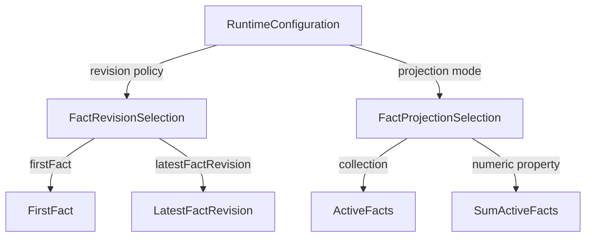
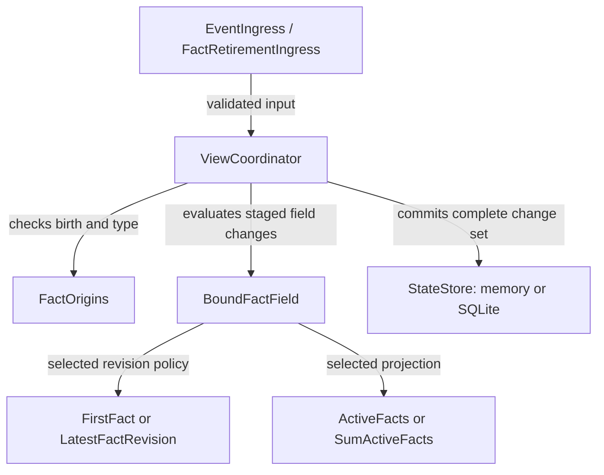

# Correcting and withdrawing retained facts

Status: accepted design. Retained collections, revision policies, retirement and exact numeric sums
are implemented. The
[usage guide](../../zooglass/docs/fact-collections.md) describes the delivered API.
No browser work or new client transport is introduced in this increment.

A match feed reports a goal, then withdraws it after a review. An application
should be able to consume the corrected score and event list without maintaining
its own revision ledger. ZooGlass will retain the facts, apply the configured
revision strategy and update the affected results together.

This document makes the [behaviour contracts](behaviour-contracts.md) concrete.
Publication identity still answers “have we processed this delivery?”. Fact
identity answers “which earlier fact does this change?”. They have different
retention rules and must not be substituted for each other.

## What an application configures

A field selects one source/type, a revision policy and a projection. Two views
can use the same feed differently: one retains the first account of each fact,
while another follows corrections. Existing arrival/latest/history fields retain
their existing behaviour and do not become correction-aware automatically.

Proposed field definitions, inside the existing `fields` object:

```json
{
  "goals": {
    "sourceId": "match-feed",
    "type": "goal",
    "mode": "activeFacts",
    "facts": {
      "revision": "latestFactRevision",
      "maxRetainedFacts": 200,
      "minimumBirthSequence": 1
    }
  },
  "score": {
    "sourceId": "match-feed",
    "type": "goal",
    "mode": "sumActiveFacts",
    "property": "points",
    "facts": {
      "revision": "latestFactRevision",
      "maxRetainedFacts": 200,
      "minimumBirthSequence": 1
    }
  }
}
```

Use `firstFact` instead of `latestFactRevision` to preserve the first accepted
create in that field. Both are explicit choices; fact fields have no implicit
revision policy. `activeFacts` returns the retained active records, ordered by
birth sequence. `sumActiveFacts` returns the sum of one top-level payload property.
The score does not read the goals field: both project their own bounded retained
records from the same input, under the same transaction.

For example, both views start with two one-point goals. A new publication withdraws
the first goal. The `latestFactRevision` view now contains one goal and scores 1;
the `firstFact` view still contains both and scores 2. Redelivering the original
create or an older revision changes neither result.

Each field owns its fact records so differently configured views stay independent.
Identical field settings produce matching active sets. Different policies or
retirement floors can deliberately produce different results.

### Configuration boundaries

- Fact fields require exactly one source/type. Keep the existing single-input
  expanded syntax equivalent to the shorthand above; reject multiple inputs and
  source-priority selection for these modes.
- `facts` is required for both new modes and rejected on ordinary update modes.
  `property` is required only for sums. Unknown properties and explicit null
  settings are rejected at startup.
- Both fact bounds are positive safe integers. `maxRetainedFacts` counts active
  records **and tombstones**, per view/entity/field; retraction does not free a slot.
  This makes the earlier active-fact bound stricter and closes unbounded tombstone
  growth. A new create at capacity is rejected, not silently evicted.
- Entity mappings, late policy, receipt age and required-field publication remain
  available. Existing configurations require no new settings and keep their
  stored encoding when the feature is unused.
- Definitions are immutable. Changing a policy or sum property requires a new
  view ID, which starts empty with no historical backfill.

## Source publications

Add an optional `fact` object to the envelope. Ordinary envelopes omit it;
explicit null and partial objects are invalid. A create looks like this:

```json
{
  "sourceId": "match-feed",
  "epoch": "match-2026-11-05",
  "sourceEntityId": "match-1",
  "publicationSequence": 40,
  "type": "goal",
  "fact": { "birthSequence": 40, "revision": 1, "operation": "create" },
  "payload": { "points": 1, "scorer": "Player A" }
}
```

A correction might use publication 55 with birth 40, revision 2 and operation
`revise`. It carries the **full replacement payload**, not a patch. A withdrawal
uses a higher revision and `retract`, with an empty object payload. A later
`revise` can restore a withdrawn fact with full content.

The fact key is `(sourceId, epoch, sourceEntityId, birthSequence)`. Type is fixed
by the create; it cannot be used to move a revision into a different collection.
Retain source-scoped birth/type evidence while any field retains that fact,
including a tombstone. Check it before type-based routing. The implementation consults the bounded field records for the resolved entity,
avoiding a second persisted index. Evidence disappears only when the last
referencing record is retired. A failed create allocates no origin evidence.
Birth and revision use the same positive safe-integer range as publication
sequence. Create requires birth equal to publication sequence and revision 1.
Revise/retract require publication sequence greater than birth and revision
at least 2. A revision number need not follow its predecessor by one.

Fact metadata participates in canonical publication-content comparison. Changing
metadata under an existing publication identity is an identity conflict even if
the payload is unchanged. When at least one fact field is configured, fact envelopes can also reach ordinary fields, which
continue processing the payload under their ordinary update policy. Ordinary
fields make no claim to revise earlier contributions. A fact field receiving an
ordinary envelope reports `factMetadataRequired` for that target. A runtime with
no configured fact fields rejects fact envelopes with `factsNotConfigured`,
preserving its existing schema and downgrade compatibility.

## Which changes are accepted?

The following decisions are per fact field, after publication-identity checks and
its late policy. A rejected target keeps its facts, projection and receipt age.

| Input | `latestFactRevision` | `firstFact` |
| --- | --- | --- |
| Valid create, room available | Retain active revision 1 | Retain active revision 1 |
| Higher revision of retained fact | Replace or retract | Reject with `factImmutable` |
| Lower revision | Reject with `obsoleteRevision` | Reject with `factImmutable` |
| Equal revision and identical operation/content | Unchanged | Reject an attempted alteration |
| Equal revision and conflicting operation/content | Reject with `revisionConflict` | Reject an attempted alteration |
| Higher revise after retraction | Restore the fact | Reject with `factImmutable` |
| Birth below field's retirement floor | Reject with `factOutsideRetention` | Same |

An exact publication retry returns its original outcome before these decisions.
A new publication carrying an equal fact revision is admitted once, but does not
refresh age or repeat effects. Compare canonical structured payloads as well as
operation; retain the highest revision's fingerprint even for tombstones.

**A revision before its create is retryable.** If an eligible fact target does not
know that birth, reject the whole publication with `unknownFact`, identifying the
first target that requires the create. Do not consume its identity or advance progress. After the
create arrives, the source can retry the same publication. There is no internal
pending-revision queue.

This whole-publication rule also applies to a fact-type mismatch, invalid numeric
contribution, numeric overflow or exhausted fact capacity. Stage every target
before committing; none may retain a partial effect. Deterministic per-target
policy rejections in the table still allow other targets to accept and commit
with the receipt, just like existing late-policy decisions.

This is a deliberate trade-off for retryable dependencies: adding an empty view
can reject subsequent revisions until that view receives the create. It must use
a new publication stream/epoch with fresh creates when seeding is required;
retrying a previously admitted create does not backfill a new view. Existing
streams/definitions are not silently reset. Targets excluded by mapping or late
policy do not require a fact dependency check.

## What the reader sees

`activeFacts` returns an array of `{birthSequence, revision, payload}` records.
Retracted records disappear from this array but their tombstones remain retained.
The array is a current collection, not an audit trail of all published revisions.

`sumActiveFacts` returns a JSON number. Use exact decimal arithmetic, independent
of arrival order. Accept a finite JSON number at the configured property on every
create/revise; reject missing, null or non-numeric values. Bound each input and the
result to at most 38 significant digits and at most 18 fractional digits after
normalisation. Validate exponent/scale bounds before expanding numeric values,
and constrain the final sum after exact addition so intermediate ordering cannot
change admission. Reject out-of-range results atomically with `numericRange`
rather than rounding. Retractions subtract the previous fact through recomputation; they
do not require a numeric property in their empty payload.

Before the first accepted create, a fact field is absent. Afterwards, an empty
active set is a present `[]` or `0`, including after retraction or retirement of
its last record. Required-field presence therefore does not mean “at least one
goal”, and retraction does not automatically make a view wait again.

Extend field status with `facts: {minimumBirthSequence, retainedCount,
activeCount}` for fact fields only. This distinguishes a retained-window score
from an all-time score. Existing field provenance identifies its source and source
entity; the active records supply their own birth/revision identity.

Receipt age measures the last accepted **source change to retained fact state**,
not the age of every fact or the health of the feed. A higher revision refreshes
it even if the numeric sum stays equal. Duplicates, equal/obsolete revisions,
policy rejections, progress controls and retirement do not refresh it. A changed
revision/status can advance the snapshot version without changing its numeric
value. Preserve the existing monotonic-clock and restart-uncertainty rules.

## Retiring old facts deliberately

Introduce `/facts/retire`, a control WebSocket for an operator or source owner.
It accepts `{viewId, entityId, fields, minimumBirthSequence}`. Fields must name
existing fact fields with one source/epoch and the same entity mapping. The
request advances all named fields atomically or changes none; callers should
name both goals and score when they represent the same retained window.

Each field stores its own monotonic floor, initialised from configuration. Delete
records with birth strictly below the new floor, including active facts and
tombstones, and recompute projections. This can reduce a score and must be visible
in the returned snapshot and status. Never infer retirement from a watermark,
receipt age or publication identity eviction.

An equal-floor retry is a no-op and returns current floors/version, not a historical
acknowledgement. A lower floor is rejected with `backwardsFactFloor`. Reject unknown
views, fields, unmapped entities, empty/duplicate field lists and unsafe integers.
A control for an otherwise empty mapped entity allocates a bounded floor record
without inventing field presence; use the existing per-source `maxStreams` budget
and required-publication pending limits. Reject capacity atomically. A floor record
must survive even if no fact has yet been created, or old creates could reappear.

Controls do not occupy a data publication sequence or advance source progress.
Return `kind: factRetirement`, applied/committed/unchanged/rejected status, reason,
current version, floors and changed views. Future authorisation must cover this
write operation; it adds no public administrative browser UI.

The publication admission floor and fact floor are independent. Publication 500
can revise birth 40 while that fact is retained, even if publication 40's retry
receipt has expired. Once the fact floor passes 40, no new publication can restore
it. An exact still-retained publication retry returns its original receipt without
reapplying the retired fact.

## Modules and runtime ownership

`ActiveFacts` and `SumActiveFacts` implement the field projections.
Keep small interfaces local to each strategy family.

| Module | Responsibility |
| --- | --- |
| `FactOrigins` | Retain and validate source-scoped birth/type bindings across field collections. |
| `FactEnvelope` | Validated birth, revision and operation; canonical identity content. |
| `FirstFact`, `LatestFactRevision` | Pure retained-record decision: create, replace, tombstone, unchanged or reasoned rejection. |
| `FactRevisionSelection` | Bind the configured revision module once at definition startup. |
| `ActiveFacts`, `SumActiveFacts` | Project the bounded retained active records into a detached JSON value. |
| `FactProjectionSelection` | Bind the selected projection and numeric-property constraints. |
| `BoundFactField` | Compose late/revision/projection policies and return staged fact state, value and outcomes. |
| `FactRetirementIngress` | Parse bounded control requests and delegate atomic retirement. |
| `ViewCoordinator`, `StateStore` | Own coordination, capacity admission, versions and atomic memory/SQLite installation. |

Configuration binds concrete strategy instances:



Runtime processing uses those bound instances:




The diagrams show responsibilities, not a universal strategy interface or plugin
system. The bound field holds the selected instances; it does not look up a mode
on every event. Retirement bypasses source revision evaluation but uses the same
projection and publication machinery.

Persist records, tombstones, fingerprints, floors, presence, projections, age and
publication outcomes in one transaction. Recover before readiness, validating the
records against definitions and recomputing projections for comparison. A bad
record or mismatched projection stops startup. Use storage schema 6 only when
fact fields are configured; preserve schema-4/5 compatibility for other setups.
Migration and recovery remain one transaction with rollback on failure.

Source progress still describes publications. A correction's publication sequence,
not its birth, is checked against the watermark and identity window. An admitted
obsolete revision can close a publication gap without changing a fact. This is
why fact rejection and publication admission are reported separately.

## Delivery and evidence

Deliver complete, usable increments on main:

1. **Retained fact collections:** envelope, revision strategies, `activeFacts`,
   bounds, retirement, memory/SQLite recovery and public status. Include
   first-versus-latest view evidence. Retirement ships here so capacity can be
   reclaimed without deleting the database.
2. **Derived numeric results:** `sumActiveFacts`, numeric limits and atomic
   collection/sum acceptance. Demonstrate a withdrawn goal changing the score,
   and old publications/revisions failing to restore it.
3. **Combined acceptance:** review the evidence below, fill gaps and update the
   verification guide. Reuse existing crash boundaries and prepared service
   artifacts; no browser matrix or new Workbench orchestration.

| Situation | Observable result to verify |
| --- | --- |
| Create two goals, revise the older one | Current collection and sum reflect both active facts, not merely the latest publication. |
| Same feed, first/latest revision views | First keeps the initial fact; latest changes; receipt records both target outcomes. |
| Correction before create, then retry | No partial view/progress/identity change; retry succeeds after the dependency exists. |
| Revision 3 before 2; conflicting revision 3 | Revision 2 cannot undo 3; conflict has an explicit outcome. |
| Retraction, duplicate, obsolete revise, then higher revise | No accidental resurrection; explicit higher revision restores the fact. |
| Watermark beyond birth, before correction publication | New correction accepted; a genuinely late publication follows each field's late policy. |
| Invalid sum or full fact capacity in one target | Every target and receipt rolls back; the same publication can be retried. |
| Last active fact withdrawn | Present empty collection and zero sum; required publication remains eligible. |
| Retirement of active facts and tombstones | Result and floor change together; slots are freed; later old creates stay rejected. |
| Retirement before any create; restart | Floor survives and blocks old births without fabricating presence. |
| Publication receipt expires, fact remains | New correction works; old delivery retry is outside publication retention. |
| Source silence, equal sum correction, retirement | Correct age/version changes; administrative retention cannot make stale data fresh. |
| Crash on either side of commit | Records, projection, floors, outcomes and freshness recover from the same committed state. |

Use independent expected collections and decimal totals, deterministic clocks and
real HTTP/WebSocket checks. Exercise SQLite migration failure and corrupt-record
startup, and verify no source payload or mutable JSON escapes state ownership.

The service exposes HTTP snapshots, live subscriptions and source/control sockets.
Client live delivery follows in the [recovery and queue increment](strategy-delivery.md#delivery-sequence);
these commits will supply its versioned snapshots. This design does not claim
subscriber delivery before that transport exists. Sports presentation comes later.
