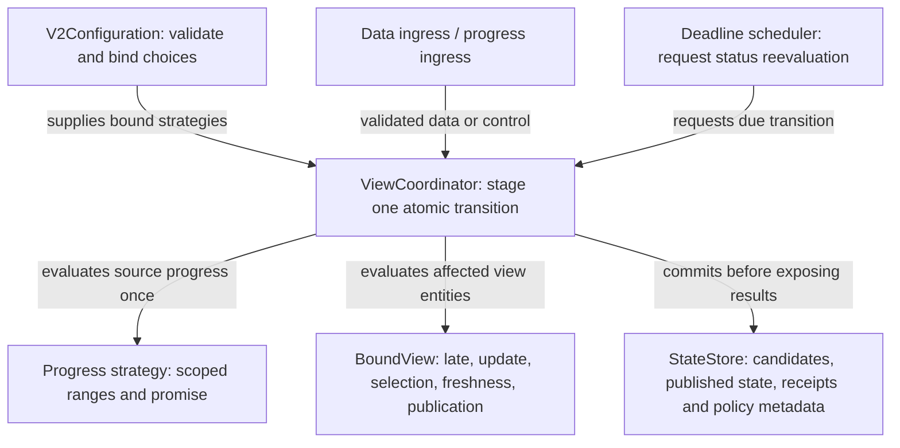

# Progress, freshness and publication strategies

Status: proposed design for review. These settings and protocol additions are not
implemented. Builds on the accepted [behaviour contracts](behaviour-contracts.md)
and delivered [relationships and priority](relationships-and-conflicts.md).
The [ingestion guide](../../zooglass/docs/v2-ingestion.md) documents today's API.

## What this gives an application

An order page can show an order immediately and label payment/inventory as missing.
A fulfilment view can use the same publications but withhold its values until all
three fields exist. A vehicle view can separately report that a position is old,
or that a source has declared a sequence missing. Those are different facts:
an old value need not have a gap, and a recent value does not prove completeness.

The application supplies source promises and chooses policies in configuration.
ZooGlass owns their execution, state, timing, persistence and observable outcomes.
The application still decides what business terms such as “paid” or “ready to ship”
mean. Required-field presence is not a business approval rule.

## How this fits the strategy approach

Each row selects a named module at startup. Modules have immutable settings;
retained state belongs to the runtime. They are independent decisions with explicit
supported combinations, not an arbitrary pipeline or user-supplied code.

| Question | Configurable choice | Scope and default |
| --- | --- | --- |
| Which value from this source? | Existing `arrival`, `latestBySequence`, `historyBySequence` | Field update; unchanged. |
| Which source wins? | Existing `independentFields`, `sourcePriority` | Field selection; unchanged. |
| Can sequence gaps be interpreted? | `untracked` or `contiguousSequence` with a starting sequence and range bounds | Source contract, separately tracked per original source entity; default untracked. |
| May a newly received event behind declared progress affect this field? | `acceptLate` or `rejectBehindWatermark` | Field, applied to each input; default accept late within identity retention. |
| How should receipt age be described? | `unspecified` or `receiptAge` with `staleAfterMillis` | Field, based on its selected candidate; default unspecified. |
| When may this entity's values be exposed? | `publishPartial` or `requireContributions` with required field names | View; default publish partial. Required mode also declares a pending-entity capacity. |

These settings are configuration, not switches end users must operate on a page.
Two configured views can make different choices over the same sources.

Always enforced: source identity and deduplication, independent sequence domains,
atomic commits, monotonic versions, strict configuration validation and declared
capacity bounds. Configuration cannot turn a timeout into proof of completeness.
Freshness does not change priority, and required presence does not require freshness
or complete progress. More combinations need a separate explicit design.

## Compare the progress choices

| Approach | What it can establish | Decision |
| --- | --- | --- |
| No promise | Received values only; sequence jumps may be normal | Support as `untracked`; completeness remains unknown. |
| Contiguous per-entity publications plus scoped watermark | Missing sequence ranges and a source's claimed completion through a boundary | Support as `contiguousSequence`; no inference across sources or entities. |
| Feed-wide offset | Position in a feed, whose intervening records may belong to other entities | Keep untracked here. A partition/offset contract needs its own scope and retention design. |
| Receipt timeout | Time since an accepted contribution reached ZooGlass | Support for age labels only. It cannot establish missing events, source health or completeness. |
| Completion marker for a named batch | A finite business group is declared closed | Defer batch IDs, membership and reopening rules. A sequence watermark already supplies the bounded source declaration needed here. |

The minimal first progress contract therefore implements the two named progress
modules already selected in the accepted strategy design. No event-time windows,
heartbeat health inference, automatic fallback, timeout release or retraction is
included. A silent source makes no new progress promise.

## Proposed configuration

These additions extend the existing v2 grammar. Input objects remain exactly
`sourceId` and `type`; field `mode` remains flat. This document is the canonical
proposal for the new `progress`, `late`, `freshness` and `publication` properties.
All other grammar comes from the relationship design.

```json
{
  "contractVersion": 2,
  "storage": "sqlite",
  "maxStreams": 100,
  "identityWindow": 1000,
  "maxHistoryEntries": 1000,
  "sources": [
    {"id": "orders", "epoch": "v1", "progress": {"mode": "untracked"}},
    {
      "id": "payments", "epoch": "v1",
      "progress": {
        "mode": "contiguousSequence", "startSequence": 1,
        "maxReceivedRanges": 64, "maxMissingRanges": 64
      }
    },
    {"id": "stock", "epoch": "v1"}
  ],
  "views": [{
    "id": "fulfilment",
    "entities": {
      "payments": {"mode": "lookupEntity", "keys": {"payment-9": "order-42"}},
      "stock": {"mode": "lookupEntity", "keys": {"reservation-7": "order-42"}}
    },
    "fields": {
      "order": {"sourceId": "orders", "type": "updated", "mode": "latestBySequence"},
      "payment": {
        "sourceId": "payments", "type": "updated", "mode": "latestBySequence",
        "late": {"mode": "acceptLate"},
        "freshness": {"mode": "receiptAge", "staleAfterMillis": 30000}
      },
      "stock": {"sourceId": "stock", "type": "updated", "mode": "latestBySequence"}
    },
    "publication": {
      "mode": "requireContributions", "fields": ["order", "payment", "stock"],
      "maxPendingEntities": 50
    }
  }]
}
```

A second view can reuse those definitions with a different ID and
`"publication": {"mode": "publishPartial"}`. It exposes partial values immediately.
The required view stores the same candidates but initially exposes only status.

Validation and normalisation:

- Omitted `progress`, `late`, `freshness`, `publication` normalise to `untracked`,
  `acceptLate`, `unspecified`, `publishPartial`. Explicit defaults are equivalent.
- Each object permits only the parameters shown for its selected mode. Untracked,
  accept-late, reject-behind-watermark, unspecified and publish-partial have no
  additional parameters. Unknown modes/properties fail startup.
- `startSequence`, range bounds, `staleAfterMillis` and `maxPendingEntities` are
  positive JSON integers no greater than 9007199254740991; no coercion. Sequences
  retain that same existing upper bound. Clock/deadline arithmetic is checked.
- Required `fields` is a nonempty, duplicate-free list of existing field names,
  normalised by name. Presence means a selected contribution exists, including an
  empty JSON payload. It does not inspect a payload property or require every
  source competing for that field. Optional fields may remain missing.
- `rejectBehindWatermark` requires contiguous progress for **every** field input.
  A shared source may feed an accepting field and a rejecting field, even in the
  same view. Priority still requires latest-by-sequence updates.
- Existing definitions remain immutable. Changing a view policy needs a new view
  ID. Enabling progress on an existing untracked source conflicts with its stored
  contract: introduce a new source ID and views, or start a separate database/run.
  Restart alone does not authorise rewriting a source contract or epoch.

## Source progress protocol

Keep data publications on `/v2/events` unchanged. Add a separate WebSocket endpoint
`/v2/progress` for controls, so a watermark cannot be mistaken for a domain event.
A connection may carry controls for configured sources, under the same source
validation boundary as ingestion. This does not add authentication guarantees.

```json
{"sourceId":"payments","epoch":"v1","sourceEntityId":"payment-9","throughSequence":42}
```

Only these four properties are allowed. The boundary is an integer at least the
configured start and at most 9007199254740991. Only contiguous sources accept it.
A watermark promises that no *new* publications through that boundary will arrive
in this source/epoch/original-entity stream. Retries of already admitted identities
are still allowed. Controls do not consume data publication sequence numbers.

Admission order is: validate scope and bounds, compare retained watermark, stage
progress and affected view status, commit once, then send a control outcome.
A control may create a stream with no data receipts, counting against `maxStreams`.
It never creates a value, satisfies a required field or updates freshness. A control
does not advance the data identity admission floor: a watermark and retention
are separate boundaries. A new control-only stream starts at floor 1 (data below
its configured start remains invalid), with an empty data-receipt map.

A successful control returns `kind: watermark`, `status: applied|committed`,
`reason: memory|sqlite`, `stream`, `throughSequence`, `version` and `changedViews`.
An equal boundary returns `duplicate` with the original advance version and empty
`changedViews`; persist that last boundary/version. A lower boundary returns
`rejected/backwardsWatermark`, even if it was once acknowledged. This bounded retry
contract does not promise historical control receipts. Unknown source/epoch,
untracked source, invalid control and capacity failures have explicit reasons:
`unknownSource`, `unknownEpoch`, `progressUntracked`, `invalidProgress`,
`streamLimit`, `progressLimit`. Rejections commit nothing. Storage failures use
`failed/processingFailure` and the existing stop-serving behaviour.

## Gap accounting and late delivery

Track each `(sourceId, epoch, sourceEntityId)` independently, across all data types,
including types with no matching view. A valid admitted publication counts as
received even when a target rejects its mapping or late policy. A whole-publication
capacity, storage or processing failure counts as neither received nor applied.
Duplicate/conflicting/outside-retention classification happens before progress or
field evaluation. Data below `startSequence` is rejected as `beforeProgressStart`.

Maintain compact inclusive integer ranges, never allocate one entry per integer:

- `observedThrough`: greatest admitted sequence or watermark, initially start−1.
- `watermarkThrough`: most recent boundary, initially absent.
- Missing ranges between start and observedThrough: provisional above the watermark,
  confirmed at/below it, and expired wherever identity admission can no longer
  accept that sequence. Expired ranges retain their missing status; deletion of
  receipts cannot turn them into received data.
- Received ranges, a contiguous received prefix, and a persistent
  `sourceContractViolated` flag. Compact a received prefix into its scalar boundary.

An admitted late event above the watermark fills its provisional gap. A new event
at/below the watermark breaks the source promise: record that fact once, whether
or not a view allows its value. `acceptLate` applies the normal update strategy;
`rejectBehindWatermark` leaves that field's candidate unchanged. A late latest-value
update may be accepted yet leave the candidate unchanged because a newer value is
already retained. Arrival/history can visibly incorporate it.

The violation flag belongs to this original stream's epoch and survives restart.
Other entities and sources retain their own status. Watermarks may still advance
for diagnostics, but cannot restore trust in this stream's completeness. Clearing
it requires a newly configured source/epoch identity; no in-place reset endpoint
is introduced.

Range limits apply after normalisation and classification. `maxReceivedRanges`
bounds disjoint received ranges beyond the compact prefix; `maxMissingRanges`
bounds all provisional, confirmed and expired segments together. Classifying a
range across watermark/floor boundaries may split it and must respect the bound.
A data event or control that would exceed either limit fails atomically with
`progressLimit`, preserving the old floor, receipts, candidates and progress.
Large sequence jumps therefore cost ranges, not jump-sized allocations. Permanent
fragmentation can exhaust the budget; there is no silent forgetting. Recovery may
need a new source identity/run if no admissible update can reduce fragmentation.

“Complete through W” is a narrow **source declaration**, available only when a
watermark exists, every sequence from start through W is received, and the promise
has not been violated. It says nothing about future data or business completeness.
Untracked sources always report unknown completeness. Do not infer a single
cross-source watermark by taking a minimum of unrelated numbers.

### Per-target outcomes

Preserve one target per matched view and existing `status: accepted|rejected`.
Add ordered `fields` outcomes with `field`, `status`, `reason` and `changed`.
Unknown mappings reject the target with no field evaluation. A resolved target is
accepted if at least one matching field accepts the event; if all reject behind
the watermark, it is rejected with `reason: behindWatermark`. Mixed cases retain
accepted target status and the individual rejection reasons.

`changedFields` and each field outcome's `changed` flag identify published
data/provenance changes, not mere candidate updates. `changedViews` identifies any observable snapshot change,
including status-only changes. The top-level admitted data receipt can therefore
be committed with rejected targets, and still report changed progress status.
Retained retries return their original target/field outcomes, without reevaluation.
Old target records gain `fields: null` on migration: unknown historical detail is
never fabricated. Whole-publication rejections return no target successes.

## Receipt age is a separate strategy

`ReceiptAgeFreshness` classifies a populated field as fresh when elapsed receipt
age is less than `staleAfterMillis`, stale at or beyond that boundary. The timestamp
belongs to each retained source candidate and changes only when an accepted event
changes that candidate. Duplicates, rejected input, watermarks and delayed no-op
latest updates do not make an old value look freshly reported. Hidden candidates
retain their own times; the visible label follows the selected winner.

For history, this is age since the last accepted addition to received history,
not the age of every element. All modes call it receipt age, never event time,
source health or a promise that the value is still correct. A missing field is
`absent`; a populated field without this policy is `unspecified`.

Persist wall receipt times and a nondecreasing last observed wall-clock value at
commits. Use a supplied monotonic clock for elapsed time while running. At restart,
rebase from wall time; if wall time is earlier than the saved observation or receipt,
mark affected recovered ages `ageUnknown` conservatively. Keep that classification
until the candidate receives an accepted update. Never clamp a negative age to
“fresh”. Older migrated candidates lack timestamps and likewise use `ageUnknown`.

The coordinator schedules the next visible threshold transition and rechecks under
its normal commit boundary. Timer work changes status/version, not source receipts,
source progress or selected values. Use an indexed deadline per view/entity/field,
replace it on updates, and remove stale entries; do not accumulate one timer per
event. Due thresholds are reconciled before snapshot reads and before startup
readiness, so scheduler delays do not produce a known-stale “fresh” response.
Snapshot reads cause no commit unless a classification actually changes. No ticking
numeric age is included in versioned snapshots; consumers may display elapsed time
from the reported receipt timestamp, with its documented clock limitations.

## Published snapshots and waiting state

Keep `data` and `provenance`. Add `status` with:

- `publication`: `partial`, `ready` or `waiting` (ready means all configured fields
  are present, not business complete; partial means values are exposed with missing
  optional or publish-partial fields).
- `missingFields` and `missingRequiredFields`: sorted field names.
- `fields`: freshness classification and receipt timestamp, plus progress references
  for each declared input. References preserve original source identity.
- `inputs`: progress records keyed by source ID for this canonical entity. Lookup
  resolution uses its injective inverse; no mapped key means `unmapped`, not a
  fabricated source stream. Envelope resolution uses the canonical ID directly.
  Each record includes mode, start, observed/watermark/complete-through boundaries,
  bounded missing ranges, admission floor and violation flag. Untracked completeness
  is `unknown`; a mapped stream not yet seen is `notObserved`.

The canonical status shape below describes one populated field with a confirmed
missing sequence. It is ready by presence but incomplete by source progress:

```json
{
  "publication": "ready",
  "missingFields": [],
  "missingRequiredFields": [],
  "fields": {
    "position": {"freshness": "unspecified", "receivedAtMillis": null, "inputs": ["fleet"]}
  },
  "inputs": {
    "fleet": {
      "state": "observed", "mode": "contiguousSequence", "epoch": "trip-1",
      "sourceEntityId": "car-1", "startSequence": 40, "observedThrough": 42,
      "watermarkThrough": 42, "completeThrough": null, "completeness": "incomplete",
      "admissionFloor": 1, "sourceContractViolated": false,
      "missingRanges": [{"from": 41, "through": 41, "status": "confirmed"}]
    }
  }
}
```

`inputs` lists source IDs in sorted order within each field. Each source record has
the shown keys: `state` is `observed`, `notObserved` or `unmapped`; `completeness`
is `unknown`, `incomplete`, `completeThrough` or `violated`. Violation takes
precedence over completeness. Untracked/unmapped/unobserved inputs use unknown
completeness; a tracked observed input without a watermark also stays unknown.
`completeThrough` is the current watermark only when its complete-through
conditions hold, otherwise null. `missingRanges` are sorted, nonoverlapping
inclusive ranges with `provisional`, `confirmed` or `expired` status. Expired
status takes precedence wherever a missing range falls below the admission floor.

Use null for unavailable numeric/timestamp values rather than invented zero
progress. `receivedAtMillis` is UTC Unix milliseconds for the selected candidate,
null when absent, unspecified or unknown. Preserve the configured start/epoch
where known, even before a stream is observed; an unmapped source entity is null.
Status exposes metadata, never withheld payloads or hidden candidate values.

`PublishPartial` exposes current selected values after every relevant change.
`RequireContributions` retains all candidates but exposes empty data/provenance
while any required field is absent. Matching events and progress controls may expose
waiting status without releasing payloads. When the last required field arrives,
release the whole selected candidate view atomically. Stale/unknown age and gaps do
not stop this release: presence and completeness are different decisions.

There is no disappearance/retraction in this slice, so a satisfied required gate
stays satisfied. Future retraction must define re-withholding before it is supported.
A known entity never observed still returns a version-zero empty snapshot with
computed missing status; querying it must not allocate retained state.

`maxPendingEntities` bounds unresolved candidate entities for a required view;
progress-only status records do not occupy candidate slots. `maxStreams` and fixed
mapping/field definitions bound those records separately. When a publication would
create an additional pending entity above capacity, reject the **whole publication**
with `pendingViewLimit`; do not discard its earlier staged views. An event that
immediately satisfies the gate needs no pending slot. Completion releases the slot.
There is no waiting-time expiry or automatic eviction. These are count bounds, not
a total byte-memory quota.

Snapshot `version` becomes the last committed change to exposed data, provenance
**or status**. Hidden updates with identical public status leave it unchanged.
This extends the existing hidden-update rule explicitly: a hidden source update
can change public progress and therefore the snapshot version without changing
the selected value. Subsequent hidden untracked updates with identical status
remain invisible. A timer or watermark can also advance it without changing data.
Runtime version counts
all committed data, progress and timer transactions; receipt retries keep their
original version. Retain source candidate versions internally, not as an implicit
published-data API. Status-only visibility is part of the observable contract.

## Modules, state and recovery

| Concrete modules | Inputs → result |
| --- | --- |
| `UntrackedProgress`, `ContiguousSequenceProgress` | Scoped admitted data/control and retained progress → next ranges/boundaries or limit rejection. |
| `AcceptLate`, `RejectBehindWatermark` | Publication sequence and pre-event watermark → field admission decision. |
| `UnspecifiedFreshness`, `ReceiptAgeFreshness` | Candidate receipt facts, clock observation and threshold → classification/deadline. |
| `PublishPartial`, `RequireContributions` | Selected fields, required names and current published state → exposure decision/missing names. |

Each group has its own small contract, result and selection factory; no universal
strategy base class. `BoundView` binds late/freshness per field and publication per
view. Source registration binds progress per source; actual state is per stream.
The coordinator evaluates progress once, then calls affected bound views. A progress
change updates all views referring to that source/entity, including those whose
field type did not match this data event. Resolver failure cannot invent a mapping.



Extend typed durable state with progress, control boundary receipts, candidate
receipt times, published state, publication status and clock observations. Each
source/control/timer transition stages and commits all affected state once, then
installs memory and replies. Preserve existing failure and exclusive-owner rules.
Runtime version overflow fails before commit. Memory mode uses the same semantics
without restart guarantees. This design does not introduce v2 live subscriptions.

Use a versioned transactional migration from schema 3 (and the existing schema-1/2
chain), before readiness. Old source definitions normalise to untracked; existing
views to publish-partial/accept-late/unspecified. Preserve field values, provenance,
versions, identity floors and original outcomes. Do not infer historical receipt
times, gaps or progress promises from retained receipts. New views still have no
backfill; controls can update their status but cannot populate their values.

Recovery validates range normalisation/bounds, nonoverlap, floors, watermarks,
candidate provenance, selected/published values, waiting capacity and definitions.
Recompute due freshness classifications before serving, committing actual status
changes. Failure or unknown schema prevents readiness; never expose partial migration.

## Delivery and acceptance

Deliver three complete implementation slices after design acceptance:

1. Progress/late policy: source grammar, control endpoint, bounded ranges, target
   field outcomes, status and migration; preserve default publication behaviour.
2. Required contributions: separate candidate/published state, presence gate,
   waiting metadata and pending capacity with atomic/restart evidence.
3. Receipt-age freshness: timestamp ownership, deterministic clock/deadline handling,
   backward-clock recovery and combined acceptance with the other strategies.

Each slice updates the guide and source map. Settings belonging to an undelivered
slice remain rejected. No empty strategy placeholders or browser work is required.

| Independent scenario | Required evidence |
| --- | --- |
| Start 40; receive 40,42, then 41 before a watermark | Provisional [41,41] clears; latest stays 42, history gains 41. |
| Same inputs, watermark 42 before 41 | Confirm missing 41. Later 41 sets violation; accept field updates under its mode, reject field retains its candidate; both expose the violation. |
| Watermark followed by retry of an already received 40 | Original receipt, no new violation or freshness refresh. |
| Untracked global feed: 40 and 42 belong to A, 41 to B | No entity gap claim; configuration cannot infer a per-entity promise. |
| Two sources map to one entity with unrelated sequence domains | Separate progress and missing ranges; neither closes the other's gap. |
| Progress-only stream, equal/lower watermark, invalid scope | Bound stream allocation; original last control version on equal; backwards/invalid rejection with no mutation. |
| Huge jump, fragmented missing ranges and floor expiry | Range operations stay bounded; overflow atomic; expired missing history stays visible. |
| Two views: partial versus required order/payment/stock | First exposes partial values; second exposes waiting status only, then atomically releases all values. |
| Full pending capacity and later required completion | Excess pending creation rejects all staged changes; completing an existing entity frees a slot. |
| Silent source after initial value, hidden backup update | Visible primary becomes stale without rank change; no heartbeat or false completeness claim. |
| Exact age threshold; duplicate and delayed no-op latest | One stale transition at equality; retries/no-op input do not refresh the selected candidate. |
| Clock rollback, service downtime and migrated timestamps | Conservative ageUnknown or stale before readiness; never invented fresh state. |
| Timer versus source update races; failed storage | Serialized deterministic result, no stale deadline overwrite or partial state. |
| Kill before/after data, control and timer commit | Recovered values, withheld state, uncertainty and retry outcomes match only committed transitions. |

Use small module tests with an injected clock, real coordinator/storage integration
for composition and independent expected results, and real HTTP/WebSocket restart
checks. Workbench may drive scoped gaps and source silence; it must consume ZooGlass
status rather than calculate the service's policy itself. Browser presentation
belongs to later demos. Scope CI to the changed components and reuse prepared service
artifacts; do not multiply the same crash matrix across every browser/platform job.

Review particularly the source promise, presence-only required gate, the absence
of timeout/freshness fallback, range-exhaustion behaviour and the distinction between
snapshot changes and data changes. Those are product trade-offs, not implementation
details that should be left implicit.
