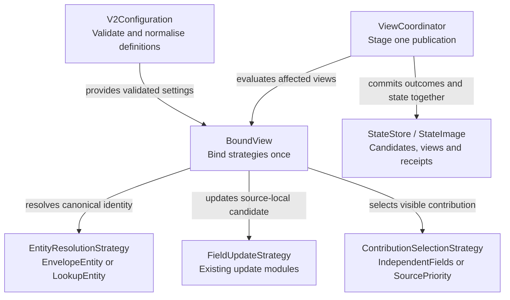

# Relationships and source priority

Status: design for review. Builds on the accepted
[behaviour contracts](behaviour-contracts.md) and the implemented v2 identity and
SQLite baseline. The configuration below is proposed for the next implementation;
it is not accepted by the current runtime.

An order service calls a purchase `order-42`. Its payment provider calls the
payment `payment-9`, and its stock service calls the reservation `reservation-7`.
ZooGlass should combine their contributions under a declared order identity.
When two sources report the same field, configuration should decide which has
authority, without comparing their unrelated sequence numbers.

## What the application supplies

The application declares the relationships and source priorities. ZooGlass resolves
the keys, retains each source's contribution, applies the selected strategies and
persists the result.

There is no inferred join, database lookup or domain-specific Java rule. Mapping
tables are startup configuration in this increment. Missing relationships are
reported immediately; ZooGlass does not buffer events hoping for a later mapping.

## Proposed configuration

This view combines order and payment fields, then chooses a delivery status from
two couriers. The couriers also use their own entity identifiers.

```json
{
  "id": "order-summary",
  "entities": {
    "orders": {"mode": "envelopeEntity"},
    "payments": {
      "mode": "lookupEntity",
      "keys": {"payment-9": "order-42"}
    },
    "courier-primary": {
      "mode": "lookupEntity",
      "keys": {"shipment-3": "order-42"}
    },
    "courier-backup": {
      "mode": "lookupEntity",
      "keys": {"tracking-8": "order-42"}
    }
  },
  "fields": {
    "order": {"sourceId": "orders", "type": "order.updated", "mode": "latestBySequence"},
    "payment": {"sourceId": "payments", "type": "payment.updated", "mode": "latestBySequence"},
    "delivery": {
      "inputs": [
        {"sourceId": "courier-primary", "type": "status.updated"},
        {"sourceId": "courier-backup", "type": "status.updated"}
      ],
      "mode": "latestBySequence",
      "conflict": {
        "mode": "sourcePriority",
        "sources": ["courier-primary", "courier-backup"]
      }
    }
  }
}
```

The enclosing v2 configuration still declares source epochs, storage and limits.
The existing single-source field shape remains valid. Omitting `entities`, or
omitting a used source from it, selects `envelopeEntity` for that source.

A field uses either the existing `sourceId`/`type` form or `inputs`, never both.
One input defaults to `independentFields`; an explicit conflict setting with that
mode is equivalent. Multiple inputs require `sourcePriority`. Each source may
appear only once in a field's inputs, with one event type.

### Canonical field grammar

This document is the single field-grammar reference for the relationship and
source-priority increment. Its expanded form uses an `inputs` array of objects
with `sourceId` and `type`, a required field-level `mode`, and an optional
`conflict` object. The enclosing `fields` map key supplies the field name.

For compatibility, the existing single-source shorthand remains accepted and
normalises to the expanded form. These definitions are equivalent:

```json
{
  "sourceId": "payments",
  "type": "payment.updated",
  "mode": "latestBySequence"
}
```

```json
{
  "inputs": [{"sourceId": "payments", "type": "payment.updated"}],
  "mode": "latestBySequence",
  "conflict": {"mode": "independentFields"}
}
```

The earlier illustrative fragment in `behaviour-contracts.md` is superseded:

| Earlier notation | Decision for this increment |
| --- | --- |
| String inputs such as `"courier-primary.status"` | Rejected. Use objects with explicit `sourceId` and `type`. |
| Nested `update.mode` | Rejected. Use the field-level `mode`. |
| A field's own `name` property | Rejected. Use its key in the `fields` map. |
| `freshness` | Rejected as unsupported in this increment. It is not silently ignored. |

Receipt-age freshness remains part of the accepted later capability design.
Its configuration grammar will be specified when that capability is implemented;
the old illustrative `freshness` fragment is not an alternative supported grammar.
Omitting it makes no freshness claim and does not enable priority fallback.

Unknown field properties remain startup errors. For `independentFields`,
`conflict` contains only `mode`; for `sourcePriority`, it also requires
`sources`. Input objects contain only `sourceId` and `type`.

## Entity resolution

Resolution belongs to a view and source. The same publication can map to
`order-42` in one view and keep `payment-9` in a payment-focused view.

| Strategy | Result |
| --- | --- |
| `envelopeEntity` | Use the envelope's `sourceEntityId` unchanged. |
| `lookupEntity` | Look up that exact string in the configured source mapping. Return its canonical ID or `unknownEntityMapping`. |

Keys and values must be nonblank strings. Matching is case-sensitive, with no
trimming, coercion or fallback. Unknown modes, parameters and source references
fail startup. An `entities` entry must refer to a source used by that view.

Within one view/source, a canonical ID may have only one source key. Mapping
two payment streams to the same order would otherwise merge independent sequence
domains. Reject that configuration as ambiguous. Different sources can map to the
same canonical ID, as in the example.

This deliberately excludes multiple payment attempts or reservations from one
source mapping to the same order. Supporting that requires a separate collection
or aggregation contract; priority selection does not solve it.

Publication identity remains
`(sourceId, epoch, sourceEntityId, publicationSequence)`. The canonical ID never
replaces part of that key or changes its retention floor.

## Unknown mappings and publication outcomes

Match source/type first. Resolve only views with matching fields, once per view
for that source. An unknown mapping rejects the contribution to that view, not
the entire source publication.

The coordinator commits the runtime identity, all target outcomes and all accepted
view changes together. This preserves independent uses of a shared source: a
payment-only view can keep working even if the order view has no relationship
for that payment.

Add a `targets` array to source acknowledgements. For example:

```json
[
  {
    "viewId": "order-summary",
    "entityId": null,
    "status": "rejected",
    "reason": "unknownEntityMapping",
    "changedFields": []
  },
  {
    "viewId": "payment-detail",
    "entityId": "payment-9",
    "status": "accepted",
    "reason": null,
    "changedFields": ["payment"]
  }
]
```

There is one target record per matched view, in configured view order.
`accepted` means the view resolved the key and processed its matching fields;
it does not promise a visible change. `changedFields` contains visible field
changes, ordered by field name. `changedViews` keeps its existing meaning.

The top-level `applied` or `committed` status describes identity admission and
storage. It can accompany rejected targets, even when every matched view rejects
the mapping. No matching views produces `targets: []`, as it does for
`changedViews` today.

A retained duplicate returns its original target records and version without
reevaluating mappings or applying effects. Those records describe the original
processing; its top-level `changedViews` remains empty for the retry. A conflicting
identity or expired publication is rejected before target evaluation, with
`targets: []`. Other whole-publication failures also return no target successes.

An evaluation exception, capacity failure or storage failure retains the existing
whole-publication failure boundary: no staged target success becomes visible.
There is no partial commit.

### Relationships that become known later

Definitions remain immutable. A mapping change needs a new view ID. New views
start empty and receive only new publications, not retries of retained identities.
To populate a newly mapped view, the source must publish its current fact under a
new publication sequence.

Existing views remain registered; this increment does not add view retirement,
live mapping edits or backfill. Old missing mappings may therefore continue to
produce rejected target records until a later retirement facility is available.

## Contributions and source priority

Process each source's update against its own retained candidate. Only then choose
the visible field value.

- `IndependentFields` exposes the sole input of a named field. Existing arrival,
  latest and history modes remain supported.
- `SourcePriority` selects the highest-ranked source that has a candidate.
  Its priority list must name every input source exactly once.
- Priority fields initially require `latestBySequence`. Arrival or history with
  source priority is rejected, keeping cross-source ordering unambiguous.

A primary source at sequence 2 outranks a backup at sequence 900 if the primary
is ranked first. A later backup update remains retained but does not displace the
primary. A delayed primary update cannot replace its newer candidate.

An absent primary permits the backup to win. A silent or stale primary remains
present and keeps its rank. There is no freshness-based fallback, timeout,
withdrawal or domain-status precedence in this increment. Later retraction support
can remove a candidate under its own contract.

### State and visible results

Candidate state is scoped by view, canonical entity, field and source, and records
the original source entity and epoch. Injective mapping within a source ensures
that each candidate has one sequence domain.

Snapshots retain the existing `data` shape. Add a separate `provenance` object
whose field entries identify the selected `sourceId`, `epoch` and
`sourceEntityId`. History fields identify their one source. Empty fields have no
provenance entry.

A winner change counts as a visible change even when its payload and sequence
happen to equal the previous winner's. Snapshot version advances for data or
provenance changes. A hidden candidate update commits state and advances the
runtime version, but leaves the visible snapshot version and `changedViews`
unchanged.

A rejected mapping allocates no entity/candidate state. Existing `maxStreams`
and per-source identity/history bounds still apply. For a fixed configuration,
each input stream contributes to at most one entity per view, bounding candidate
counts by admitted streams and configured fields. This is not a byte-memory quota.

## Strategy modules and runtime ownership

These are planned modules, not additions to make as empty placeholders.

| Module | Input and result |
| --- | --- |
| `strategy/identity/EnvelopeEntity` | Source entity string → resolved canonical ID. |
| `strategy/identity/LookupEntity` | Source entity string and immutable mapping → resolved ID or unknown mapping. |
| `EntityResolutionStrategy`, `EntityResolution`, `EntityStrategySelection` | A resolution-specific contract, typed outcome and startup selection. |
| `strategy/contribution/IndependentFields` | One retained source candidate → visible contribution and provenance, or absent. |
| `strategy/contribution/SourcePriority` | Retained candidates and immutable source order → selected candidate or absent. |
| `ContributionSelectionStrategy`, `SelectedContribution`, `ContributionStrategySelection` | A selection-specific contract, result and startup selection. |

Strategies own immutable settings, not retained entities. `BoundView` binds
resolvers per source, update strategies per input and contribution selectors per
field at registration. The coordinator invokes those modules; it does not scatter
mode checks across ingestion or storage.



## Persistence and compatibility

Persist normalised definitions, source candidates, visible values/provenance and
original target outcomes within the existing atomic boundary. Recovery validates
candidate provenance against the declared mapping, rather than assuming the
source entity always equals the view entity as it does today.

Existing v2 configurations normalise to envelope resolution and independent
single-source fields. Equivalent short and expanded forms, or reordered
definitions, must not cause a false configuration conflict.

Each storage-format change needs a versioned, transactional migration before
readiness. Schema 1's single-source field state can seed its corresponding
candidate and provenance without recomputing or republishing values. Preserve
publication identities, floors, versions and existing field data.

Schema 1 receipts did not record target outcomes. Their retry responses must use
`targets: null` to mean “not recorded by the earlier version”, not fabricate
historical results. New receipts always store an array. Migration failure stops
startup without installing partial state; unknown schemas remain rejected.
Older binaries must reject the newer schema rather than misread it.

Legacy APIs and the existing demos retain their current behaviour.

## Delivery and acceptance

Deliver two complete implementation slices after this design review:

1. **Entity mappings and outcomes:** resolver modules, backward-compatible
   configuration, per-view outcomes, provenance, persistence migration and
   HTTP/WebSocket/restart tests. Single-source fields remain usable throughout.
2. **Source-priority selection:** retained candidates, configured selection,
   migration where needed, and combined multi-source/restart acceptance.

The acceptance examples must demonstrate:

- Order, payment and reservation IDs converging under declared mappings.
- One publication mapping differently in two views; an unknown mapping rejecting
  one target while another succeeds, with stable outcomes on retry and restart.
- Ambiguous same-source mappings failing startup before any state changes.
- Backup sequence 900 followed by primary sequence 2 selecting the primary.
- Hidden backup updates surviving restart without changing the visible version.
- Delayed updates being compared only against their own source candidate.
- The same sources having different priority orders in different views.
- Identical visible payloads still reporting a winner/provenance change.
- Rejection, storage failure and crash recovery preserving the atomic boundary.
- Existing schema-1 databases migrating without losing values or identity history.

Keep browser work and domain-specific status rules out of these slices. The later
order demo will make the relationship and authority choices visible to users.
