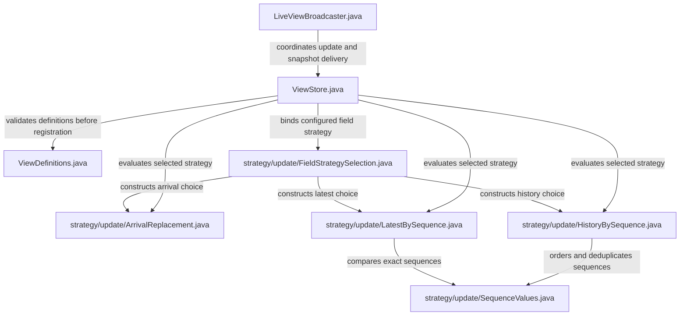
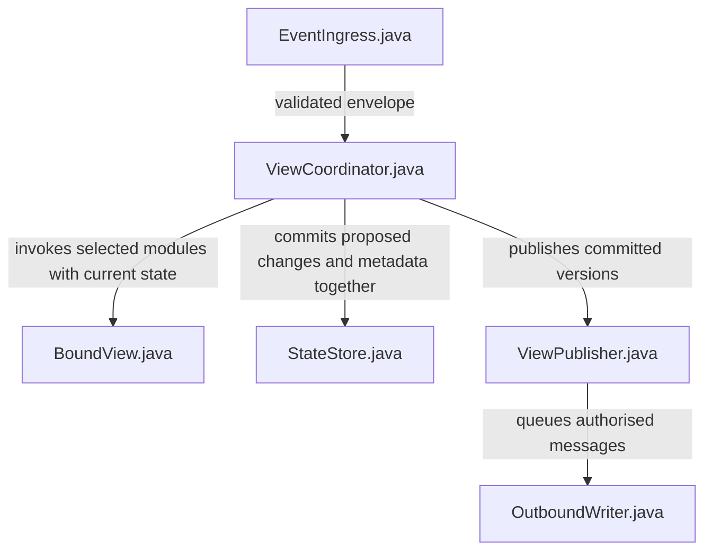

# Configurable behaviour through strategy modules

Status: design for review, based on `main` at `3011f6e` (30 October 2026).
This design chooses how ZooGlass's behaviours are represented, configured and
executed. It starts with the working ordering policies and gives later source,
correction and recovery behaviour explicit places to live.

Read this document for the code shape, [behaviour contracts](behaviour-contracts.md)
for the decisions and failure rules, and [delivery and verification](strategy-delivery.md)
for the bounded implementation sequence and evidence.

## The organising decision

Each concrete strategy is a named module containing its behaviour. Configuration
is validated and resolved into those modules before processing events. The runtime
calls the selected implementation; it does not repeatedly interpret a mode string
throughout the processing path.

The first change is deliberately small: extract the three existing field policies
from `FieldUpdates` into `ArrivalReplacement`, `LatestBySequence` and
`HistoryBySequence`. Preserve their public configuration and behaviour. Group them
under `io.zooglass.strategy.update`. Keep a small update-specific contract because
these three modules genuinely do the same kind of job. Other concerns have their
own inputs and outputs; they do not inherit an all-purpose strategy base class.

## Baseline audit

The current code already provides useful behaviour and evidence. This is a source
and existing-test audit, not a new test execution or a coverage-percentage claim.

| Concern | Current implementation | Existing evidence and next change |
| --- | --- | --- |
| Field ordering and different views of a feed | `FieldUpdates` selects arrival/latest/history on every update; `ViewStore` fans one source/type event out to matching fields. | `ViewStoreOrderingTests` checks 64 seeded orders, all permutations of three positions plus a duplicate, every prefix, decimal precision and equal-sequence conflicts. Preserve this and extract named modules. |
| Configuration selection | `ViewDefinitions` validates modes; `ViewStore.register` retains ordering records in field targets. | `ViewConfigurationTests` checks startup/runtime rejection and registration atomicity. Bind a strategy at registration and exercise both registration paths. |
| State and isolation | `ViewStore` owns all entity/field maps under its monitor; incoming and outgoing values are copied. | `ViewStoreTests`, `ViewSnapshotOwnershipTests` and independent ordering expectations cover isolation. Strategies must not take ownership of these maps. |
| Live snapshots | `LiveViewBroadcaster` serialises apply, subscribe and enqueue; HTTP reads use `ViewStore` directly. | `ViewFunctionalTests`, `LiveViewIsolationTests` and Workbench `concurrent-clients.test.ts` cover real delivery/recovery. Preserve the coordination boundary while changing strategies. |
| Slow or broken clients | A separate `OutboundWriter` per client owns a bounded 128-message queue; overflow removes the subscriber and closes asynchronously. | `LiveViewBroadcasterTests` and `DeliveryFailureTests` cover stalled writes, overflow and obsolete-writer callbacks. Make policy/limits explicit in the later delivery slice. |
| Multiple sources | Source/type matching writes independent fields; multiple sources may also match one field. | Order source slice in PR #99 verifies three independent sockets, two views and three cycles. Independent sequence domains targeting one field need a new contract, not a numeric comparison. |
| Progress and revisions | No source-progress or general fact-revision contract; history retains received payloads. | Existing gap and score fixtures illustrate inputs. Add explicit progress and revision state before claiming those semantics. |
| Persistence | Definitions and views are held in memory. Sources receive no commit acknowledgement. | Existing prebuilt-service tests check launch isolation, not durable restoration. Introduce a commit boundary before acknowledging durability. |

Relevant current sources are in [the service source map](../../zooglass/docs/source-map.md)
and tests in [the verification guide](../testing.md). In particular, current numeric
ordering treats `1` and `1.0` equally, keeps the first payload at an equal sequence,
ignores missing/non-numeric sequences and allows negative/fractional values. These
are compatibility requirements for the initial extraction, not accidental changes
to make while moving code.

## First module shapes

Suggested files under `src/main/java/io/zooglass/strategy/update/`:

| Module | Responsibility | Inputs and result | State |
| --- | --- | --- | --- |
| `ArrivalReplacement.java` | Replace a field on every matching arrival. | Current field plus payload → replacement. | No retained module state. |
| `LatestBySequence.java` | Keep the greatest configured numeric sequence. | Current field, payload and configured sequence key → replacement or unchanged. | Sequence currently lives in the retained payload. |
| `HistoryBySequence.java` | Insert a new sequence into ordered received history. | Current array, payload and sequence key → replacement array or unchanged. | History lives in field state, never in the module instance. |
| `FieldUpdateStrategy.java` | Describe this specific update operation. | `evaluate(current, incoming)` → `FieldUpdate`. | None. |
| `FieldUpdate.java` | Explicit result, so unchanged is not confused with a null payload. | `changed` plus an owned replacement value when changed. | One evaluation result only. |
| `FieldStrategySelection.java` | Resolve validated configuration once. | Ordering record or absent ordering → the concrete strategy. | Immutable configuration in the selected instance. |
| `SequenceValues.java` | Shared numeric extraction/comparison used by the two sequence modules. | JSON numeric values → exact decimal comparison. | None. |

`SequenceValues` is a small shared calculation, not another configurable policy.
The factory's mode switch is the one selection boundary. It rejects unknown modes;
absence selects the existing arrival behaviour. Validation still happens before
registration, including duplicate view-ID checks.

Illustrative shape, not a patch or final method spelling:

```java
public interface FieldUpdateStrategy {
    FieldUpdate evaluate(JsonNode current, JsonNode incoming);
}

public record FieldUpdate(boolean changed, JsonNode replacement) {}

final class LatestBySequence implements FieldUpdateStrategy {
    private final String sequenceField;

    public FieldUpdate evaluate(JsonNode current, JsonNode incoming) {
        // Read exact numeric sequences; ignore invalid or <= current.
        // Return an owned copy only when the field changes.
    }
}

record FieldTarget(String viewId, String fieldName,
                   FieldUpdateStrategy strategy) {}
```

The selection factory and update contract are accessible from the store package;
concrete implementations can remain package-private. `current` is absent for a
new field. The store passes read-only-by-contract values. A strategy never mutates either
input and returns a detached replacement; tests enforce nested ownership. The
store installs the replacement under its existing lock and produces copied
snapshots. A `changed=false` result has no replacement. Arrival replacement remains
changed even for equal content, preserving its existing notification semantics.

### Configuration and runtime use

The first slice retains the existing JSON shape, including omitted `ordering`:

```json
{
  "id": "latest-position",
  "fields": { "position": [{ "sourceId": "fleet", "type": "position" }] },
  "ordering": {
    "position": { "mode": "latestBySequence", "sequenceField": "sequence" }
  }
}
```

Another view matching the same source/type can select `historyBySequence`. A
registration creates the selected strategy for each field, and all matchers for
that field use it. The strategy object contains only immutable settings; field
state is scoped by `(viewId, entityId, fieldName)`. Neither another view nor another
entity can change it by sharing a strategy object.



This is the proposed first-slice map. The existing source map continues to describe
implemented code until these modules land. `FieldUpdates` is then removed once its
callers use the selected modules; there is no second hidden implementation.

## Later strategy inventory and shapes

These are concrete responsibilities for subsequent slices, not files to create
empty in the first PR. The contracts specify the supported combinations.

| Group and modules | Input → output | State owner |
| --- | --- | --- |
| Identity: `EnvelopeEntity`, `LookupEntity` | Source event plus declared key/mapping → resolved entity or explicit rejection. | Versioned mapping records in the runtime state store. |
| Contributions: `IndependentFields`, `SourcePriority` | Accepted contribution plus retained per-source candidates → visible field selection. | Per-view/entity/source contribution records. |
| Progress: `UntrackedProgress`, `ContiguousSequenceProgress` | Scoped event/watermark plus received ranges → progress and gap status. | Per-source/stream/entity received ranges and watermark. |
| Late delivery: `AcceptLate`, `RejectBehindWatermark` | Event and relevant progress boundary → apply or reject for this target. | Reads progress, owns no separate queue. |
| Freshness: `UnspecifiedFreshness`, `ReceiptAgeFreshness` | Last accepted receipt time, now and configured threshold → age classification. | Runtime owns receipt timestamps and scheduled reevaluation. |
| Publication: `PublishPartial`, `RequireContributions` | Candidate view and required contribution names → publish or withhold. | Candidate state remains in the store even when publication is withheld. |
| Revisions: `FirstFact`, `LatestFactRevision` | Stable fact key, revision and operation plus retained record → unchanged, replace or retract. | Fact records, highest revisions and tombstones in the store. |
| Derived result: `SumActiveFacts` | Retained active numeric contributions → sum. | Reads the retained fact collection; no side effects. |
| Recovery: `FreshSnapshot` | Subscription plus current published state → acknowledgement and ordered snapshot. | Subscription membership is ephemeral; committed view state is persistent when configured. |
| Slow client: `DisconnectOnOverflow`, `CoalesceLatestState` | Queue contents and new message → enqueue, replace eligible pending state or terminate. | Per-client writer owns the bounded queue. |
| Storage: `InMemoryState`, `SqliteState` | Atomic proposed change set → committed state/version or failure. | Storage owns records and transactions; strategies own no files/connections. |

Access enforcement belongs at read, subscription and write-time delivery boundaries;
it uses an application-supplied policy decision. It is not an update strategy.
`SumActiveFacts` is deliberately a bounded numeric fold (for example goal counts),
not arbitrary application code execution or a query language.

### One processing path and one state owner

For richer contracts the existing store/broadcaster coordination becomes an
explicit `ViewCoordinator`, introduced when there is a concrete need for staged
multi-field updates. `EventIngress` parses and validates envelopes; `BoundView`
contains selected modules; `StateStore` owns typed state and atomic commits;
`ViewPublisher` queues committed snapshots. These are runtime modules, not strategy
choices. The coordinator stages all changes before publishing any of them.



Order: validate envelope and identity, resolve entity, classify duplicate/revision,
update source progress, evaluate per-target late policy and contribution/update
strategy, calculate derived fields, determine publication eligibility, commit,
then queue snapshots and acknowledge the producer. An explicitly rejected event
changes no facts. Per-target policy outcomes may differ; all accepted changes from
one envelope and its receipt metadata commit together. A strategy exception aborts
the staged change, reports a processing failure and emits no success acknowledgement.
It must not be caught and described as malformed input.

The runtime serialises commits, registration and snapshot subscription setup.
No socket writes happen while holding that coordination boundary. Storage is
called once per change set, not once from each strategy. Timer-based freshness
changes and authorised mapping changes also enter this coordinated path.
