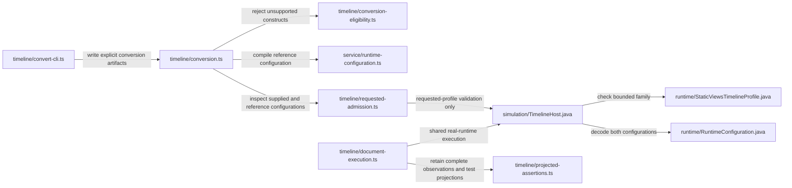

# Broader deterministic configuration support

Status: accepted expansion contract, 15 November 2026, merged through PR #174.
Baseline main `ec4fbbf`. The first two implementation slices add
[requested-profile admission](../../workbench/docs/timeline-static-admission.md) and
[V3 conversion/execution](../../workbench/docs/timeline-conversion.md). The third
slice supplies [reviewed fixtures](../../workbench/scenarios/timeline-static/README.md);
the [finite qualification](../../workbench/docs/timeline-static-qualification.md)
passes in the fourth slice. All four slices are merged into the integration
branch; their combined promotion to main is ready for review and pending merge.
The [bounded timeline](../../workbench/docs/timeline-guide.md) is delivered. This
proposal adds one reusable configuration family and one explicit conversion path;
it does not reopen the completed POC or promise every Workbench scenario.
The implementation and qualification satisfy the fixed finish line below.
Main promotion remains a separate acceptance decision.

## Outcome and fixed finish line

Run ordinary static-view scenarios through real ZooGlass without adding a domain
profile or a scenario-specific TypeScript author module. The first milestone is
**five converted legacy fixtures plus one independently authored mixed-mode fixture**,
qualified under the configuration family below. Unsupported constructs receive
path-specific diagnostics; none are silently omitted or executed in real time.

The milestone ends when all six cases pass independent assertions, strict replay,
the finite qualification matrix and representative real-service comparison, with
reviewed documentation and retained evidence. New faults, storage modes and
conversion constructs are separate decisions, not automatic extra slices.

## Current code and the actual gap

The current host already admits structural families, not hardcoded demo hashes.
IDs can vary within the rules of `TimelineProfile`, `OrderTimelineProfile` and
`SportsTimelineProfile`. The gap is uneven configuration coverage: memory sequence
fields require unspecified freshness and one matcher; arrival is limited to a
single receipt-age field; Order and Sports have separate SQLite combinations.

The ordinary compiler defaults to arrival ordering and unspecified freshness,
allows several event types from one source per field, and uses memory limits of
100,000 streams and 10,000 identities/history entries. Those are not the controlled
profiles' current bounds. Renaming a profile or loosening its predicate alone
would neither preserve old admission nor qualify new combinations.

A fresh inventory covers 19 legacy JSON fixtures and 369 entries: 108 source events,
113 server checks, 90 client checks, 26 client-state changes, 27 subscriptions,
three dynamic definitions and two browser-route faults. The legacy inspector is
conservative and contains historical absence claims. Its hardcoded
`unchangedExecutionSupported: false` is not an empirical compatibility percentage.
Installed runtime observations now exist; their semantics still differ from HTTP
polling and client message consumption.

## One configuration family

Explicit profile: `memory-static-views-v1`.

| Dimension            | Admitted contract                                                                                                            |
| -------------------- | ---------------------------------------------------------------------------------------------------------------------------- |
| Runtime              | Production configuration version 2, memory storage, unprotected access; static definitions only                              |
| Shape                | 1–3 sources, 1–2 views, 1–3 fields per view and at most 4 fields total; arbitrary valid IDs and payload shapes               |
| Selection            | `arrival`, `latestBySequence`, `historyBySequence`, including mixtures across fields/views                                   |
| Inputs               | One source per field, 1–2 distinct event-type matchers from that source; no cross-source selection                           |
| Entities/publication | `envelopeEntity`, `publishPartial`                                                                                           |
| Freshness/progress   | `unspecified` freshness and `untracked` source progress only                                                                 |
| Other policies       | `acceptLate`; no conflict policy, facts or property aggregation                                                              |
| Resource ceilings    | At most 20 streams, an identity window of 20 sequence positions, 20 history entries; delivery at most 128 messages and 1 MiB |

These ceilings bound qualification; they are not intrinsic ZooGlass limits. Retain
current document/turn/trace budgets, canonical payload bounds and host ownership
checks. Reject out-of-profile production-valid configuration with a precise reason;
production validation remains the authority for malformed configuration.

No receipt-age extension, SQLite, restart, wall-clock adjustment, mapping, priority,
required-contribution publication, fact retirement or dynamic registration is added
by this profile. Existing profiles continue to provide their delivered capabilities.
The new family's initial transport scope is zero-latency links, explicit source
sends and client connect/disconnect/subscribe/unsubscribe. No source retries,
receipt-loss rules, writer faults or automatic retry policies are admitted for this
new family in this milestone. Source actors connect exactly once at time zero,
without source disconnect/reconnect; client lifecycle remains explicit. Existing-profile
support is unchanged.

### Preserve admission identity

`TimelineProfile.inspect` currently returns the first matching profile. The new
family overlaps Fleet: inserting it first would reclassify old configurations;
inserting it last would reject some explicit new-profile requests.

Keep existing classification and old protocol responses unchanged. Add a bounded
**requested-profile admission** operation, advertised by a new host capability
`memoryStaticViews:1`. It validates the production configuration, then checks the
requested profile directly. It creates no runtime, store, subscriptions or tasks.
Report the requested profile, eligibility and failing configuration path/rule.
Host startup must repeat the same profile check against the actual input bytes;
inspection is not a bypass token. Do not add a generic strategy/plugin framework.

## Explicit document and evidence contract

Use a new `timeline-simulation/v3` document, with `timeline-trace/v3`,
`timeline-run/v3` and `timeline-bundle/v3` identities. V3 initially requires the new
profile explicitly. Keep existing V1/V2 parsing, profile names and meanings intact.
V3 reuses the existing agenda, runtime/transport ownership, canonical encoding and
production strategies. It adds the two assertion forms below; it does not create
a second executor. Require `memoryStaticViews:1` during prepared admission.
Old readers reject V3 clearly; new readers retain old syntax support. Old evidence
still requires its recorded modules/artifacts/environment for re-execution; there
is no promise that newly built tools replay old archives with different identities.

- **`runtime-data`**: names view/entity, exact expected data object and settled
  timestamp. Read installed state using the existing side-effect-free observation
  operation. Retain the complete internal observed snapshot in the semantic trace.
  The host applies production `ViewSnapshot.from` to that installed snapshot and
  also records the projected public snapshot; compare its entire `data` object
  losslessly. Internal data retains publication-sequence/payload envelopes, whereas
  legacy HTTP expectations contain public values. Reuse the production projection;
  do not unwrap those envelopes independently in TypeScript or change legacy
  expected values. This is explicitly a data assertion,
  not a claim to have asserted every status/version/provenance field. The initial
  converter accepts non-null expected objects only; absence is deferred.
- **`source-accepted`**: references a declared send and its source actor. At that
  timestamp's settlement require exactly one receipt matching the complete
  publication identity, with status in `applied`, `committed`, `duplicate`, matching
  the ordinary runner's acceptance check. Retain the complete receipt and the
  assertion result; unrelated, absent, extra, failed or rejected receipts fail.
  Its timestamp must equal the referenced send's timestamp, and that source actor
  must have exactly one send at that timestamp. Check receipts delivered to that
  actor at that timestamp, not its entire cumulative receipt history. Record the
  matched receipt event identity; a receipt cannot satisfy two such assertions.
  This projection does not consume or alter the observations used by full-envelope
  assertions. The converter rejects repeated publication identities and explicit expected-rejection cases.

Existing full-envelope `runtime-snapshot`, `source-receipts` and `client-frames`
assertions remain available with unchanged meaning. The mixed-mode witness uses
these full expectations as well as projected data assertions. Neither converter
nor tests may execute ZooGlass to manufacture expected versions or answers.

## Conversion is reviewable, explicit and bounded

Explicit conversion command:

```text
npm run timeline:convert -- LEGACY.json NEW_DIRECTORY --runtime CONFIG.json --epoch-ms INTEGER --seed HEX [--jar HOST.jar]
```

The command parses losslessly before legacy parsing, rejects ambiguous duplicate
keys/unsafe numeric values rather than rounding, checks conversion eligibility,
uses the prepared host for configuration admission, and writes new output only.
It never builds Java or executes scenario effects. Admission can start the host
solely for validation, with no runtime initialized.

Outputs: original legacy bytes, exact supplied configuration bytes, converted V3
scenario, and a versioned conversion report containing input/output hashes,
converter identity, source-path-to-action/assertion mapping, preserved expectations,
explicit adaptations and rejected constructs. Scenario configuration hashes refer
to the copied exact bytes. The report is included and hash-pinned as optional
conversion provenance in the V3 bundle inventory; bundle replay validates it before
execution. A converted V3 document names its report with an optional relative
`conversionReport` path. The report hashes the converted document, while the bundle
manifest hashes the report and original legacy bytes; the document does not hash
the report back, avoiding a circular identity. A declared report must be present
and valid, never silently dropped during recording or replay. Hand-authored V3
documents omit this field. Conversion errors leave no executable-looking success directory.

### Configuration and limits

Require the caller to supply the bounded runtime configuration, with all five
selected resource bounds explicit. The general admission path still accepts
production defaults; converter reporting must not invent their numeric values. Compare its
normalized meaning to the legacy declarations compiled by the existing shared
`runtimeView`/`runtimeConfiguration` logic. The requested-admission host operation
compares both configurations after production decoding, with an explicit whitelist of the five resource properties
(`maxStreams`, `identityWindow`, `maxHistoryEntries`, delivery message/byte bounds).
The reference configuration need not fit the execution profile; the supplied
configuration must. All other normalized fields must match. Return field-path differences; do not
reimplement production defaults or strategy validation in TypeScript. The only
allowed semantic configuration difference is explicitly supplied resource bounds. Preserve source
IDs/epochs, matchers, field selection, views, entities, publication and freshness.
Report original compiler limits and each selected bound; never silently clamp them.

Before accepting conversion, count distinct source/epoch/entity streams and an
upper bound on history entries per view/entity/field over the complete finite
input. Both must fit the supplied bounds. For each stream, require the complete
input's highest sequence minus lowest sequence plus one to fit its selected
identity window. ZooGlass advances that stream's admission floor by numeric
sequence distance, not receipt count: three inputs numbered 1, 100 and 2 do not
fit a window of 20. This conservative span rule ensures that the selected window
neither evicts a receipt from this finite input nor rejects a later out-of-order
input because of a newly raised floor. It deliberately rejects some safe runs.
The numerical floor can still differ from the original large-window configuration,
including for a first publication numbered 40; report that bounded-configuration
adaptation and do not claim equality of all original status/provenance envelopes.
Count history conservatively when an alias matches; refuse uncertainty rather
than assume a harmless reduction.
Ordinary-service comparison uses the exact selected bounded configuration too.
This is a declared adaptation of defaults, not byte-identical configuration conversion.

### Actions, ordering and observations

- Preserve publication bodies, identities, declared timestamps and per-timestamp
  input order. Generate stable IDs from original indices, not wall time/randomness.
  Preserve explicit epoch/seed inputs in the report.
- Sources connect at virtual time zero in declaration order. Preserve initial
  `connected`/`disconnected` client declarations; reject transient initial states.
  Initial connections do not imply subscriptions. The first converter rejects all
  timeline client-state, subscription and client-view-check entries.
- Accept source events and non-null `view-check` entries with static views only.
  Reject fact metadata, explicit expected rejections, repeated publication identities,
  dynamic views, browser-route faults and unknown constructs. Validate epochs and
  field-ordering configuration rather than silently changing them.
- Reject multiple publications at the same timestamp and any check followed by a
  later same-time action. Do not add invented milliseconds or hidden drain turns.
  An input followed by checks at the same timestamp is translated to input followed
  by settled assertions; the report describes this change from real-interface waits.
- Copy each legacy expected data object exactly into `runtime-data`. Add an explicit
  `source-accepted` check for every publication: dropping the ordinary runner's
  implicit receipt checks would weaken the scenario even if its last view matched.
- Legacy HTTP checks poll for up to five seconds; controlled checks inspect settled
  installed state. Unspecified freshness avoids HTTP-triggered expiry differences,
  but the report must still say that this qualifies data at the translated checkpoint,
  not HTTP transport, real timing or native concurrency.

The converted document requires zero pending messages/held frames at its finite
horizon. No default real-time fallback, hidden execution, fixture-name allowlist or
per-demo conversion module is permitted. Preview, real-interface integration and
deterministic execution remain distinct explicit command paths.

## Per-fixture decision at the baseline

These are design admission decisions, not claims that conversion already works.
Paths are relative to `workbench/scenarios/`. Full-subset predicates, not filenames,
determine eligibility. Five acceptances contain 20 publications and 12 server-data
checks; the other fourteen are rejection/deferral fixtures for this milestone.

| Fixture                                | Decision and reason                                                                             |
| -------------------------------------- | ----------------------------------------------------------------------------------------------- |
| `live-match.json`                      | Accept: two independent arrival fields; preserve its initially connected, unsubscribed client   |
| `late-update.json`                     | Accept: three sources, two same-source type aliases, late payload timestamp                     |
| `bursty-updates.json`                  | Accept: closely spaced arrival publications, final literal data check                           |
| `sequence-gap.json`                    | Accept: latest/history and late missing sequence                                                |
| `shared-sequence-across-entities.json` | Accept: source numbering across entities, per-entity history                                    |
| `correction.json`                      | Reject transient initial `connecting` state; no silent normalization                            |
| `disconnect-catch-up.json`             | Defer timeline client-state transitions                                                         |
| `client-reconnect-snapshot.json`       | Defer subscriptions, reconnect and consuming client checks                                      |
| `live-view-updates.json`               | Defer subscriptions and client checks                                                           |
| `order-fulfilment-live-order.json`     | Defer subscriptions and client checks; not the modern five-source Order demo                    |
| `sports-betting-live-market.json`      | Defer subscriptions and client checks; not the modern Sports fact profile                       |
| `runtime-view-definition.json`         | Defer runtime registration, null/absence checks and a check before later same-time registration |
| `vehicle-browser-basic.json`           | Defer client-state/subscription/client checks                                                   |
| `vehicle-browser-journey.json`         | Defer client-state/subscription/client checks                                                   |
| `vehicle-browser-recovery.json`        | Defer reconnect/subscription/client checks                                                      |
| `vehicle-event-ordering.json`          | Defer runtime registration and client semantics                                                 |
| `vehicle-fleet-contracts.json`         | Defer subscriptions, client checks and expected rejection conversion                            |
| `vehicle-tracking-live-ride.json`      | Defer client-state/subscription/client checks                                                   |
| `browser/vehicle-connection-loss.json` | Defer browser-route faults and client reconnection behaviour                                    |

Client checks are a deliberate exclusion: the ordinary Node executor consumes a
matching queued frame and can skip others, while timeline frame assertions compare
cumulative recorded observations. A generation-aware consuming projection would
be another feature. Existing manually authored Fleet/Order/Sports timeline scenarios
continue to run under their own profiles and are not removed by this table.

## Implementation boundaries and delivery

Integration branch: `integration/timeline-configuration-breadth`, created
from refreshed main after design acceptance. Four bounded implementation PRs target
it; a final reviewed promotion PR targets main. No automatic main merge. Expected
count: **one design PR, four implementation/evidence PRs, one promotion PR**.

1. **Admission and identity contract.** Requested-profile host capability, bounded
   family predicate and V3 version plumbing, with positive/negative/overlap tests.
   Existing profile classification must remain unchanged. New source-map entries
   identify the predicate and requested-admission path.
2. **Assertions and converter.** Cohesive generic converter, semantic/configuration
   comparison, limits report, lossless inputs, two explicit projection assertions,
   conversion provenance and V3 record/replay/bundle support. Update the legacy
   inspector's historical absence messages; distinguish assessment from execution.
   No scenario-name switch or general capability/plugin registry.
3. **Reviewed fixtures and independent expectations.** Five conversion inputs and
   exact selected configurations plus one mixed-mode scenario. The mixed witness
   uses different domain IDs/payloads, one field per selection strategy, two aliases,
   an older sequence that changes arrival but not latest and inserts into history,
   two entities, and at least one subscriber. Declare literal full envelopes before
   execution. Include a maximum-shape boundary case in focused tests (not a campaign).
4. **Finite qualification and handoff.** Run the matrix below once against a clean
   candidate and prepared artifacts; retain and audit evidence, update capability
   guide/roadmap/source maps, and review the combined main diff. No additional
   implementation slice unless a concrete defect or accepted scope change requires it.

Proposed source ownership is ordinary modules: `StaticViewsTimelineProfile.java`
owns the new predicate; current host protocol owns requested admission;
`timeline/conversion.ts` owns translation and the report; a separate conversion
eligibility module owns path diagnostics; assertion code owns projections and
retains full observations. Reuse current configuration compilation, execution and
bundle infrastructure. Split by responsibility, not arbitrary file sizes.

## Proposed module relationships

The added files below are proposed; existing runtime/transport execution remains
shared. Arrows show dependencies, not the order of scheduled actions.



## Finite evidence and acceptance

- Focused tests cover all admitted selection/alias combinations and every profile
  exclusion, limits at/over boundaries, old/new profile overlap and host capability
  mismatch. Existing profile admission results are unchanged.
- Converter tests cover all 19 corpus decisions; the five expected outputs are
  reviewed deterministic fixtures. Negative tests cover missing/unsafe inputs,
  mismatched configuration, undeclared bound changes, history/stream overflow,
  sparse and out-of-order sequences exceeding the selected identity window, duplicate
  identities, transient clients, same-time bursts and checks before later inputs.
- New assertion tests must fail for wrong/missing/extra data and rejected/failed,
  missing, duplicated or wrong-identity receipts. Verify full observed envelopes
  remain in traces; tampering with projection records or conversion provenance
  fails replay/bundle validation. Test that earlier valid receipts do not invalidate
  later checks, receipt reuse fails, and projected assertions leave cumulative
  observations unchanged. Old schemas reject new syntax explicitly.
- Six semantic cases: the five converted fixtures plus the mixed-mode witness.
  Run each baseline once and once with configured long Node/JVM pauses; strict
  replay each of those 12 runs. **24 executions**, no seed multiplier. These cases
  contain no random fault rules; varying seeds would add no behaviour coverage.
- One isolated actual wrong-selection host control makes the mixed witness use
  arrival where latest-by-sequence was configured. The independent literal
  expectations must fail on the older update; the normal control passes. Prepare
  this artifact explicitly and record its recipe/hash; tests never build JARs.
- Two ordinary-service comparisons: `late-update` (aliases/three sources) and the
  mixed-mode case, using the exact bounded configurations, input bytes and reviewed
  expectations. Compare data and receipt identities/acceptance at named barriers;
  retain complete observations. Do not claim real-time or cross-socket trace equality.
  Use one bounded runner built on the existing service-session, publication and
  read primitives. The mixed case's companion service inputs/barriers share its
  authored inputs and literal expected data; they never compute expected answers.
  Do not add domain-specific parity programs or a general V3 real-interface executor.
  Including the separate normal/mutant control pair and two service comparisons,
  the fixed qualification contains 28 scenario executions, excluding focused tests
  and CI; this is not a claim about operating-system process counts.
- Run appropriate selected CI and final combined-diff gates. Retain one new release
  archive containing the exact inputs/configurations, reports, raw traces/replays,
  perturbation evidence, control/parity outputs and source/artifact/environment
  identities. Keep hashes/URLs in Git; verify a downloaded copy. Prior archives and
  release anchors remain immutable. Requalify affected semantics, not every historic
  campaign merely because module/JAR identities changed.

The review gate is zero outstanding actionable findings in code, semantics and
raw evidence. This milestone qualifies the declared memory/static family and
conversion subset only. It does not establish a complete Workbench configuration
cross-product, deterministic HTTP/WebSocket timing, a DSL, new UI, arbitrary
mid-commit crashes or cross-platform trace equality.
