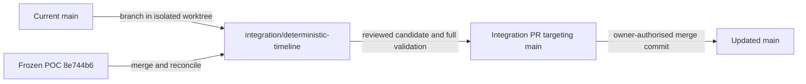

# Integrating the deterministic timeline into Workbench

Status: accepted integration plan, implementation underway on
`integration/deterministic-timeline`, 15 November 2026. Main and the frozen POC
remain unchanged; final promotion requires separate owner authorisation.

The outcome is one Workbench checkout containing the existing Vehicle, Order and
Sports live demos plus the completed bounded timeline. Existing demo commands keep
their behaviour. Timeline commands remain explicit; this integration does not move
live demos onto virtual time or broaden supported configurations.

The [accepted-scope candidate](https://github.com/sproates/zooglass/blob/8e744b6a19753babe5e83b7539226c440eaee820/workbench/docs/timeline-acceptance.md)
and [capability guide](https://github.com/sproates/zooglass/blob/8e744b6a19753babe5e83b7539226c440eaee820/workbench/docs/timeline-guide.md)
define the delivered boundary. Owner acceptance of promotion remains pending.

## Inspected starting points

| Reference       | Commit                                     | Contents                                                                   |
| --------------- | ------------------------------------------ | -------------------------------------------------------------------------- |
| Main            | `ad04db982cf32e4f26919a7ffbbb042e48212a78` | Completed three-demo delivery, including Order/Sports PR #170              |
| POC             | `8e744b6a19753babe5e83b7539226c440eaee820` | Completed timeline and final evidence manifest; tested candidate `9798fab` |
| Common ancestor | `1ba9c573c61b592bde239688553f7286a71be7ae` | Accepted timeline design                                                   |

A non-applying `git merge-tree --write-tree` inspection found 15 files changed on
both sides, with content conflicts in ten. It did not modify either branch or the
working tree. These counts describe the pinned heads; refresh them if main advances.
Main has no changes under `zooglass/` since the common ancestor. Its live-demo use
of the POC's production clock/delivery changes still requires regression coverage.

| Area            | Observed overlap                                                                | Required resolution                                                                                                                 |
| --------------- | ------------------------------------------------------------------------------- | ----------------------------------------------------------------------------------------------------------------------------------- |
| Service session | `workbench/src/service/zooglass-session.ts`, its test, two process-test helpers | Combine typed configuration/session-owned SQLite with exact-byte file configuration/caller-owned databases; preserve both test sets |
| Package/build   | `workbench/package.json`                                                        | Keep main's central demo CLI and all three demo build/lint/type/format targets; add every timeline command and required dependency  |
| CI              | `.github/ci/selection.mjs`, its test, `.github/workflows/workbench.yml`         | Keep specific Order/Sports/UI rules, timeline packaging/host/tests and both browser container ownership safeguards                  |
| Reset tests     | Browser reset helper and `reset-input.test.ts`                                  | Helper implementations already match byte for byte; consolidate coverage, retaining rejection of nonexact closure messages          |
| Documentation   | Root README/roadmap, timeline design, Workbench README/source map               | Preserve delivered demos and bounded timeline capabilities; distinguish current guidance from historical evidence                   |

The ten conflicted files are the CI selection test, the five documentation files,
package.json, the session implementation/test and reset-input.test.ts. The other
five overlapping files also need review despite Git resolving them automatically.

## Isolation and delivery workflow

Use a dedicated worktree, separate from any checkout with generated demo outputs.
Inventory and leave unrelated untracked files in their original location.

1. Publish this plan as a documentation-only PR from
   `docs/timeline-integration-plan` to main. It contains no runtime integration.
2. After plan acceptance, refresh main and record its exact commit and relevant
   passing baseline. Create `integration/deterministic-timeline` from that main
   in a fresh worktree. If the plan PR is still unmerged, carry its reviewed document
   deliberately into the integration branch and close the superseded plan PR only
   when the replacement preserves it. Do not assume either PR is authorised to merge.
3. Merge frozen POC `8e744b6` into the integration branch with an explicit merge
   commit, resolving and reviewing the conflicts before completing that commit.
   Do not rebase or rewrite POC history, retag releases or use blanket ours/theirs
   resolutions. Preserve a file-by-file resolution record in the integration PR.
4. Push coherent checkpoints and open one draft integration PR targeting main.
   Follow-up fixes are normal commits on the integration branch. Temporary fix
   branches, if useful, target integration and are removed after incorporation.
5. Review the combined candidate, fix findings and repeat review until clear.
   Complete the validation/evidence gates below before marking the PR ready.
6. Present the exact tested head, main base, tree identity, remaining limits and
   rollback instructions for owner authorisation. Main remains unchanged throughout.

Expected delivery: one plan PR and one implementation/integration PR; no new
feature programme. The existing POC is frozen and retained until promotion is
verified. Integration is a temporary delivery branch, not a new permanent main.

## Phase 1 — preserve the session contracts

This is the principal semantic reconciliation. Keep the existing API forms and
make their combinations explicit; no generic configuration framework is needed.

| Input form                                | Required behaviour                                                                                                                     |
| ----------------------------------------- | -------------------------------------------------------------------------------------------------------------------------------------- |
| Default options                           | Preserve ordinary default service startup and owned cleanup                                                                            |
| Generated `views`/`sources`               | Preserve existing generated configuration and protected-session behaviour                                                              |
| Typed `configuration`                     | Preserve main's complete runtime configuration and existing protected-access behaviour                                                 |
| `runtimeConfigurationPath`                | Copy exact file bytes; do not parse/reserialize them; reject combination with `configuration`, `views`, `sources` or `protectedAccess` |
| Typed configuration with generated inputs | Reject `configuration` combined with `views` or `sources`, as main does                                                                |
| Explicit `databasePath`                   | Require an absolute path; preserve caller-owned file/directory on close and failed startup                                             |
| Typed SQLite configuration without a path | Allocate session-owned storage under the temporary configuration directory and remove it on close/failure                              |
| Exact-file SQLite configuration           | Preserve the POC's explicit caller-owned database contract; do not silently introduce a new inferred storage policy                    |

Preserve abort handling, concurrent ephemeral ports, process-tree shutdown,
protected trust settings and no-build startup. Review default and missing-file
failure paths as well as successful launches. Consolidate duplicate tests, not
behavioural coverage. Add a focused regression for any newly rejected ambiguous
combination before spawning Java, exact-byte preservation and both database ownership
lifetimes. Explicitly verify caller-owned SQLite files survive failed startup as
well as normal close; verify session-owned files are cleaned in both cases.

Exit: focused session/process, protected-session and reset tests pass; the combined
contract is independently reviewed before broad validation.

## Phase 2 — preserve commands, selection and documentation

- Keep `demo` and `demo:drive` routed through main's central demo CLI; retain every
  current Vehicle, Order and Sports entry point, interactive and continuous mode.
- Keep all three demos in browser builds, lint, format and type checks. Add timeline
  preparation, run/inspect/compare/replay/bundle commands and qualification tools.
  Preserve the lockfile's dependency identities; regenerate it only if the merged
  package actually requires a change, and explain any resulting identity change.
- Retain main's specific demo/UI selection rules ahead of generic rules and the
  POC's timeline/host/package selection. Test representative paths from all three
  demos, shared service code and timeline/host code; keep main-target full gating.
- Retain explicit artifact preparation, host/runtime packaging checks and platform
  coverage. Tests must consume prepared JARs, never invoke builds themselves.
- Update current setup/commands/roadmap to describe the integrated product. Keep
  historical tested commits, archive hashes and qualification limits unchanged.
  Update and render affected source maps. Do not rename historical evidence or
  replace live-demo instructions with timeline-only instructions.

Exit: script/selection tests, static checks and documentation checks pass. A
reviewer can account for every overlapping file and the retained main-only demos.

## Phase 3 — validate one combined candidate

Freeze a clean integration commit before qualification. Prepare artifacts explicitly
once per source/artifact change, then reuse them. Run Maven preparation serially
within each checkout; do not race compilation with tests using its output.

| Gate                    | Finite scope and pass condition                                                                                                                                                                                        |
| ----------------------- | ---------------------------------------------------------------------------------------------------------------------------------------------------------------------------------------------------------------------- |
| Artifact identity       | Service excludes simulation hooks; host embeds the matching freshly prepared runtime. Compare production class inventory with the accepted POC when Java sources/toolchain are unchanged; explain any difference       |
| Focused integration     | Session option/ownership matrix, protected startup, reset cases, package commands and CI-selection regressions pass                                                                                                    |
| Complete baseline       | Select checks from the complete main-to-candidate diff. The inspected change requires all eight groups: Java, static, core, demo, browser, native, engines and reconnect. Require every selected CI job/gate to pass   |
| Live-demo preservation  | Existing automated acceptance covers Vehicle/Order/Sports launch, interactive and continuous operation, reset/reconnect, rendered views and supported narrow layouts. No new physical-phone approval or prototype gate |
| Clean setup             | Fresh checkout, dependency install, explicit preparation, admission, execution, bundle, strict replay and offline comparison work from the documented commands                                                         |
| Timeline witness        | Exactly the nine cases listed below, one fresh execution and strict bundle replay each; no seed multiplier or repeated historical campaign                                                                             |
| Ordinary-service parity | One existing qualification run each for Fleet, Order and Sports, using prepared artifacts and independent existing expectations; this exercises the reconciled session helper                                          |

The nine timeline cases are:

1. `scenarios/simulation/warehouse-retry.json` — v1 receipts and retries.
2. `scenarios/simulation/memory-restart.json` — memory lifecycle.
3. `scenarios/simulation/sqlite-restart.json` — durable lifecycle.
4. `scenarios/timeline-fleet/scenario.json` — sequence/history fleet.
5. `scenarios/timeline-order/scenario.json` — full ordinary Order inputs.
6. `scenarios/timeline-order-recovery/after.json` — explicit Order recovery.
7. `scenarios/timeline-order-retention/scenario.json` — Order identity/progress boundary.
8. `scenarios/timeline-sports/scenario.json` — full ordinary Sports inputs.
9. `scenarios/timeline-sports-retention/scenario.json` — fact/identity/retirement boundary.

The full timeline suite retains the other before/at/after, wall-clock, negative
control and malformed-evidence cases. Existing actual-mutant campaigns remain
historical evidence; do not claim to have rerun them through unit tests.

Do not rerun the 1,961 historical campaign executions merely because Git provenance
changed. If reconciliation changes production Java, timeline semantics, admitted
profiles or expected outcomes, stop claiming evidence continuity. Identify the
invalidated guarantee and rerun the affected proof/control/campaign with independent
expectations before proceeding. Expand scope only for that demonstrated need.

If a check fails, preserve its evidence, distinguish regression from infrastructure
or test synchronisation, fix and review it, and rerun the affected checks. Do not
weaken assertions or timeouts to obtain green results. The POC standard CI job took
11m41s within 15 minutes; the added demo work may change that. If a real validation
bottleneck appears, investigate measured setup/execution costs and split independent
jobs or bounded test shards if needed, preserving selected tests and preparation
contracts. Avoid repeating already-green unrelated jobs without a changed dependency.

## Phase 4 — record evidence and review

Keep historical release tags/assets/manifests immutable. A new Git commit changes
source provenance, but does not necessarily change executor identity: current
Workbench identity hashes the timeline module files. Measure configuration,
dependency, module, environment and JAR identities rather than assuming they changed.
Never remove identity checks or scrub semantic records to make old replay pass.

Retain the new candidate's nine raw runs/bundles/replays and the complete three
parity evidence directories: pinned inputs, raw service observations, reports and
identities. Include artifact inventories, commands, source/base/tree identities, check results and
independent audit in one integration evidence archive. Publish the archive as a
release asset; commit its hash, tested revision and download URL. Verify a downloaded
copy. Historical archives remain referenced by their original tested revisions.
If a genuinely relevant file changes after freezing, refresh affected evidence and
review; documentation-only follow-ups need document checks, not another campaign.

Review the final diff against current main and against the frozen POC, including
all automatically merged files. Review/fix/re-review continues until no actionable
findings remain. If main advances, merge it into integration, recheck resolutions,
refresh affected validation and re-review the exact new head before promotion.

## Phase 5 — promote, verify and clean up

Promotion requires explicit owner authorisation for the reviewed integration PR.
Use a merge commit to retain both histories and historical source anchors. At the
merge gate, require the current main base and tested integration head to match the
reviewed pair; do not merge an untested moving combination.

After merge, verify main's tree matches the tested integration tree, archive links
resolve and the recorded command/artifact identities are intact. Run a small
packaging/launch/replay smoke if warranted by the merge result; do not repeat the
full baseline when the tree and artifacts are unchanged. Any unexpected difference
reopens validation before calling the delivery complete.

Before promotion, fixes or reverts stay on integration; main needs no rollback.
After promotion, a material regression takes priority. Preserve evidence, prepare
an owner-authorised revert of the integration merge using its main parent, and
verify restoration to the pre-integration main tree, preserving Order/Sports.
If main has advanced, review the revert against subsequent work rather than blindly
resetting it. Do not rewrite published history or delete retained evidence.

After verified promotion, synchronise local main and remove merged integration/fix
branches. Retain the POC until its history is demonstrably reachable from main and
its evidence anchors remain available, then remove it under the agreed branch
cleanup policy. Preserve unrelated local files throughout. No website publication,
DSL, new profile, UI redesign or conversion of every legacy scenario is in scope.
