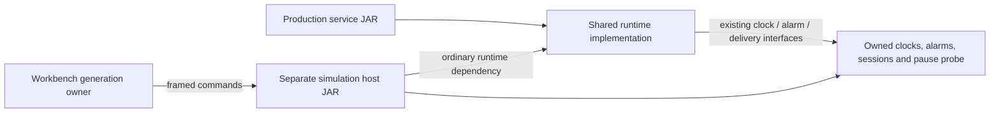

# Simulation boundary and restart implementation design

This refines the [accepted simulator design](deterministic-timeline.md) for the
next POC increments. **It is a design, not delivered SQLite/restart support.**
The current executable remains the qualified, single-generation memory profile.

## Assessment and chosen boundary

The current host is 324 lines and `document-execution.ts` is 717 lines. Size alone
does not justify a rewrite. Their mixed lifecycle responsibilities do justify
separating generation ownership before adding restart.

| Area                                       | Decision                                                                                                                                                               |
| ------------------------------------------ | ---------------------------------------------------------------------------------------------------------------------------------------------------------------------- |
| Production clock/alarm/delivery interfaces | Retain the small existing interfaces and production defaults.                                                                                                          |
| Simulation classes in `src/main`           | Move to a separate host build; the service must not ship pause switches or simulation adapters.                                                                        |
| Java host                                  | Separate framed protocol/validation from generation composition and sessions.                                                                                          |
| TypeScript executor                        | Extract runtime generation/availability ownership; retain the agenda, retry controller and delayed-link modules.                                                       |
| Nested Java clock/alarm implementations    | Give the controlled clock and alarm driver named host-side classes.                                                                                                    |
| Sorted agenda and internal assertions      | Keep the current bounded implementation. Profile a demonstrated bottleneck before changing algorithms; user-input validation must continue to produce explicit errors. |

Create a separate Maven project at `zooglass/simulation-host/`, with independent
output directories. Move `simulation/*`, `runtime/TimelineRuntime`,
`runtime/TimelineProfile` and `delivery/TimelineDelivery` there, together with
`TurnContextTests`. Retain their Java packages so adapters can use package-private
runtime seams without introducing a public extension API.

The production project attaches an ordinary `runtime` classifier JAR and keeps
its existing executable service JAR. The host depends on that ordinary artifact
and packages a separate executable `zooglass-simulation.jar`. Its classes and the
runtime dependency must use the same unnamed classloader; no JPMS split-package
arrangement is introduced. Reconciliation/storage/writer implementations exist
once, in the runtime dependency.

Explicit preparation installs the current production artifact into the local Maven
repository, then packages the host. Verify that the embedded runtime dependency
hash matches the freshly prepared classifier; do not accidentally use an old local
snapshot. Both projects use the same declared project/dependency versions.
Tests never prepare either artifact. Update all Workbench defaults, scripts,
mutation preparation and CI references in the same packaging increment.
The host JAR remains the single executable hash admitted by the bridge.

Production packaging must explicitly exclude all moved classes, including nested
classes, from both its ordinary classifier and executable-JAR input. This protects
against stale `target/classes` after an incremental build. Do not inherit these
exclusions into the host project. Check clean production builds without an installed
host artifact, deliberately stale output builds, archive contents, and launching
the separate prepared host JAR.

A profile that mixes simulation sources into the same output directory was
rejected because it makes class leakage easier. A wholesale runtime/module rewrite
or public plugin API is unnecessary.

## Clock and lifecycle contract

For global simulation time `T`, generation start time `S`, configured epoch `E`
and explicit signed wall offset `A`:

- Runtime monotonic time is `T − S`.
- Runtime wall time is `E + T + A`.
- Agenda times, transport deadlines and external actor retry deadlines remain
  global `T`. Runtime alarm delays are converted to `T + delay`.
- Every sample in a synchronous runtime turn has identical monotonic before/after
  values. Host execution time and I/O duration never advance these clocks.

Retain current bounded integer times. Check every addition/subtraction for safe
integer/Java-long agreement; wall time must remain nonnegative and in range.
Keep global time, the epoch and wall offset in the Workbench execution state.
Do not persist a runtime's monotonic origin in SQLite or reconstruct simulation
time from file timestamps, JDBC duration, database bytes or host clocks.

Generation 1 starts implicitly at global time zero, before declared time-zero
actions, and emits a recorded initialization. Admission therefore begins in the
running state. Each subsequent explicit start creates a fresh JVM and increments
runtime generation.
Before constructing `ViewCoordinator` or opening SQLite, install `S=T`,
monotonic zero and the current wall value. Production recovery then sees those
exact clocks. No source, subscription or snapshot command precedes initialization.
Only successful initialization makes the generation available.

Stops are between acknowledged turns. An orderly stop closes production storage;
an abrupt stop terminates the JVM without normal close after an acknowledged turn.
Wait for process exit before reopening its database, without advancing virtual time.
Unexpected process death, failed close/startup or native I/O error is an
infrastructure failure, not a simulated receipt loss or accepted stop.

Stop invalidates that generation's runtime tasks, writer handoffs, sessions and
both directions of queued transport. External actors, retained publication bytes,
attempt budgets and retry timers survive. Runtime task identity is
`(runtimeGeneration, taskId)`; connection generations never reset across starts.
No stale callback, packet or receipt may attach to a new runtime generation.
Allocate connection generations on successful opens, not from a precomputed count
of declared connect actions. Unavailable connects create no session/generation.
The v2 admission model must account for lifecycle invalidation instead of reusing
v1's preassigned connection state. Abrupt-stop cancellation records cite the model
stop action; they must not fabricate a Java close callback.

While stopped, connect/send attempts yield `connection-unavailable` without IPC
or automatic startup. A managed publication attempt includes reconnect and send:
a failed connection consumes one attempt even though no bytes were sent. This is
an explicit extension of the present send-attempt semantics. An unavailable attempt
is a model outcome, never a fabricated wire receipt. It consumes the publication
attempt index but emits no receipt-loss draw; a later successful attempt uses its
actual attempt index and newly allocated connection generation. Runtime observations
report `runtime-unavailable`; client observations may still inspect frames already
delivered before stop. They must never return a cached view as current runtime state.

### Downtime retry policy

V2 managed retry entries require the existing `action`, `maxAttempts`,
`receiptTimeoutMs` and `retryIntervalMs`, plus `unavailableRetryIntervalMs`.
Keep maximum attempts bounded to 1–10 and each duration to 0–3,600,000 ms;
check deadline additions against the run-time bounds.

- A sent attempt waits `receiptTimeoutMs`. If still unacknowledged, it retries
  after `retryIntervalMs`, as today.
- An unavailable publication attempt sends nothing and creates no receipt timeout.
  If attempts remain, retry after `unavailableRetryIntervalMs` from that outcome.
- Exhaustion produces the named retry-exhausted scenario assertion failure.
  An unavailable final attempt fails immediately, rather than waiting for a
  receipt that cannot exist.
- Zero-delay retries enter the next causal round at the same timestamp, never
  recursively execute inside the failed attempt. Attempt and round budgets apply.

The accepted example therefore declares `maxAttempts: 3`,
`receiptTimeoutMs: 10`, `retryIntervalMs: 0` and
`unavailableRetryIntervalMs: 30`: initial send at 10, timeout/retry at 20,
unavailable outcome at 20, next attempt at 50. Do not change v1 retry timing.

A standalone source/client connect during downtime emits a connection outcome,
creates no connection and charges no publication attempt. For managed actors, the
initial connect merely prepares a session. The initial send starts attempt 1 and
ensures a connection to the current generation; it reconnects if stop/start
invalidated the prepared session. Only that initial send may reuse its prepared
current-generation session. Later managed retries retain today's behaviour:
retire the previous connection and open a fresh connection generation for each
available attempt, even when the runtime generation has not changed.
A failed connect within that attempt charges it once, never once for connect and
again for send. Only declared service downtime yields this unavailable outcome;
an unexpectedly dead host or failed initialization remains infrastructure failure.

Lifecycle and wall adjustments are preloaded phase-zero actions. At equal times
their declaration order decides the resulting state and clocks; they precede
derived retry timers. A stop/start at the same timestamp is valid. Starting an
already running service or stopping an already stopped service is rejected during
admission. Additional assertions during downtime cannot create a JVM or change
the declared startup time.

## Explicit wall adjustments

Add a bounded `wall-clock-set` action with `id`, `atMs`, `kind` and absolute
`wallMillis`, no actor. Its new offset is `wallMillis − E − T`.
It changes the injected wall clock only. While stopped it changes the clock used
by the next start. While running a clock-only command records/installs the new
sample; it must not call reconciliation, commit storage, mark receipts uncertain
or publish a freshness transition.

Normal commands cannot change the offset. The host validates clocks against the
current generation origin and the last explicitly installed offset. A same-time
adjustment before start affects recovery; an adjustment after start cannot
retroactively change recovery.

Use production `ClockRollback` and `FreshnessRuntime` unchanged where possible.
Live elapsed freshness uses monotonic time. Rollback uncertainty is recorded only
when production commits a clock sample; duplicate-only retries may return without
such a commit. Recovery compares its wall sample with durable `lastWallMillis`
and uses stored uncertainty flags. The durable wall high-water mark is never
reset to the adjusted wall value. The simulator must not infer or manufacture
these flags merely because it knows an adjustment occurred.

## Observe recovery without repairing it

Recovery runs inside the coordinator constructor, before host listeners are
attached. Existing `snapshot()` calls `expire()`, so it cannot be the sole oracle
that recovery already happened.

Add a small package-private read-only installed-snapshot seam to the runtime,
using its existing snapshot projection under the coordinator lock. It must not
sample clocks, call `expire()`, schedule work, write storage or mutate state.
The host adapter uses it after construction and before ordinary commands, for a
bounded, explicitly declared list of view/entity observation targets.

Emit one initialization observation containing actual installed snapshots and
returned task registrations. Use a distinct initialization record, not a fabricated
sequence of ordinary state-change callbacks. Stable target ordering is part of
the trace contract. Subsequent subscription frames still use the real subscription
path. Tests must prove the initialization observation itself does not change
versions or make missing recovery appear successful.

## First storage profile and artifacts

Start with an empty, unprotected SQLite store using the same one-source/one-view/
one-field receipt-age constraints as the memory proof; multiple entity identities
remain possible. Each run gets its own writable database directory. A later
fixture extension requires a clean closed database or a declared complete
database/WAL bundle copied into that directory; live file copying is not admitted.

Keep the database through stop/start within a run. Replaying an empty-store
scenario creates a new empty store and re-executes all inputs; never reopen the
recorded final database as its initial state. Preserve database files from failed
runs for diagnosis, without treating page/WAL layout or file hashes as semantic
outputs. Native commit/close/open failures retain incomplete evidence.

The new capability needs a new document/trace/profile/protocol contract: proposed
`timeline-simulation/v2`, `timeline-trace/v2`, `receipt-age-restart-v1` and bridge
protocol 2. Add matching run/bundle versions when these records are implemented.
Retain v1 source execution with its existing bounded semantics; do not silently
reinterpret unavailable attempts or lifecycle fields in v1. Old archived runs
still require their matching executable/module identities.

Admission must validate complete lifecycle schedules, clock arithmetic, target
lists and all feature combinations before creating a writable store. Handshake/
configuration inspection is metadata-only, without runtime construction or clock
sampling. Initialization binds the generation, origin and first turn identity.
Use these closed v2 forms (unknown fields reject):

| Action           | Fields beyond `id`, `atMs`, `kind`             |
| ---------------- | ---------------------------------------------- |
| `service-stop`   | `mode`, either `orderly` or `abrupt`; no actor |
| `service-start`  | None; no actor                                 |
| `wall-clock-set` | `wallMillis`; no actor                         |

Add top-level `observationTargets`: at most 64 unique `{viewId, entityId}` pairs.
New trace kinds retain the ordinary event ID, key, actor, parent and causal
references. Define their additional payloads as closed objects:

- `connection-outcome`: `data: {outcome}`, with outcome
  `connection-unavailable`, both generation fields null, the declared connect
  action as parent and the stop event as a cause. The top-level actor identifies
  the source/client. No publication or attempt index is invented.
- `attempt-outcome`: `data: {publication, attempt, outcome}`, where outcome is
  `connection-unavailable`. Both generation fields are null. The parent is the
  attempted external action/timer; `causes` also references the stop event.
- `runtime-observation` while stopped: `data: {viewId, entityId, outcome}`, where
  outcome is `runtime-unavailable`, both generation fields null, and the stop
  event is a cause. It has no snapshot payload.
- `runtime-initialized`: `data: {startTimeMs, wallMillis, monotonicMs, snapshots}`,
  with the actual runtime generation and no connection generation. Snapshot
  ordering follows the declared target list; task registrations remain separate,
  causally linked records. Monotonic time in this record must be zero.

The first v2 profile admits at most 16 runtime generations, initial state `empty`,
and no fixture-import fields. Store identity is the declared empty initial state
plus storage/configuration identity; future fixture admission needs a separate
versioned immutable-fixture contract. Ordinary successful runtime records carry
their actual generation. Runtime-unavailable forms do not impersonate generation 1
or an empty snapshot. Unmanaged sends while stopped are modelled unavailable;
after startup they require an explicit successful reconnect. Managed initial
sends and retries ensure their own current-generation connection as specified
above. Global action/turn/message limits still apply.
Turn counters and run budgets remain global across generations; each new host
validates its initialization and subsequent consecutive command identities.
Environment manifests add the actual SQLite library version; every generation
must match the declared executable/environment identity.

## Literal acceptance cases

Author complete expected frames, receipts and versions independently. These are
minimum cases, not a substitute for failure-path tests.

| Case                                                                                                                                           | Required result                                                                                                                                                                                                          |
| ---------------------------------------------------------------------------------------------------------------------------------------------- | ------------------------------------------------------------------------------------------------------------------------------------------------------------------------------------------------------------------------ |
| Threshold 30 ms: receipt at 10, stop at 11, unavailable retry at 20, start at 50                                                               | SQLite recovery is stale/version 2 before observation; retry returns the original version-1 receipt with `duplicate/alreadyCommitted`, unchanged targets and age. Memory applies anew/version 1, fresh until 80.         |
| Threshold 50 ms: receipt at 10, stop at 11, start at 40                                                                                        | SQLite keeps fresh/version 1 and receipt wall `E+10`; generation monotonic starts at zero and the alarm is globally due at 60, not 90.                                                                                   |
| Threshold 50 ms: receipt at 10, restart at 60                                                                                                  | Recovery is already stale/version 2 before same-time input; no old alarm runs.                                                                                                                                           |
| Downward adjustment during downtime: receipt at 10, stop at 11, set wall to `E+5` at 20, start at 21                                           | Recovery wall `E+6` is below durable high water; age becomes `ageUnknown`, timestamp null, version 2. No fabricated stale deadline.                                                                                      |
| Persisted live rollback, threshold 50 ms: entity A received at 10; set wall `E+5` at 20; new entity B committed at 21; stop at 22; start at 50 | A becomes `ageUnknown`/version 3 from persisted uncertainty, despite restart wall `E+35` exceeding old high water. B remains fresh/version 2 with receipt `E+6`, due globally at 71.                                     |
| Clock adjustment followed only by duplicate retry, with no expiry/commit                                                                       | Do not invent an uncertainty write. Check recovery against the actual durable high water and unchanged stored receipt.                                                                                                   |
| Extend the downtime rollback case: duplicate at 22; new contribution at 30; threshold 50 ms                                                    | Duplicate retains original receipt/version 1; current view remains `ageUnknown`/version 2. New contribution becomes fresh/version 3, receipt `E+15`, due globally at 80. Time passing alone must not repair unknown age. |
| Stop/start between a managed initial connect and its initial send                                                                              | Send begins attempt 1, reconnects to the new generation, and sends once. A standalone failed connect during downtime does not charge this attempt.                                                                       |
| Zero unavailable interval and exhausted attempts while stopped                                                                                 | Each retry advances causal round, consumes one attempt and emits no IPC/draw/receipt timeout; the last attempt fails immediately and leaves no retry timer.                                                              |
| Old packets/tasks and source timers across stop/start                                                                                          | Old generation work stays cancelled; surviving external timeout consumes the unavailable attempt exactly once. Reconnection IDs and keyed draw identities do not alias.                                                  |
| Extra assertion at 25 during the first downtime example                                                                                        | No startup, reconciliation, delivery or retry-time change.                                                                                                                                                               |

Use the existing production
[receipt-age recovery tests](../../zooglass/src/test/java/io/zooglass/runtime/ReceiptAgeRecoveryTests.java)
and [live-clock tests](../../zooglass/src/test/java/io/zooglass/runtime/ReceiptAgeTests.java)
to check the intended semantics, including masked backwards offsets and post-jump
replacement; do not replace their independent literal expectations with generated
runtime snapshots.

Repeat selected restart cases in fresh processes with long Node/JVM pauses,
within each recorded environment. Include a deliberately incorrect generation
origin/recovery-clock control that fails a named semantic assertion, not merely
an identity check. Continue complementary real SQLite crash/integration tests;
mid-commit termination and physical durability are not simulated here.

## Delivery order and gates

1. Isolate the host artifact and named controlled drivers. Check service/classifier
   contents and independent preparation; run existing proof/document/replay tests.
2. Extract generation ownership and add protocol/lifecycle handling with memory
   first. Prove downtime, attempt accounting, cancellation and clock reset before
   opening SQLite through this path.
3. Add empty SQLite restart and the read-only recovery observation. Prove literal
   durable receipts/freshness cases and failed-start evidence.
4. Add explicit wall adjustments and rollback cases, then qualify selected restart
   campaigns and retain their raw artifacts.

Each increment needs focused validation and independent review before the next.
These gates refine the existing POC scope; they do not promote it to main or claim
any restart capability has already been delivered.
