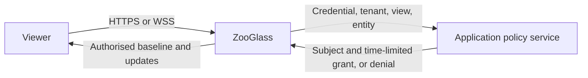

# Who can read a live view?

**Accepted contract.** An order operator can read order 42 while assigned to it. If
the assignment ends while the order is on screen, ZooGlass stops releasing its
data within five seconds. A fresh subscription requires a new decision. Another
operator who still has access continues receiving updates.

## Who decides

The application owns identity, assignments and policy. ZooGlass asks an
application-operated HTTPS endpoint for a decision and enforces it at three
points: snapshot read, subscription admission and release to the transport.

The first protected deployment serves **one tenant per ZooGlass instance and
store**. The operator configures its tenant ID. Both HTTP forms and the socket
use the same decoded view and entity IDs as the snapshot lookup. The caller
supplies neither the tenant nor the subject. Permission covers the entire
snapshot, including status, provenance and publication sequences. Applications
that need different field visibility expose separately authorised views.

**Store ownership.** At initialisation, record the configured tenant in an
empty durable store in one transaction. On every subsequent open, including
restore from backup, verify ownership before readiness or serving any route.
Refuse a mismatched tenant. Open demo mode must also refuse a tenant-bound store.

A nonempty legacy store with no owner requires explicit offline adoption.
With ZooGlass stopped, the operator verifies the data's provenance and takes a
backup, then supplies the database path and intended tenant ID to an adoption
command. Under an exclusive transaction it binds only an unbound store. A
repeated adoption for the same tenant is harmless. A conflicting owner aborts
the operation. Ordinary startup never adopts existing data implicitly.

Use a startup choice between open demo access (the existing default) and
application policy. Protected mode requires a tenant, a fixed policy endpoint,
service authentication and an allowed browser origin. Invalid protected
configuration fails startup. The policy service authenticates ZooGlass and
ZooGlass verifies the service's TLS identity. Policy calls have a bounded
timeout and never follow redirects.

**Viewer transport.** Protected viewers use HTTPS for reads and WSS for
subscriptions, including bearer clients. Terminate TLS at ZooGlass or at a
trusted proxy. In the latter deployment only the proxy can reach the backend
listener, and it strips and replaces client-supplied forwarding headers.
Expose no plaintext viewer listener. Redirecting a credential-bearing HTTP
request would already have exposed the credential.

Forward only the configured opaque session cookie or the bearer credential
from the request. Reject ambiguous credentials. Browsers use a secure,
HTTP-only cookie on the same origin and ZooGlass validates the WebSocket
Origin before upgrading. Non-browser callers can use a bearer credential.
Keep credentials out of URLs, logs, snapshots and persistent storage. Source
publication, retirement, progress and view registration are separate operator
interfaces and must be isolated from viewer traffic in a protected deployment.

## Read and subscribe

ZooGlass asks for permission to read the exact tenant, view and entity. The
policy service validates the credential on every call. An allow decision binds
the authenticated subject to that resource and carries a maximum lifetime in
milliseconds, already limited by the remaining credential and grant lifetime.
ZooGlass rejects malformed replies. It binds each request to its own response
and each socket to one subject. A changed subject requires a new connection.

| Request | Outcome |
| --- | --- |
| Either HTTP snapshot route | Check before lookup and again at release. Missing, invalid or expired credentials receive 401. Authenticated denial receives 403. An unavailable decision receives 503. Only an authorised lookup can reveal a missing view (404). Send protected responses with `Cache-Control: no-store`. |
| Open a socket | Validate identity at the handshake. Reject invalid credentials or origin before upgrade. Identity alone grants no subscription. |
| Subscribe to an inactive resource | Obtain a fresh resource decision. Check it when admitting the acknowledgement and baseline together. A denied request receives a generic `accessDenied` error and creates no subscription. An unavailable policy returns `accessUnavailable` and no data. |
| Repeat subscribe to an active resource | Obtain a fresh decision. An allow admits a new generation. A denial or unavailable decision invalidates the active grant and closes the whole socket with 1008, even if another subscription is still allowed. Discard queued payloads for both generations before any further release. |
| Reconnect after disconnect or service restart | Authenticate again and decide each requested resource anew. An allowed client gets the [current baseline](client-delivery.md). Keep grants out of the restored store. |

The identity check at upgrade uses the same policy endpoint with an
authenticate-only request. A decision failure at upgrade returns 503.
HTTP and socket errors omit protected data and details of other resources.

## Where the code belongs

The `OpenDemoAccess` and `ApplicationPolicyAccess` modules implement the
two access behaviours; their [policy protocol](../../zooglass/docs/access-policy.md)
is defined separately. Admission handlers use the selected strategy for HTTP
reads and socket handshakes/subscriptions; protected startup remains gated.
The latter uses a policy client to obtain grants and a local grant registry
to check deadlines and invalidate subscription generations. The writer checks
the local grant at release. This keeps a slow policy call off the publication
path and lets a prepared snapshot remain shared across authorised viewers.

## What five seconds means

A grant expires at the **start of the policy request** plus the shorter of
five seconds and the lifetime returned by the authority. Measure elapsed time
with a monotonic clock. Discard replies that arrive after their deadline.
Starting the clock before the call prevents network delay from extending access.

Revocation starts when the authority commits the policy change. Subsequent
decisions must see that change. Even if an earlier allow reply arrives late,
its original deadline applies. Credential expiry can shorten the bound further.
An explicit denial, a failed renewal or expiry invalidates the grant immediately
when observed. Renew active subscriptions before their deadlines, including
during source silence. Run policy I/O outside the coordinator and writer locks.
Bound outstanding renewals and discard superseded responses.

Each queued baseline or update carries its subscription generation and grant
reference. Recheck membership, generation and deadline at the final handoff of
each frame to the transport, including frames already taken from the queue.
Serialise invalidation with that handoff. A timer alone cannot provide the
cutoff after a scheduling delay. Bytes handed to the transport before cutoff
can arrive afterwards.

**HTTP release.** Serialise a snapshot into application-owned bytes and offer
bounded chunks to the HTTP transport when its writer is ready. Returning from
the controller, completing serialisation and queuing a chunk in ZooGlass all
precede release. Release occurs when the transport accepts a chunk. Check the
current grant and deadline at each nonblocking handoff, ordered with invalidation.
A stalled writer must wait outside that boundary and check again when ready.

Before committing success headers, authorise the first chunk. If access fails
while the response is still uncommitted, return the applicable error above.
After commitment, discard the remaining bytes and abort the response stream.
The client discards an incomplete snapshot. It cannot receive a replacement
HTTP status or a successful end-of-body marker on the aborted response.

On loss of an active grant, invalidate the socket's memberships, discard
waiting frames and close with code 1008. Closing the whole socket gives one
unambiguous outcome even when it carried several views. Other sockets keep
their own grants. The client clears all protected data on loss of the socket,
including abnormal closure when a close frame cannot get through. It ignores
callbacks from the old connection. It may show data again only after a fresh
authorised baseline. A client that copied data before revocation owns that copy.

## Delivery and acceptance

The durable ownership boundary and offline adoption command are implemented;
see the [storage guide](../../zooglass/docs/sqlite-storage.md#tenant-ownership).
Tenant-aware startup, HTTP/WebSocket admission and active subscription renewal
are exercised through internal test wiring. Renewal handles expiry and access loss
during source silence. WebSocket frames now carry generation leases and use a
guarded asynchronous transport handoff. HTTP chunk release checks remain outstanding. Protected serving remains gated on active release enforcement and
an isolated operator path. The current admission boundary uses direct TLS;
proxy termination requires its own backend-isolation verification.

Implement admission first and active enforcement second. Enable protected mode
for users only once both are in place. Workbench supplies an application policy
fixture, two callers and controllable decisions. Exercise the real HTTP and
WebSocket interfaces with these observations:

- Allow one caller and deny another for the same order. Try both HTTP routes,
  an unauthorised entity, a tenant mismatch, an invalid credential and a
  disallowed browser origin. Check the response and the absence of a baseline.
- Restore tenant A's database under tenant B, with order 42 present in both.
  Startup must fail before readiness. Check open-mode refusal, legacy-store
  refusal and offline adoption followed by a successful same-tenant restart.
- From the viewer network, verify HTTPS and WSS with a synthetic bearer.
  Attempt plaintext HTTP, WebSocket and direct backend access, including spoofed
  forwarding headers. None may reach an authenticated viewer route.
- Subscribe to two orders on one socket. Deny a repeat request for the first,
  then run the case again with the policy service unavailable. In each case
  check that both subscriptions end, queued updates are discarded and another
  viewer continues receiving updates.
- Hold the HTTP writer before the first chunk, then between two chunks of a
  large response. Revoke access and advance past the grant deadline before
  resuming. Observe no further transport handoff in either case. Verify an
  error before commitment and a truncated or reset stream after commitment.
- Block a socket write, revoke access and release the block. Observe
  the last authorised handoff against the authority's commit time. Cover a frame
  taken from the queue, a delayed allow reply, coalescing and several subscriptions
  on one socket. A separate permitted socket must continue receiving updates.
- Expire a credential during silence. Exercise a timeout, malformed decision
  and a renewal racing revocation. Use a controlled clock at the release boundary
  and measure the real socket outcome separately.
- Reconnect with the old credential, then with a valid grant. Verify denial
  followed by a fresh baseline. Independently inspect the demo's rendered state
  after access loss. Any future replay interface must pass the same resource check.
