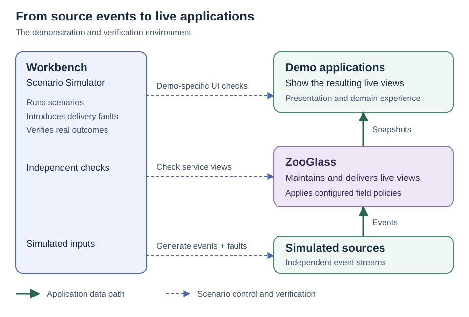

# ZooGlass architecture diagrams

These diagrams are maintained project documentation. The vehicle demo makes the
implementation concrete, but its delivery plan is not needed to find or understand
the diagrams.

## README overview

The [README](../../README.md) uses this compact overview to show the roles at a
glance: demo applications consume ZooGlass views, simulated sources publish real
events, and Workbench coordinates scenarios and checks outcomes. Solid green
arrows show the application data path; dashed blue arrows show scenario control
and verification. UI checks belong to individual demos.

This overview omits the transport proxy and browser-control details shown below.
Keep its roles and labels aligned with the detailed diagram. Edit the SVG directly
and render it when changing layout or text.

## Building and testing ZooGlass

Read the data path from bottom to top: the simulated feed sends real events to
ZooGlass, the service maintains the two views, and snapshots reach the vehicle
app through the data proxy. Subscriptions travel down the same path. This is the
local verification environment, not a production deployment topology.

Workbench sits alongside the stack because it coordinates several boundaries:

- **Playwright** launches the browser and supports the vehicle demo's independent
  rendered checks. Those UI checks are demo-specific, not shared executor logic.
- **Client commands and observations** use a separate control connection. The
  bridge operates the app's actual socket and reports real completion and receipts.
- **Break / restore** controls the data proxy. Breaking it closes active transport
  and refuses new data upgrades. Restoring it opens the route; the client performs
  its own retry and resubscription during an explicitly armed fault interval.
- **Processing checks** read server view state independently of browser receipts.
  A successful source send does not establish processing or rendering.
- **Source control** advances the scenario's feed independently of the viewer.

Blue identifies verification machinery and control. Green identifies the
application/data path roles. The simulated feed is green because it occupies the
source role in this example; Workbench supplies it. The proxy is blue because it
is test machinery, even though real application snapshots pass through it.
Neither colour indicates whether a component is currently healthy or faulted.

The horizontal lines show responsibilities, not an additional data source for
the app. Expected values stay in Workbench checks and never populate the vehicle
view. The source and control connections remain available during a data fault.
Snapshot recovery does not replay individual missed messages, and the two view
snapshots are not an atomic pair.

## Intended production role

[The production-intent diagram](zooglass-intended-production.svg) shows the wider
role we want ZooGlass to occupy between source systems and consuming applications.
It includes responsibilities that remain to be built. Workbench is not a runtime
dependency of that intended production deployment. The
[product explanation](../what-is-zooglass.md) distinguishes ambition from current
capability.

## Keeping the diagrams current

[`zooglass-workbench.svg`](zooglass-workbench.svg) is the single canonical vertical
Workbench diagram. Edit that SVG directly, preserve the component stack and
horizontal connections, and update its accessible title/description as well as
visible labels. Render it to check text fits and arrows still reach the intended
components. Update this guide when ownership or meaning changes.

The root README, product explanation, Workbench guide and browser orchestration
design link to this same asset or guide. Do not copy the SVG into individual
plans or regenerate it from the older Mermaid sketch. The sketch records earlier
planning, not the current layout source. Source-file dependency maps are separate
and remain in each component's `docs/source-map.md`.
