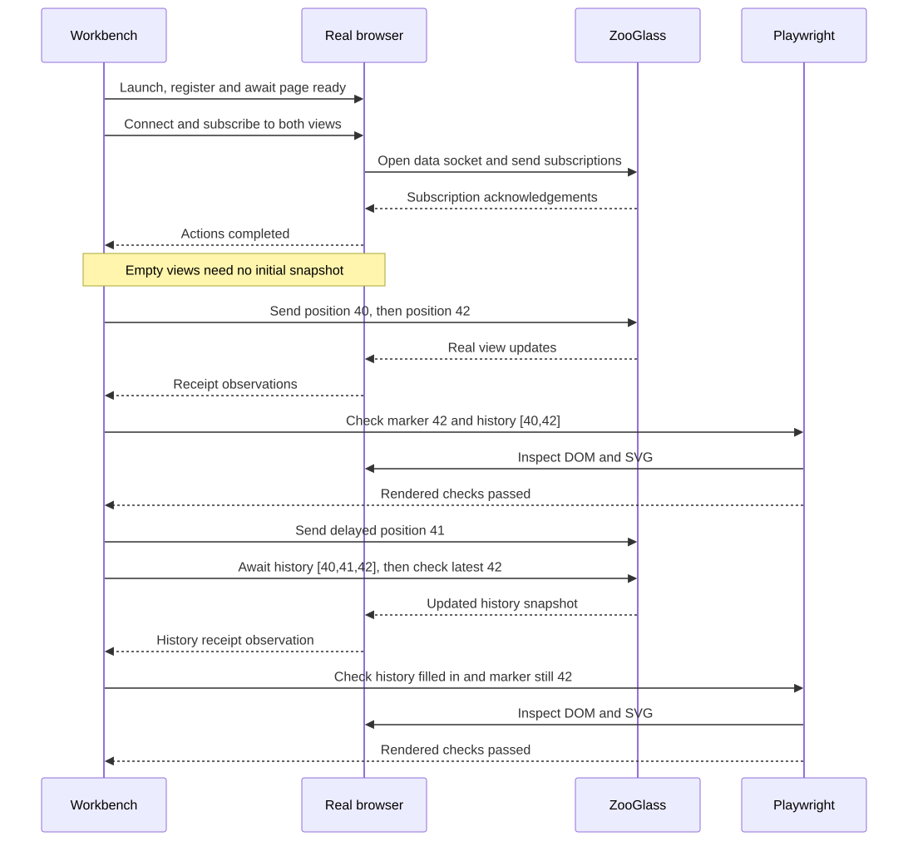
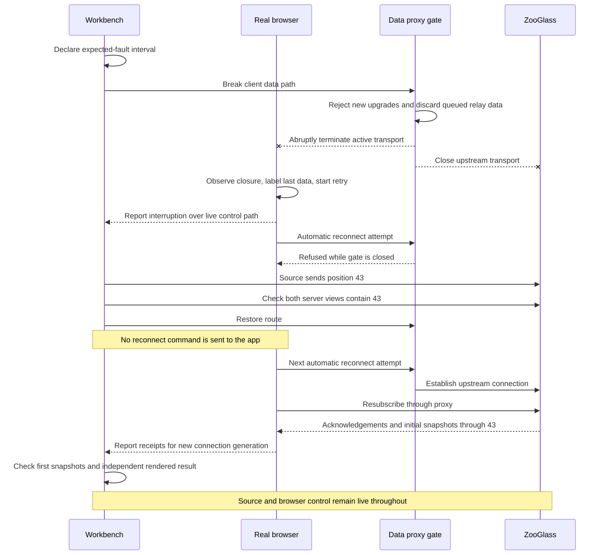

# Browser orchestration for the vehicle demo

Status: design baseline. Shared Workbench service and scenario sessions are
implemented, along with an owned Chromium bootstrap, registration connection
and local data proxy. Basic browser commands and snapshot rendering now run
short 40/42 and twenty-position journey fixtures, with visible waiting and
retained/error states. Step and reset are implemented: startup connects and
subscribes, each step sends one position and awaits its following service/receipt
checks, and reset replaces the service and browser with fresh state. Terminal
reset remains available after page loss. `--auto` retains timed playback and its
previous cleanup behaviour. Independent rendered checks in interactive action
completion, play/pause, fault injection and full
acceptance described here remain planned. This extends the [vehicle demo plan](vehicle-tracker-demo.md).

## Decision

Workbench will orchestrate a real browser client through a small control
connection in the demo app. Playwright will launch that browser and independently
check its rendered state. The browser will continue to receive its vehicle data
through the actual ZooGlass live-view protocol.

Automation alone would need UI controls or an app interface to operate the
ZooGlass socket reliably. A control connection alone would tell us what the app
reports, without independently checking what it displays. Combining them gives
explicit scenario actions and browser-level evidence.

Keep this bounded to one vehicle and one browser client. Existing Node clients
remain available for the headless scenario suite. There is no new general
adapter framework, arbitrary-site automation or general network-fault simulator in this
slice. One required fault is a proxy-controlled data-connection break and recovery.

## One verification workflow

Workbench is the entry point for defining, running and inspecting an end-to-end
scenario. Specialist tools provide capabilities underneath it; the user should
not have to coordinate separate browser scripts, proxy commands and reports.

Use one scenario timeline and one run identity. Workbench owns startup,
readiness, scheduling, fault control, checks and cleanup. Browser assertions may
add presentation-specific expectations, but must not duplicate the event script.
Present one overall outcome with failures attributed to the relevant action,
client and check; retain tool-specific logs and screenshots as supporting detail.
A failed required assertion or orchestration failure makes the run fail, even if
another tool reports success. An interrupted or exploratory run is not a pass.

Interactive execution and CI use the same orchestration semantics. Choose tools
for defined capabilities and keep scheduling, retry and outcome ownership clear.
Existing unit tests, lint and build checks remain separate focused developer
checks; this design unifies scenario verification rather than replacing them.

## Architecture at a glance

This is the shared diagram used in the project-level
[ZooGlass explanation](../what-is-zooglass.md). Blue marks test machinery and control,
including the fault gate. It does not indicate an active failure.

The control path and the vehicle-data path are separate. Breaking the data proxy
leaves Workbench able to observe and control the browser, while the source keeps
sending events to ZooGlass. Playwright checks the display rather than supplying
its data.

## Ownership and connections

| Component | Owns |
| --- | --- |
| Workbench session | Scenario position, source connections, ZooGlass process, action queue, control server, browser process/context and run evidence. |
| Browser control bridge | Registration, command dispatch into the app's connection controller and reports of actual socket events and view receipts. |
| Vehicle app | ZooGlass socket, subscriptions, received snapshots, connection state and rendering. |
| Playwright observer | Browser launch and checks of the real DOM/SVG. It never supplies vehicle state. |

The browser has two independent WebSocket connections: `/control` to Workbench,
and `/views/live` through the local host's proxy to ZooGlass. Workbench sends
source events through a third connection to ZooGlass's `/events` endpoint.
Closing `/views/live` must leave `/control` and source delivery working.

Serve controls beside the vehicle view in one page, but keep the two components
separate. Control buttons request actions from Workbench; they don't operate the
ZooGlass socket directly. The app never builds its vehicle state from scenario
expectations, control messages or the source trace.

Bind the host and ZooGlass to loopback. Validate the control connection's origin
against the host's exact origin and use a fresh per-run registration token passed
when loading the owned page. Reject foreign origins and registrations. This is
a local demonstration boundary, not a production authentication scheme.
The live-data proxy validates the incoming origin and establishes the upstream
connection with a ZooGlass-compatible origin. Test the real browser path rather
than disabling origin checks globally.

## Browser lifecycle

Use Playwright-managed Chromium, headed for the interactive demo and headless
for CI. Pin the Playwright dependency and matching browser installation during
implementation. Playwright supports both modes and isolated browser contexts;
see its [browser documentation](https://playwright.dev/docs/browsers) and
[context documentation](https://playwright.dev/docs/browser-contexts).

The demo command owns a browser process and a fresh non-persistent context. It
opens the demo page itself, rather than attaching to someone's existing browser.
Manual attachment and additional browser engines are deferred. Print the local
URL for diagnostics, but an independently opened tab cannot replace the
registered client or join the run automatically.

Startup order: create the run and configuration, start ZooGlass and wait for
health, open sources, start the host, launch the browser, and await registration
and page readiness. Only then enable scenario execution. A startup error cleans
up everything already created. On exit, close the owned context/browser, sockets,
host and ZooGlass process, and remove temporary configuration.

## Identity and control protocol

Assign a fresh `runId` on every reset and a fixed scenario `clientId`, initially
`rider-app`. Each new ZooGlass socket has a monotonically increasing
`connectionGeneration` within that run. Workbench allocates a unique `commandId`
for each action. Reports must carry the run/client IDs; data-socket reports also
carry the connection generation. Stale reports are ignored and traced.

The browser registers with `protocolVersion: 1`, `runId`, `clientId` and its
registration token. Accept exactly one page for that client. Reject duplicates
rather than stealing the active binding. After registration, the page reports
`ready` when its controller, message listeners and UI have been initialised.
This does not mean it is subscribed or has vehicle data.

Control messages have these roles:

| Message | Meaning |
| --- | --- |
| `command` | Workbench requests connect, disconnect, subscribe or unsubscribe, with IDs and action arguments. |
| `completed` | The identified action reached its specified completion condition. |
| `failed` | The action failed, with the command ID and a diagnostic reason. |
| `observation` | A socket opened/closed, subscription acknowledgement arrived, or view snapshot was received; includes generation and an increasing observation index. |
| `control-request` | A UI request for play, pause, step, reset or a viewer action; Workbench validates it against run state. |

Subscribe commands contain actual resolved view/entity IDs, never expected data.
An observation of a view receipt includes the received snapshot for assertions.
The bridge observes the app's real connection controller; it doesn't create a
second data socket. Receipt reporting happens after validation and acceptance
into app state, but is not treated as proof of a DOM update.

One client action is outstanding at a time. There is no automatic command retry:
uncertain execution fails the run and requires reset. Cache completed command
results for the bounded run so a repeated ID can return its result without
performing the action again. Reject reuse of an ID with different arguments.

## Mapping existing scenario entries

Bind each scenario client to either the existing Node executor or a browser
executor in the run configuration. The default remains Node, preserving current
fixtures and CLI behaviour. Browser mode explicitly binds `rider-app` to the
owned page; it must not silently omit client entries.

| Entry | Browser execution and completion |
| --- | --- |
| Initial/client state `connecting` or `connected` | Ensure a real data socket exists; complete on its `open` event. If already open, complete without another socket. These names retain the current runner's ensure-connected semantics. |
| Initial/client state `disconnecting` or `disconnected` | Close the actual data socket; complete on `close`, or immediately if already closed. Clear that connection's subscriptions and cancel automatic reconnect for this deliberate closure. |
| `client-subscription` | Send the real protocol action and complete on the matching ZooGlass `subscribed` or `unsubscribed` response for this generation. Missing/closed socket is a failure. |
| `client-view-check` | Await an observation from the actual browser matching the expected view, entity and data. Never substitute an HTTP check or Node viewer. |
| Source event, view definition or HTTP view check | Use Workbench's existing shared execution path. |

Retain the existing JSON event shapes. Add only an optional
`firstAfterSubscribe: true` to `client-view-check` for reconnect assertions.
It means the first view-update for that view/entity after its latest acknowledged
subscription on the current connection must match; a mismatching first snapshot
fails immediately. Buffer observations from before the check is reached so a
snapshot received immediately after acknowledgement is not lost. The default
matching behaviour stays compatible with existing scenarios. Implement this
option consistently for Node and browser executors.

Readiness is layered: page ready, data socket open, subscription acknowledged,
then view received. An empty view sends no snapshot, so startup waits for the
subscription acknowledgements, not nonexistent data. The first source event
follows these acknowledgements in the fixture.

## Normal scenario flow

The diagram separates source sends, browser receipts and rendered checks. The
HTTP check after late position 41 is a processing barrier; it prevents an early
check of unchanged position 42 from giving false confidence.

## Checks and the demonstration

Use one shared fixture containing source events, browser-client actions and
expected views. The interactive controller executes the same trace as automated
runs. Step executes the next non-check action and its immediately following
checks, stopping before the next action. It does not skip client actions.

Three different observations answer three different questions:

1. HTTP view checks establish that ZooGlass processed an event.
2. Browser receipt checks establish what that client's socket delivered.
3. Playwright assertions establish what the app displays after those receipts.

At each demo checkpoint, verify visible sequence labels/history rows and the
SVG marker's position derived from the fixture coordinates. Derive expectations
from the fixture, not from a second hard-coded event script. Keep these rendered
checks in the demo's Playwright observer, outside the generic scenario format.
Interactive steps and automated runs both await them at their checkpoints.

For late 41, await server history containing 41 before asserting that the map
still shows 42. For duplicate 41, use a later event on the same source socket for
a separate barrier entity, with its own HTTP check; this proves the duplicate
was processed without changing the displayed vehicle or requiring an update for
unchanged state. Keep that barrier in the trace with an explanatory label.
For reconnect, await both server views containing 43 before reconnecting, then
use `firstAfterSubscribe` for both browser snapshots before any further vehicle
event is sent. Verify the rendered marker and history as a separate checkpoint.

## Scheduling, pause and manual controls

Workbench serialises scenario execution. Simulated times order actions and
supply delays; they don't replace real browser or network clocks. An action
waits for its completion and checks before another action is dispatched.
Repeatability concerns action order and results, not identical timing or frames.

Pause prevents new actions from starting and freezes the remaining scenario
delay. An in-flight action and its checks finish; incoming view messages may
still render. Resume uses the remaining delay, without a burst caused by wall
time spent paused. Step is allowed only while paused and idle. Reject repeated
or overlapping execution requests with a visible reason.

Manual viewer controls are allowed only while paused and idle and use the same
command path. Record the intervention and mark the run as exploratory. It may
continue for inspection but cannot be reported as a passing scripted run; reset
restores the scripted baseline. An already-closed connection may be disconnected
again safely, but manual actions never silently advance the scenario cursor.

## Failures, reset and limits

Use real wall-clock deadlines: 60 seconds for ZooGlass startup, 15 seconds for
browser registration/readiness, 10 seconds per connect/disconnect action, and
5 seconds per subscription acknowledgement, view check or rendered check. These
are initial demo defaults, not performance promises. Include the action and last
observed state in a timeout report; don't turn timeout into successful completion.

A deliberately closed data socket is a scenario action. A data closure during
a declared connection-loss scenario enters the recovery state below. Outside
that declared fault, an unexpected data closure fails the run. Control loss,
browser/tab exit or ZooGlass exit also fails the run, stops dispatch, cancels
waits and preserves the diagnostic trace. Cleanup or
reset remains available from the host/CLI even if the page is gone. No automatic
resumption after an uncertain action.

Reset invalidates the old run immediately, cancels pending work, closes its
browser context and sockets, and awaits ZooGlass termination before starting
another session with empty views. Recreate the browser context/page and issue a
new registration token. The browser process and host may remain if healthy.
Wait at most 5 seconds for graceful process/socket closure, then use bounded
forced cleanup; report a reset failure rather than start a replacement if owned
resources have not terminated. Old acknowledgements cannot complete new actions.

Keep the last 500 trace records per run in memory, label truncation, and store
only pending-check observations plus the first snapshot required by each active
subscription. Cap buffered observations at 256 per client; overflow fails the
run rather than silently dropping assertion evidence. These are demo defaults.
Trace records distinguish commands, acknowledgements, source sends, receipts and
rendered assertions, correlated by run/client/step and command IDs where relevant.
Never log registration tokens. CI failures attach the trace and a screenshot;
long-term recording/replay is out of scope.

## Required unexpected-connection-loss scenario

This is a transport interruption, not an instruction to the app to disconnect.
Restoring the route permits the next automatic attempt; it doesn't reconnect the
browser on its behalf. The independent rendered check at the end is performed
by the Playwright observer shown in the architecture diagram.

In addition to deliberate disconnect/reconnect, the demo must prove recovery
from an unexpected interruption of the browser's data path. Workbench breaks
the active proxy connection without instructing the app to disconnect. The
browser control connection and source feed remain live throughout.

Add a `data-connection-fault` timeline entry with a scenario `clientId` and an
`action` of `break` or `restore`. This is a narrowly scoped browser-demo action.
The parser validates the referenced client. Node-only execution must reject this
unsupported capability before starting processes, rather than skip the fault.
Keep the fault fixture separate from the existing all-Node scenario set; the
browser CI suite executes it through the shared scheduler and real browser.

The host binds a data proxy route to the registered run and client, using an
opaque per-run route token. Every reconnect attempt uses the same route. A
`break` action first marks the route unavailable, then abruptly terminates both
sides of the active proxied connection without a normal WebSocket close
handshake. Reject subsequent upgrades on that route with HTTP 503. Completion
means the gate is closed and the active transports have closed, not merely that
a fault command was queued. Apply the gate before closing to avoid a reconnect
race. Discard pending relay buffers; don't replay them after restoration.

The browser must detect the closure through its real socket event, retain its
last received values with an interrupted/reconnecting label, and retry using its
normal connection controller. Do not send it a synthetic disconnected event.
Use one reconnect attempt at a time with delays of 250ms, 500ms, 1s, then 2s
capped, without jitter for this bounded demo. Each attempt has a 10-second open
timeout. Retry only for unexpected data loss; an explicit disconnect command,
reset or shutdown cancels the retry timer and closes any pending attempt.

Workbench declares the expected-fault interval before breaking the transport,
so the observed closure does not fail this scenario. Recovery expectations have
a 30-second wall-clock deadline from fault activation, including the outage;
pausing doesn't suspend this failure deadline. The scripted outage must fit
within it. Every attempt uses a new connection generation, and stale events
cannot update the UI or complete a newer attempt.

The fixture establishes position 42, activates the fault, waits for the browser
to report interruption and at least one refused reconnect attempt, and sends
position 43 while the gate remains closed. HTTP checks confirm both server views
contain 43. `restore` reopens the upgrade gate; it does not reconnect the browser
or flush old data. The app's next automatic attempt opens a new connection and
resubscribes to its desired view/entity pairs. Keep desired subscriptions across
unexpected loss, but clear acknowledged subscriptions per generation.

On automatic resubscription, require real acknowledgements and both first
snapshots through 43 before declaring recovery. Observe the first update for
each subscription with the same strict semantics as `firstAfterSubscribe`;
add no explicit reconnect or subscribe commands that could mask a broken client
recovery path. Playwright verifies the interruption label during the outage,
the marker/history after recovery, and that history has no duplicate entries.
No further vehicle event is sent until these checks finish. An open socket alone
is not a successful recovery. Preserve the separate waiting state of each view.

Record fault activation, refused attempts, restoration and recovery in the trace.
Reset removes the gate and invalidates its route token as part of destroying the
old run. Test that a stale restore command cannot affect a new run. Fault actions
and manual controls use the same serialised controller; manual fault intervention
marks the run exploratory under the existing rules.

This proves recovery from a real abrupt connection break at the local proxy.
It does not establish detection of a silent blackhole, packet loss, asymmetric
network partition or suspended browser. Those fault types remain deferred.

## Delivery and acceptance

Deliver in three implementation PRs, each independently reviewable:

1. Extract Workbench process and connected-session ownership, preserving existing
   CLI runs, and define the small Node/browser client-executor boundary. Test
   cleanup and keep all current scenarios passing.
2. Add the owned Chromium session, control bridge and basic vehicle UI. Drive
   connect/subscribe, positions 40 and 42, real receipt/render checks and reset
   through Workbench. Add the browser CI job and relevant path filters.
3. Complete late/duplicate events, deliberate and proxy-induced disconnect/recovery, play/pause,
   manual-intervention rules, trace and failure checks. Prove initial reconnect
   snapshots and finish the six-step demo.

Acceptance includes both scripted demo and connection-loss runs without manual viewer actions; a closed
data connection while control and source remain live; timeout/control-loss
failures; stale-report rejection after reset; repeat runs; and browser-visible
late insertion without the marker moving backwards. Check the existing headless
suite still works. Pin tooling and verify its compatibility with Node 26 and the
CI host during implementation; no runtime validation is claimed by this design.

Manual browser attachment, additional browser engines, multiple simultaneous
clients and arbitrary application adapters remain deferred. The architecture
leaves an explicit client boundary for later work without implementing those
features now.

## Diagram sources

The diagrams are committed as SVG images so the Markdown doesn't need Mermaid
rendering support. The [architecture SVG](../diagrams/zooglass-workbench.svg) is
hand-laid out: edit it directly to preserve the vertical stack and horizontal
orchestration connections. Its earlier Mermaid sketch remains as
[browser architecture sketch](diagrams/browser-architecture.mmd), not the source
for regenerating the SVG. The sequence diagrams retain editable Mermaid sources:
[normal scenario](diagrams/browser-scenario.mmd) and
[connection recovery](diagrams/browser-recovery.mmd).
