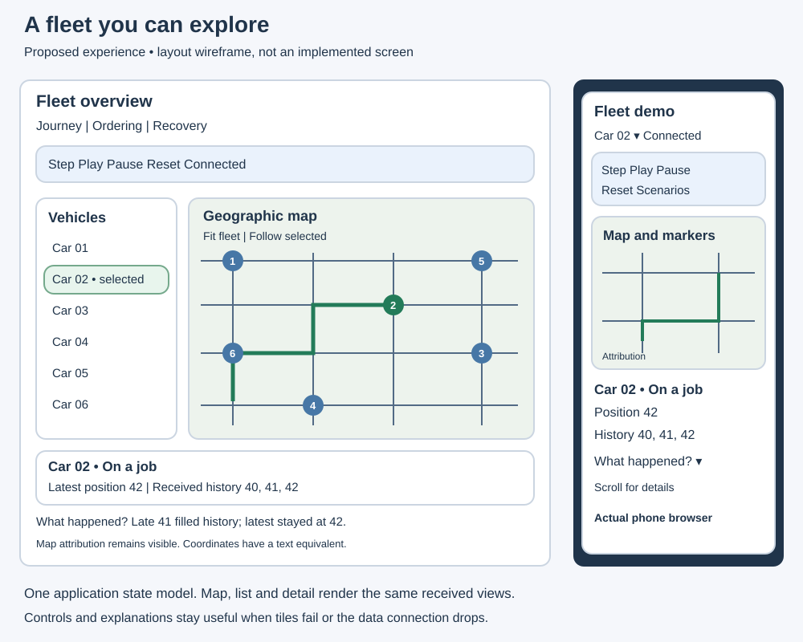
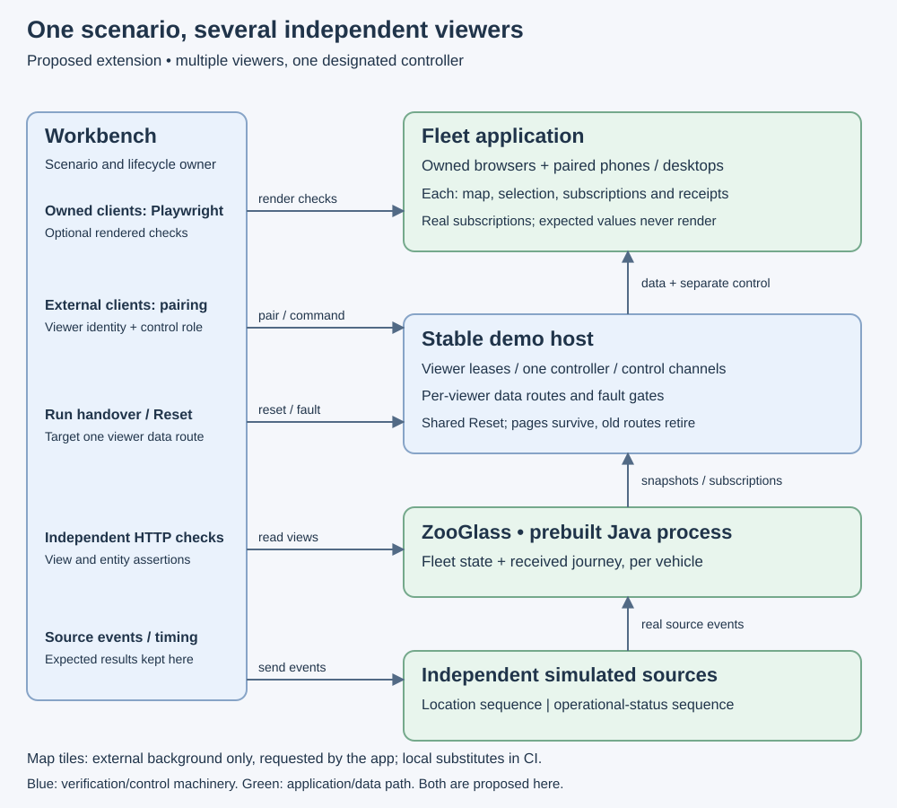

# Vehicle fleet demo

Status: design accepted in [PR #78](https://github.com/sproates/zooglass/pull/78).
The existing single-vehicle demo is delivered; this document describes the next
experience, not capabilities already implemented. The first
[fleet contract scenario](../../incubator/workbench/docs/fleet-contracts.md)
establishes three entities and independent feeds. The programme branch now adds
a text-based fleet browser with local selection, independent received state and
manual reconnect/reset. Map integration adds a Gibraltar background, received
markers and selected history. Fit/follow and map failure handling are merged on
the programme branch; [map acceptance](../verification/2026-10-27-fleet-map.md)
merged in PR #84, with location pointers added in PR #85. The
[host lifetime foundation](../../incubator/workbench/docs/browser-lifetime.md) is
proposed for review; network viewers and the longer six-vehicle scenarios remain pending.

## What someone should be able to do

Open the demo on a laptop or directly on a phone on the same network. See a small
fleet on a geographic map, select a vehicle, inspect its received journey and
operational status, and understand what changes when an update is late or the
viewer loses its connection. Workbench supplies repeatable scenarios and controls;
ZooGlass supplies the application state. This should feel like a usable fleet
viewer with an inspectable demonstration mode, not a test log with a map attached.

The proposed finished scope is six synthetic vehicles, each with a finite route
of about sixty positions over roughly five minutes of scenario time, plus a
separate operational-status feed. Start delivery with three vehicles, but retain
the complete experience as the target. This is not a scale benchmark.

### The experience

- A fleet list shows each vehicle's name, latest received position and operational
  status. Selecting a row or marker selects the same vehicle in every panel.
- The map shows all received latest positions and the selected vehicle's received
  route. Fit fleet and Follow selected are explicit controls. User panning turns
  off follow mode; updates must not repeatedly drag the map away from the user.
- Detail shows coordinates, source sequence, received history and status such as
  available, on a job or returning. These labels are simulated operational facts,
  not inferred from motion or implemented dispatch/payment workflows.
- One designated controller has Step, Play, Pause and Reset; other viewers see
  playback state and their viewer role. Selection and map navigation stay local
  to each device. Scenario selection explains the
  behaviour about to be demonstrated. Changing scenario creates a fresh run;
  it never mixes one fixture's state with another's.
- An expandable “What happened?” panel separates source sends, actual receipts
  and checks. The main screen gives a concise explanation; technical detail is
  available without dominating ordinary exploration.
- On a phone, controls and selection stay usable above a map and stacked detail.
  Touch, keyboard, visible focus, text alternatives and 200% text enlargement
  are acceptance requirements. No hover-only interaction or colour-only status.

Use received coordinates only. Do not invent movement through interpolation,
map matching or directions services. A line between positions illustrates the
received history, not a verified road journey. Use deliberately authored synthetic
coordinates in one compact real geographic area; explain their synthetic origin.

## What this should establish

The demo should make three kinds of reuse visible: different views of one feed,
independent fields contributed by different feeds, and the same rules applied to
several entities. Adding a new vehicle or supported source contribution should
not require a vehicle-specific change to ZooGlass's core.

| Demonstration | Expected observation |
| --- | --- |
| Ordinary fleet movement | Vehicles advance independently. Selecting one does not stop the rest or change their server state. |
| Late position and duplicate | One vehicle's history acquires a delayed position while its latest marker stays ahead. An identical duplicate adds no history entry after a processing barrier. Other vehicles retain their own state. |
| Independent status feed | Status changes while location does not, and location changes without overwriting status. Both arrive through the real service. |
| Deliberate viewer disconnect | All retained values are labelled accordingly. Sources continue; reconnect receives the first current snapshot for every desired view/entity pair before later events can conceal stale recovery. |
| Unexpected data interruption | The proxy breaks the actual route, rejects at least one retry, and lets sources advance. Restoring only the route permits bounded client recovery. Control remains available. |
| Quiet location source | A selected location stops changing while status continues. The UI reports receipt age and observed values, without claiming the source is healthy, stale or complete. This makes the missing freshness contract visible. |
| Reset or scenario change | Old data, receipts and commands cannot affect the replacement run. A fresh viewer starts waiting for real snapshots. |

Recovery fixtures first establish a snapshot for each required view/entity pair
and wait for those receipts before the fault. After restoration, recovery waits
for every desired pair, not merely the selected vehicle. An intentionally
unpopulated pair stays waiting and must be declared as such in its fixture,
rather than being silently counted as recovered.

Keep journey, ordering, deliberate recovery and unexpected loss as named finite
scenarios. Use a dedicated short fault sequence so a five-minute presentation
does not depend on leaving a thirty-second recovery window open. Manual source
or connection interventions mark exploration and invalidate affected scripted
checks explicitly; they never turn an unverified result into a passing scenario.

## Views and application responsibilities

Use an explicit demo manifest for known vehicle IDs, display names and scenario
choices. It may contain descriptive metadata, but not current coordinates,
status or history used to populate the screen. No wildcard subscription or fleet
discovery API is implied.

For each vehicle, propose two views:

| View | Fields and policy |
| --- | --- |
| Fleet state | `position` from the location feed, using `latestBySequence`; `operation` from a separate status feed, using its own `latestBySequence` field policy and sequence domain. |
| Received journey | Location payloads using `historyBySequence`. |

Both sources use the same canonical vehicle ID in this fixture. This is explicit
source preparation, not a relationship/join capability. Equal-sequence changed
payloads remain first-accepted duplicates, not corrections. Status gets its own
numeric ordering domain so a late status cannot regress it, without sharing the
location sequence counter.

Initially subscribe to both views for every manifest vehicle: twelve subscriptions
for six vehicles on one viewer connection. Selection changes presentation only.
Keep state keyed by `(viewId, entityId)` and reject unknown pairs. No duplicate
subscription on selection, reset or reconnect. Missing data stays visibly waiting;
an empty history snapshot is distinct from no snapshot. Fleet-state fields can
reflect different source times, and the two views are not an atomic pair.

This bounded subscription set avoids introducing entity discovery or dynamic
subscription churn merely to draw a small fleet. Revisit selective subscriptions
before increasing fleet size materially. Histories remain finite because the
service's history retention is unbounded and updates send full snapshots.

Move the existing hard-coded vehicle binding and renderer towards small modules
for fleet state, selection, map presentation and detail. Keep transport/recovery
independent of Leaflet and vehicle IDs. Do not introduce a plugin framework or a
new frontend framework as part of this design. Update source maps as those
responsibilities actually change; the current maps describe current code.

## Map choice and failure behaviour

Propose Leaflet, bundled locally with the demo, and a configurable raster tile
source. It supports markers, polylines and touch maps without requiring a provider
account. The first human-facing local demo can use the standard OpenStreetMap
raster endpoint; a publicly hosted or heavily used demo needs a separate provider
decision. See the [Leaflet guide](https://leafletjs.com/examples/quick-start/).

The tile source supplies the background only. Coordinates, status and paths still
come from ZooGlass. Show attribution persistently. Honour normal browser caching,
use HTTPS tiles and an origin-only cross-origin referrer, and do not prefetch or
bulk-download areas. Provider availability is best-effort; the service can change
or restrict access. Keep the URL and attribution configurable. These choices
follow the [OSMF tile policy](https://operations.osmfoundation.org/policies/tiles/),
reviewed 27 October 2026; recheck it at implementation.

Tests must use local synthetic tiles or intercept requests; automated browsers
must never sweep the public tile service. No offline map download feature is
planned. If tiles fail, preserve coordinates, list, history, selection and controls,
and show “Map background unavailable”. Loss of tiles must not be reported as a
ZooGlass disconnection. Automated correctness does not depend on map availability.

## Direct phone access and multiple viewers

Retain local owned-browser mode for scripted verification. Add an explicit
external-browser mode that binds the demo host to a selected local network
interface and prints a pairing link. Default remains loopback. The phone loads
and runs the actual app and opens its own data and control WebSockets; no remote
screenshots or browser-control port are exposed.

The application host and the owned-browser launcher need separate lifetimes.
An external page must keep its URL and control connection across Reset, while
Workbench replaces the ZooGlass session, data route and run identity. The app
clears old state on a run-change handshake and acknowledges readiness before
scenario actions resume. The old data socket is closed; stale run messages and
queued commands are rejected. Owned-browser mode can retain its current fresh
page behaviour. Keep this as ordinary session composition, not a generic host
plugin system.

Proposed external-session rules:

- Multiple browsers may view the same run simultaneously, including a phone and
  a desktop. Each has its own identity, selection, subscriptions, receipt state
  and data route. One viewer disconnecting does not disconnect the others.
- One designated controller owns shared playback, scenario changes, Reset and
  fault controls. The terminal assigns or explicitly transfers that role and
  can revoke a viewer. Transfer removes the previous controller's authority;
  the host checks authority on every command, including queued commands.
  Observers cannot obtain it by sending controller-shaped messages.
- Issue a separate high-entropy, single-use pairing secret for each viewer in
  the URL fragment, consume it for registration and remove it from history.
  Subsequent access uses a viewer-scoped session capability; the controller role
  is assigned separately. Invalidate credentials on unpair/exit. Reset rotates
  run/data-route identities without requiring people to pair again.
- Admit only the configured Host and exact allowed Origin; check both on socket
  upgrades and control requests. Serve an exact asset allowlist, with bounded
  messages and no filesystem or arbitrary URL proxy. Keep ZooGlass on loopback.
- Make pairing expire if unused, propose five minutes. Refresh can resume the
  same viewer lease using session-scoped credentials, but cannot create a second
  active connection under that identity. Another device pairs as another viewer.
- An observer's control-channel loss marks only that viewer disconnected; other
  viewers and source dispatch continue. Controller loss pauses shared playback
  until explicit terminal handover or recovery. Loss of a client required by a
  scripted check marks that check interrupted, never passed; restart the run
  before claiming a complete scripted verification.
- Phone backgrounding or Wi-Fi loss can drop control as well as data. That is not
  a successful controlled data-fault test. Returning viewers attach to the current
  run and receive fresh snapshots, rather than reviving an obsolete run.
- Limit this mode to synthetic data on a trusted local network. Plain local HTTP
  is not confidential transport. This pairing mechanism is demo-host access,
  not the required ZooGlass application authorisation model or internet hosting.

Fault controls name the target viewer. Each viewer has a separate data proxy
route and fault gate; interrupting one leaves its control channel, other viewers
and sources running. Workbench evidence is keyed by `(clientId, viewId, entityId)`.
Every viewer maintains its own twelve subscriptions; one client's receipts cannot
stand in for another's recovery. Selection never changes another device's display.

Reset is shared. Serialise it with other controller commands, announce the new
run to every connected viewer, retire every old data route and collect readiness
acknowledgements with a bounded timeout. An unready observer is detached and may
rejoin the current run; it cannot block everyone indefinitely. An unready required
verification client interrupts the scripted run. Ignore late acknowledgements
and old-run commands. Viewer admission and role changes during scripted runs
must not silently change the declared set of required verification clients.

The host's current `no-referrer` policy and restrictive image/style CSP need a
narrow app-specific change for map tiles and Leaflet styling. Pairing secrets
must never be in tile URLs, referrers or logs. Use fragment/session credentials,
`strict-origin-when-cross-origin`, and an explicit configured tile-origin policy;
do not weaken host checks or enable arbitrary scripts. Test these headers and
cross-origin rejection. No paid service or public tunnel is selected.

## Verification remains separate from presentation

Workbench continues to own scenario time, source actions, connections, fault
control, reset and one overall outcome. Service and client-receipt assertions
establish view semantics; a browser model is useful for inspection but is not
independent proof of received values. Expected fixture values never populate app
state. Optional demo observers check rendering without moving UI testing into
Workbench's core.

Owned-browser runs must independently check marker identity/location, selected
history, status fields, retained-state labels and mobile layout. Use local tiles.
External-phone runs can execute HTTP and receipt checks, but cannot claim a
Playwright rendering pass. Their outcome must name the checks actually run and
mark visual inspection manual/unverified. Follow with a real iPhone/Safari
walkthrough; a desktop WebKit run is complementary evidence, not an iPhone test.

Test multiple entities, source isolation, late status and location, duplicates,
first snapshots on reconnect, per-view waiting states and old-run rejection.
Use two concurrent real browser clients to check independent selection and
receipts: interrupt one data route while the other continues receiving, then
check every required pair's first recovery snapshot for the interrupted viewer.
For the host, test wrong/absent tokens, wrong Origin/Host, reused pairing secrets,
expired pairing, refresh, observer/controller loss and reset across both pages.
Check observer command rejection, explicit controller transfer and revocation of
old authority, plus bounded readiness and stale-run rejection for returning clients.
Retain existing core, lifecycle and three-engine checks. Do not put map-provider
availability or every visual variation on the critical path of every small PR.

## Incremental delivery

Each increment leaves a usable result and includes relevant tests, docs and source
map updates. These are delivery boundaries, not a promise of one PR per row.

| Increment | Usable result | Acceptance boundary |
| --- | --- | --- |
| Fleet state and selection | Three vehicles, shared field policies, selected detail and text/schematic display; preserve the existing short fixtures. | Real entity isolation and independent status/location updates; state keyed by view/entity; selection cannot mix vehicles. |
| Geographic map | Bundled Leaflet, real background, all markers, selected history, fit/follow controls and responsive text alternative. | Actual received coordinates; keyboard/touch/reflow; tile failures leave the demo useful; CI uses local tiles. |
| Direct network viewers | Explicit bind/pair command, simultaneous phone/desktop apps, one controller and stable host across Reset. | Independent selections, targeted fault isolation, role enforcement, shared Reset, refresh/background loss and a real iPhone alongside another viewer. |
| Scenario experience | Six vehicles and fuller finite routes, named demonstrations, concise explanations and expandable evidence. | Late/duplicate/source-quiet/recovery cases independently checked; short fault run respects its deadline. |
| Acceptance and value review | Documented desktop/phone walkthrough, screenshots/recording and an application-work comparison. | Reproducible setup/cleanup, claims reconciled, evidence linked and remaining gaps visible. |

The network host lifecycle is the largest change and may need two focused PRs:
separate host/browser ownership first, then viewer pairing, control ownership and shared reset. Split further if needed
to keep viewer isolation and its verification reviewable.
Do not make the map or the richer presentation wait for a broad client framework.

## Demonstrating value and deciding what follows

Record what was needed to add the status feed, a vehicle and another supported
view: definitions, source translation, app binding, server changes and checks.
Compare those responsibilities with a minimal custom-service design offering the
same in-memory semantics. Do not inflate the alternative with durable storage or
permissions ZooGlass does not yet supply, or turn line counts into hours saved.
Core edits required merely to add a domain example count as an adoption gap.

The first version does not add source freshness guarantees, revision corrections,
durable replay, production retention, external fleet adapters, dispatch optimisation
or application authorisation. Keep the [authorisation requirement](../requirements/authorisation.md)
visible. If real protected data or external users enter scope, revisit that
boundary before deployment. Design freshness next around an explicit source-quiet
case; receipt age alone does not establish source progress or completeness.

Review should confirm the proposed six-vehicle target and map choice, the
network lifecycle before implementation.
Direct phone access and simultaneous viewers with one controller are requirements; the mechanisms above are the proposed way
to fulfil them. The [existing architecture guide](../diagrams/README.md) remains the
canonical explanation of the implemented system; these new diagrams describe
this proposed extension only.
