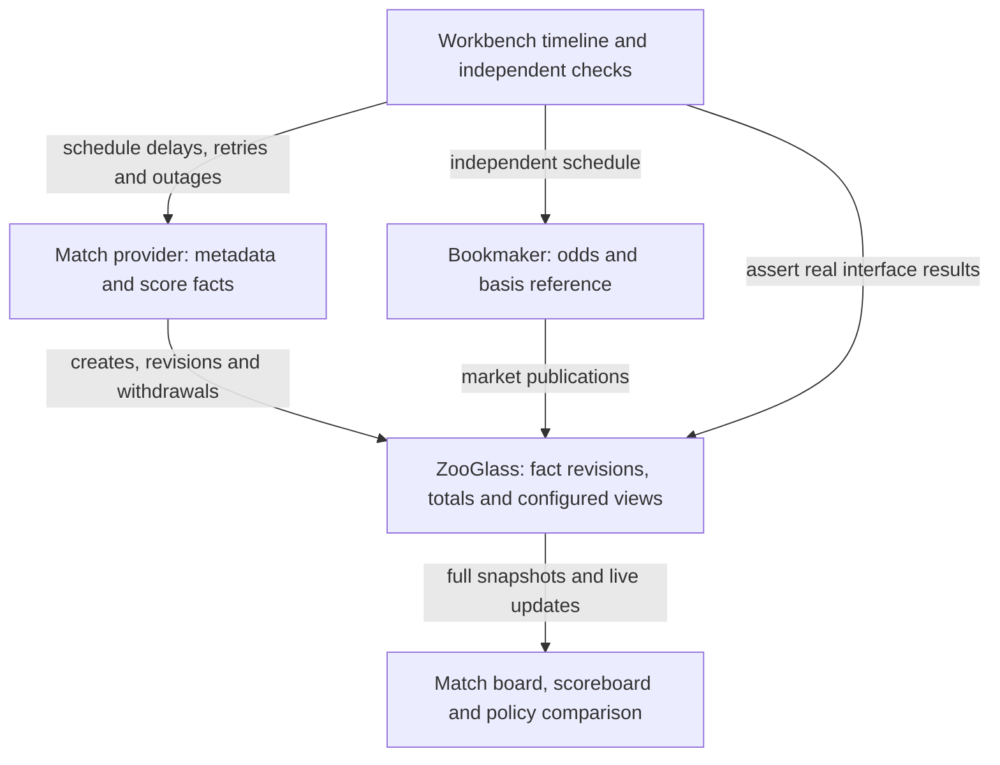

# Live sports: detailed demo design

Status: accepted design, 10 November 2026 (PR #155). Sports follows delivery of both Order modes.
Source foundation is delivered on the shared branch (PR #164); see the
[source guide](../../workbench/docs/sports-sources.md) for commands and verification.
Continuous browser integration is proposed for review; interactive delivery remains pending.
This replaces the Sports scope in the [original outline](order-and-sports-demos.md).
The existing sports JSON scenario and Java match acceptance tests are useful
fixtures, not a delivered sports application.

## What this makes easier

A sports screen combines a match provider's evolving account with a bookmaker's
independent market. A goal may be corrected or disallowed after publication. The
score, goal list and other views must respond consistently without each consumer
implementing its own revision ledger and score projection.

ZooGlass retains the facts, applies the configured revision policy, recalculates
totals and publishes the resulting snapshots. The bookmaker still owns pricing
and suspension decisions. ZooGlass does not calculate odds or infer that a market
is safe to trade because its score matches a feed.

The demo uses three fictional football matches with compressed clocks. It is a
sports-data demonstration, with no wagering, money or real data integration.

## Three demos, materially different configurations

| Demo | Distinct configuration choices | What the viewer can observe |
| --- | --- | --- |
| Fleet, delivered | `latestBySequence` for continuous positions; interactive fleet also uses `historyBySequence` | A delayed position does not move the latest marker backwards; received history and current position are different views of updates. |
| Order, delivered on the shared delivery branch | `lookupEntity`, multi-source `sourcePriority`, `requireContributions`, contiguous progress and `receiptAge` | Different service identifiers combine into one order; authority, missing contributions and stale information are explicit. |
| Sports, planned here | `activeFacts`, `sumActiveFacts`, `latestFactRevision` versus `firstFact`, explicit fact retirement | Correcting or withdrawing a fact changes both the goal list and score; another view can retain the first report from the same input. |

Each demo also exercises common snapshot delivery and reconnect behaviour. That
overlap provides continuity; the different configured strategies provide the
showcase. Do not claim fleet already exposes the newer progress/freshness metadata.

## Experience and early acceptance

A [clickable fixture prototype](../../demos/live-sports/README.md) was visually accepted on
12 November 2026. The continuous browser now binds that layout to live snapshots;
see the [live guide](../../demos/live-sports/README.md).

The primary screen is a compact live match board. All three scorelines are visible
on desktop; the first match is immediately visible on a phone. Selecting a match
shows its goal list and current market. Put controls and technical detail below
the domain content. Use ordinary HTML/CSS, restrained transitions and clear text
labels, not a canvas-heavy broadcast simulation.

Show three fictional pairings: Harbour Athletic versus Hilltown, Riverside versus
Northbridge, and Westfield versus Kingsford. Stagger goals, reviews and bookmaker
responses so the board remains active. Team names and scores should dominate;
short notices explain “Goal withdrawn: score recalculated” or “Market references
an earlier feed boundary”. Disclose source identifiers, revisions and policies on
request, rather than making them the whole screen.

The first Sports delivery slice is a clickable static prototype. Show desktop
and phone layouts, selected-match detail, the scoreboard-only view, corrected
versus first-reported comparison, stale/disconnected states and both control
layouts. Use representative fixtures and label it a prototype; no ZooGlass
instance is required. Serve a working LAN preview and retain its source in the
repo. Obtain explicit project-owner acceptance, including corrections, before
live UI implementation. Keep screenshots and layout notes as the reference.
This is visual design acceptance, not mandatory physical-phone qualification.

Planned commands from `workbench/`, using the explicitly prepared service JAR:

```sh
npm run demo -- live-sports --continuous
npm run demo -- live-sports --interactive
```

Require exactly one mode and preserve the other demo commands. Continuous mode
runs automatically, approximately three minutes per synthetic match cycle, with
no playback controls. Viewers can join or leave without affecting the simulation.
Interactive mode exposes the existing Step/Play/Pause/Reset and Help/Quit controls
through the prepared-checkpoint adapter delivered for Order. Its finite run keeps
results visible at completion. Reset creates a fresh run/store; Ctrl+C and Quit
clean up owned processes and files. No implicit Maven builds during either run.

## Responsibilities and reuse



Put source schedules and payload builders in `workbench/src/demos/sports/` and
presentation in `demos/live-sports/`. Reuse Order's typed runtime configuration
launcher, full-snapshot transport, receipt assertions, prepared checkpoints and
hosting where actually delivered. Shared execution modules must not import either
domain. Preserve existing scenario coverage. No plugin registry, new session
manager or generic UI component framework is needed.

The consumer receives `data`, `status`, `provenance`, `publicationSequences` and
`version`. Render supplied totals, never sum goal records in the UI. Presentation
may filter non-goal baseline records from a goal list and compare explicit market
basis metadata. Those are named application rules, not replacement projections.

## Sources and views

Use canonical entities `match-1` through `match-3` for both sources, with
`envelopeEntity` mapping. Sources are `match-feed` and `bookmaker`, each with epoch
`run` for the fresh store. Sequences increase independently per source/entity
across all its event types; synthetic cycle changes never reset identity.

| Source/type | Content |
| --- | --- |
| `match-feed` / `match.state` | cycle, teams, period, simulatedClock, scoreWindowStart, observedAt |
| `match-feed` / `home.contribution` | fact envelope; payload kind, cycle, scorer, minute, points |
| `match-feed` / `away.contribution` | same grammar for the away score |
| `bookmaker` / `market.state` | cycle, status, decimal odds for home/draw/away, basedOnMatchSequence, observedAt |

Match metadata does not contain an authoritative score. Each real goal contributes
one point; a scorer correction changes the full payload but not its points. At
kick-off, the source publishes one zero-point `kind: "baseline"` fact for each
side, with no scorer/minute. This establishes a source-declared 0–0; before those
facts arrive, display “awaiting score”, not an invented zero. Goal facts use
`kind: "goal"`. Separate home/away event types avoid unsupported filtered sums.
Changing which side scored requires a retract and a new create, which is not an
atomic cross-publication correction and is outside this first demo's scenes.

All views are installed before any facts arrive; new views do not backfill.

| View | Fields | Revision policy |
| --- | --- | --- |
| `match-market` | match, market, homeGoals, awayGoals, homeScore, awayScore | `latestFactRevision` on all four fact fields |
| `scoreboard` | match, homeScore, awayScore | `latestFactRevision` |
| `first-reported` | match, homeGoals, awayGoals, homeScore, awayScore | `firstFact` on all four fact fields |

The comparison panel labels `first-reported` clearly as a different policy, not an
alternative current score. Both policy views receive the same source publications.
`scoreboard` demonstrates a smaller view without bookmaker input. Do not derive
that view by filtering the match-board client model.

`match` and `market` use `latestBySequence`. `market` alone uses `receiptAge` with
`staleAfterMillis: 15000`. Goal silence does not mean a match feed is stale, so do
not apply receipt-age freshness to the goal lists or sums. All views use
`publishPartial`; absent fields remain absent until their first contribution.

For a home-goal list and its score, use this field recipe; substitute the away
type for away fields, and `firstFact` for the comparison view:

```json
{
  "homeGoals": {
    "sourceId": "match-feed", "type": "home.contribution", "mode": "activeFacts",
    "facts": {"revision": "latestFactRevision", "maxRetainedFacts": 16, "minimumBirthSequence": 1}
  },
  "homeScore": {
    "sourceId": "match-feed", "type": "home.contribution", "mode": "sumActiveFacts",
    "property": "points",
    "facts": {"revision": "latestFactRevision", "maxRetainedFacts": 16, "minimumBirthSequence": 1}
  }
}
```

Declare contiguous source progress starting at 1, with 16 received and missing
ranges for each source. Use `acceptLate` for every field. Configure SQLite storage,
`maxStreams: 16`, `identityWindow: 128` and `maxHistoryEntries: 64`. The six source
streams and three fixed view entities remain bounded. Match metadata, goals and
revisions share one match sequence, not a counter per event type.

A real goal example:

```json
{
  "sourceId": "match-feed", "epoch": "run", "sourceEntityId": "match-1",
  "publicationSequence": 4, "type": "home.contribution",
  "fact": {"birthSequence": 4, "revision": 1, "operation": "create"},
  "payload": {"kind": "goal", "cycle": 1, "scorer": "Alex Vale", "minute": 12, "points": 1}
}
```

Create has birth equal to publication sequence and revision 1. Revise/retract use
a later publication sequence, the same birth/type and a higher revision. A revise
is a full replacement; retract carries `{}`. Every receipt assertion distinguishes
whole-publication admission from per-target/per-field rejection. A revision can
commit in corrected views while `first-reported` reports `factImmutable`.
See [fact collections](../../zooglass/docs/fact-collections.md) and
[source progress](../../zooglass/docs/source-progress.md) for the exact contracts.

## Finite checkpoints and independent expectations

For match-1, use these initial match-feed sequences. Bookmaker sequences belong to
its own stream. Pause unrelated match-1 metadata at named checkpoints so expected
values and market basis are unambiguous; other matches can continue.

| Checkpoint | Delivery | Expected result |
| --- | --- | --- |
| Kick-off | 1 metadata, 2 home baseline, 3 away baseline | Corrected and first-reported views reach 0–0. Missing scores before their baselines are visible. |
| Goal | 4 creates home goal birth 4, revision 1, scorer Alex | All score views show 1–0; both goal-list views show Alex. List and total change in the same installed snapshot. |
| Revision before create | Reserve 5 for a second home goal; deliver 6 revising birth 5 first | Whole publication rejects `unknownFact`; no identity/progress or view change for 6. |
| Retry after dependency | Deliver create 5, then exact retry 6 correcting scorer Sam to Taylor | Corrected views show 2–0 and Taylor; first-reported shows 2–0 and Sam. Target outcomes differ by policy. |
| Withdraw first goal | Withhold 7 (revision 2 of birth 4); deliver 8 retracting birth 4 at revision 3 | Corrected score is 1–0 and goal Alex disappears; first-reported stays 2–0. Gap 7 is provisional. |
| Late obsolete correction | Deliver 7, before watermark | Corrected fields reject `obsoleteRevision`; first-fact fields reject `factImmutable`. The publication commits progress, gap closes, and no goal reappears. |
| Exact duplicate | Retry 8 with identical metadata/payload | Duplicate receipt; no additional withdrawal or score change. |
| Independent market | Market based on match sequence 6 remains while withdrawal 8 arrives; later update references 8 | UI distinguishes earlier basis from source progress while preserving bookmaker's own open/suspended status. Market update does not change score. |
| Bookmaker outage | Disconnect its socket and withhold reports over 15 seconds | Market becomes stale while match publications continue. Reconnection alone does not refresh it; a new accepted update does. |
| Missing report | First cycle only: skip bookmaker sequence 2, deliver 3, watermark through 3 | Latest odds remain usable as last reported; missing 2 becomes confirmed. Do not equate complete delivery with correct pricing. |
| Returning viewer | Disconnect, advance sources, then reconnect while publications are paused | First subscribed snapshots replace old state, including corrected scores and missing/stale metadata. |
| New cycle | Finish match, retire old births in every fact view, then publish new baselines | Old goals cannot affect the new cycle; selected windows and synthetic cycle labels remain explicit. |

Use a normal goal in the away stream and varied later scores for the other matches.
Keep the same correction mechanism, rather than building three independent engines.
Hand-author expected values and field outcomes; do not generate assertions by
running the production reducer or summing its output. Use receipts, observed
snapshots and bounded waits, not timing guesses. An accepted status-only update
may change snapshot version while the score is unchanged.

`basedOnMatchSequence` is an explicit bookmaker assertion about a match-feed
publication. Compare it with `status.inputs.match-feed.observedThrough` and require matching
cycles. This is the source progress boundary, including declared watermarks, not
a claim that every publication arrived. Show any gaps alongside the basis. A lower
basis means “earlier feed boundary”, not proof of an incorrect price. A higher
basis is “feed basis beyond known progress”; equal basis is not a synchronised
transaction guarantee. Fact projections do not populate `publicationSequences`,
so do not attempt to obtain their revision-publication sequence from that map. Keep odds and market status in one bookmaker payload.

## Infinite mode and retirement

Allocate sequences as publications are scheduled, including deliberately omitted
messages. No cycle-number multiplication or silent sequence resets. Complete the
withheld revision before advancing the watermark, so the normal repeating scene
does not accumulate broken source promises. Only the first cycle permanently loses
a bookmaker report. Later cycles repeat delays, duplicates, corrections and outages;
otherwise isolated permanent gaps would eventually exhaust the range bounds.

Limit each match cycle to two baseline facts and at most six goals. Corrections
reuse births; tombstones still count towards retention. At cycle end, pause that
match's producer and drain scheduled/retry work. Send `/facts/retire` for each view,
using the next match-feed sequence as the new minimum birth. In `match-market` and
`first-reported`, name all four fact fields; in `scoreboard`, name both sums. They
share the same source and mapping, so each view's retirement is atomic.

Require `committed`, or `unchanged` for an exact same-floor retry, from every view.
Check the echoed view/entity/field control and the returned floor for every named
field against the requested boundary. Receiving a reply alone is not success:
`rejected`, `failed`, an unexpected floor or a timeout keeps that match's producer
paused and reports a visible scenario failure. Do not publish next-cycle metadata,
baselines or goals after partial success. Other matches may continue.

A lost acknowledgement may be retried with the identical retirement control and
boundary, using a bounded retry. Successful views need no rollback; an equal-floor
retry is safe. Proceed only once every view has a verified result. Persistent
failure leaves the checkpoint failed until Reset or termination, rather than
silently advancing the timeline.

Retirement spans one view, not all views together. Show an explicit cycle-transition
state while windows differ; do not claim cross-view atomicity. Preserve the last
match metadata's cycle until new metadata arrives, and label old market data as
previous-cycle. Empty fact fields stay present with zero totals after retirement;
zero alone does not establish the next cycle's score.

Include `scoreWindowStart` in match metadata: 1 for the initial cycle, then the
verified retirement boundary for each new cycle. The source publishes new metadata,
then both zero-point baselines, before any goals for that cycle. In each displayed
view, require both score fields' `status.fields.<field>.facts.minimumBirthSequence`
to equal that metadata boundary and both `activeCount` values to be greater than
zero before presenting a current scoreline. The baseline stays active throughout
the cycle, so this also permits a genuine 0–0 after all goals are withdrawn.

If floors disagree with metadata, show a cycle transition. If floors match but
either count is zero, show “awaiting score”, even if the sums already contain zero.
Apply the rule to the scoreboard-only view too; it needs no goal payloads or client
score calculation. A new subscriber derives the same state from its own complete
snapshot, without relying on having watched the transition.

Acceptance must inspect each view after retirement, after new metadata, after
only the home baseline and after both baselines. Only the last checkpoint exposes
the new 0–0. Check a late subscriber at the intermediate checkpoints and a later
withdrawal of all goals, where the surviving baselines still establish a valid zero.

Also force one retirement to reject after another view has committed, and assert
that no next-cycle publications occur and the failure is visible. Separately lose
a committed control's acknowledgement: retry the exact control, accept verified
`unchanged` floors, and complete the remaining views before resuming. These checks
belong to source-foundation acceptance; browser acceptance checks the transition
and awaiting-score labels using those same intermediate states.

A fresh delayed publication correcting a retired birth must receive
`factOutsideRetention`. A retained exact duplicate can still return its old receipt
without restoring the fact. Include both in finite acceptance. Keep controls and
retry assertions within their intended publication-retention window.

Bound notices to 20 and pending delayed envelopes to a fixed per-match list. Verify
at least three accelerated cycles and a soak exceeding the 128-identity window:
retained facts, tombstones, received/missing ranges, entities and queues must stay
within the configured limits. Keep database and identities owned by the run using
Order's lifecycle support. General producer-process recovery and automatic service
restart every cycle are not part of this demo.

## Verification and delivery slices

The first four slices depend on accepted Order design and its delivered shared
capabilities. Do not implement Sports against speculative helper APIs; if Order
exposes a mismatch, update this plan explicitly rather than starting a new framework.

1. **UI prototype and acceptance:** static fixture-driven board, scoreboard,
   policy comparison, status states and both modes; LAN preview and explicit owner
   acceptance. No live runtime connection.
2. **Sports source foundation:** complete configuration fixture accepted by the
   real service; three match schedules across two source clients,
   fact create/revise/retract, target receipt assertions, bounded retirement and
   all finite table rows except Returning viewer. Check cycle-boundary snapshots
   through independent service clients, not a browser.
3. **Continuous sports board:** advertised working command, full-snapshot bindings,
   domain-first presentation, independent scoreboard subscription, policy comparison,
   late/returning viewers and cleanup. Own Returning viewer acceptance, stale
   rendering, phase labels and status-only updates. Keep interactive command hidden
   until usable.
4. **Interactive sports walkthrough:** shared prepared checkpoints and controls,
   Step assertions, Pause during a pending check, Reset cancellation and repeat,
   retained final state and failure reporting. Both modes use the same envelopes
   and view definitions; compare their equivalent first-cycle deliveries.
5. **Acceptance and developer-value explanation:** clean setup of both commands,
   independent bounded soak, screenshots, source map and evidence linking actual
   configuration choices to the work removed from the application.

Core fact/recovery acceptance already exists in
`MatchCorrectionAcceptanceTests`; it does not replace scenario acceptance. Reuse
its independent expected outcomes where appropriate without importing production
fixtures as the oracle. Do not rerun broad crash/authorisation qualification for a
presentation-only change. Source behaviour is primarily verified with real socket
clients; small browser tests check rendering, reconnect replacement and controls.

Select and document the supported modern browser baseline during prototype/live
UI delivery. Inspect desktop and phone-width rendering; no owner-operated phone
sign-off, exhaustive device suspension tests or new browser orchestration.

The final guide must point to the exact view configurations and consumer bindings,
show the same goal publication producing different policy outcomes, and explain
what adding another match changes versus adding another view. No invented savings
or claims that the browser is processing a real sporting feed.

## Deferred work and capability gaps

No new core strategy is assumed. The shared source publication helper will need to
carry fact metadata and assert field outcomes; the scenario runner will need a
fact-retirement action. Put these focused additions alongside the existing typed
publication/control support and preserve Order/vehicle callers. This is integration
work, not a plugin or strategy framework.

Deferred: real sports adapters, pricing engines, wagering, cross-feed causal
barriers, filtered aggregate expressions, atomic team reassignment, persistent
producer restart, dynamic scenario editing and additional access UI. Order owns
the explicit protected-access scene; Sports does not repeat it merely for coverage.
If the concrete configuration fails an existing contract, identify that gap before
expanding this programme.
