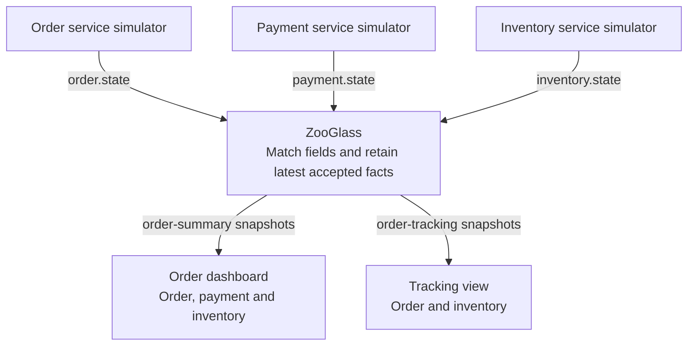
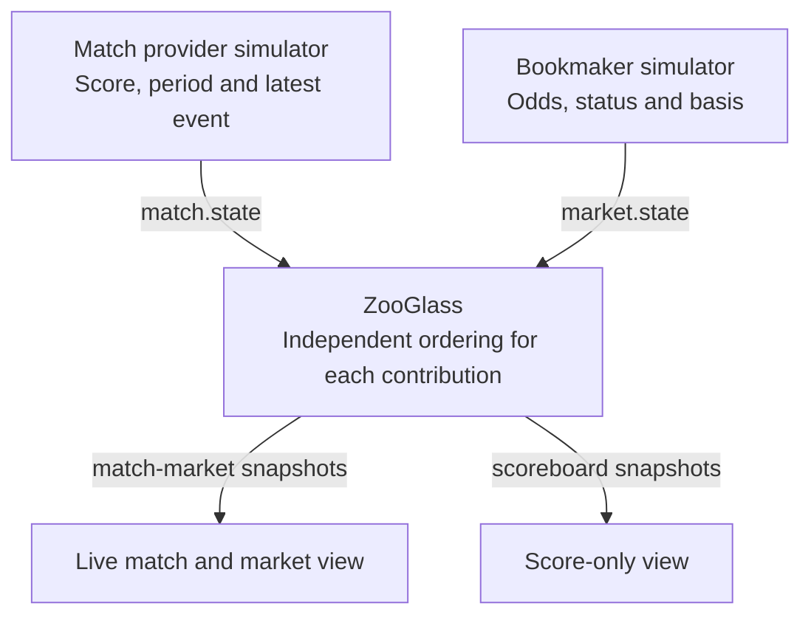

# Order tracking, then live sports

Status: accepted design. Delivery order agreed: order tracking first, then sports.
Neither browser demo described here is implemented yet. The existing small
[order](../../workbench/scenarios/order-fulfilment-live-order.json) and
[sports](../../workbench/scenarios/sports-betting-live-market.json) scenarios are
service-level starting points.

## What we are making easier

A useful screen often needs facts owned by several services. Without a maintained
view, an application team must route those events, retain each contribution,
handle ordering, build snapshots and deliver changes to its clients. The two
demos should make that repeated work visible, then show which parts ZooGlass
already supplies.

The claim we want to demonstrate is concrete:

> Define the contributions to a view, publish events, and subscribe to the
> resulting state. The application does not need its own projection store or
> a separate subscription service for every screen.

| Application concern | Work delegated to ZooGlass | Evidence the demo must provide |
| --- | --- | --- |
| Combine independent sources | Match source/type to fields and retain their values by entity. | Payment can update while order and inventory values remain intact; scores can update while market data remains unchanged. |
| Keep a delayed event from replacing a newer fact | Apply `latestBySequence` to each configured field/entity. | Deliver sequence 12 before 11 and verify that the browser still displays 12 without a client-side sequence reducer. |
| Open a screen after activity has begun | Supply the current snapshot on subscription. | A new client sees the combined state without waiting for each source to report again. |
| Recover a disconnected screen | Supply current snapshots when the client resubscribes. | Sources advance while the viewer is offline; its first recovery snapshots match the service, even when no later events arrive. |
| Offer another view of the same events | Configure another set of fields and subscribe to it. | A second, smaller view works without another Java projection implementation or another producer. |

The application still owns source adapters, shared entity IDs, event semantics,
view definitions, browser connection/retry behaviour, rendering and domain rules.
ZooGlass composes currently accepted facts; it does not make independently
reported facts an atomic business transaction. The
[developer-value comparison](../developer-value.md) is the baseline for these
claims. We will add evidence from each demo, not estimates of hours saved.

## Two experiences for each domain

Orders and sports each provide the same pair of experiences as cars. The two
modes demonstrate the same source/view contracts and reuse domain event builders,
view definitions and rendering wherever practical.

| Mode | Purpose | Behaviour |
| --- | --- | --- |
| Interactive | Inspect why the view changes at particular checkpoints. | A finite scenario with existing Workbench Step, Play, Pause and Reset controls, expected-state checks and a brief explanation of each checkpoint. |
| Continuous (infinite) | Watch the application handling imperfect delivery over time. | Automatic repeating activity and faults until Ctrl+C, ordinary viewer URL, no playback controls or pairing. Simulation lifetime is independent of viewers. |

The first screen should show the actual orders or matches, with a single short
sentence explaining the benefit. Interactive controls should be compact; the
continuous page has none. Keep technical details below the main display or behind
a small “How this view is built” disclosure. Selection is a viewing interaction
in both modes. Simulator notices must be labelled as such; they are not ZooGlass
detecting a lost event.

### Interactive behaviour

Reuse the existing Workbench controller, playback, reset and browser bridge.
Step advances a meaningful checkpoint and waits for its checks. Play follows the
finite timeline; Pause stops future scheduled activity using existing semantics.
The run stops at its final checkpoint, retains the result for inspection and does
not loop automatically. Reset starts a fresh isolated scenario and service state.
Help explains the available controls and the next checkpoint in plain language.

Use the existing owned-browser/terminal flow for interactive inspection. Bind the
new page and domain-specific assertions to it; do not import vehicle composition
or add pairing, controller handover or session-management features. Reusing the
controls is part of the demo, not a new browser-orchestration programme.
Interactive and continuous runs are separately launched and own separate state;
no live mode-switching is required.

### Continuous behaviour

Open an ordinary URL and see useful activity immediately. Several independent
viewers can come and go while simulation and faults continue. Reuse the existing
optional private-LAN bind argument. Closing every browser does not stop the run.
There is no end-of-scenario stop or manual restart between cycles.

Use synthetic data and existing local HTTP/WebSocket hosting for both modes.
Phone-width layout is worth checking; manual phone sign-off and physical-device
qualification are not delivery gates. No external source credentials, paid APIs
or real orders, payments or betting are involved. No scenario editor is required.

Proposed launch commands, after the existing setup and service preparation:

```sh
cd workbench
npm run demo -- order-tracker --interactive
npm run demo -- order-tracker --continuous
npm run demo -- live-sports --interactive
npm run demo -- live-sports --continuous
```

Require exactly one mode flag; missing or conflicting modes print clear usage.
`--continuous` is infinite mode. Both modes stop cleanly on Ctrl+C; interactive
also retains the existing Quit command. These are planned commands, not commands
available today. Existing vehicle commands remain supported. The launcher adds
explicit cases for the two domains; no plugin system is needed.

## Order tracking

### What the viewer sees

Proposed starting size: six synthetic orders, staggered so the screen always
contains progress and a useful contrast. A compact list shows order details,
order status, payment and inventory side by side. Selecting a row exposes the
received facts and their source labels. The list remains useful without opening
the explanation panel or scrolling through a control dashboard.

The opening scene should make the value obvious: one order is accepted and paid
but inventory is still unknown; another has all three contributions; a third
has a declined payment. Unknown must not be rendered as a failure or success.
There is no “ready to ship” inference in ZooGlass. If an overall business label
is later wanted, it needs an explicit application-owned rule or an authoritative
source event, with that ownership documented.

### Source and view contract

Use three real source sockets, with independent delivery schedules. The synthetic
world decides domain events; the delivery schedule decides what reaches ZooGlass.
For example, inventory can genuinely have been reserved before packing even when
its report arrives after the order's packed report.

| Source | Event type | Field in `order-summary` | Example payload facts |
| --- | --- | --- | --- |
| `orders` | `order.state` | `order` | Sequence, cycle, observation time, reference, items, accepted/packing/dispatched/cancelled status |
| `payments` | `payment.state` | `payment` | Sequence, cycle, observation time, pending/authorised/declined/refunded status |
| `inventory` | `inventory.state` | `inventory` | Sequence, cycle, observation time, checking/reserved/unavailable status |

Every field uses `latestBySequence` on `sequence`. Counters are independent per
source/entity and never compared across fields. The simulator supplies the same
`entityId` to related contributions; ZooGlass does not discover relationships
between an order ID, payment ID and inventory reservation ID.

Define a second view, `order-tracking`, containing `order` and `inventory` only,
at service startup. A small second rendering or documented viewer mode consumes
that view directly. It demonstrates reuse of inputs for another presentation,
not access control: this is no substitute for the outstanding authorisation work.



### Scenes for both modes

1. Normal activity establishes separate contributions for several orders.
2. Payment arrives while inventory is missing. The combined view remains useful
   and the missing contribution remains explicit.
3. A late inventory report fills the gap without changing order/payment fields.
4. Deliver an older order update after dispatch, then duplicate the latest one.
   Dispatch remains visible; neither payment nor inventory regresses.
5. Permanently drop an intermediate payment report. A later full payment state
   supersedes it; the missing event is not reconstructed or claimed as received.
6. Disconnect the inventory source while order/payment updates continue, then
   reconnect it and publish its latest full state. No client-side feed assembly
   is involved in catching up the affected fields.

Interactive checkpoints expose each of these scenes with expected-state checks.
Continuous mode staggers scenes across orders. A roughly two-minute cycle is a starting pacing
choice, to be tuned once the experience is visible. Do not add a controls system
just to tune fixture timing.

## Live sports

Sports follows acceptance of both order-demo modes. It reuses proven composition and viewer
lifecycle behaviour, then shows why different fields can change at different
rates and why corrections must be interpreted carefully.

### What the viewer sees

Proposed starting size: three fictional football matches with compressed simulated
time, score, period and a market panel. The fixture announces that it is a
simulation; a three-minute match cycle is a starting presentation choice, not a
claim to model real bookmaker behaviour. No betting actions or odds calculation.

A goal changes the score while the market contribution initially retains its
previous state. Market suspension and revised odds arrive from the bookmaker
source. The viewer must show that temporary mismatch honestly rather than imply
ZooGlass has made the two feeds agree.

### Source and view contract

| Source | Event type | Field in `match-market` | Example payload facts |
| --- | --- | --- | --- |
| `match-feed` | `match.state` | `match` | Sequence, cycle, observation time, teams, score, period, simulated clock and most recent match event |
| `bookmaker` | `market.state` | `market` | Sequence, cycle, observation time, open/suspended/closed status, odds and `basedOnMatchSequence` |

Both fields use `latestBySequence`. Put odds and market status in the same
bookmaker payload so their own publication is one accepted contribution. The
match and bookmaker counters are independent. `basedOnMatchSequence` is an
explicit synthetic source assertion, not a sequence comparison performed by
ZooGlass or an inferred causal relationship.

A second `scoreboard` view contains the match field only. Define it at startup
and demonstrate a score-only rendering from that subscription. It should receive
the same accepted match facts without importing a second sports projection into
the Java service.



### Scenes for both modes

1. Match and market sources update at different rates across three matches.
2. A goal is reported. The market still references an earlier match sequence:
   display “market based on earlier match update” as an application interpretation
   of the supplied basis, without claiming the service suspended the market.
3. The bookmaker publishes suspension and then an open market based on the new
   match sequence. Its own authoritative status remains visible throughout.
4. Delay an older market publication until after its replacement and duplicate a
   match report. The latest accepted contributions remain unchanged.
5. Simulate a disallowed goal by publishing a lower score with a higher match
   sequence. The score legitimately decreases. Deliver the older pre-correction
   report later and verify it cannot undo that replacement.
6. Silence or disconnect the bookmaker while match updates continue, then publish
   current market state after reconnection. Also omit one intermediate update
   permanently to demonstrate snapshot recovery rather than message replay.

The disallowed-goal scene demonstrates replacement by a newer source publication.
It does not implement historical retraction, correction propagation, event-time
recomputation or a general revision model. Avoid presenting it as those features.

## Infinite mode, interactive runs and bounded verification

Both domains require an interactive finite run and a separate continuous infinite
run. Tests bound the continuous runner by cycle count and accelerate its timing;
this test facility does not replace the user-facing interactive demo. Share event
meaning and view definitions across the two runners, with independent test
expectations rather than two unrelated domain implementations.

Acceptance checks that continuous activity and injected faults continue across at
least three cycles, including with no viewers, and that stopping releases owned
sources and service. Interactive acceptance covers Step completion, Play/Pause,
end-of-run state, Reset and a repeat run, plus failure reporting and cleanup.

The continuous modes run with bounded state. Use fixed demonstration
slots (six order entities and three match entities), latest-value fields and a
small capped activity display. Do not continually create new entity IDs or use
unbounded `historyBySequence` to support an endless animation.

Each source payload carries a `cycle` identifier. These slots replay synthetic
stories, rather than claiming that a dispatched real order becomes accepted
again or a finished real match restarts. Show the demo cycle explicitly. Per-field
sequences keep increasing across cycles and reconnects; they never reset while
the service retains state. Flush bounded delayed-delivery queues at a cycle
boundary, while deliberately tested old-cycle deliveries must still be harmless.

At a cycle boundary, independently retained fields may describe different cycles.
The client labels a contribution from an older cycle as “previous demo cycle”
until replaced. It must not silently present old payment or odds as belonging to
the new story. Cycle interpretation is a demo presentation rule, not a cross-field
transaction guarantee from ZooGlass. A late subscriber must see the same honest
mixed-cycle state as an already connected viewer.

Show each contribution's last observation time or age. “Not received”, “last
reported” and “viewer disconnected” are distinct states. A quiet source is not
necessarily unhealthy, and reconnecting the browser does not make its data fresh.
Retained facts remain visible during a viewer outage with a disconnected label.
No source-health, completeness, durable recovery or permission guarantee is added
by these demos.

## Reuse and implementation boundaries

| Existing piece | Intended use |
| --- | --- |
| ZooGlass field matching, sequence policies, snapshots and subscriptions | Reuse without domain-specific Java branches. New behaviour must be identified as a product gap rather than hidden in a demo. |
| Order and sports JSON scenarios | Keep their existing coverage; add explicit ordering and failure fixtures for the new contracts. The existing arrival-based fixtures do not already prove sequence rejection. |
| Workbench service ownership, sockets, HTTP host and data route | Compose real producers and passive viewers with existing cleanup and private-LAN binding. |
| Interactive vehicle demo | Reuse shared controller/bridge behaviour through explicit domain bindings, keeping vehicle-specific code separate. |
| Continuous vehicle demo | Use its separation of simulation lifetime and viewers as a reference. Do not import vehicle composition into either new demo. |
| Existing client connection code | Reuse narrowly where it is domain-independent. Extract a small shared client module only if both demos need the same code; retain direct-import checks and avoid a public SDK project. |

Put producer/scenario composition in `workbench/src/demos/orders/` and
`workbench/src/demos/sports/`. Use separate root components `order-tracker/` and
`live-sports/` for the browser apps, with `pages/`, `src/` and `docs/` groupings.
A component README explains its purpose and entry point. Extend build/lint/test
paths and CI filters alongside the files; keep standard checks independent of
browser binaries and core verification independent of demo assets.

Shared extraction must follow an actual repeated responsibility. Do not introduce
plugins, a generic scenario editor, an orchestration framework, a production client
SDK, a broker or a database as a prerequisite. Existing vehicle demos must continue
to work. Maintain source maps as concrete modules are added or moved.

## Delivery slices and acceptance

Deliver the complete order example before implementing sports. Each row is a
reviewable slice with a visible or independently inspectable result. Aim for one
PR per row; split only when implementation evidence justifies it. Allow roughly
three to four implementation PRs for each domain, after this design PR.
Split the browser slice into continuous and interactive delivery if needed; both
are required before that domain is accepted. These are planning
estimates, not a promise to combine unrelated changes to meet a count.

| Slice | Deliverable | Completion evidence |
| --- | --- | --- |
| Order sources and views | Three independent sources, six bounded slots, two view definitions, shared event contracts, finite checkpoints, continuous schedule and fault cases. | Node clients through real ZooGlass verify partial composition, independent ordering, duplicates, permanent omission, source recovery and cycle boundaries against explicit expectations. |
| Order browser experience | Readable order dashboard and smaller tracking view, continuous passive viewers, interactive Workbench controls and retained/unknown state. | Browser checks confirm displayed service snapshots, selection, late subscription and reconnect; verify Step/Play/Pause, final state and Reset/repeat; inspect desktop and phone-width presentation. |
| Order acceptance and developer value | Fresh-start guide for both modes, representative screenshots, evidence map and concrete account of application code removed and still needed. | All claims map to evidence; repeat at least three accelerated cycles, verify bounded IDs/queues and cleanup, demonstrate first recovery snapshots with no following events. |
| Sports sources and views | Two independent providers, three matches, scoreboard and market views, newer-publication score correction, finite checkpoints, continuous delivery and all fault cases. | Independent service checks cover field isolation, market basis, correction followed by old delivery, source recovery and cycle boundaries. |
| Sports browser experience | Automatic match board, second scoreboard view, honest market mismatch/age labels, continuous viewers and interactive Workbench controls. | Rendered checks show accepted score/market facts and their limits, including a legitimate score decrease and recovery. Verify interactive checkpoint completion and Reset/repeat. Inspect desktop and phone-width presentation. |
| Sports acceptance and developer value | Fresh-start guide for both modes, screenshots, evidence map and comparison with the order example. | Repeat the bounded-cycle and recovery checks; show the same service handling both domains through definitions, with any required core changes explicitly accounted for. |

For each demo, verify the domain contract primarily through independent Node
clients and real ZooGlass. Use a few browser tests for the binding, rendering and
recovery. Expected results must not be calculated with the production reducer or
producer helper. Test lost/duplicate events using processing barriers, not a
sleep followed by an assumption. Keep resource and cross-platform coverage within
the existing CI structure; do not repeat every full suite in every job.

The acceptance guide must answer a concrete change request: add another known
entity, add a source contribution, and define another view. Identify the exact
configuration, adapter and UI changes required. Exercise the second view already
specified here and record whether it needs any ZooGlass core change. Runtime view
creation sees future events only; no demo may claim backfill.

Do not claim ease from an attractive screen alone. The result should make it easy
to point to the view definition, the thin consumer and the service behaviour that
replaces bespoke projection and delivery code. A custom service remains a fair
alternative, and this work does not measure adoption effort or performance at scale.

## Deferred work

Authorisation remains required and follows these demos in the selected order;
its design and implementation are not prerequisites for synthetic local data.
General freshness/progress contracts, durable state, retention APIs, historical
correction propagation, automatic entity discovery, real payment/bookmaker
integrations and physical-phone qualification remain separate work.
