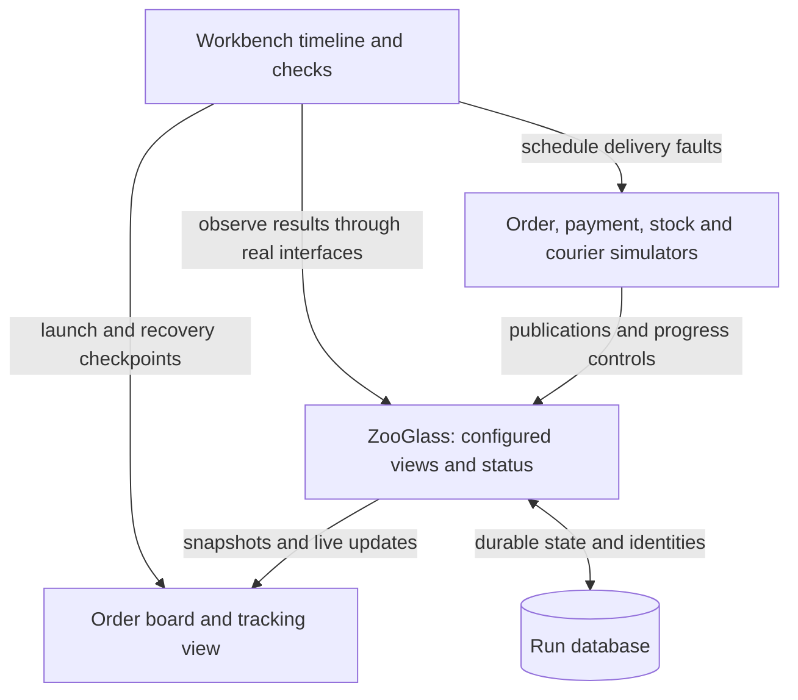

# Order tracker: detailed demo design

Status: proposed refresh, 10 November 2026. The source-only order simulator exists;
this document specifies the remaining work. It supersedes the Order details in
[the original two-demo plan](order-and-sports-demos.md). Sports retains its outline
pending its own detailed refresh.

## What this demonstrates

Six orders progress through payment, stock allocation and delivery. Independent
services report at different times, use different identifiers and occasionally
send late, repeated or missing messages. ZooGlass maintains the configured views;
the application displays their values and status.

The application does not implement a projection database, merge source updates,
compare unrelated source sequences, detect reporting gaps or reconstruct state
for a returning viewer. It supplies source adapters, relationships, policy choices,
access decisions and the presentation. Payment approval and fulfilment decisions
remain source-owned business rules, not conclusions inferred by ZooGlass.

The main experience is an order board, not a scenario console. A visitor should
see orders progressing immediately and understand one visible discrepancy without
opening a technical panel.

## Experience and commands

From `workbench/`, after the existing explicit service preparation step:

```sh
npm run demo -- order-tracker --continuous
npm run demo -- order-tracker --interactive
```

These commands are planned, not available yet. Require exactly one mode. Preserve
vehicle commands while moving command dispatch out of the vehicle-specific entry
point. Launch the prepared JAR; do not compile Java during scenario execution.

**Continuous:** six fixed slots, staggered activity, approximately two minutes per
cycle. No playback controls, pairing or viewer-dependent simulation lifetime.
Joining late shows current snapshots; closing every browser leaves the run going.
Ctrl+C closes owned processes, sockets and temporary data.

**Interactive:** a finite version of the same delivery scenes. Reuse Step, Play,
Pause, Reset and terminal Help/Quit. Each step waits for an observable checkpoint.
The final state remains visible. Reset starts a fresh service/store and producer
identities; it does not replay sequence 1 into the old store.

Keep the board above explanations at desktop and phone widths. On narrow screens,
use compact order cards, with the first orders visible immediately. Each card has
an order reference, payment, stock and delivery values, plus short missing/stale
labels. Selection opens detail below or beside the board. Never put a long control
or explanation panel ahead of the orders.

Use a bounded activity strip such as “Order 2: older dispatch report ignored”.
Label it **Simulated delivery events**: these notices come from Workbench, while
values, provenance, gaps and freshness come from ZooGlass. Do not present simulator
knowledge as runtime diagnostics. Technical detail is an optional disclosure.

## Components and ownership



The UI lives in `demos/order-tracker/`. Scenario data, source clients and independent
checkpoint expectations live in `workbench/src/demos/orders/`. Shared Workbench
modules own process lifecycle, transport and existing playback. They must not
import order business rules. ZooGlass needs no order-specific Java code.

## Sources, identities and payloads

Canonical entities are `order-1` through `order-6`. Declare all sources and views
before publishing. Use one configured epoch per fresh run. Each source/entity has
its own strictly increasing publication sequence, preserved across a service
restart. Never compare a payment sequence with an order or courier sequence.

| Source | Original entity for slot N | Event type | Payload |
| --- | --- | --- | --- |
| `orders` | `order-N` | `order.state` | cycle, reference, items, status, observedAt |
| `payments` | `payment-N` | `payment.state` | cycle, status, observedAt |
| `inventory` | `reservation-N` | `inventory.state` | cycle, status, observedAt |
| `courier-primary` | `shipment-N` | `delivery.state` | cycle, status, observedAt |
| `courier-backup` | `tracking-N` | `delivery.state` | cycle, status, observedAt |

Retain existing order/payment/inventory payload conventions. Add courier statuses
`collected`, `inTransit` and `delivered`. Use source-owned cancellation/refund and
stock-unavailable paths for variety. No real customers, addresses or credentials.

Example publication for the first payment contribution:

```json
{
  "sourceId": "payments", "epoch": "run", "sourceEntityId": "payment-1",
  "publicationSequence": 1, "type": "payment.state",
  "payload": {"cycle": 1, "status": "authorised", "observedAt": 1794300000000}
}
```

`publicationSequence`, not a payload field, controls ordering and identity.
Duplicates resend the exact envelope and payload, including timestamps. Inspect
all receipts; an unexpected rejection or processing failure fails the run.
Intentional omissions never enter a socket, but do consume the source's sequence.

## View configuration

Use the existing runtime configuration grammar directly. Add a typed configuration
option to the service launcher, mutually exclusive with its legacy scenario-view
option. Leave existing callers unchanged. Runtime validation remains authoritative;
do not invent another strategy DSL or duplicate strategy implementations.

| View | Fields and policy | Purpose |
| --- | --- | --- |
| `order-summary` | order, payment, inventory, delivery; `publishPartial` | Operations board exposes partial information honestly. |
| `order-tracking` | order, inventory, delivery; require order and inventory | Tracking panel waits for its required contributions; payment is absent by definition. |

For each view, orders use `envelopeEntity`. Other used sources use `lookupEntity`,
with the six exact pairs from the table above mapped to `order-N`. Tracking must
not declare the unused payments source in its entity mapping. Unknown keys must
produce an explicit target rejection, not an inferred relationship.

Every field uses `latestBySequence` and `acceptLate`. Delivery has two inputs of
type `delivery.state`, with `sourcePriority` ranking primary before backup. Apply
`receiptAge` with `staleAfterMillis: 15000` to inventory and delivery. Tracking uses
`requireContributions` with `fields: ["order", "inventory"]` and
`maxPendingEntities: 6`. Payment approval is not a required-field condition.

Declare contiguous progress for orders, payments and inventory, starting at 1,
with 64 received and missing ranges. Leave courier progress untracked: its scene
illustrates priority, not gaps. A later backup sequence must never outrank a lower
primary sequence. A stale primary remains selected; there is no automatic fallback.

Use a run-owned SQLite database to exercise persistence, with `maxStreams: 64`,
`identityWindow: 128` and `maxHistoryEntries: 64`. Latest fields retain one candidate
per source; no history or fact collection is needed. Capacity and wire formats
follow [publications](../../zooglass/docs/publications.md),
[source progress](../../zooglass/docs/source-progress.md) and
[storage](../../zooglass/docs/sqlite-storage.md).

## Scenes and expected results

The first four scenes adapt the existing schedule. Later scenes add capabilities
that the original demo could not show. Spread scenes across slots, with normal
activity elsewhere; do not make every order fail identically.

| Scene | Deliberate input | Observable result |
| --- | --- | --- |
| Partial order | order-1 and payment-1 arrive before reservation-1 | Summary exposes order/payment; tracking reports waiting with empty data/provenance. Inventory releases tracking's combined values. |
| Late order | Order sequence 3 dispatched arrives before sequence 2 packing | Dispatch stays selected. The provisional gap closes when 2 arrives; a version change for status is allowed. |
| Duplicate | Retry the exact dispatched publication | Duplicate receipt; no additional value change. |
| Lost payment | Skip payment sequence 2, deliver 3, then watermark through 3 | Latest payment is 3; gap 2 changes from provisional to confirmed. Newer state does not repair missing delivery. |
| Independent failure | Close inventory's socket and withhold reports for over 15 seconds | Orders/payment continue; stock becomes stale from receipt age. Reconnection alone does not refresh it; a new accepted stock update does. |
| Competing couriers | Backup sequence 20 arrives, then primary 1, then backup 21 | Backup wins initially, then primary wins and remains selected. Provenance identifies the winner; no cross-source sequence comparison. |
| Silence without failure inference | Withhold primary while backup reports | Primary delivery becomes stale, with its last value retained. UI says last reported, not confirmed current or automatically failed. |
| Unknown relationship | Send payment for an unmapped key | Rejected target, no accidental order row. Expected rejection is recorded explicitly. |
| Returning viewer | Disconnect a client, advance sources, reconnect while sources are paused | First subscribed snapshots contain the current state; the client replaces its old model without replaying missed messages. |
| Service recovery | Pause producers, close service, restart against the same database | Connected viewer sees loss; restored baseline agrees on values/provenance/progress. Age status may advance with elapsed time. Retry the last committed publication and receive duplicate. |

Checkpoint expectations are hand-authored, independent of the producer and
ZooGlass reducers. Compare values and status separately; do not assume an ignored
value means an unchanged snapshot version. Wait for receipts and observable status,
not arbitrary sleeps. Freshness tests use bounded polling around the real timer.

Service recovery is an interactive terminal checkpoint and automated acceptance
case, not a service restart every continuous cycle. Keep producers alive across
that controlled restart so their next identities and exact retry payload survive.
Restarting the producer itself against an existing store is not supported by this
demo; fail clearly rather than silently reusing identities with different content.

## Repetition and bounded state

Keep six slots and mappings fixed. Each source allocates contiguous sequences for
actual scheduled publications, including intentional losses; remove the old
`cycle * 10` spacing on tracked streams, which would manufacture extra gaps.
Watermarks cover only the concluded part of each source/entity schedule. Delayed
publications intended to close a provisional gap arrive before that boundary.

Introduce the permanent payment loss once, in the first cycle for order-2. Keep
that gap visible as later cycles progress; repeat delays, duplicates and outages,
not permanent isolated losses. The runtime retains separated received ranges even
when old gaps expire, so losing a new isolated event every cycle would eventually
hit `progressLimit`. This schedule needs only a fixed number of ranges. Expiry
changes the gap label, not the fact that delivery was incomplete. The finite
interactive scenario reproduces the loss on each fresh Reset.

`cycle` labels distinguish reused synthetic slots. Fields may legitimately show
different cycles. Required contributions govern first presence, not a transaction
barrier for every new cycle. Show “previous cycle” beside older contributions;
never combine them into an invented ready-to-ship conclusion. The continuous run
must visibly explain this reuse. Fresh interactive Reset restores first-presence
scenes. Track a bounded 20-entry notice list and fixed delayed-event queue.

## Access demonstration

The ordinary synthetic board uses the existing local unprotected demo mode. The
smaller tracking view is not, by itself, an authorisation boundary.

Add a separate finite **protected order access** acceptance scenario using the
existing TLS/authority fixtures and real HTTPS/WSS. One credential can view only
order-1 tracking; another can view operations. Deny order-2 and the summary view to
the first credential. Revoke its active grant while updates continue: its socket
closes within the existing access contract, displayed protected data clears, and
the operations viewer continues. A fresh authorised connection obtains a baseline.

Reuse the existing protected browser acceptance harness for that visible clear;
do not add a login product, token editor, policy server framework or certificate
installation requirement to the normal demo. Document this separately runnable
scenario and its evidence. It demonstrates application-supplied decisions enforced
by ZooGlass; it does not turn fictional customer data into a production deployment.
See [view access](../design/view-access.md).

## Verification and delivery

Reuse OT source tests, generic playback/reset, prepared-service ownership and
snapshot subscription clients. Existing `ScenarioView` conversion cannot express
mapping, multi-source priority or progress; the launcher extension is required.
Existing source-only tests assume shared IDs and sparse sequences, so update those
expectations deliberately. Keep the old simple fixtures as compatibility coverage.

Deliver these coherent PRs, each with its own evidence and current documentation:

1. **Configured source foundation:** typed runtime configuration input, distinct
   keys, both views, courier candidates, progress/freshness scenes and bounded
   repeated execution. Real-interface assertions for the table, no browser work.
2. **Continuous order board:** working command and finished domain-first UI,
   both views, late/reconnecting viewers and cleanup. Advertise this mode only
   when usable; do not expose a placeholder interactive command.
3. **Interactive order walkthrough:** finite checkpoints, existing controls,
   reset/repeat and visible outcomes. Both modes share contracts and rendering.
4. **Recovery and protected evidence:** durable service restart plus the finite
   access scenario, isolated failures and explicit test/run instructions.
5. **Acceptance and explanation:** clean setup of both commands, developer-value
   comparison, screenshots, source maps and capability coverage update.

Most correctness checks use independent clients against real ZooGlass. Browser
checks cover rendering, stale/waiting labels, reconnect replacement and protected
clearing. Inspect desktop and phone-width layouts and select/document minimum
modern browser versions during UI delivery. No physical-phone sign-off or device
suspension qualification. Keep CI scoped to affected components and avoid repeating
core strategy suites in a UI-only change.

The final acceptance includes three complete accelerated cycles, a longer bounded
soak across identity-window expiry, and fresh/reconnected viewers after publication
stops. Record entity, stream, range and queue bounds. A standalone configuration
fixture must be accepted by the real service before building the UI.

Deferred: dynamic configuration/editor, reusable UI library, live source adapters,
SSE, clustering, general producer recovery, comprehensive tracing/logging and
Sports fact-revision scenes. No new core capability is assumed. If a contract or
capacity issue prevents these scenes, report the specific gap before expanding scope.
