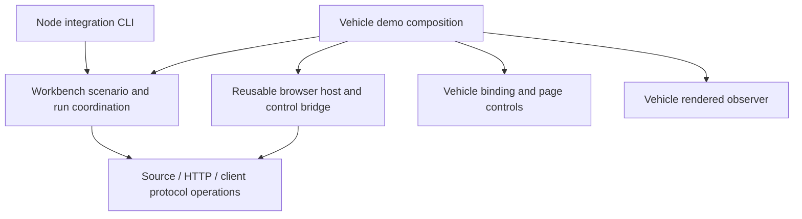

# Readability and responsibility review

Workbench should remain useful as a scenario simulator beyond the vehicle demo.
This plan makes its reusable responsibilities easier to find and keeps demo
presentation out of them. It also reviews the Java service and test code, where
ownership and control flow need to remain understandable as the project grows.

Reviewed at `0b72ce1` on 25 October 2026. This is a proposed extraction plan;
the initial inventory below describes that baseline. The service projection
extraction merged in [PR #48](https://github.com/sproates/zooglass/pull/48).
Subscription indexing and outbound writer ownership merged in
[PR #49](https://github.com/sproates/zooglass/pull/49). Scenario parsing merged in [PR #50](https://github.com/sproates/zooglass/pull/50).
HTTP view operations and pure step planning merged in
[PR #51](https://github.com/sproates/zooglass/pull/51). The controller retains
playback timing and lifecycle ownership. Host/session asset and identity
configuration merged in [PR #52](https://github.com/sproates/zooglass/pull/52).
The shared bridge, client presentation boundary and shared demo assembly merged
in PRs #53–#55. Independent core verification and the dependency/reuse review are
implemented pending review and merge. Test organisation and final acceptance remain ahead. The accepted
[verification review](../verification/2026-10-25.md) supplies the behavioural
baseline and identifies gaps that need protection before particular extractions.

## Findings in the current code

Paths in this table are relative to `incubator/`. Line counts include comments
and blank lines. They identify review targets, not limits to enforce mechanically.

| Area | Observed responsibility problem | Proposed treatment |
| --- | --- | --- |
| `zooglass/.../ViewStore.java` (256 lines) | Configuration loading/validation, matcher registration, state ownership and sequence policies share one class. | Extract configuration validation/loading and the field-update policies into small package-private collaborators. Keep view/entity state and synchronisation visibly owned by the store. |
| `zooglass/.../LiveViewBroadcaster.java` (220) | Two subscription indexes, writer registration, queueing, serialisation and failure cleanup interact under the same monitor. | Separate the subscription index and per-session outbound writer. Keep the broadcaster as coordinator, with explicit lock and callback rules. |
| `workbench/src/scenario.ts` (512) | Types, file loading, view validation, timeline parsing and reference checks coexist. `parseScenario` spans lines 224–489. | Separate model types, view parsing and timeline parsing/reference validation; retain a small public parse/load entry point. Keep errors and validation order stable. |
| `workbench/src/browser-host.ts` (343) | Generic-looking host owns vehicle assets and hardcoded `rider-app`, plus registration, control dispatch, data proxy and teardown. | Supply assets/client identity from demo composition; give registration/control and proxy routing cohesive helpers. The host remains their single lifecycle owner. |
| `workbench/browser/bridge.js` (153) | Registration, command deduplication and execution are mixed with vehicle imports, DOM selectors and button state. | Separate a browser control bridge from the vehicle bootstrap and controls. Inject the client and presentation callbacks directly. |
| `vehicle-tracker/src/vehicle-client.ts` (187) | Socket generation/acknowledgement handling calls view functions directly and validates vehicle-specific IDs. | Separate protocol state from presentation callbacks; keep vehicle restrictions in the vehicle binding. Retain the existing wire protocol and failure behaviour. |
| `workbench/src/demo-controller.ts` (354) | A single factory owns run replacement, cursor groups, manual interventions and playback timing through shared mutable state. | Extract pure step grouping and, if it simplifies ownership, a cancellable timing helper. Keep active tasks, reset and close coordination together rather than distributing the state machine. |
| `workbench/src/vehicle-observer.ts` (199) | Rendered observation, independent projection assertions and cancellation/polling occupy one large closure. | Keep this demo-specific. Separate reading the page from comparing its representation; do not import the app's projection function into expected results. |
| `workbench/src/scenario-session.ts` (204), `zooglass-session.ts` (199), `vehicle-demo.ts` (128) and `automatic-demo.ts` (113) | HTTP checks, acquisition and cleanup are readable locally but require following several nested ownership paths. Interactive/automatic demos each assemble similar resources. | Extract HTTP operations where useful and share a vehicle-run composition function. Keep explicit resource acquisition/cleanup order; avoid a general resource framework. |
| `workbench/test/sessions.test.ts` (400), `demo-controller.test.ts` (372) | Different session lifetimes and controller behaviours share files and local fixtures. | Split by scenario session vs service process, and controller replacement vs playback vs interventions. Share only small explicit fixtures/gates. |
| `workbench/test/browser/reconnection.test.ts` (287), Java `ViewFunctionalTests.java` (242) | Length mostly follows related behavioural cases; setup can obscure the action, but the grouping has a purpose. | Retain coherent groups unless extraction improves reading. Preserve independent assertions at the test site. |

Java paths above abbreviate `zooglass/src/main/java/io/zooglass/`; the functional
test is under `zooglass/src/test/java/io/zooglass/`. None of the Java files needs
splitting solely for size. The small WebSocket handlers can retain their separate
validation rules: source events are ignored on rejection, while live requests
receive errors. A shared parser must not accidentally erase that distinction.

## Boundaries to preserve and make explicit

`ScenarioSession` already executes real source actions and HTTP checks without
knowing the vehicle UI. Its client executor boundary supports Node or browser
receipts. The browser executor holds expectations in Workbench and sends only
commands to the app. Preserve these useful boundaries.

The target dependency direction is shown below. Arrows mean “uses”; they do not
represent data flow. This supplements the existing system diagrams.

The demo chooses concrete assets, client identity, allowed views/entities and
presentation. The reusable host takes that configuration explicitly, with no
vehicle defaults hidden in its implementation. The browser bridge owns command
identity, completion and transport errors; the vehicle bootstrap owns DOM updates.
Protocol callbacks report received state without requiring a DOM. The rendered
observer remains independent of the app's rendering calculations.

The demo can continue to require rendered checks for successful completion.
Core scenario execution and service/protocol verification must not require them.
Browser transport checks remain useful Workbench integration evidence even when
no visual correctness assertion is involved.

Keep one package initially, with clearly named core, browser and vehicle-demo
modules. Folder names can follow the extraction rather than forcing a rename-only
PR. Simple function arguments and composition are sufficient. There is no plugin
registry, service locator, universal event bus or second orchestration framework.

## Delivery sequence and protecting checks

Each row is a proposed focused PR boundary. Split a row further if its diff becomes
hard to review. Test fixtures needed for an extraction move with it; the later
suite tidy-up must not be a prerequisite for retaining protection.

| Slice | Concrete change | Protection required before or with the change |
| --- | --- | --- |
| Service projection | Extract configuration and field-update policies from `ViewStore`; retain store-owned maps and synchronisation. | Existing seeded reference-model, equal-sequence, functional and history tests. Add focused configuration-load/invalid-configuration checks for branches moved that lack coverage. Preserve decimal comparisons, first-accepted equal sequence, deep copies and changed-view reporting. |
| Service delivery | Extract subscription indexing and outbound writer ownership from the broadcaster. | Existing isolation, exact 128-message queue, resource cleanup and real slow-client checks. First add deterministic send/serialisation failure, stale writer failure and close-error tests for affected exception paths. Preserve acknowledgement-before-snapshot queue order and the atomic relationship between subscribe and apply. |
| Scenario and run coordination | Separate scenario model/parsing and HTTP operations; simplify step grouping/timing. Keep `ScenarioSession` and the run controller as explicit owners. | Parser/fixture tests, every-scenario execution, partial setup/cleanup tests and the six-boundary reset/close matrix. Preserve error order, cancellation-before-disposal and rejection of overlapping actions. |
| Browser and demo composition | Configure host assets/identity; separate transport bridge from vehicle controls, protocol callbacks from presentation, and share vehicle-run assembly between interactive/automatic paths. | Host origin/token/duplicate registration tests, executor generation/receipt tests, browser protocol/reconnection tests, rendered regression checks and native lifecycle jobs. Add a minimal non-vehicle host/client fixture and focused automatic-demo interruption/error checks before moving its weakly covered paths. |
| Test commands and suite clarity | Separate core protocol checks, browser transport checks and demo rendering checks; split mixed session/controller test files and retain readable fixtures. | Core command succeeds from a clean worktree with no vehicle build output or browser binaries; existing non-vehicle scenarios still use Workbench. Existing full checks remain available and CI must not silently lose cases during regrouping. |
| Final review | Review dependencies and ownership, repeat affected suites and compare coverage with the accepted baseline. | Show each boundary criterion below using imports/configuration and executed checks. Explain uncovered paths and justified larger modules; record actual counts and exclusions rather than requiring a percentage increase. |

Start with service projection. The broadcaster extraction carries more concurrency
risk and follows with its own focused review. Do not change wire formats, view
semantics, timing guarantees or command behaviour as incidental cleanup. Record
any discovered defect separately with a regression check.

For broadcaster extraction, maintain the current coordination lock until there
is a separately justified concurrency change. Writer callbacks must identify the
writer instance so an obsolete writer cannot remove its replacement. Removing a
session must clear both subscription directions and stop its queue/task. Avoid
calling blocking I/O while holding the coordination lock or introducing a reverse
lock order through new helpers.

## Verification commands and reuse evidence

`npm run test:core` now runs scenario, service and protocol checks without
`build:browser` or a browser engine. Host tests supply fixture assets, and the
four demo-specific test files live in `test/demo-unit/` with a separate command.
The full standard suite still includes both groups. CI proves the isolated core
path before building any assets, then retains the combined coverage report.

The Node integration CLI should continue to run the existing order-fulfilment,
sports-betting and other non-vehicle fixtures through the same session/executor
machinery. These already provide useful reuse evidence; a new showcase demo
would add unnecessary scope.

For the browser boundary, add a small fixture with a different client identity,
its own page/assets and no vehicle DOM. Check registration, command completion,
receipt comparison and cleanup through the configured host. Use Node WebSockets
for host-only checks and a real browser for the bridge integration check. This
fixture proves composition at the existing boundary; it does not promise support
for every consumer UI.

In an isolated checkout with no generated vehicle-tracker output, create a fresh
temporary directory and confirm it is empty. Set `PLAYWRIGHT_BROWSERS_PATH` to
that directory's absolute path for the `test:core` process and its children.
Do not leave the value unset or empty: Playwright then falls back to its default
user cache. Do not use `0`, which selects package-local browser installations.

Run `test:core` without installing browsers, then confirm the temporary directory
is still empty and no vehicle build output was created. Record the command,
exit status and both directory checks as acceptance evidence. Review the core
execution path for explicit executable paths or branded browser channels that
could bypass this directory; it must not launch a browser. This recipe passed with 95 core tests on 25 October 2026; both directory checks
passed. The [verification guide](../testing.md#independent-verification-and-reuse-evidence)
records the scope and reuse review.

Installing the npm development dependencies, including the Playwright package,
is allowed. The browser suites separately build their assets and use installed
engines. Preserve real transport checks as the primary evidence for service
behaviour, and keep demo rendering checks labelled and separately runnable.

## Acceptance criteria

- Reusable scenario, transport and lifecycle modules do not import vehicle
  presentation/observers or hardcode vehicle assets, client identity or view/entity
  IDs. A small demo composition module owns these bindings.
- The core verification command runs without building the vehicle UI or installing
  browser binaries. Browser integration and rendered-demo checks remain available,
  documented and exercised by CI where applicable.
- Vehicle protocol code reports through an explicit boundary to presentation.
  Scenario expectations never enter the application; the rendered oracle remains
  independent of production rendering calculations.
- Existing non-vehicle scenarios and the minimal browser fixture use Workbench
  coordination. Tests do not grow separate scheduling and lifecycle frameworks.
- A reader can locate state ownership, failure propagation and cleanup order.
  Splitting files must improve that reading path, not merely reduce line counts.
- Behavioural suites and required CI pass, with coverage scope and remaining gaps
  reported against the accepted baseline. Reflection-based cleanup tests may change
  with internals, but queue release, interruption and registry cleanup remain checked.

Future fault injection, automatic recovery, permissions, persistence and retention
remain separate feature work. This plan preserves space for them without claiming
that extracting modules implements those capabilities.

## Client presentation extraction

The client boundary merged in PR #54. The existing
browser build now contains a DOM-free `subscription-client.ts` and a small
`vehicle-client.ts` binding. The protocol module owns socket generations,
subscriptions, acknowledgement completion and receipt reporting. The binding
owns allowed vehicle IDs, presentation calls and the user-facing disconnect
message. No scenario expectations enter either module.

Eight focused checks use an inventory binding without a DOM. Existing browser
protocol, reconnection and rendered checks protect the vehicle binding. The
module stays in the current browser build; packaging a general client library
is outside this extraction. Shared interactive/automatic run assembly merged in PR #55,
with automatic failure paths protected before extraction.

## Shared vehicle-run extraction

`vehicle-run.ts` owns service/browser acquisition, one scenario binding and
ordered cleanup. Scenario closure is separate from full closure so visible
automatic failures retain their inspection window. The interactive controller
and automatic playback keep their existing policies and cancellation ownership.
Pending scenario setup is cancelled before cleanup waits for it to settle.

Eight controlled automatic-flow cases passed before and after the extraction.
Four ownership cases cover repeated calls, closing without a scenario, aggregated
cleanup failures and cancellation during setup. Automatic cleanup now reports all
resource cleanup errors through the same DemoCleanupError used by the interactive
controller; this is an intentional diagnostic improvement over nested finally
blocks replacing earlier cleanup errors. Real browser/CLI integration checks
remain the evidence for actual process, transport and rendering behaviour.
