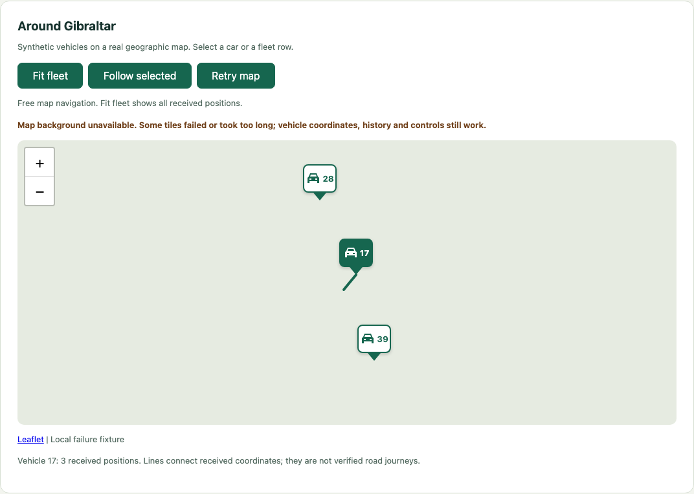

# Geographic map acceptance

This record proposes acceptance of the geographic map increment on
`feature/vehicle-fleet`, following [PR #82](https://github.com/sproates/zooglass/pull/82)
and [PR #83](https://github.com/sproates/zooglass/pull/83). Acceptance remains
pending review and merge. It does not deliver the programme to main or complete
network viewers and the longer six-vehicle scenarios.

Reviewed implementation: `3ab9f43a8b3068d2c3aa3fb5459d6324dcf7e87b`.
This change adds one provider-boundary browser check, extends touch coverage to
two-finger release, and adds a reproducible failure capture and documentation. No application behaviour or module responsibilities
change.

## Acceptance evidence

All test paths below are relative to `workbench`.

| Requirement | Evidence |
| --- | --- |
| Real geography from received coordinates | `test/browser/fleet-map.test.ts` independently projects the three fixture coordinates with Web Mercator and compares actual marker centres and SVG route vertices. It does not use Leaflet's projection API or the app model. No marker exists before a position is received. Late 41 fills the route while the latest marker remains at 42; changed-payload duplicates cannot replace accepted values. |
| Consistent local selection | The same test selects both markers and list rows, checks detail and selected route changes, and observes real socket sends/connections. Selection does not create subscriptions or replacement sockets. Reset removes old markers. |
| Fit and follow | `test/browser/fleet-map-controls.test.ts` checks fitting all markers, following real position updates and selection changes, releasing follow on mouse/keyboard panning, preserving the user's chosen view through later receipts, and fresh Reset state. |
| Keyboard and touch | The controls test selects markers with Enter and Space and checks keyboard controls. Its Chromium touch-emulation case taps a marker, drags out of follow mode and releases follow on a two-finger gesture. This is browser-engine input, not a native phone walkthrough. |
| Narrow layout and enlarged text | `test/browser/fleet-usability.test.ts` checks 1280px, 390px and 320px widths at 100% and 200% root font size. Buttons remain contained, the page has no horizontal overflow and attribution sits below the map. Captures are available in `test-results/fleet-*.png` and `test-results/map-320-200.png`. |
| Background loss is independent of data | `test/browser/fleet-map-failure.test.ts` starts with local 404 tiles, completes all real fleet steps and checks received data while the background is unavailable. Retry restores it. A separate local request stall triggers the ten-second warning; late responses restore availability without reconnecting ZooGlass. Browser clock control makes the deadline check fast. |
| Provider boundary and initial readiness | `test/browser/fleet-map-provider.test.ts` intercepts provider requests before navigation and holds them while the real fleet app registers. Requests use the expected HTTPS tile path, a browser User-Agent and an origin-only Referer. The registration fragment is removed. Releasing synthetic responses restores the background, with linked OSM attribution. This isolated host check does not start ZooGlass; the other fleet cases exercise the real service. |
| Local-only automated imagery | Programmatic sessions default to local synthetic tiles. The provider-boundary check intercepts every external request before it could reach the network. Other origins are aborted and fail its assertion. Tests do not contact public tile servers. |
| Maintainable boundaries | Camera navigation and tile availability are separate fleet modules. Workbench's shared host only admits configured HTTPS image origins; its session waits for app registration rather than optional images. Both existing source maps describe these dependencies. |

## Visual evidence

The [Gibraltar screenshot](../../demos/vehicle-tracker/docs/fleet-map.png)
was captured with real background tiles during implementation. It was retained
and reviewed for acceptance; no further public tile traffic was needed. Fresh
local-tile desktop, narrow and enlarged-text captures come from the browser suite.
These are viewport checks, not native iPhone evidence or a complete accessibility
audit.

This failure image is generated by the local 404 fixture. It is not evidence of
an actual OpenStreetMap outage. The test also checks the connection indicator,
selected detail and history outside this crop.

## Provider assumptions

The [OSMF tile policy](https://operations.osmfoundation.org/policies/tiles/) was
rechecked on 27 October 2026. Interactive runs use the prescribed HTTPS endpoint,
persistent attribution and normal browser caching. There is no prefetch or offline
map download. The provider test verifies the request referrer and attribution;
request interception changes caching behaviour, so it does not certify live
provider cache headers or availability. Those remain browser/provider behaviour.

The [map guide](../../demos/vehicle-tracker/docs/fleet-map.md) documents
configurable tile URL and attribution, the local test mode, the ten-second
presentation deadline and the distinct ZooGlass connection state. The standard
OSM endpoint is for modest human-operated local viewing here. Public or heavy
usage requires a provider decision; it has no availability guarantee.

## Verification and remaining scope

Run `npm run test:browser` from `workbench` with dependencies and the
current prebuilt ZooGlass JAR already prepared. The suite writes the captures
above without invoking Maven or contacting a public tile provider.

The reviewed programme commit passed all seven checks in
[Workbench CI run 40584131868](https://github.com/sproates/zooglass/actions/runs/40584131868).
Local acceptance ran 57 browser tests successfully, including the provider check;
the subsequently extended touch test also passed. Typecheck, lint, formatting,
whitespace and changed documentation links pass. The standard suite was not rerun
for this test/documentation-only change; baseline CI includes that coverage.

This proposes acceptance of the map's rendering, local controls and bounded failure behaviour.
It does not establish native phone access, simultaneous viewers, complete history,
atomic cross-view snapshots or road-valid journeys. The short synthetic contract
segments are not intended as a plausible driving itinerary. The fuller scenario
will use ordinary driving roads and avoid pedestrianised Main Street for its main
journeys. No road snapping or invented movement is introduced to disguise the
fixture's current limits.

Direct phone access follows as the next increment. Six vehicles and longer
journeys remain part of the later scenario increment. The final programme merge
to main stays outstanding.
