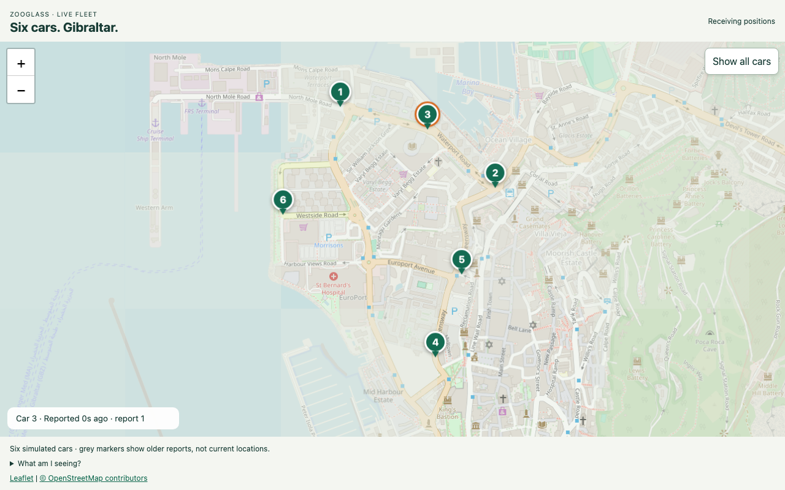

# Continuous Gibraltar demo walkthrough

This walkthrough checks that someone can start the six-car demonstration from a
fresh source tree and understand what its map shows. It covers the continuous
experience; the three-car interactive fixture remains available separately.
Programme delivery to main still requires final acceptance and merge.

## Setup and launch

On 28 October 2026, an archive of programme commit `280d095` was extracted into
an empty directory on macOS. No `node_modules`, browser output or Java build
artifacts were copied from the working checkout. Node 26.0.0 and OpenJDK 25.0.5
were already installed; the machine's npm/Maven caches were available.

From `workbench`, these commands completed successfully:

```sh
npm ci
npm run prepare:service
npm run demo -- vehicle-tracker --continuous
```

The viewer opened at the printed loopback URL in Chromium. The capture was then
repeated with this slice’s map-warning wording correction applied. No browser was launched
by the command itself. The explicit preparation produced the executable JAR;
starting and stopping the demo left its modification time unchanged. Ctrl+C shut down the run. Across the captures the npm wrapper returned either
zero or its SIGINT exit status, 130; both runs released the viewer port.
This is fresh source/dependency/build-output evidence, not a clean operating-system
installation or a test of an empty dependency cache.

## Observed behaviour

The walkthrough used the normal one-second reporting cadence and the real
OpenStreetMap background. A 1280×800 desktop viewer and a 390×744 mobile viewport
both received six markers automatically. The map was the main visible content.
Selecting Car 3 exposed its report number and observation age.

During its scheduled source outage, Car 3's last position stayed visible and became
grey and dashed. A fresh report after source reconnection restored its recent
state. Other cars continued receiving positions. The recording below preserves
normal playback speed, including the waiting period. Some provider tiles exceeded
the loading deadline during capture, so the recording also shows the independent
background warning while positions keep updating.

Closing all viewers left the simulation running. A later viewer received all six
cars. In that viewer, blocking tile requests produced the map-unavailable warning
while Car 1's accepted sequence continued advancing. Restoring tile requests and
selecting **Retry map** loaded the background without restarting the sources.
The shared warning now refers to vehicle updates and map navigation, rather than
promising history and playback controls in the continuous viewer.



[Watch or download the normal-speed recording (MP4)](../../vehicle-tracker/docs/continuous-driving.mp4).
The [guide retains its phone screenshot](../../workbench/docs/continuous-driving.md#verification).

## Supporting checks and limits

The focused browser checks `continuous-driving.test.ts` and
`fleet-map-failure.test.ts` pass against the real prebuilt service. They cover
Chromium/WebKit viewer recovery and late subscribers, plus background failure,
retry and stalled-tile recovery. Typecheck and lint also pass for the wording
change. These checks use synthetic local tiles; the walkthrough captures use the
real map provider.

Existing `continuous-delivery.test.ts` checks accepted sequences and retained
positions through two fault cycles using six real source sockets. It provides
ordering evidence which cannot be established just by watching moving markers.
`continuous-journeys.test.ts` covers route wrapping and observation-age rules.
The latest programme PR passed all seven CI jobs before this walkthrough.

The real-phone preview was reported successful by the project owner. The new
captures are desktop Chromium with a mobile viewport, not an additional physical
phone test. Exhaustive background/Wi-Fi transitions and native accessibility
acceptance are not claimed here. The original interactive multi-viewer acceptance
programme remains deferred.

Positions are synthetic and road routes illustrative. ZooGlass retains the highest
accepted sequence; it neither reconstructs lost reports nor predicts physical
location. Report-age labels are demo presentation using observation timestamps and
assume reasonably synchronised host/viewer clocks. State is in memory. Durable
recovery, product authorisation and a general source-freshness contract remain
separate requirements.

No modules were added or moved in this slice, so source-map diagrams are unchanged.
