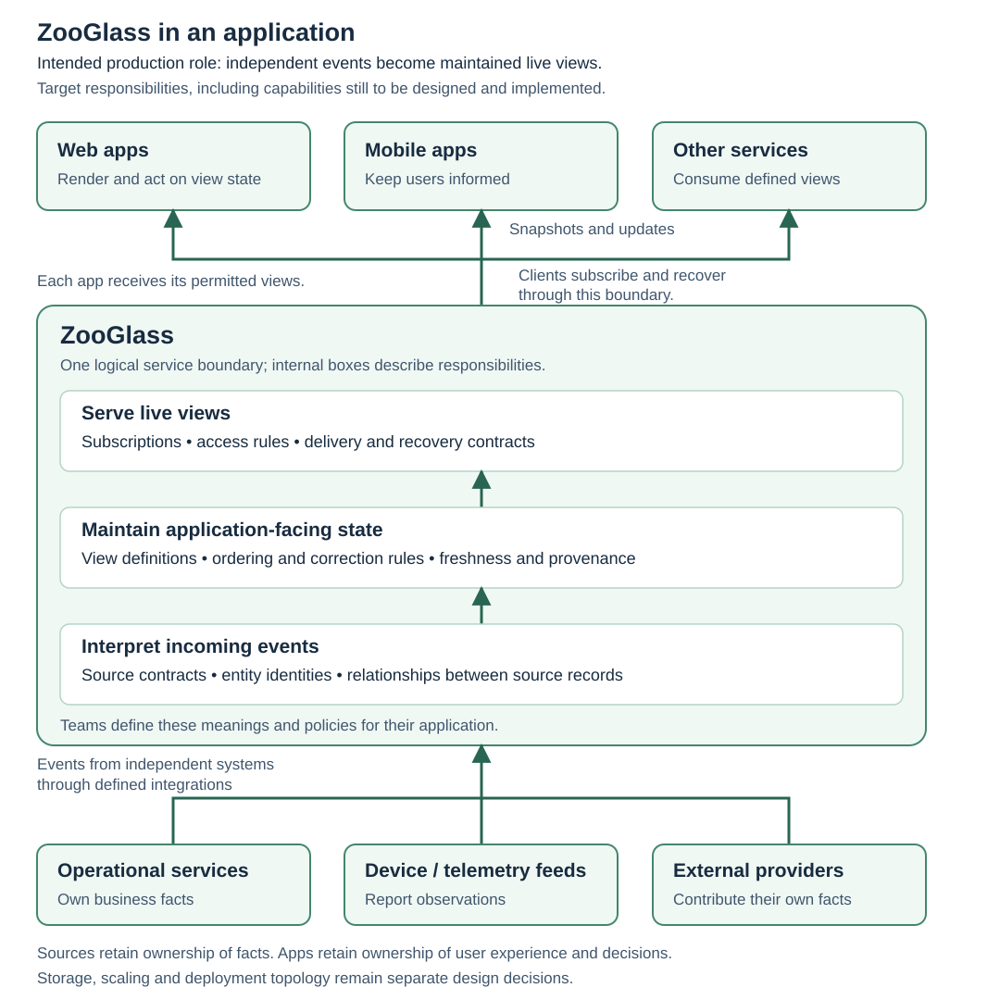

# ZooGlass: what we're trying to build

An app can have access to all the right systems and still struggle to show a
useful picture of what's happening. A trip might depend on vehicle location,
dispatch decisions and rider actions. A match view might combine scores with
odds from a separate provider. Each source changes independently, and the app
has to make sense of updates that arrive at different times.

ZooGlass is intended to be a service that maintains application-facing views
from those events and delivers changes to clients. A team would describe the
view it needs and the rules for updating it. ZooGlass would apply those rules
as information arrives, including information that arrives late, and give the
app a view it can consume without rebuilding that reconciliation itself.

The ambition is to make that whole journey practical: from independently
changing facts to a useful live application. This is the product direction.
ZooGlass is an early prototype, and the contracts and capabilities described
below are goals to work towards. The [current implementation](#where-we-are-now)
covers a small part of them.

## Where it fits

Read the stack from the bottom upwards. This is the intended role of ZooGlass in
an application serving real users. It shows logical responsibilities, including
capabilities that remain to be built. It doesn't prescribe separate deployable
services for the internal boxes, or claim that a production deployment is ready.

**The sources provide facts.** Operational services, device feeds and external
providers own the information they supply. Their event contracts would need to
say how an entity is identified, what an update means and what ordering or
revision information can be relied on. Connecting to a source doesn't establish
those meanings by itself.

**ZooGlass maintains the view.** It would relate incoming events to the relevant
entity, apply the configured update rules and maintain the state applications
subscribe to. A single source could contribute to several views, and one view
could draw on several sources. The intended product boundary includes both the
meaning of those updates and their delivery to clients.

**The app presents the result.** It would subscribe to the views it needs and
render received state. It still owns its user experience and domain decisions:
which vehicle to show, how to explain stale information, or what an operator is
allowed to do. The goal is for it to spend less effort reconstructing source
history and managing the consequences of delivery order.

The view definitions and source contracts are deliberate application choices.
ZooGlass would need enough information to relate records from different systems,
apply the right update policy and restrict access to the resulting views. Its
state storage, retention, scaling and recovery mechanisms still need their own
design. The diagram describes the product boundary without selecting that
infrastructure.

Workbench belongs to the development and verification environment described
[later in this article](#how-we-build-and-test-it). It isn't a runtime dependency
for an application serving users through ZooGlass.

## A live view has to mean something

A view is a maintained representation of the facts an application needs for a
particular purpose. Keeping the last message received is one possible rule,
but it isn't always the right one.

Suppose a vehicle produces positions numbered 40, 41 and 42, but they arrive as
40, 42, 41. Assume the sequence describes measurement order for that vehicle.
A map should keep showing position 42 when the delayed position 41 arrives.
A history view should incorporate 41 between 40 and 42. The same incoming event
has a different effect in each view because the views answer different questions.

| Arrival | Intended latest-position view | Intended received-history view |
| --- | --- | --- |
| 40 | 40 | `[40]` |
| 42 | 42 | `[40, 42]` |
| Delayed 41 | 42 | `[40, 41, 42]` |
| Another copy of 41 | 42 | `[40, 41, 42]` |

The prototype already explores these two ordering rules. The wider ambition is
to make the rules explicit, reusable and understandable at the application
boundary. The browser should receive the resulting view, rather than each client
having to invent its own interpretation of the raw arrivals.

There are several different notions of time here. A source may say when a fact
was measured. ZooGlass observes when it arrives. A client observes when a view
reaches it. An event's place in source history cannot generally be inferred from
which message arrived most recently. We want the view's contract to explain
which information determines its state.

A correction raises another question. A repeated event with the same identity
and the same content can be treated as a duplicate. A newer revision of that
fact may need to replace it and cause affected views to be recalculated. Those
need distinct rules. The prototype's sequence-based duplicate handling does not
yet define a general correction or revision model.

## The promises we want a view to make

Calling a view “live” leaves too much unstated. These are the contracts we want
to develop and demonstrate, rather than guarantees the current prototype offers.

| Question from an application | Intended promise |
| --- | --- |
| What am I looking at? | A defined view with an entity identity, named source contributions and explicit update rules. Relationships between sources must be described rather than guessed. |
| What happens when information arrives late or changes? | A stated policy for ordering, duplicates and corrections, with the resulting view delivered to subscribers. The policy may differ between views. |
| How current is this? | Enough source progress, freshness and provenance information to distinguish new information from a retained value whose source is delayed or unavailable. |
| Is the history complete? | A clear account of what is known about completeness, based on source guarantees and progress signals. Receiving a newer event alone is insufficient. |
| What happens after a disconnect? | Defined recovery behaviour: what a new snapshot contains, whether missed changes can be replayed, and when a client must start from a fresh view. |
| Who may see it? | Explicit access rules for the views and data exposed to a client. |

A joined view also needs a consistency boundary. If location and dispatch update
independently, the view can contain a newer location alongside an older dispatch
status. A team needs to understand that combination and decide whether it is
useful for its application. We aren't proposing a universal order or an atomic
snapshot across every contributing system.

Completeness deserves particular care. A history of `[40, 42]` proves which
positions were received. It only suggests a missing position if the source
promises contiguous numbering for that entity. Even then, knowing whether more
positions will arrive needs further information. We want ZooGlass to make those
assumptions visible, and to say when it cannot establish completeness. The
[source progress exploration](../zooglass/source-progress-signals.md)
discusses possible signals; it doesn't select a policy.

## Reconciliation has to reach the screen

The useful outcome is that the app reflects the revised view. If a late position
fills in history on the server but leaves the screen unchanged, the journey
we're trying to support is still incomplete.

For the vehicle example, the intended browser would replace its received view
state from ZooGlass snapshots. A delayed 41 would update the history while the
current marker remained at 42. During an interruption the app would retain its
last received values with a clear connection state. If position 43 arrived at
ZooGlass while the browser was disconnected, recovery would bring the browser
back to the service's current view.

Recovering current state and replaying every missed change serve different
needs. The prototype supports resubscribing for a current snapshot; it doesn't
replay missed messages. An activity log or an app that must process every
transition would need a stronger contract. We need to define that contract
before claiming those applications are covered.

The intended benefit is a shorter route from event reconciliation to usable UI
state, with less bespoke infrastructure between them. A team shouldn't need to
build an analytical platform just to keep a modest operational view current.
Whether ZooGlass makes this simpler in practice is something the working
applications need to establish. Storage, retention, recovery and operating cost
still have to be designed for the workload.

## How we build and test it

This is a different view of the system: the implemented local environment used
to exercise ZooGlass through the vehicle demo. The vehicle app and feed make a concrete scenario. Workbench
runs alongside the stack, with a separate control path to each boundary. The
browser bridge, Playwright observer and fault proxy are implemented test machinery
for this bounded vehicle scenario. Wider application adapters remain future work.
The [diagram guide](diagrams/README.md) explains its arrows, ownership and maintenance.
Rendered UI checks belong to the demo; shared Workbench execution remains
independent of vehicle presentation.

Blue marks that machinery and its control connections; green marks the
application components and data flow. The proxy is blue because it belongs to
Workbench's testing environment, even though it carries real application data.
Its role is to let a scenario interrupt that connection. Colour describes
ownership and purpose, not whether a fault is currently active.

The difficult behaviour often occurs between components. A producer can send
an event successfully while the service is still processing it. A service can
update a view while a client is disconnected. A socket can receive data before
the screen has rendered it. Checking only one boundary leaves the rest uncertain.

Workbench coordinates those boundaries in the vehicle scenario. It sends 40,
then 42, then delayed 41; verifies the server view; observes the browser's actual
receipt; and independently inspects the rendered marker and history. Expected values belong in the checks. They must
never supply the app's displayed data.

The fault gate makes failure observable too. Workbench breaks the real
data connection, lets the feed advance and then restores the route. The demo app
detects the interruption and recovers through its own bounded connection
policy during an explicitly armed fault interval. Keeping control separate from data lets us examine that behaviour while
the fault is still present.

The aim is one way to run and understand a scenario, using specialist tools such
as Playwright where they help. Interactive exploration and automated checks
should exercise the same action definitions and completion rules. A failed
required check should identify the action and observation that failed. The
scenario's event order can be repeatable even though network timing and browser
rendering aren't identical on every run.

Workbench gives us a way to test whether the intended promises hold under
specified conditions. Passing a finite scenario demonstrates that case; broader
reliability and capacity claims need their own evidence.

## Where we are now

As of October 2026, the project has a small in-memory service, a CLI Workbench
and an orchestrated browser demo.
The distinction between that foundation and the intended product matters:

| Area | Current position |
| --- | --- |
| View maintenance | Source/type matching, entity-scoped fields, runtime view definitions, and optional latest/history ordering by numeric sequence. |
| Client delivery | HTTP view reads and WebSocket subscriptions with full snapshots. A reconnecting client can resubscribe for current state. |
| Workbench | JSON scenarios, real service/source/Node-client connections, checks, and reusable service and scenario sessions. |
| Browser verification | The basic vehicle app receives real snapshots through an owned Chromium session and local proxy. Its short fixture and twenty-position journey have receipt and rendered checks, including delayed 41. Waiting, empty and retained/error states are visible. Step and reset provide repeatable sessions, with independent rendered checks gating interactive and automatic completion. Play/pause, explicit reconnect and proxy-induced loss with bounded automatic recovery are implemented. Checks verify first recovery snapshots; final demo acceptance is underway. |
| Data lifecycle | State is in memory. Durable recovery, replay and a bounded history-retention policy remain future work. |
| Permissions | [Authorisation over time](requirements/authorisation.md) is required: scope checks on reads and subscriptions, plus bounded cessation after revocation or expiry. Design and enforcement remain outstanding. |
| Broader view contracts | General source relationships, correction revisions, freshness/provenance metadata, and completeness signals remain design and implementation work. |

The [prototype guide](../zooglass/README.md) describes the behaviour
available to try now, and the [Workbench guide](../workbench/README.md)
describes the scenario runner. The separate
[browser orchestration design](plans/browser-orchestration.md) develops one
concrete way to verify the journey shown in the testing diagram.

## Where the idea should earn its place

ZooGlass is aimed at applications whose useful state changes continuously and
whose teams would otherwise have to maintain derived views and client recovery
themselves. Trip operations, live markets and incident views are useful examples
because the meaning of delayed information matters to the person using the app.

The product would still need deliberate integration: source identities, update
semantics, view definitions, access rules and client behaviour. Its usefulness
should come from sharing that work across applications while keeping those
choices explicit. The intended role is a reusable service for maintained live
views, with a clear boundary alongside the systems that own the underlying facts
and the apps that act on them.
