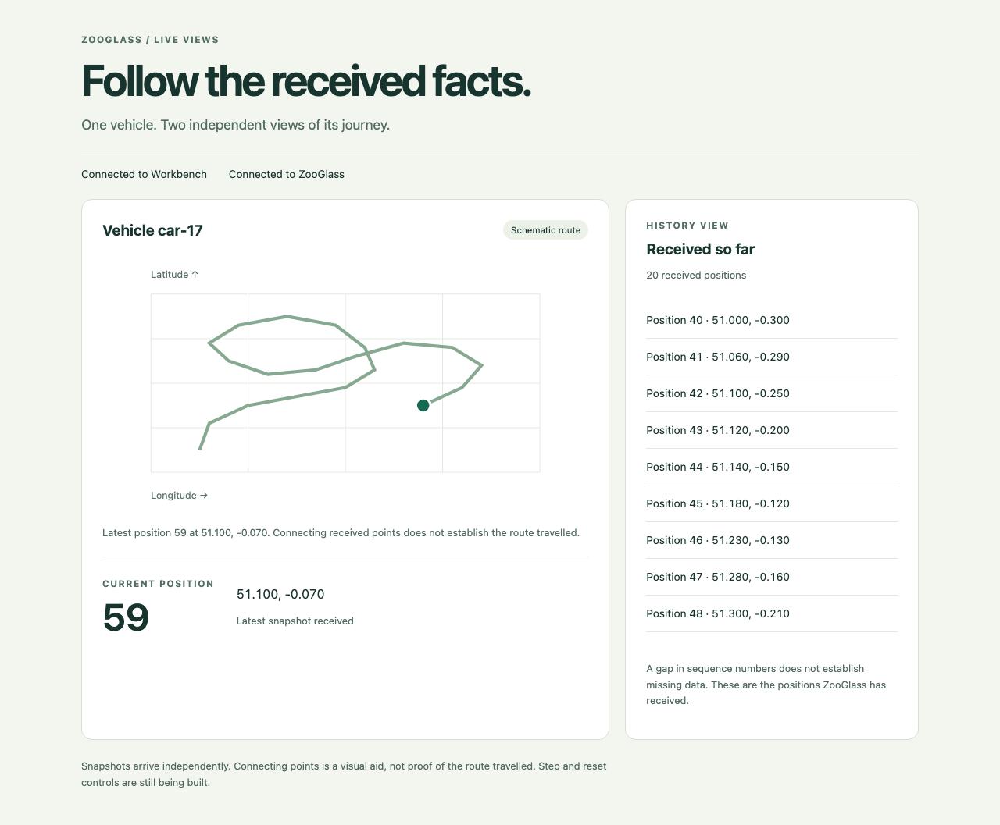
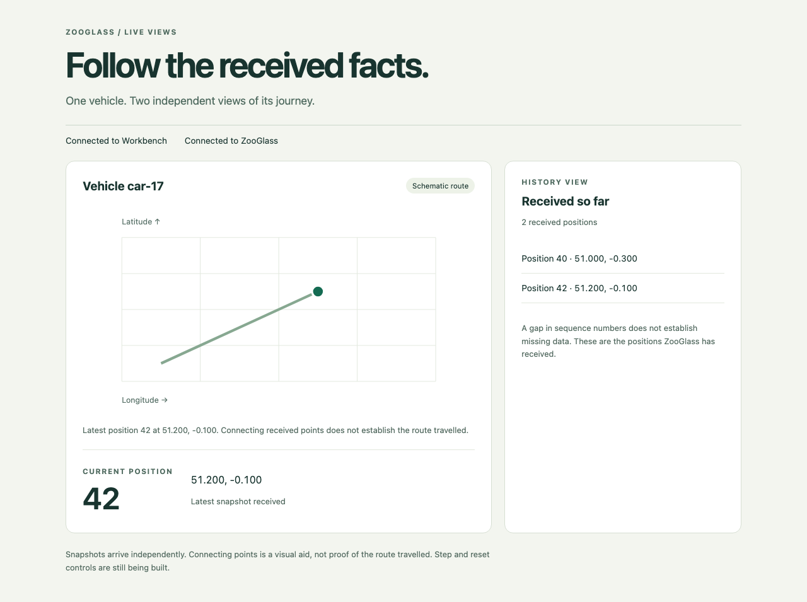
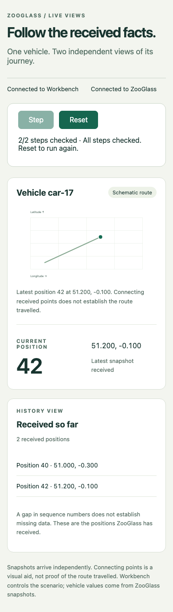
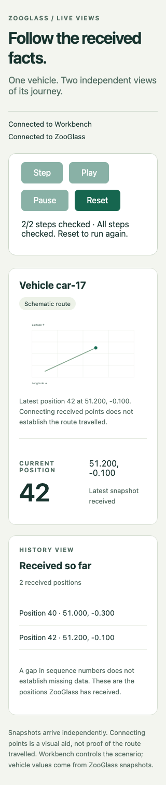
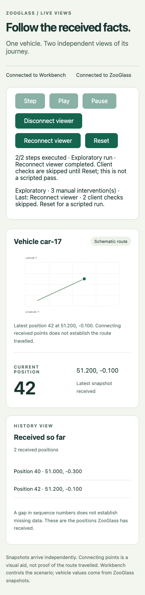

# Vehicle tracker demo

The [source map](docs/source-map.md) explains the source files, their responsibilities
and how they depend on each other. Start there when reading the implementation.

A real browser receives two ZooGlass views for one vehicle: its latest position
and the history received so far. Workbench drives a twenty-position journey through the
same service and browser connections used by the app.



The route includes turns and one deliberately delayed position: 41 arrives after 42. Positions 43–59 then arrive in order.

### Short fixture



### Watch the demo

https://github.com/user-attachments/assets/0c43837d-2f3d-4ccf-8b22-2e5cfcf958a0

[Download the demo recording (MP4)](docs/basic-run.mp4).
The 11-second recording shows the short `--basic` fixture using real ZooGlass snapshots, with longer pauses between
positions 40 and 42 so the changes are easy to follow.

## Follow the run

Interactive controls explain the next scripted action, including late or duplicate
positions. While a step is running, the explanation labels it as the current step.
Exploratory runs explicitly say browser receipt checks are skipped.

The **Run activity** panel keeps the latest 100 entries. It distinguishes source
sends, actual browser view receipts, subscription acknowledgements and connection
changes. A source send is not confirmation that ZooGlass processed it. Entries
appear in the order the page learns about them across the data and control
connections, not a global event order. Reset creates a fresh page and trace.
The panel is keyboard-scrollable and also records activity during automatic runs;
next-step explanations belong to interactive runs.

## Run it

Install Git, Node 26 and a Java 25 JDK, with `node`, `npm` and `java` available
in your terminal. Check `node --version` and `java --version` before starting.
The repository includes the Maven wrapper; no separate Maven installation is needed.
The first run needs internet access to download JavaScript, Chromium and Maven dependencies.

From a new terminal:

```sh
git clone https://github.com/sproates/zooglass.git
cd zooglass/incubator/workbench
```

Then install and run:

```sh
npm ci
npx playwright install chromium
npm run demo -- vehicle-tracker
```

On Linux, use `npx playwright install --with-deps chromium` if browser system
packages are missing. A visible run needs a desktop session; use `--headless`
with terminal controls on a machine without a display. The browser runs on the
machine where you start Workbench. The loopback URL is not a remotely hosted demo.

The command compiles the app's TypeScript, starts ZooGlass and an owned Chromium
session, connects the viewer and subscribes to both views. **Step** sends one position at a time, using positions
40–59 from the [journey fixture](../workbench/scenarios/vehicle-browser-journey.json),
awaiting HTTP, browser receipt and independent rendered checks after each send. The page stays
open at position 59 with twenty history entries. Add `--basic` to use the short
40/42 fixture. Ctrl+C closes the owned resources.

**Reset** cancels pending work, closes the old browser and service, and opens a
fresh session with empty views. It waits for cleanup before starting the
replacement. The window closes and reopens during reset. Step is disabled while
an action is running; Reset can interrupt it. Failed steps stop further advance.

**Play** advances the same scenario cursor as Step. **Pause** stops future
steps and freezes the remaining delay. An in-flight send and its checks finish,
and incoming snapshots can still render. Wait for the paused status before
using Step or Play again. Resume keeps the remaining delay, so time spent
paused does not produce a catch-up burst.

The gaps between steps come from scenario time and start after the preceding
checkpoint completes. Slow checks can extend a run. Step bypasses the next delay
and advances once; Play continues from there. Reset cancels playback and its timer.
Play stops on completion or a failed check. Step and repeated Play are unavailable
during playback; Pause is available while a checkpoint is running.

You can also type `step`, `play`, `pause`, `disconnect`, `reconnect`, `reset` or `quit` in the terminal. Terminal reset
remains available after the browser page closes. `--headless` uses the same
controls through the terminal without showing a window.

Add `--auto` for the previous timed demonstration. That mode plays once and
keeps the result open; it has no interactive controls. The recording above shows
this automatic mode. Use the interactive recovery fixture below for deliberate
disconnection and duplicate delivery. The full unexpected-fault scenario and automatic recovery integration
remain planned. See the
[Workbench guide](../workbench/README.md#browser-host-preview) for installation
and host details.





## First walkthrough

1. Wait for Step to become available. Both views initially say they are waiting
   for their first snapshot. An empty history at this point does not mean an
   empty snapshot has been received.
2. Use Step once: position 40 appears in the current view and history.
3. Step again: the marker moves to 42 and history contains 40 and 42.
4. Step once more: delayed 41 fills the history between them, while the current
   position stays at 42. Continue to position 59 for the full twenty-point journey.
5. Use Reset. The window is replaced and both views return to waiting. Step
   again to check that the new run starts at 40.
6. Use Ctrl+C in the terminal, or enter `quit`, to close the owned resources.

For a quick two-step run, add `--basic`; it has no delayed 41. Each completed
step includes service, browser receipt and demo rendering checks. The counter
advances only when those checks pass.

### Keyboard and narrow screens

Tab moves through the enabled playback, viewer and Reset controls, then the history list; Shift+Tab moves backwards.
Activate a button with Enter or Space. When Step is disabled it is skipped in
the tab order. With the history list focused, use the arrow keys or End to scroll
through received positions. Reset opens a new window, so focus starts afresh.

At narrow widths the history sits below the route. Scroll the page to reach it,
then scroll within the history list to read later positions. Status text explains
waiting, received and retained data without relying on colour alone.

### If startup fails

- A Node version error means the active terminal is not using Node 26.
- Java compilation failures should first be checked against `java --version` and
  `JAVA_HOME`; the service needs a Java 25 JDK.
- If Chromium is missing, rerun `npx playwright install chromium` from Workbench,
  particularly after updating Playwright. On Linux, check system dependencies too.
- Keep the terminal output when reporting a startup or check failure. If the page
  closes, type `reset` in the terminal; reopening its URL does not register a new
  viewer. If startup never succeeds, quit and rerun after fixing the reported cause.

## Viewer controls and recovery fixture

Disconnect viewer closes only the app's ZooGlass data socket. Workbench's control
connection and the source remain live. Previously received values stay visible
and are labelled **Last received**. Reconnect viewer opens the data connection
and subscribes to both views again. Each view becomes current when its own
snapshot arrives; the pair is not an atomic result.

Manual viewer controls require a paused, idle run, including a completed run.
They don't advance the scenario cursor. Disconnecting an already disconnected
viewer is safe. Every accepted manual request marks the run **Exploratory**, with
an intervention count and the latest action shown on the page. That label stays
until Reset, even if you reconnect immediately.

In an exploratory run, Step and Play still send source events and perform server
checks, but skip fixture client-receipt and rendering checks. The manual change
may have invalidated their subscription assumptions. The page counts those
skipped checks and reports steps executed, never a passing scripted run. This
allows you to send positions while disconnected and inspect current snapshots
after reconnecting. Server errors still fail the run. Reset restores all checks.

For the scripted version, start a fresh run:

```sh
npm run demo -- vehicle-tracker --recovery
```

This fixture uses eight checkpoints: 40, 42, late 41, duplicate 41, the duplicate
processing barrier, viewer disconnect, 43 while disconnected, then reconnect.
The duplicate is verified at the following barrier, not by expecting a new
message for unchanged state. Step stops separately at the connection changes,
so you can inspect the retained display before and after sending 43. Play runs
the same sequence. Both server views must contain 43 before reconnect, and the
initial snapshots and rendered views are checked without another vehicle event.

Use the scripted Step/Play actions to keep this a verification run; pressing a
manual viewer button makes it exploratory. `--recovery` cannot be combined with
`--basic` or `--auto`. Deliberate disconnect is not an unexpected network fault.



## Reading the display

The current sequence and coordinates come from the `live-map` snapshot. The
history list and line come from `trip-history`. Each full snapshot replaces its
own displayed state; the app does not sort events or merge these two views into
an atomic result. Repeated history snapshots replace the list without appending
extra rows.

The SVG uses fixed bounds for this finite example: longitude -0.35 to 0.05 and
latitude 50.95 to 51.35. It is a schematic coordinate plot, not a street map.
Joining received positions does not prove the path travelled, and sequence gaps
do not establish missing data. The textual coordinates describe the same points.

The Workbench bridge sends connect/subscription instructions, never expected
vehicle data. The app owns its ZooGlass socket and renders only validated
snapshots received on that socket. Receipt observations go back to Workbench
for checks; expected results stay outside the app.

## Connection and view states

Each view distinguishes waiting for its first snapshot from receiving an explicit
empty snapshot. ZooGlass currently sends no snapshot for an uninitialised view,
so a subscription acknowledgement alone leaves that view waiting.

After disconnect or unsubscribe, previously received values remain visible and
are labelled **Last received**. Reconnecting does not make them current: each
view must receive its own fresh snapshot. A connection failure stops playback
and shows an error. In a visible demo, the failed page remains open for
inspection. Use Reset to start again, or type `reset` in the terminal if the
page or control connection is gone. Ctrl+C closes all owned resources. In
`--auto` mode, restart the command after failure; automatic headless runs clean
up on failure. Automatic reconnection is not implemented.

## Checks and current limits

From Workbench, `npm run test:browser` drives both fixtures in Chromium and checks
the visible sequence, coordinates, marker position and history at their
checkpoints, including late 41 leaving the current position at 42. It also checks that resubscription does not duplicate the history
and that the phone-width layout has no horizontal overflow. `npm run build`,
`npm run lint` and `npm run format:check` include this app.

Separate controlled protocol tests cover explicit empty snapshots, waiting,
unsubscribe, reconnect and connection failure. They do not establish service
recovery behaviour. Interactive steps and automatic playback now wait for the
same independent Playwright observer. It reads the displayed sequence,
coordinates, marker, ordered history, route points and received-state labels.
Expectations stay outside the app and come from the fixture.

A rendered mismatch fails the step after a five-second deadline, without
advancing its counter. Reset cancels pending rendered checks. Tests deliberately
break the marker while real snapshots arrive, verify that the step fails, and
check both fixtures again after reset. Lifecycle tests also cover fresh state,
old host/service closure and reset after page loss. Opt-in automatic recovery
now has controlled-peer browser coverage for refused retries, both snapshot
orders, cancellation and deadline expiry. The full ZooGlass fault scenario and
final acceptance remain outstanding.
Keyboard Step/Reset, history scrolling and layouts at 320, 390 and 1280 CSS
pixels are covered by the browser suite. This is a focused demo usability check,
not a full accessibility audit or a check of native mobile browsers.
The local host registration is not production authorisation. See the
[demo plan](../../docs/plans/vehicle-tracker-demo.md) for the remaining behaviour.
