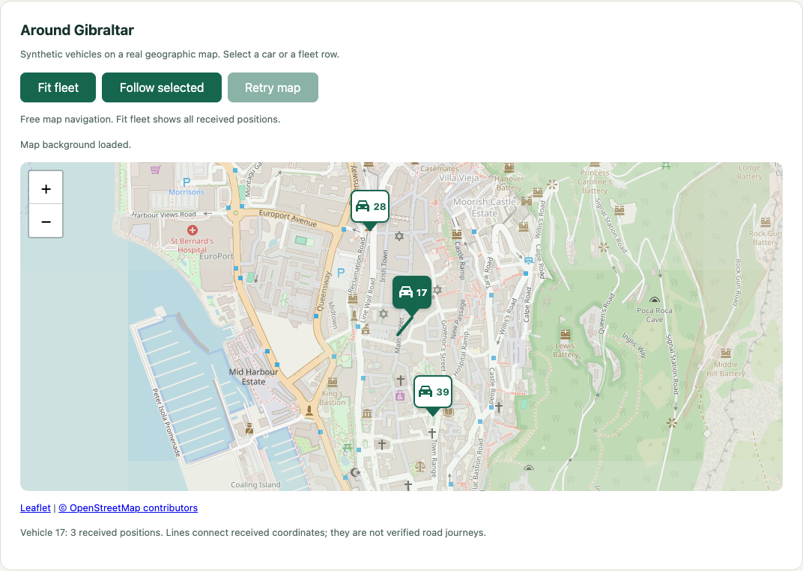

# The Gibraltar fleet map

The fleet demo uses a real street background centred on Gibraltar, with synthetic
vehicles around Queensway and Reclamation Road. Leaflet 1.9.4 draws the map;
OpenStreetMap supplies the default background tiles. ZooGlass supplies every
vehicle position, operational status and received history.



The image is a captured interactive demo, with attribution preserved. It is not
an assertion that these short synthetic segments follow a road.

## Run and explore

From `incubator/workbench`, after the normal installation and explicit service
preparation steps in the [demo README](../README.md):

```sh
npm run demo -- vehicle-tracker --fleet
```

Step advances the existing short three-vehicle fixture. Play runs its timed
sequence. Markers move directly to received coordinates; there is no interpolation
or road snapping. Each marker’s downward pointer ends at the received coordinate;
the vehicle label sits above it so the location is unambiguous. Select a marker or fleet row to select the same vehicle in
list, map and detail. Only that vehicle's received history is drawn as a line.
The other vehicles remain subscribed. A delayed position can extend that line
without moving the latest-position marker backwards.

Disconnect retains the last received markers with dashed outlines and labels the
selected history as retained. Reconnect refreshes each view independently. Reset
opens a fresh page with no manufactured vehicle positions.

Edit coordinates in the [scenario fixture](../../workbench/scenarios/vehicle-fleet-contracts.json)
and its expected results, then restart the demo to load those edits. Reset reruns
the scenario already loaded by the process; it does not reread the file. During a
run a higher sequence supplies a new position. Resending an accepted sequence
with different coordinates remains a duplicate, not a historical correction.

The map supports ordinary panning and zooming. **Fit fleet** frames all received
latest positions, including retained positions while disconnected. **Follow selected**
centres the selected car and follows subsequent received positions. Selecting
another vehicle transfers follow to that vehicle. Mouse/touch panning, keyboard
arrow panning or a two-finger gesture switches follow off. Fit fleet also switches
it off. Incoming data will then leave your chosen view alone. Reset starts with
follow off; controls wait for actual received positions before enabling.

Tab reaches map controls and markers. Enter or Space selects a focused marker;
arrow keys pan the focused map, and the zoom buttons support keyboard and touch.
Controls wrap at narrow widths and enlarged text. Attribution stays immediately
below the map so enlarged credits cannot cover cars or map controls.

Direct phone access and the six-vehicle longer journeys are separate
planned increments. The manifest determines the vehicle set; the renderer has no
three-vehicle limit.

## Tile configuration

Leaflet's JavaScript, stylesheet and licence are served locally from the installed
npm package. The only remote map dependency is the raster background. The default
interactive provider is `https://tile.openstreetmap.org/{z}/{x}/{y}.png`, with
persistent linked attribution. This is suitable for a small human-operated local
demo, not a commitment to a public production tile service.

The [OSMF tile policy](https://operations.osmfoundation.org/policies/tiles/) was
rechecked on 27 October 2026. Requests use HTTPS and normal browser caching, with
an origin-only cross-origin Referer. There is no prefetch, bulk download or offline
map feature. The tile provider receives the requested map area and ordinary browser
request metadata, not ZooGlass snapshots. Public/heavy use needs a provider review.

Set a different HTTPS raster template and plain-text attribution before launching:

```sh
export ZOOGLASS_MAP_TILE_URL='https://tiles.example/{z}/{x}/{y}.png'
export ZOOGLASS_MAP_ATTRIBUTION='Your provider attribution'
export ZOOGLASS_MAP_ATTRIBUTION_URL='https://tiles.example/attribution'
npm run demo -- vehicle-tracker --fleet
```

The attribution link is optional; attribution text is required for custom tiles.
The host allows images from that exact HTTPS origin while scripts and data
connections remain local. Providers which redirect images to another origin need
a directly usable endpoint. Configuration and attribution are demo assets, not secrets.

For a local synthetic background with no provider traffic:

```sh
ZOOGLASS_MAP_TILE_URL=local npm run demo -- vehicle-tracker --fleet
```

Programmatic demo sessions default to local tiles. Automated tests use this mode,
never OpenStreetMap. The local tile is deliberately labelled as test imagery,
not real geography. A failed tile, or one taking longer than ten seconds, shows
**Map background unavailable**. Vehicle coordinates, history, selection, playback
and data recovery remain usable. This is separate from the ZooGlass connection
status. **Retry map** requests the current tiles again; a late successful response
can also restore availability. No automatic retry loop or bulk download is added.
The browser session waits for app registration, not optional image completion.

## Verification boundary

The browser geometry test independently projects fixture coordinates with Web
Mercator and compares the actual marker centres and SVG route vertices. It does
not call the app model or Leaflet's projection API. It also checks selection in
both directions, route changes, absence of subscription traffic on selection,
retained markers, Reset and local-only resources. This caught and fixed a broad
schematic SVG style that initially distorted the Leaflet route layer.

Map navigation tests exercise fit, follow through received updates, selection
changes, mouse/keyboard panning and Reset. A Chromium touch-emulation check taps a
marker and drags the map. Local 404 and stalled-image cases verify continued fleet
playback, retry and late background recovery. Browser clock control bounds the
stall test without spending ten real seconds on every run. Keyboard tests caught
and fixed the missing Enter/Space activation on custom markers. Enlarged-text
review caught attribution covering a car; credits now sit outside the map area.

The existing keyboard, enlarged-text, reconnect and single-vehicle tests remain.
The screenshot above came from a bounded visual check using real background tiles;
CI uses local synthetic tiles and does not assert provider availability. The separate map
acceptance record is [ready for review](../../../docs/verification/2026-10-27-fleet-map.md);
emulated touch is not native iPhone evidence.

Leaflet is distributed under its [BSD 2-Clause licence](https://github.com/Leaflet/Leaflet/blob/v1.9.4/LICENSE),
also served at `/vendor/leaflet/LICENSE` by the demo host. Map data and background
attribution remain separate from the library's licence.
