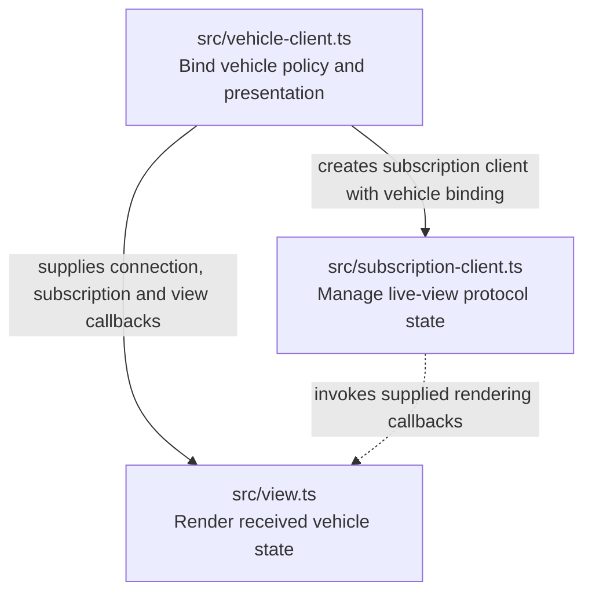
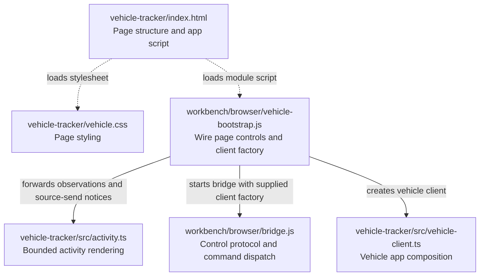

# Vehicle tracker source map

The vehicle tracker is the browser UI for a ZooGlass demo. Its four TypeScript
modules separate vehicle-specific policy, subscription handling, rendering and
run diagnostics.
Workbench supplies the scenario and controls; vehicle values come from ZooGlass
snapshots.

Each rectangular box below is a source file. Solid arrows point from a module to
a dependency and explain what it uses that dependency for. Dotted arrows show
asset loading or supplied callbacks, explicitly labelled. This is a static source
map, not the order in which messages arrive.

## The app modules

Paths in this diagram are relative to `incubator/vehicle-tracker`.

The dotted callback arrow is not an import: `subscription-client.ts` accepts a
`ClientBinding`. `vehicle-client.ts` supplies that binding using functions from
`view.ts`, so protocol handling does not need to know about vehicle rendering.

| Module                                                    | Responsibility                                                                                                                                                                                                |
| --------------------------------------------------------- | ------------------------------------------------------------------------------------------------------------------------------------------------------------------------------------------------------------- |
| [`vehicle-client.ts`](../src/vehicle-client.ts)           | Create the subscription client, restrict subscriptions to `car-17` and the `live-map`/`trip-history` views, and bind protocol notifications to the renderer. Start here to understand the app's composition.  |
| [`subscription-client.ts`](../src/subscription-client.ts) | Own the WebSocket, connection generations, active subscriptions and pending acknowledgements. Execute connect/disconnect/subscribe/unsubscribe commands, report observations and notify the supplied binding. |
| [`view.ts`](../src/view.ts)                               | Validate received positions for rendering, retain the displayed latest position and history, and update the map, route, history list and connection/subscription status.                                      |

The subscription client rejects unexpected acknowledgements and ignores messages
from an old socket. Its connection lifecycle is explicitly commanded; this map does not
imply an autonomous reconnect loop. The renderer distinguishes retained data
from a current subscribed snapshot. It does not manufacture expected scenario
results or own the socket.

[`activity.ts`](../src/activity.ts) renders the latest 100 diagnostic entries. It
receives actual browser observations and successful source-send notices from the
bootstrap; it does not drive the vehicle views or infer service processing from
a send. Its state lives for one page lifetime, so reset starts a new trace.

## How Workbench starts the page

The browser app is currently composed by Workbench. Paths below are relative to
`incubator/`. The `.js` modules are authored JavaScript; `vehicle-client.ts` and
its dependencies compile to JavaScript served by the host.

[`index.html`](../index.html) supplies the DOM and loads `/vehicle-bootstrap.js`.
The [bootstrap](../../workbench/browser/vehicle-bootstrap.js) wires page buttons
and run status to the [bridge](../../workbench/browser/bridge.js), and passes it
a vehicle-client factory. The bridge dispatches commands to that supplied client
and reports observations over Workbench's control connection; it does not import
the vehicle implementation itself.

On the Node side,
[`vehicle-browser.ts`](../../workbench/src/demos/vehicle/vehicle-browser.ts)
selects the page, scripts and stylesheet and supplies them to the shared browser
host. This asset binding is separate from imports executed inside the browser.
The app's data socket reaches ZooGlass through the host's data proxy, while the
control connection carries Workbench commands and observations.

## Where orchestration and verification belong

The app code above displays the demo. Scenario scheduling, service/browser
ownership and independent page checks live in
[`workbench/src/demos/vehicle/`](../../workbench/src/demos/vehicle/).
In particular, the [page observer](../../workbench/src/demos/vehicle/vehicle-observer.ts)
checks the rendered result without importing `view.ts` or reusing its projection
function. Expected results stay outside the app.

For the surrounding modules, see the [Workbench source map](../../workbench/docs/source-map.md).
For the service that produces the views, see the [ZooGlass source map](../../zooglass/docs/source-map.md).
The [demo README](../README.md) explains how to run it and interpret its display.
Update this map when module responsibilities, bindings or bootstrap paths change.
