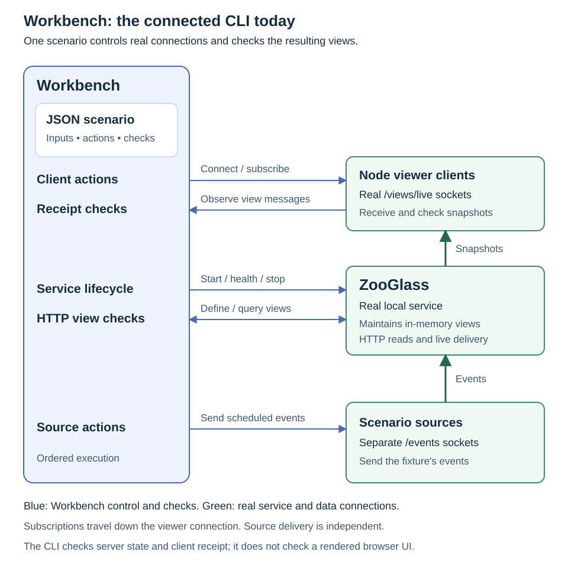
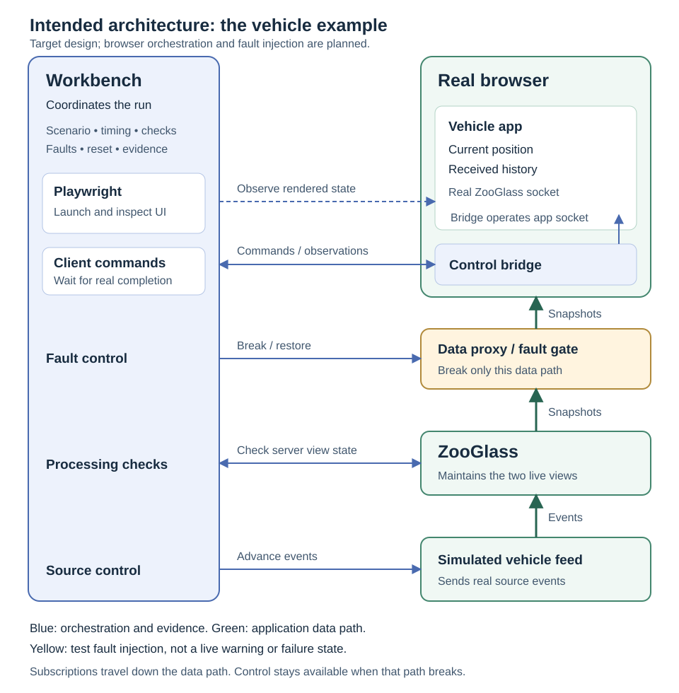

# Workbench Scenario Simulator

**Workbench Scenario Simulator**, or **Workbench** for short, exercises how
ZooGlass and its clients behave as events arrive, views change and connections
come and go. A scenario describes the inputs, client actions and expected views
in one place. Workbench runs those actions against the real service and checks
what happened.

That makes it useful for exploring an idea as well as catching a regression.
For example, a scenario can send a newer vehicle position before an older one,
check both the latest position and received history, then disconnect a viewer
while the source continues. The service's response is the evidence; the scenario's
expected values are only used to check it.

Today Workbench is a CLI with Node WebSocket clients. Browser orchestration,
interactive controls and fault injection are planned. See
[where we're heading](#where-were-heading) for that separate view, and
[what ZooGlass is trying to build](../../docs/what-is-zooglass.md) for the wider
product explanation.

## Run a scenario

Use Node 26 and install dependencies with `npm ci`. Connected runs and the full
test suite also need JDK 25; Workbench starts the adjacent ZooGlass project with
its Maven Wrapper. Maven dependencies may need downloading on the first run.
Run the commands below from `incubator/workbench`.

| Command                                                 | What it does                                                                                          |
| ------------------------------------------------------- | ----------------------------------------------------------------------------------------------------- |
| `npm run simulate -- scenarios/live-match.json`         | Validates the fixture and prints its ordered trace. It doesn't start ZooGlass or verify view results. |
| `npm run integrate -- scenarios/live-match.json`        | Starts ZooGlass, executes the scenario through real connections and checks the expected views.        |
| `npm run integrate -- --fast scenarios/live-match.json` | Executes the same actions and checks without the scheduled timeline delays.                           |
| `npm test`                                              | Runs the Workbench tests, including the scenario fixtures through a real ZooGlass process.            |

From this directory, run the example with:

```sh
npm ci
npm run simulate -- scenarios/live-match.json
```

To start ZooGlass and play a scenario against it, run:

```sh
npm run integrate -- scenarios/live-match.json
```

This starts ZooGlass with the Maven Wrapper, waits for its health check, opens a
WebSocket connection for each event source and scenario client, and sends each
event at its scheduled simulation time. Client state changes open or close
their WebSocket connections. The scenario's view definitions are loaded by
ZooGlass at startup, and each `view-check` queries the HTTP view endpoint and
compares its data with the expected JSON. Workbench stops the local
ZooGlass process when the scenario finishes.

Pass several scenario paths to play them in order against one ZooGlass process:

```sh
npm run integrate -- scenarios/live-match.json scenarios/correction.json
```

Add `--fast` to preserve the timeline order but skip its real-time waits. The
functional test suite uses this mode; regular `integrate` runs keep the timed
playback for demonstrations.

The runner gives each scenario its own source and view IDs so its events don't
affect another scenario's views. The functional test suite uses this batch mode
to avoid starting ZooGlass separately for every scenario.

## What a connected run owns



The source and viewer sockets are separate. Disconnecting a viewer doesn't
stop a source from sending events. Node clients use the same live-view protocol
that an application would use, but they don't provide evidence about a browser
or its rendered UI.

Workbench owns the local ZooGlass process, temporary view configuration,
connections and the ordered execution loop. A connected batch runs as follows:

1. Load and validate all fixtures, namespace their sources and views, then start
   one service with the combined startup definitions.
2. Wait for service health, open the scenario's source sockets, and execute its
   initial client states and timeline entries in order.
3. Await each action's completion condition before starting the next. Close that
   scenario's connections before moving to the next fixture in the batch.
4. On completion, failure or interruption, clean up the owned sessions and
   service. A failed check or execution error makes the CLI exit unsuccessfully.

The trace shows the action being attempted. A source send is not proof that
ZooGlass has processed it, and a server-side check is not proof that a client
has received it. The checks below deliberately cover those separate observations.

## Describing actions and expectations

Each scenario has a name, a list of event sources, a list of clients, view
definitions, and a timeline. View definitions map event source and type pairs
to fields in a view. A field can be updated by more than one event type, and it
can also set an ordering strategy using a numeric field from each event:
`latestBySequence` keeps the event with the highest sequence, while
`historyBySequence` keeps accepted events in sequence order. These settings
work for startup views and runtime `view-definition` entries. The
`vehicle-event-ordering.json` scenario sends a newer vehicle position before
older ones, then checks both views, duplicate and invalid sequences, and a
client reconnect.

### Actions and their completion conditions

| Timeline entry        | What Workbench waits for                                                                                                                                                              |
| --------------------- | ------------------------------------------------------------------------------------------------------------------------------------------------------------------------------------- |
| `source-event`        | The event is sent on that source's open socket. Use a later check to establish processing.                                                                                            |
| `client-state`        | `connecting` or `connected` ensures a connection is open; `disconnecting` or `disconnected` closes it. These are requested actions, not measurements of a connection's current state. |
| `client-subscription` | The matching subscribe or unsubscribe acknowledgement for the view and entity.                                                                                                        |
| `view-definition`     | ZooGlass accepts a new runtime view definition. It starts without replaying earlier events.                                                                                           |
| `view-check`          | The HTTP view matches the expected data, or returns 404 when the expectation is `null`.                                                                                               |
| `client-view-check`   | That client's received-message queue contains a matching view update for the view, entity and expected data.                                                                          |

Each declared client's `initialState` also becomes an action at the start of the
trace. Connection and subscription are separate steps: a reconnected client
must subscribe again before it can receive a current snapshot.

The existing client view check can match an earlier queued update. It does not
prove that the matching update was the first snapshot after a subscription, nor
that a browser rendered it. The vehicle demo adds an independent rendered
observer after receipt checkpoints; the generic Node client check retains its
existing meaning. Stronger first-snapshot checks remain planned.

### Timeline order and real time

`simulationTime` is an elapsed time in milliseconds. Entries run in ascending
time order, preserving declaration order for ties. Initial client states are
placed before timeline entries at time zero. This field schedules the scenario;
it doesn't define domain event time or ZooGlass's ordering guarantees.

In ordinary connected playback, Workbench waits until an entry's scheduled time
relative to the start of that scenario's playback. If an earlier action takes
longer, an overdue entry starts once the previous action finishes. `--fast`
removes scheduled delays but still awaits acknowledgements and checks. Neither
mode makes service processing or network timing deterministic.

### Writing a useful check

Start with an existing [fixture](#scenarios) close to the behaviour you want to
explore. Define the sources, clients and startup views, then interleave actions
with the observations needed to establish their effects. Include subscriptions
before client checks and make expected data specific to the entity and view.

A check of unchanged state can pass before the event under investigation is
processed. For late position 41, first check that history contains 41, then
check that the current position remains 42. Duplicate suppression needs similar
care: another matching snapshot alone doesn't prove the duplicate was handled.
Use an observable processing barrier when the scenario requires that evidence.

Checks have finite waits and fail if their condition isn't observed. A passing
scenario supports its stated expectations and conditions; it doesn't establish
unmeasured performance, general completeness or every possible failure outcome.

## Scenarios

ZooGlass has unit and functional tests for its components and core running
behaviour. Most scenario testing belongs here in the Workbench: these functional
scenarios drive event and client behaviour through ZooGlass and check its view
responses. External-system tests, such as checking a Kafka adapter, are a
separate kind of integration test.

### Business examples

These scenarios show three distinct applications that could use ZooGlass:

- `sports-betting-live-market.json` combines score updates from a match feed
  with bookmaker odds and sends the changing market view to a client.
- `order-fulfilment-live-order.json` combines order, payment, and inventory
  updates for an order dashboard, including a late inventory update.
- `vehicle-tracking-live-ride.json` sends vehicle locations to a rider app,
  including disconnecting, missing updates, reconnecting, and receiving the
  latest snapshot.

They exercise live data flows and view delivery; they don't implement the
business rules of a sportsbook, order system, or ride service.

### Focused scenarios

- `live-match.json` checks a match view assembled from score and odds updates
  arriving from separate feeds.
- `late-update.json` shows an older order and inventory update arriving after
  newer order activity, then checks the view before and after the inventory
  event. The `sourceTimestamp` values are example payload data;
  `simulationTime` still says when each event appears in the replay.
- `correction.json` checks a score feed replacing an earlier result with a
  correction.
- `disconnect-catch-up.json` shows location updates arriving while a viewer is
  disconnected, then the viewer reconnecting, and checks the latest location
  view.
- `bursty-updates.json` checks the view after several odds changes arrive close
  together.
- `runtime-view-definition.json` creates two views at different points in the
  event timeline. Both match the same events, but each starts with no data and
  only reflects events received after it was created.
- `live-view-updates.json` subscribes a connected client to a view, sends events
  through ZooGlass, and checks the updates received over WebSocket.
- `client-reconnect-snapshot.json` disconnects a subscribed client while two
  updates arrive, then reconnects and checks that a new subscription receives
  the latest snapshot.
- `vehicle-browser-journey.json` sends twenty positions, 40–59, along a route
  with turns. Position 41 alone is delayed until after 42; later positions arrive
  in order. HTTP and browser checks verify received history and latest position.
- `vehicle-browser-recovery.json` adds late 41, an identical duplicate, and 43
  while the viewer is deliberately disconnected. A separate entity on the same
  source connection supplies a processing barrier before the unchanged-state
  checks. Both server views must contain 43 before reconnect; the initial
  subscription snapshots are checked without sending another vehicle event.
  Run it with `npm run integrate -- --fast scenarios/vehicle-browser-recovery.json`
  using the Node client. The Chromium suite also runs its receipt checks through
  the real browser. Select it in the interactive demo with `npm run demo -- vehicle-tracker --recovery`.
  This is deliberate disconnection, not an unexpected network failure.
- `vehicle-browser-basic.json` is the finite first slice for the planned browser
  demo: connect `rider-app`, subscribe to `live-map` and `trip-history`, then send
  positions 40 and 42 for `car-17`. Each send is followed by HTTP and client
  receipt checks for both views. The CLI uses a real Node WebSocket client;
  the vehicle demo and Chromium suite use the browser executor and an
  independent rendered observer.
- `vehicle-event-ordering.json` sends vehicle positions out of sequence and
  checks a latest-position view and an ordered trip history view.
- `sequence-gap.json` shows a history view before and after a missing vehicle
  position arrives late, alongside a latest-position view that continues to
  show the highest sequence.
- `shared-sequence-across-entities.json` shows why a number skipped by one
  entity may belong to another entity in a shared feed, rather than being a
  missing event.

Run any scenario by passing its path, for example:

```sh
npm run simulate -- scenarios/late-update.json
```

## Ordering and completeness

### Sequence gaps

`sequence-gap.json` explores what happens when a vehicle reports sequence 40,
then 42, and only later sends 41. The example assumes sequence numbers are
contiguous for each vehicle. After 42 arrives, the current history view
immediately shows `[40, 42]`; when 41 arrives, it becomes `[40, 41, 42]`. The
latest-position view stays at 42 throughout. ZooGlass sorts the history it has
received, but it does not currently identify the gap or mark the history as
incomplete.

There are a few general ways a system could handle this:

- **Show received events immediately.** This keeps the view responsive. The
  view should also expose that a sequence is missing so a client does not
  mistake a partial history for a complete one.
- **Wait for missing sequences.** This can keep the visible history contiguous,
  but a missing event that never arrives can hold later events back forever.
  It needs a policy for timeouts, recovery, and how much data to buffer.
- **Wait for a bounded period.** This limits how long the view waits, but needs
  a definition of the period and a rule for events arriving after it expires.
  A time-based policy may also depend on clocks or progress signals from the
  event source.

These choices depend on what a view promises. A live map may prefer the latest
position with little delay; a trip history may care more about completeness.
This scenario documents current behaviour and makes the trade-off concrete. It
does not select or implement a new gap-handling policy. Also, gap detection only
makes sense if the source guarantees that sequence values are contiguous; a
monotonically increasing sequence alone is not enough to prove an event is
missing.

### What a sequence guarantees

Before treating a jump as a gap, define what the number counts and where it is
unique. A source might provide a contiguous sequence per entity, a position in
a shared feed or partition, or only a value that increases when that source
emits an event. Those guarantees are not interchangeable.

For example, a shared feed may assign sequence 40 to car 17, 41 to car 22, and
42 to car 17. Car 17's history then contains 40 and 42, but nothing is missing
from that car's history: 41 belongs to a different entity. The
`shared-sequence-across-entities.json` scenario demonstrates this alongside
`sequence-gap.json`, where 41 really is a delayed event for car 17.

To detect gaps reliably, ZooGlass would need a source contract that says the
sequence is contiguous at the scope of the view, plus a way to know the range
that should exist. Even then, a jump between 40 and 42 only identifies an
interior gap. Knowing that 42 is the final event, or that no more events are
coming, requires a further signal with a documented completeness meaning, such
as a watermark or end-of-stream marker. A heartbeat only helps if it also
communicates a sequence or high-water mark. The prototype does not model those
contracts or signals; its ordering strategies only order the events they
receive.

For a comparison of possible source progress signals and their trade-offs, see
the [source progress exploration](../zooglass/source-progress-signals.md).

## Browser host preview

The local browser host can launch an owned Chromium session and register its
vehicle page over a separate control connection and step through the twenty-position journey:

```sh
npm ci
npx playwright install chromium
npm run demo -- vehicle-tracker
```

Use `npx playwright install --with-deps chromium` on a Linux machine that also
needs browser system packages. Playwright is pinned in the package manifest;
install its matching Chromium after changing that dependency. Java 25 and
Node 26 remain prerequisites. Add `--headless` to the demo command for an
invisible browser session. Ctrl+C stops the owned browser, host and ZooGlass.
Closing the owned page fails the run and closes its browser host. Type `reset`
in the terminal to replace it, or `quit` to close all owned resources. Failed
interactive runs remain stopped until reset or exit. Control loss is a failure,
not a recovery instruction.

The command compiles the TypeScript vehicle app and runs the 40–59 journey
fixture (or the short 40/42 fixture with `--basic`) through the shared scenario session and browser executor. It waits for
actual socket and subscription acknowledgements, then checks service state and
browser receipts. The [vehicle display](../vehicle-tracker/README.md) renders
latest position, a schematic route and received history from those snapshots.
Step sends one position and awaits its following service, receipt and rendered
checks. The same observer runs in automatic mode. It reads DOM/SVG output
without supplying expected data to the page; a mismatch fails the step within
five seconds. Reset cancels a pending rendered wait.
Reset cancels the old run and waits for its browser, sockets and ZooGlass to
close before creating an empty replacement with a new run identity. It replaces
the window. Overlapping step/reset requests are rejected, and failed cleanup
prevents a replacement from starting. Terminal `step`, `play`, `pause`, `disconnect`, `reconnect`, `reset` and `quit` provide
the same lifecycle controls if the page is unavailable.

Manual Disconnect viewer and Reconnect viewer commands are allowed while paused
and idle. They use the same executor as scenario commands and leave the source
connection running. They record an intervention and mark the run exploratory
until Reset. Server checks continue; fixture client/DOM checks are skipped and
counted visibly. Exploratory completion is never reported as a scripted pass.
See the [viewer walkthrough](../vehicle-tracker/README.md#viewer-controls-and-recovery-fixture).

`--recovery` selects the late/duplicate/disconnected-viewer fixture. Connection
changes form their own checkpoints after startup; Step stops at disconnect,
source delivery while disconnected, and reconnect. It cannot be combined with
`--basic` or `--auto`. The basic and journey defaults are unchanged.

Use `--auto` for the previous timed, single-run demonstration without interactive
controls. Its headed failures retain the page for inspection; headless failures
clean up immediately. Interactive Play uses the same cursor and checks as Step.
Pause freezes the remaining delay and lets the active checkpoint finish. Resume
uses that remaining delay, without catching up for time spent paused. Each gap
starts after the preceding checkpoint completes; slow checks extend the run.
Step is available only while paused and idle. Reset and exit cancel playback.

Both services bind to loopback. The host serves only its explicitly listed app and bridge assets,
validates HTTP Host and WebSocket Origin, accepts one registered `rider-app`
for its run, and provides a token-scoped `/views/live` proxy route. The bootstrap
registration token is passed in the owned page's URL fragment and then removed.
Opening the printed URL independently does not attach another client. The
proxy uses ZooGlass's own origin upstream, leaving service origin checks intact.
This is a local demo boundary, not production authorisation.

`npm run test:browser` runs the separate Chromium transport checks against real
ZooGlass: registration, subscription and snapshot delivery, independent control
and data connections, page-exit cleanup, a fresh run and cancelled startup.
It requires the Chromium installation above. The standard `npm test` also
checks rejected origins, invalid registrations, duplicate clients and timeout
cleanup. The browser suite checks both rendered views for both fixtures,
full-snapshot replacement on resubscription and a narrow layout. Controlled
protocol peers additionally check waiting, explicit empty snapshots, retained
values and visible failures. Both suites
run in Workbench CI. The [first walkthrough](../vehicle-tracker/README.md#first-walkthrough)
covers installation, keyboard controls, reset and narrow-screen use. Final acceptance
of the complete recovery demo remains outstanding.

## Where we're heading



This is the intended browser environment, not the current CLI architecture.
Workbench would keep ownership of the scenario while a real browser performs
its client actions. Playwright would launch the browser and independently check
the rendered result. A separate control connection would keep orchestration
available while the blue fault proxy interrupts the application's data path.

The aim is one scenario workflow for interactive exploration and automated
verification, with source sends, service state, client receipts and rendered
results distinguishable in the evidence. Expected data must never be used to
populate the app. Specialist tools can provide individual capabilities beneath
Workbench without introducing a competing timeline or outcome.

The shared session and client-executor boundary already provide a starting
point. Owned browser launch, registration and the data proxy now exist.
The bridge now executes browser actions and reports actual receipts, and the
display has rendered checks within interactive and automatic action completion,
plus serialised Step/Play/Pause/Reset controls. Fault injection remains planned. Their detailed contracts are in the
[browser orchestration design](../../docs/plans/browser-orchestration.md).

## Reusing a connected session

`startZooGlassSession({ views, signal })` owns one local service, its readiness
check and temporary view configuration. It returns `baseUrl`, a lifetime
`signal` and an asynchronous, idempotent `close()`. The service binds to
loopback; its directory is resolved relative to the module, independently of
the caller's working directory. Startup failure cleans up before rejecting.

`openScenarioSession(scenario, baseUrl, { signal })` owns source sockets and
client executors. Call `execute(entry)` for each entry from `playScenario`.
Execution waits for the action's existing completion condition, but does not
apply `simulationTime` delays. The caller owns scheduling. Concurrent actions
are rejected. Closing cancels the active action, waits for it to settle, then
closes all connections and executors. Always close the scenario session before
the service in `finally` blocks, including after an action fails.

The optional `createClientExecutor(client, liveUrl)` factory binds each declared
client to an executor with `execute(entry, signal)` and `close()` methods. The
session owns every returned executor. Each must honour cancellation and finish
its cleanup before `close()` resolves. The default uses Node WebSockets; a
browser executor can implement the same boundary. Source events, runtime view
definitions and HTTP checks continue through the shared session.

The CLI retains timed and `--fast` playback and batch namespacing. Interrupting
it cancels pending waits and closes its sessions. WebSocket close waits are
bounded and report failure; service shutdown terminates the owned process tree
and waits for its output streams to close before removing configuration.

## Code style

The project uses the recommended ESLint rules for JavaScript and TypeScript,
with Prettier enforcing formatting. Run the checks with:

```sh
npm run lint
npm run format:check
```

Apply formatting with `npm run format`.

## Test coverage

See the [verification map](../../docs/testing.md) for coverage commands, report
boundaries and the remaining behavioural gaps.
