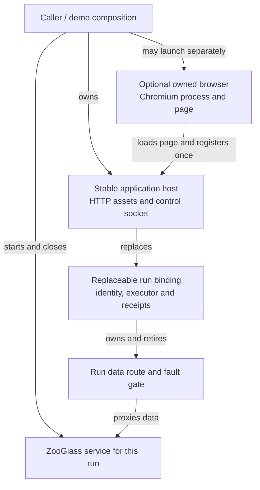

# Browser host and run lifetimes

The application host can now outlive a browser launcher and a ZooGlass run.
This is the lifecycle foundation for external viewers. The demo CLI still uses
its existing owned-browser mode: Reset replaces the service, host and page.
LAN binding, pairing, simultaneous viewers and controller roles are not exposed yet.

## Ownership

`startApplicationHost({ application, onControl })` owns the loopback HTTP server,
asset allowlist and registered control connection. It does not launch Chromium
or ZooGlass. Its `replaceRun(baseUrl)` method retires the previous run and returns
a new immutable run binding with its own ID, data route, executor, observations
and cancellation signal. Keep that binding with the scenario it belongs to;
do not look up a new executor on behalf of old work.

`launchOwnedBrowser(pageUrl, options)` owns only Chromium and its page. Closing
it leaves a caller-owned host running. `startBrowserSession` composes the host,
run and launcher for existing scripted verification, with the same cleanup and
failed-page inspection behaviour as before. Applications still supply their own
assets, client identity and presentation; none of the shared modules imports a demo.

## Replacement handshake

The caller stops scenario dispatch before replacement. It prepares the next
service, calls `replaceRun`, then awaits `run.waitForReady(signal)` before opening
the next scenario session or sending actions. Readiness has a default 15-second
bound; interruption or timeout fails that run, not the stable host.

Replacement closes old data connections, including pending upstream handshakes,
and cancels the old executor. The registered control socket receives `run-changed`
with the new identity and data path. The browser closes its previous application
client, clears its command cache and presentation, creates a new client, and
acknowledges readiness with the new run ID. Its document and URL stay in place.
The new data path rejects upgrades until that acknowledgement arrives.

The fleet app releases map listeners and tile timers, clears rows, selection,
history and activity, and starts waiting for received data. Its new map has no
markers until actual snapshots arrive. The single-vehicle renderer also clears
its retained state. These are application presentation responsibilities; the
shared bridge only knows the client factory and lifecycle hooks.

Old route URLs cannot reach the replacement service. Old acknowledgements,
receipts and controls cannot affect the new run. An asynchronous command or
receipt callback from the previous browser client retains its old binding and
is discarded after replacement. A closed control connection still fails the
single required client; reconnect leases and observer policies belong to the
external-session increment.

## Evidence and limits

- `test/browser/host-lifetime.test.ts` runs the fleet fixture against three fresh
  ZooGlass processes using one host, page and control socket. It checks cleared
  UI/receipt state, fresh snapshots, established-route retirement, old-route
  refusal, readiness gating and timeout, and launcher/host cleanup separation.
- `test/browser/bridge-replacement.test.ts` uses a deliberately delayed client to
  prove that an old command completion and receipt cannot contaminate its replacement.
- Existing owned-browser, fault, recovery and resource checks retain their separate
  coverage. Automated map tests use local tiles.

These checks establish one connected viewer's lifecycle. They do not establish
LAN reachability, native phone behaviour, multi-viewer isolation or access roles.
