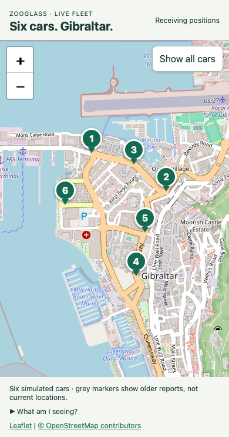

# Continuous Gibraltar fleet

This demo shows six cars moving around Gibraltar while their position streams
suffer delays, loss, duplicates and outages. ZooGlass maintains the latest accepted
position for each car and delivers it to viewers. The map shows those received
positions, with older reports visibly distinguished from recent ones.

## Start from a fresh checkout

Install Node 26 and JDK 25, with `java` on your PATH. From the repository root:

```sh
cd incubator/workbench
npm ci
npm run prepare:service
npm run demo -- vehicle-tracker --continuous
```

Preparation builds ZooGlass explicitly and may download Maven dependencies. Repeat
it after changing Java sources, resources or dependencies, with active runs stopped.
Starting the demo compiles the TypeScript viewer, then launches the prebuilt Java
application; it does not run Maven. Continuous mode does not launch a browser or
require downloading Playwright browser binaries.

Open the URL printed after `Six cars are driving` in your usual browser. The port
is allocated for this run, so use the newly printed URL after restarting. Six
numbered pointers should appear on a map which fills the initial screen. Movement
starts automatically. Leave the terminal running; Ctrl+C stops the sources, viewer
host and ZooGlass. A subsequent run starts fresh in-memory state.

### Open it on your phone

Use the computer's private IPv4 address on the same network as the phone:

```sh
npm run demo -- vehicle-tracker --continuous --bind=<private IPv4 address>
```

Replace the placeholder, including its angle brackets, with the actual address.
Open the printed URL in Chrome, Safari or your usual browser. You can open the same
URL on more than one device; no pairing link or controller role is involved. If a
chat app opens the link in an embedded browser, copying that ordinary URL into your
preferred browser is fine. It contains no single-use token.

The host must remain awake and reachable on the chosen interface. A firewall or
Wi-Fi client-isolation rule may prevent phone access even when local access works.
A changed IP address requires restarting with the new address. This is a trusted
private-network demo, not an internet-facing deployment.

## A short walkthrough

1. Watch for about three minutes. Each car encounters the full repeating delivery
   schedule during a cycle, with staggered faults so other cars keep moving.
2. Select a numbered marker to see its report sequence and observation age. Pan or
   zoom freely; **Show all cars** restores the view of the complete routes.
3. When a source goes quiet or disconnects, its marker stays at its latest received
   position. After eight seconds without a fresh observation it becomes grey and
   dashed. The car's simulated journey continues, so a fresh report can move the
   marker forward a noticeable distance when reporting resumes.
4. Watch the brief **Simulator** notices. Delayed reports and duplicates should not
   roll the accepted sequence back. A permanently lost report stays missing.
   A map alone cannot prove every ordering rule; the checks below inspect the
   service's accepted state directly.
5. Close every viewer, wait, then reopen the same URL. The simulation continues
   without a viewer. A new subscription receives the latest snapshot. Returning
   from a backgrounded tab reconnects as needed; it doesn't restart the journeys.

If map tiles fail, **Map background unavailable** and **Retry map** concern the
background only. Received markers and their updates remain available. This differs
from a lost ZooGlass connection, which marks retained positions stale while the
viewer retries. Restoring the map background does not restart the simulation.

## What the simulation does

Six synthetic cars follow closed road polylines automatically. Each publishes
positions to ZooGlass; the browser subscribes to the latest-position view.
Closing a browser does not stop the sources. Each lap retains increasing sequence
numbers. The viewer does not receive the simulator's intended coordinates.

Road geometry is derived from OpenStreetMap, retrieved 28 October 2026, under
[ODbL](https://www.openstreetmap.org/copyright). `routes.json` retains source way
IDs and attribution. Routes follow mapped one-way directions, avoid Main Street,
and are illustrative journeys rather than a turn-restriction-validated router.
Speeds are approximately 18–25 km/h. The map uses the existing configurable tile
provider; tests use local synthetic tiles. Six latest positions are retained;
this demo does not define an indefinitely growing history view.

The separate three-car interactive fixture uses
`npm run demo -- vehicle-tracker --interactive`, with the same optional `--bind`.
It provides Step/Play controls and a short scenario rather than continuous road
journeys. See [interactive phone access](external-viewers.md) for its pairing flow.

## Imperfect delivery

Each car repeats a staggered 180-report schedule: one report is held for five
report intervals, one is duplicated exactly, one is dropped forever, the source
socket closes for twenty reports, and later the connected source goes silent for
twenty reports. Cars continue along their journeys during these gaps. Reconnecting
sends new observations, not a replay of lost reports. Other cars continue reporting.
The default cadence is one report per second. No fault depends on browser presence.

ZooGlass retains the highest accepted sequence for each car. An older or equal
sequence cannot replace it; equal-sequence conflicts are first-wins, not corrections.
Permanent loss is not repaired. A grey, dashed marker means its observation is at
least eight seconds old, the viewer is disconnected, or it is awaiting a new
subscription snapshot. Reconnection does not change the observation timestamp.
These are demo age labels, not a ZooGlass source-health or physical-location guarantee.
The host and viewer clocks should be synchronised for meaningful age labels.

The brief footer notices are labelled Simulator: they describe injected delivery
conditions, not ZooGlass acknowledgements. Notices are also projected through
ZooGlass, independently of position, so they cannot refresh an old position's age.
Only the latest position and notice per car are stored. At most one delayed report
per car is queued; no growing event history or browser activity list is maintained.
ZooGlass state remains in memory and is lost when the application stops.

## Verification

Automated acceptance runs the real service and six real source sockets through
two fault cycles. It checks monotonic accepted sequences, permanently absent
reports, recovery after source disconnect/silence and all six independent entities.
Route checks cover 10,000 simulated seconds per car, including wrap continuity.
Chromium and WebKit checks cover phone layout, live markers, selection, late
subscribers, network reconnection and cached-page lifecycle events. These checks
are not a claim of an exhaustive native iPhone background/Wi-Fi test.

The full-route default camera keeps future positions within the map; the user can
pan, zoom or choose Show all cars. The real-map screenshot was inspected at phone
width. Tile-provider availability remains separate from live position delivery.



[Watch or download the continuous demo recording (MP4)](../../vehicle-tracker/docs/continuous-driving.mp4).
The recording runs at normal speed and shows Car 3's report ageing during a source
outage, followed by a fresh position after reconnection. The screenshot above is
retained as a quick preview.

The [fresh-setup walkthrough record](../../../docs/verification/2026-10-28-continuous-walkthrough.md)
describes the checked environment, map-failure recovery and remaining limits.
