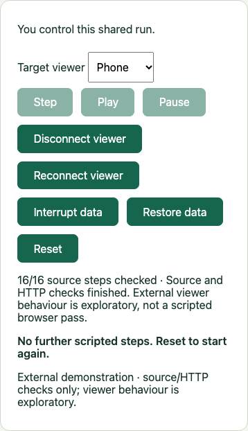

# Direct browser viewers

The fleet demo can serve the actual application to a phone and desktop at the
same time. Each browser opens its own data/control connections and keeps its own
selection and subscriptions. This mode uses synthetic data on a trusted local
network. It is not a remote screenshot stream.

After the usual installation and explicit service preparation, run:

```sh
npm run demo -- vehicle-tracker --interactive --bind=192.168.1.20
```

Replace the example address with the computer's current local IPv4 address.
Use the same network on the phone. The host accepts only loopback (`127.0.0.0/8`) and RFC 1918 private ranges
(`10.0.0.0/8`, `172.16.0.0/12`, `192.168.0.0/16`). Public addresses, wildcards,
link-local/shared ranges, hostnames and IPv6 are rejected before listening.
The operating system must also allow binding that address. ZooGlass itself stays on loopback. Without `--bind`,
the existing owned-browser verification mode is unchanged.

The terminal prints a controller pairing link. Open it on the first device
within five minutes. Use `pair Laptop` to print a separate observer link for
another device. Each link works once; reusing it does not create another viewer.
The fragment is removed from browser history before application data connects.
Keep links private while they are unused.

## Using the shared run



The controller has Step, Play, Pause and Reset. Observers can select cars, fit
or pan the map and inspect history independently, but cannot change playback.
The server enforces this even if someone bypasses the disabled UI controls.
The terminal always retains control.

Use **Target viewer** before Disconnect, Reconnect, Interrupt data or Restore.
These controls affect only the selected viewer's data route. Its control channel
stays available; other viewers and the source connections are unaffected.
Interrupt arms a 30-second recovery deadline. Restore within that deadline;
otherwise Reset or refresh the affected viewer before trying again.

Reset is shared: it replaces ZooGlass, closes old routes, clears each page's
received state and selection, and waits for new readiness before source dispatch.
Pages and their control sockets remain open. An unready external viewer is
detached after the readiness deadline; it cannot block everyone indefinitely.

| Terminal command                                  | Effect                                                        |
| ------------------------------------------------- | ------------------------------------------------------------- |
| `pair <name>`                                     | Issue a five-minute, single-use observer link.                |
| `viewers`                                         | List IDs, names, connection state and controller designation. |
| `control <viewer-id>`                             | Pause playback and transfer control.                          |
| `revoke <viewer-id>`                              | Close the viewer's routes and invalidate its credentials.     |
| `step`, `play`, `pause`, `reset`                  | Control the shared scenario.                                  |
| `disconnect <viewer-id>`, `reconnect <viewer-id>` | Change that viewer's data connection.                         |
| `interrupt <viewer-id>`, `restore <viewer-id>`    | Exercise that viewer's data fault gate and recovery.          |
| `help`, `?`, blank input                          | Show command help.                                            |
| `quit`, `q`, Ctrl+C                               | Close the host, viewers and service.                          |

Refresh in the same browser tab resumes its lease using a session-storage
capability and resubscribes for current snapshots. A new device/tab should use
its own pairing link. A second active connection cannot take over an existing
lease. Revocation or stopping the demo invalidates the capability.

If the phone backgrounds or loses Wi-Fi, refresh when it returns. Its selection
and retained data are cleared on reattachment. Control loss pauses playback if
that viewer was the controller; observer loss does not stop the other viewers.
A heartbeat detects silent connection loss within roughly 30 seconds. Recovery
of the controller does not resume Play automatically. The terminal can transfer
control if the original device is unavailable.

## What this mode verifies

External mode is explicitly exploratory. The scenario still dispatches its source
events and performs its HTTP view checks. Dynamic external viewers are not added
to the fixture's required browser-check set, and their observations cannot stand
in for scripted client assertions. The page labels this distinction, including
on completion. Source sends and each browser's own receipts remain inspectable
in its activity panel.

Use the normal owned-browser mode for scripted receipt and rendered checks;
losing that required client still fails the run. Automated external-mode tests
use two independent Chromium pages with local tiles to check selection isolation,
targeted recovery, refresh, revocation, controller handover/loss and shared Reset.
Protocol tests cover host/origin checks, stale authority, readiness bounds and
Reset during initial viewer setup. Native iPhone/Safari acceptance remains a
separate walkthrough; these tests do not claim to have completed it.

## Boundaries

Pairing is access control for the demo host, not ZooGlass product authorisation.
HTTP on the local network is not confidential transport. Do not publish this
endpoint on the internet or use it with sensitive data. Private-address binding
does not prevent an operator from exposing it through port forwarding or a tunnel. The host serves only its
asset allowlist and proxies only to its current loopback ZooGlass service; it is
not a general URL proxy or browser-debugging endpoint.

The current limit is eight viewer leases, sixteen simultaneous control sockets
(including unregistered connections), a five-second registration deadline and a
bounded command queue. Revoke unused leases before issuing more. Role and run
identity are checked both when commands arrive and when queued commands execute.
A viewer has its own run binding and random data-route token; replacement and
revocation retire old routes. No historical data replay is promised on refresh.

The initial fixture still contains three vehicles and short journeys. The fuller
six-vehicle Gibraltar scenario is a later increment.
