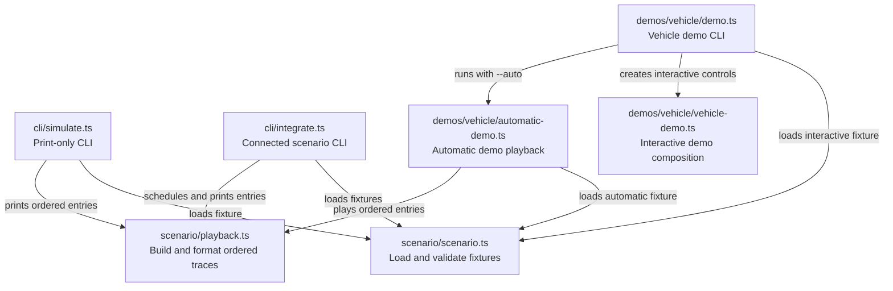
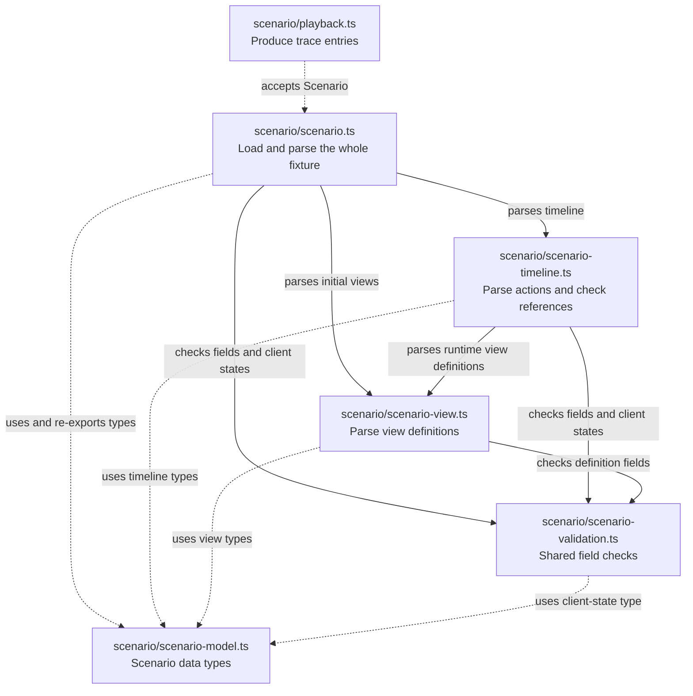
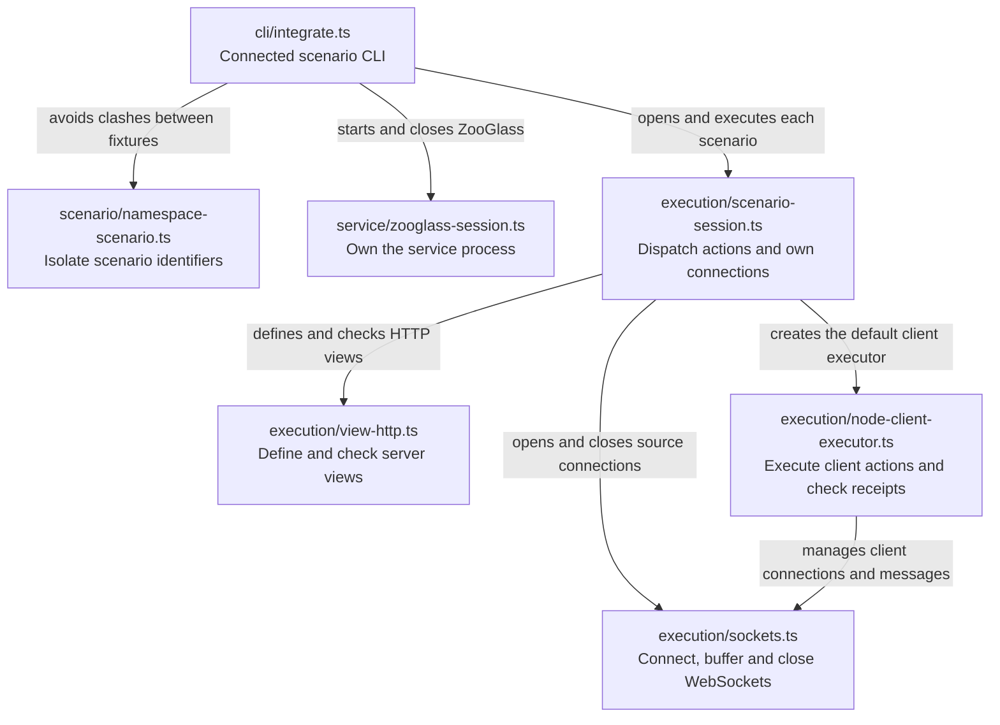
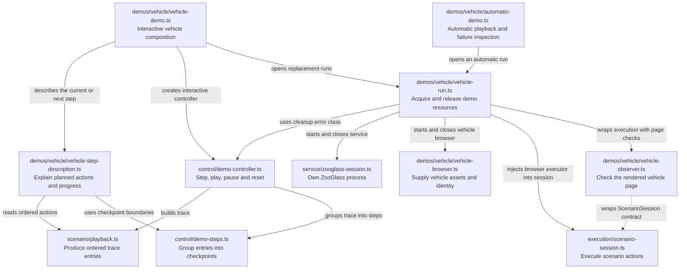
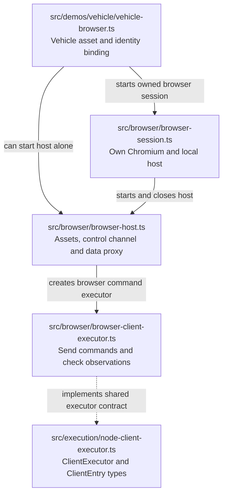
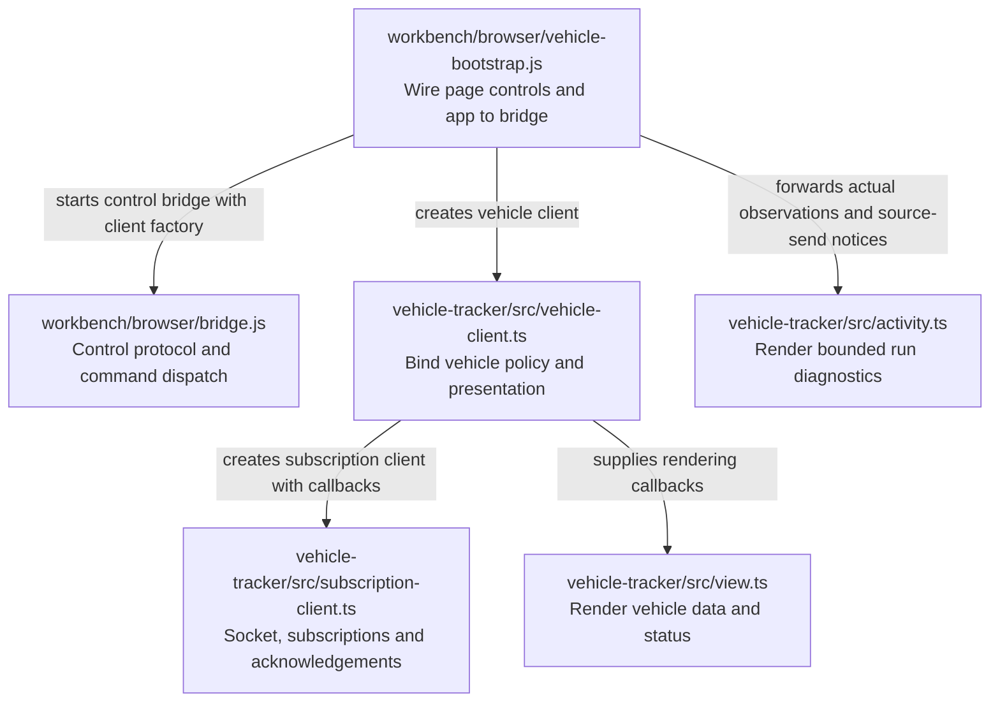

# Workbench source map

This is a reading guide to the current TypeScript modules. Start with the command
being run, then follow its dependencies to the code that does the work.

Each box is a source file. Arrows point from a module to a dependency, with labels
explaining what it uses that dependency for. Solid arrows are runtime imports;
dotted arrows are selected type dependencies. These are static relationships,
not a sequence of events or a diagram of deployed processes. Node built-ins,
external packages and most type-only imports are omitted to keep the views readable.
A file repeated in two diagrams is the same module.

Diagram paths are relative to `src/` unless shown otherwise. Modules are grouped
by responsibility, with concrete demos under `src/demos/`.

The `demos/vehicle/` folder contains its CLI (`demo.ts`), automatic playback, interactive
composition, resource ownership, asset binding and rendered-page observer.
Shared scenario execution, browser transport and playback controls have their
own folders. These modules use ordinary imports; there is no plugin loading mechanism.

## Source folders

```text
src/
├── cli/             Print-only and connected scenario commands
├── scenario/        Scenario definitions, validation and ordered traces
├── execution/       Execute actions, manage connections and check results
├── browser/         Browser lifecycle, local hosting and command execution
├── control/         Stepping, playback controls, reset and cancellation
├── service/         ZooGlass process lifecycle
└── demos/
    └── vehicle/     Compose shared components for the vehicle demo
```

`scenario/` describes and prepares the work; `execution/` performs it against
ZooGlass. `browser/` is the Node-side browser infrastructure. The sibling
`workbench/browser/` directory contains scripts served to the browser itself.
New demos can compose shared modules through ordinary imports beside `vehicle/`.
No plugin loader or registration framework is involved.

## Start with the command

| Command                           | Entry module                                                | Purpose                                                                                                  |
| --------------------------------- | ----------------------------------------------------------- | -------------------------------------------------------------------------------------------------------- |
| `npm run simulate`                | [`src/cli/simulate.ts`](../src/cli/simulate.ts)             | Load a scenario and print its ordered trace. No service is started and no results are verified.          |
| `npm run integrate`               | [`src/cli/integrate.ts`](../src/cli/integrate.ts)           | Run scenarios against a real ZooGlass process using Node clients; send events and verify expected views. |
| `npm run demo -- vehicle-tracker` | [`src/demos/vehicle/demo.ts`](../src/demos/vehicle/demo.ts) | Start the vehicle demo with browser and terminal controls, or select automatic playback with `--auto`.   |

`cli/integrate.ts` means **scenario integration with the real ZooGlass service**.
It namespaces scenario identifiers, starts one service, runs the scenarios in
order and closes the resources it owns. `--fast` skips scheduled delays, but still
executes the actions and checks. It is a CLI entry point, not a general integration
library.



## Turn a fixture into an executable trace

[`scenario/scenario.ts`](../src/scenario/scenario.ts) is the public loader/parser and re-exports the
scenario types. The smaller parser modules validate their own portions of the
JSON. [`scenario/playback.ts`](../src/scenario/playback.ts) turns a validated scenario into ordered
trace entries; callers decide when and where those entries execute.



## Execute against ZooGlass

[`service/zooglass-session.ts`](../src/service/zooglass-session.ts) owns the Java process, temporary
configuration, readiness checks and shutdown. [`execution/scenario-session.ts`](../src/execution/scenario-session.ts)
owns one scenario's connections and dispatches its trace entries. It does not
schedule delays or start a browser.



The session accepts a `ClientExecutor` factory. Normal connected runs use the
Node executor. Browser demo composition supplies an executor from the browser
host instead. This is the existing seam that keeps browser and vehicle details
out of scenario execution.

## Assemble the vehicle demo

[`control/demo-controller.ts`](../src/control/demo-controller.ts) controls stepping, playback,
reset and cancellation through the `DemoRun` contract. It does not import the
vehicle app or browser host. [`vehicle-demo.ts`](../src/demos/vehicle/vehicle-demo.ts) supplies
the concrete run and the vehicle-specific disconnect/reconnect actions.



The arrow back to `control/demo-controller.ts` is a real import of `DemoCleanupError`.
The map shows the code as it exists, including small dependencies that are easy
to miss when reading a directory listing.

`vehicle-step-description.ts` describes planned actions without inferring results.
`vehicle-run.ts` publishes a demo activity notification only after a source-send
action succeeds. Neither changes the shared execution or control contracts.

The observer is optional demo verification assembled by `vehicle-run.ts`.
It reads the rendered page independently of the vehicle app's rendering code.
The shared scenario session and client executors do not depend on it.

## Host the browser and bind the app

[`browser/browser-session.ts`](../src/browser/browser-session.ts) owns Chromium, its context/page
and the local host. [`browser/browser-host.ts`](../src/browser/browser-host.ts) serves supplied
assets, accepts the browser control connection and proxies its data connection
to ZooGlass. It has no dependency on the vehicle app's implementation.



The host serves browser modules as assets; it does not import them into Node.
The next diagram crosses into the browser source, where the two `.js` modules
are authored JavaScript and the three `.ts` modules compile to served JavaScript.



The browser bridge knows the supplied client interface. It does not import the
vehicle client. Likewise, the subscription client receives callbacks rather
than importing the vehicle renderer. These boundaries let the shared machinery
be read independently of the demo's presentation.

## Use the map while reading

For a first connected run, read `cli/integrate.ts`, then `execution/scenario-session.ts`,
then the executor or HTTP helper for the action you are interested in. For a
browser demo, start with `demo.ts`, then `vehicle-demo.ts` and `vehicle-run.ts`.
The controller explains interaction; the browser host explains transport; the
vehicle app explains presentation.

These diagrams cover the production TypeScript modules and the JavaScript
bootstrap needed to understand their browser boundary. Tests, fixtures, Java
implementation and external libraries are outside this map. See the
[verification map](../../../docs/testing.md) for the test structure and
[Workbench README](../README.md) for commands and scenarios.

When a module is added or its responsibility or dependencies change, update the
relevant view here alongside the code. Keep labels about the purpose of each
relationship, rather than reducing them to “imports”.

For the adjacent components, see the [ZooGlass source map](../../zooglass/docs/source-map.md)
and [vehicle-tracker source map](../../vehicle-tracker/docs/source-map.md).
