# Workbench source map

This is a reading guide to the current TypeScript modules. Start with the command
being run, then follow its dependencies to the code that does the work.

Each box is a source file. Arrows point from a module to a dependency, with labels
explaining what it uses that dependency for. Solid arrows are runtime imports;
dotted arrows are selected type dependencies. These are static relationships,
not a sequence of events or a diagram of deployed processes. Node built-ins,
external packages and most type-only imports are omitted to keep the views readable.
A file repeated in two diagrams is the same module.

Diagram paths are relative to `src/` unless shown otherwise. Modules are grouped
by responsibility, with concrete demos under `src/demos/`.

The `cli/demo.ts` entry point selects Order, Sports or vehicle demos.
The `demos/vehicle/` folder contains its domain CLI (`demo.ts`), automatic playback, interactive
composition, resource ownership, asset binding and rendered-page observer.
Shared scenario execution, browser transport and playback controls have their
own folders. These modules use ordinary imports; there is no plugin loading mechanism.

## Source folders

```text
src/
├── cli/             Print-only and connected scenario commands
├── scenario/        Scenario definitions, validation and ordered traces
├── execution/       Execute actions, manage connections and check results
├── browser/         Browser lifecycle, local hosting and command execution
├── control/         Stepping, playback controls, reset and cancellation
├── service/         ZooGlass process lifecycle
└── demos/
    ├── vehicle/     Compose shared components for the vehicle demo
    ├── orders/      Order sources, delivery schedule and service composition
    └── sports/      Match facts, market sources and bounded cycle retirement
```

`scenario/` describes and prepares the work; `execution/` performs it against
ZooGlass. `browser/` is the Node-side browser infrastructure. The sibling
`workbench/browser/` directory contains scripts served to the browser itself.
New demos can compose shared modules through ordinary imports beside `vehicle/`.
No plugin loader or registration framework is involved.

## Start with the command

`cli/demo.ts` dispatches demo commands. Vehicle-specific argument handling remains
in `demos/vehicle/demo.ts`, including its directly executable compatibility entry.
The Order renderer has its own [source map](../../demos/order-tracker/docs/source-map.md).

| Command                           | Entry module                                                | Purpose                                                                                                  |
| --------------------------------- | ----------------------------------------------------------- | -------------------------------------------------------------------------------------------------------- |
| `npm run simulate`                | [`src/cli/simulate.ts`](../src/cli/simulate.ts)             | Load a scenario and print its ordered trace. No service is started and no results are verified.          |
| `npm run integrate`               | [`src/cli/integrate.ts`](../src/cli/integrate.ts)           | Run scenarios against a real ZooGlass process using Node clients; send events and verify expected views. |
| `npm run demo -- vehicle-tracker` | [`src/demos/vehicle/demo.ts`](../src/demos/vehicle/demo.ts) | Start the vehicle demo with browser and terminal controls, or select automatic playback with `--auto`.   |

`cli/integrate.ts` means **scenario integration with the real ZooGlass service**.
It namespaces scenario identifiers, starts one service, runs the scenarios in
order and closes the resources it owns. `--fast` skips scheduled delays, but still
executes the actions and checks. It is a CLI entry point, not a general integration
library.

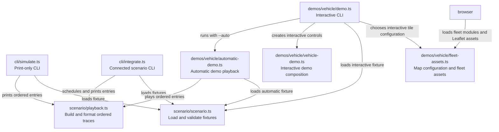

## Turn a fixture into an executable trace

[`scenario/scenario.ts`](../src/scenario/scenario.ts) is the public loader/parser and re-exports the
scenario types. The smaller parser modules validate their own portions of the
JSON. [`scenario/playback.ts`](../src/scenario/playback.ts) turns a validated scenario into ordered
trace entries; callers decide when and where those entries execute.

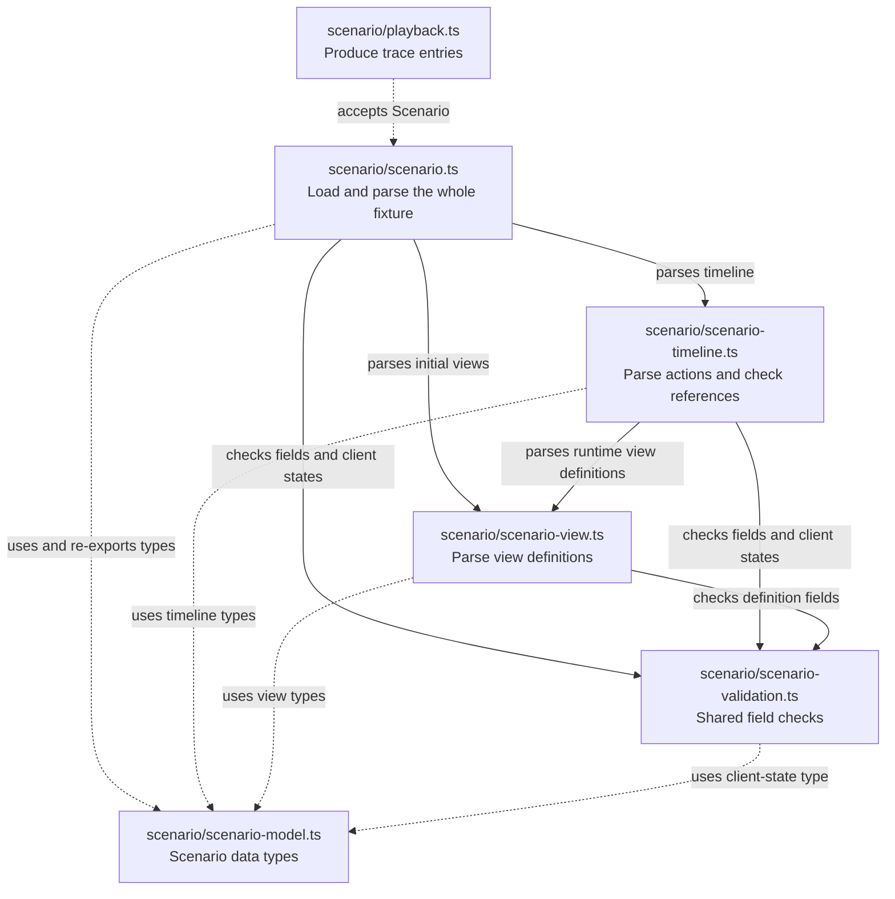

## Execute against ZooGlass

ZooGlass binds an OS-assigned loopback port and writes its number into the session directory. Workbench reads that file before checking service health.

[`service/zooglass-session.ts`](../src/service/zooglass-session.ts) owns the Java process, temporary
configuration, readiness checks and shutdown. It launches the already-built
`zooglass/target/zooglass.jar` directly with Java, without a shell or Maven.
[`scripts/prepare-service.js`](../scripts/prepare-service.js), outside `src/`, is
an explicit developer/CI preparation command. Session modules do not import or
call it; there is no runtime dependency from session startup to the build step.
[`execution/scenario-session.ts`](../src/execution/scenario-session.ts)
owns one scenario's connections and dispatches its trace entries. It does not
schedule delays or start a browser.

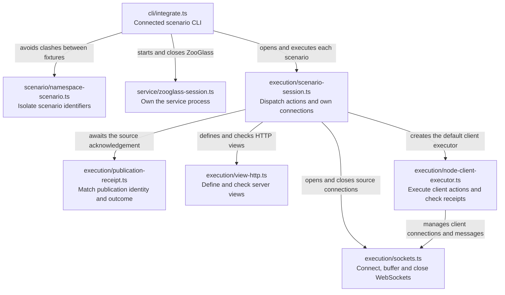

The session accepts a `ClientExecutor` factory. Normal connected runs use the
Node executor. Browser demo composition supplies an executor from the browser
host instead. This is the existing seam that keeps browser and vehicle details
out of scenario execution.

## Assemble the vehicle demo

[`control/demo-controller.ts`](../src/control/demo-controller.ts) controls stepping, playback,
reset and cancellation through the `DemoRun` contract. It does not import the
vehicle app or browser host. [`vehicle-demo.ts`](../src/demos/vehicle/vehicle-demo.ts) supplies
the concrete run and the vehicle-specific disconnect/reconnect actions.

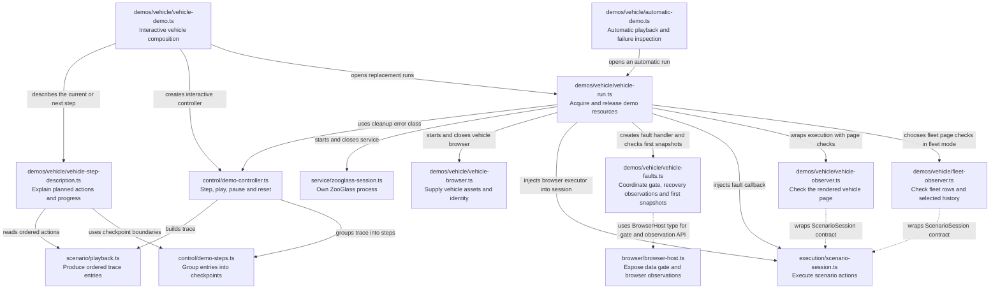

The arrow back to `control/demo-controller.ts` is a real import of `DemoCleanupError`.
The map shows the code as it exists, including small dependencies that are easy
to miss when reading a directory listing.

`vehicle-step-description.ts` describes planned actions without inferring results.
`vehicle-run.ts` publishes a demo activity notification only after a source-send
action succeeds. Neither changes the shared execution or control contracts.

`vehicle-faults.ts` arms recovery, controls the gate and waits for current-run
observations. After restoration it compares each view's first snapshot with the
scenario expectation. The shared session dispatches fault entries through an
injected callback and rejects unsupported scenarios before allocating resources;
it does not import the vehicle adapter.

The observers are optional demo verification assembled by `vehicle-run.ts`.
Fleet mode checks list rows and selected history without changing selection;
unselected histories are receipt-checked. The fleet browser test separately
selects each vehicle to check its detail.
It reads the rendered page independently of the vehicle app's rendering code.
The shared scenario session and client executors do not depend on it.

## Serve independent external viewers

The `--bind=<IPv4>` path selects external mode explicitly. The terminal owns the
demo lifetime; the demo composes shared playback with a source/HTTP-only scenario.
Viewer setup and targeted actions stay in the vehicle adapter. The external host
knows leases, roles, control connections and per-viewer run bindings, not vehicles.

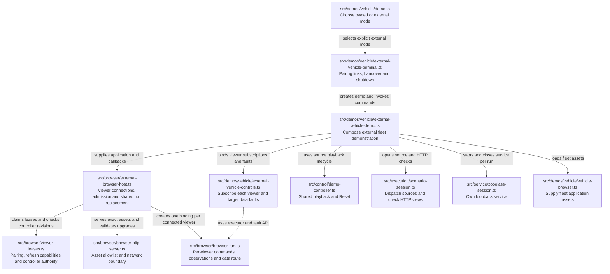

Browser `bridge.js` consumes pairing or session-storage credentials, then keeps
run-change handling independent of the demo. `vehicle-bootstrap.js` presents the
controller role and target-viewer selector. External observers remain optional;
owned-browser mode retains its required scripted client. See the
[external-viewer guide](external-viewers.md) for the runtime contract and limits.

## Host the browser and bind the app

[`browser/browser-session.ts`](../src/browser/browser-session.ts) composes an owned
browser and local host for existing verification. The independent lifetimes and
replacement handshake are described in [Browser host and run lifetimes](browser-lifetime.md).
The host owns assets and the control connection; each run owns its executor,
receipts and data fault gate. The launcher owns only Chromium.

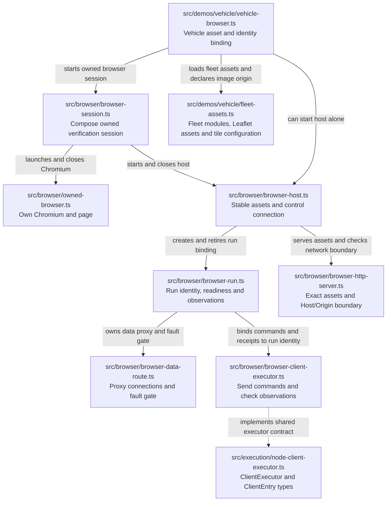

The host serves browser modules as assets; it does not import them into Node.
Applications may declare exact HTTPS image origins; scripts and data connections
remain local. Fleet composition supplies that declaration for the tile provider.
The demo CLI chooses interactive tile configuration; programmatic sessions default
to local synthetic tiles.
The next diagram crosses into the browser source, where the two `.js` modules
are authored JavaScript and the `.ts` modules compile to served JavaScript.

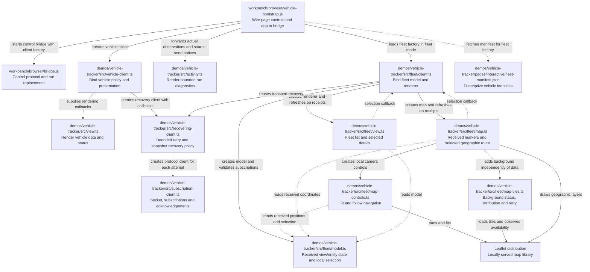

The browser bridge knows the supplied client interface. It does not import the
vehicle client. Likewise, the subscription client receives callbacks rather
than importing the vehicle renderer. These boundaries let the shared machinery
be read independently of the demo's presentation.

## Use the map while reading

For a first connected run, read `cli/integrate.ts`, then `execution/scenario-session.ts`,
then the executor or HTTP helper for the action you are interested in. For a
browser demo, start with `demo.ts`, then `vehicle-demo.ts` and `vehicle-run.ts`.
The controller explains interaction; the browser host explains transport; the
vehicle app explains presentation.

These diagrams cover the production TypeScript modules and the JavaScript
bootstrap needed to understand their browser boundary. Tests, fixtures, Java
implementation and external libraries are outside this map. See the
[verification map](../../docs/testing.md) for the test structure and
[Workbench README](../README.md) for commands and scenarios.

When a module is added or its responsibility or dependencies change, update the
relevant view here alongside the code. Keep labels about the purpose of each
relationship, rather than reducing them to “imports”.

For the adjacent components, see the [ZooGlass source map](../../zooglass/docs/source-map.md)
and [vehicle-tracker source map](../../demos/vehicle-tracker/docs/source-map.md).

## Continuous Gibraltar demonstration

`npm run demo -- vehicle-tracker --continuous` selects this small demo-specific composition through `demos/vehicle/demo.ts`. There is no
controller, pairing lease, browser command channel or dependence on a viewer's
presence. The static host exposes assets and the live subscription proxy only.

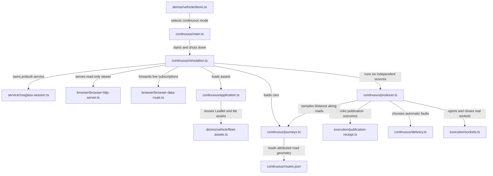

[Behaviour and limits](continuous-driving.md). The browser source map describes
its passive subscriber and map, separately from the scripted bridge.

## Order service and browser composition

The [order source guide](order-sources.md) explains the schedule and verification.
`npm run demo -- order-tracker --continuous` dispatches through `cli/demo.ts` to
`demos/orders/main.ts`. The browser composition owns a prepared service, producer,
exact static asset host and data proxy. Sources continue independently of viewers.
Shared Workbench infrastructure does not import this concrete demo.

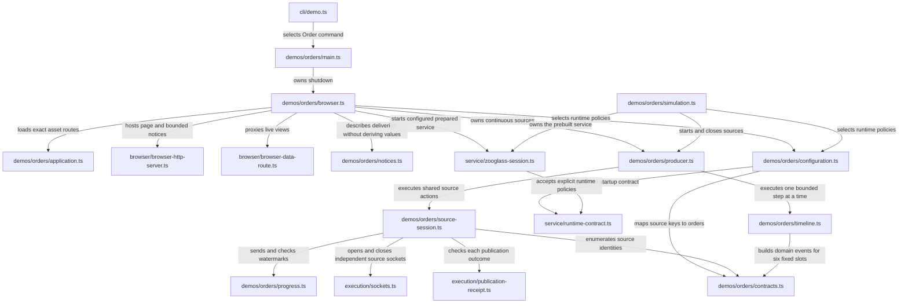

The final acceptance keeps its oracles outside the producer.
[`order-simulation.test.ts`](../test/scenarios/order-simulation.test.ts) checks
service snapshots over three cycles and inspects the stopped 50-cycle SQLite
image for retained row/receipt/range bounds.
[`order-browser.test.ts`](../test/browser/order-browser.test.ts) checks all twelve
first baselines for reconnecting and late viewers after three completed cycles.
[`order-extension.test.ts`](../test/scenarios/order-extension.test.ts) supplies an
extra entity, source and view through the real launcher's startup configuration,
without invoking the production event builder or adding projection code.
See the [acceptance record](../../docs/verification/2026-11-12-order-acceptance.md).

### Interactive Order walkthrough

`--interactive` keeps one page/control host while Reset replaces its service,
store, source sockets and view route. Same-origin controls are shared by up to 16
viewers; stale run-generation commands are rejected. Closing the terminal owner
retires all resources. `checkpoints.ts` owns domain expectations; shared playback
owns the cursor and cancellation, with its vehicle trace adapter preserved. The
prepared adapter publishes state through the stable host even between runs, so a
failed replacement startup remains visible and Reset can be retried.

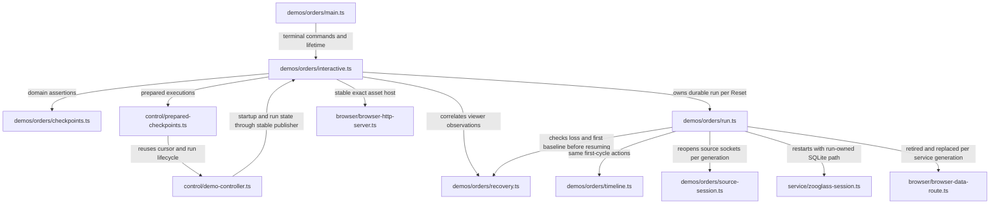

## Protected service acceptance

The existing service owner also accepts explicit protected deployment settings.
The browser acceptance fixture supplies the authority and exercises the basic
vehicle demo or Order-specific configured grants; it does not replace ZooGlass's
decision or delivery code. The finite Order case runs the actual protected renderer
through scoped subscription denial, revocation and fresh admission.

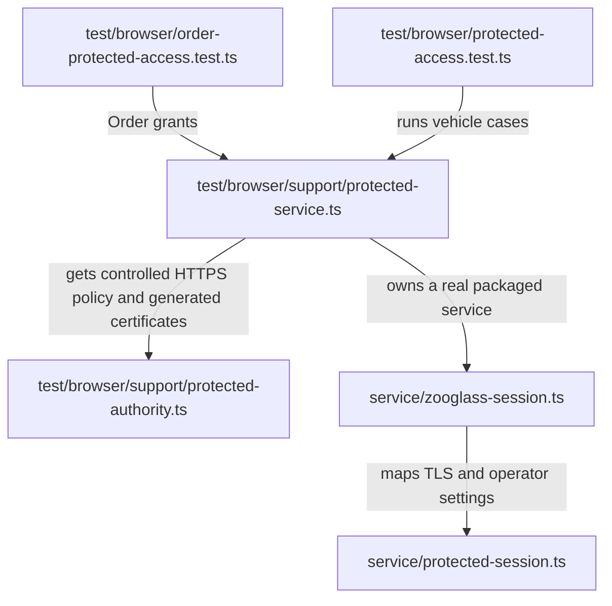

See [protected client acceptance](protected-client-acceptance.md) for the command
and the behaviours it verifies.

## Sports source foundation

`demos/sports/main.ts` runs sources without a browser. The typed Sports checkpoint
runner includes publication, watermark and fact-retirement actions; the older
print-only JSON scenario format is unchanged. Finite and repeating operation use
the same lazy schedule. See the [source guide](sports-sources.md) for commands,
observable outcomes and window-transition rules.

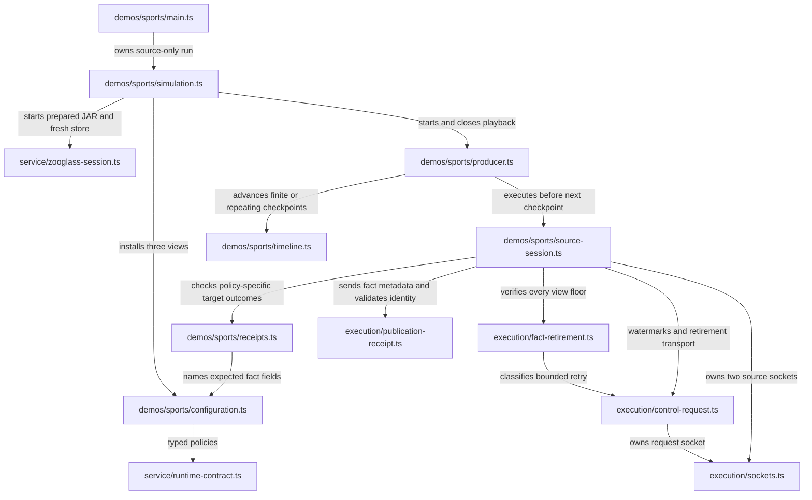

No shared execution module imports a Sports module. `configuration.ts` selects
existing ZooGlass strategies; `timeline.ts` supplies synthetic source facts and
market decisions. It does not project scores or reconcile revisions. Retirement
blocks the producer until every view's acknowledgement is verified. Observers
may await checkpoints for independent HTTP and live-subscriber assertions.

## Sports continuous browser

`cli/demo.ts` selects `live-sports --continuous`. The source-only `sports/main.ts`
entry remains available separately. This composition reuses the delivered source
schedule and shared service/host/data-route modules; viewers do not own the run.

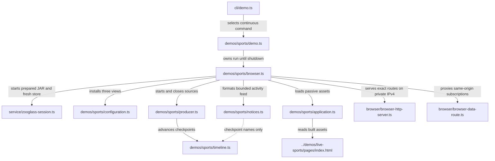

The host exposes viewer assets, a bounded activity JSON document and the live
subscription socket. It does not expose source/control or direct service HTTP
routes. `demo.ts` logs checkpoint failures and keeps the failed run available until
Ctrl+C or SIGTERM. `browser.ts` publishes run failures and owns cleanup of sources, data
route, HTTP host and service. Tests can block the data route or await source
checkpoints without adding controls to the passive page. The browser consumer has
its own [source map](../../demos/live-sports/docs/source-map.md).

## Sports interactive walkthrough

The interactive host keeps the page and controls alive while Reset replaces the
service, store, source sockets and data route. It uses the delivered prepared
checkpoint controller; no browser code reconciles scores or owns source state.

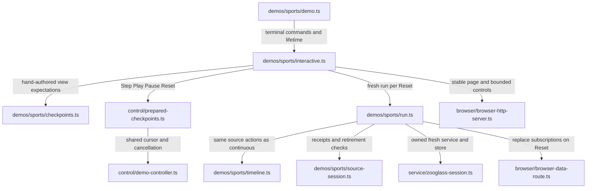

`checkpoints.ts` inspects real snapshots with independent expected totals, scorers,
gaps and floors. Its finite sequence covers the complete first cycle and the next
cycle's baselines. `run.ts` advances the same lazy timeline used by continuous
mode. Pause finishes pending verification; Reset cancels it and creates a fresh
store. Failed checkpoints and failed Reset startup remain visible through the
stable control connection. Terminal Quit/Ctrl+C retires the controller and host.
