# Workbench source map

The accepted [deterministic timeline design](../../docs/design/deterministic-timeline.md)
contains the wider planned component diagram. The implemented
[bounded timeline](timeline-guide.md) runs through explicit commands alongside
the existing live demos.

This is a reading guide to the current TypeScript modules. Start with the command
being run, then follow its dependencies to the code that does the work.

Each box is a source file. Arrows point from a module to a dependency, with labels
explaining what it uses that dependency for. Solid arrows are runtime imports;
dotted arrows are selected type dependencies. These are static relationships,
not a sequence of events or a diagram of deployed processes. Node built-ins,
external packages and most type-only imports are omitted to keep the views readable.
A file repeated in two diagrams is the same module.

Diagram paths are relative to `src/` unless shown otherwise. Modules are grouped
by responsibility, with concrete demos under `src/demos/`.

The `cli/demo.ts` entry point selects Order, Sports or vehicle demos.
The `demos/vehicle/` folder contains its domain CLI (`demo.ts`), automatic playback, interactive
composition, resource ownership, asset binding and rendered-page observer.
Shared scenario execution, browser transport and playback controls have their
own folders. These modules use ordinary imports; there is no plugin loading mechanism.

## Source folders

```text
src/
├── cli/             Print-only and connected scenario commands
├── scenario/        Scenario definitions, validation and ordered traces
├── execution/       Execute actions, manage connections and check results
├── browser/         Browser lifecycle, local hosting and command execution
├── control/         Stepping, playback controls, reset and cancellation
├── timeline/        Deterministic execution, evidence contracts and replay
├── explanation/     Offline evidence presentation and report output
├── ha-cases/        Fixed two-process fault cases and evidence runner
├── ha-fixture/      Owned Docker topology, TLS and service fault controls
├── service/         ZooGlass process lifecycle
└── demos/
    ├── vehicle/     Compose shared components for the vehicle demo
    ├── orders/      Order sources, delivery schedule and service composition
    └── sports/      Match facts, market sources and bounded cycle retirement
```

`scenario/` describes and prepares the work; `execution/` performs it against
ZooGlass. `browser/` is the Node-side browser infrastructure. The sibling
`workbench/browser/` directory contains scripts served to the browser itself.
New demos can compose shared modules through ordinary imports beside `vehicle/`.
No plugin loader or registration framework is involved.

## Start with the command

`cli/demo.ts` dispatches demo commands. Vehicle-specific argument handling remains
in `demos/vehicle/demo.ts`, including its directly executable compatibility entry.
The Order renderer has its own [source map](../../demos/order-tracker/docs/source-map.md).

| Command                           | Entry module                                                | Purpose                                                                                                  |
| --------------------------------- | ----------------------------------------------------------- | -------------------------------------------------------------------------------------------------------- |
| `npm run simulate`                | [`src/cli/simulate.ts`](../src/cli/simulate.ts)             | Load a scenario and print its ordered trace. No service is started and no results are verified.          |
| `npm run integrate`               | [`src/cli/integrate.ts`](../src/cli/integrate.ts)           | Run scenarios against a real ZooGlass process using Node clients; send events and verify expected views. |
| `npm run demo -- vehicle-tracker` | [`src/demos/vehicle/demo.ts`](../src/demos/vehicle/demo.ts) | Start the vehicle demo with browser and terminal controls, or select automatic playback with `--auto`.   |

`cli/integrate.ts` means **scenario integration with the real ZooGlass service**.
It namespaces scenario identifiers, starts one service, runs the scenarios in
order and closes the resources it owns. `--fast` skips scheduled delays, but still
executes the actions and checks. It is a CLI entry point, not a general integration
library.

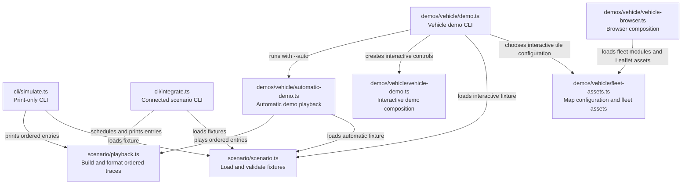

## Turn a fixture into an executable trace

[`scenario/scenario.ts`](../src/scenario/scenario.ts) is the public loader/parser and re-exports the
scenario types. The smaller parser modules validate their own portions of the
JSON. [`scenario/playback.ts`](../src/scenario/playback.ts) turns a validated scenario into ordered
trace entries; callers decide when and where those entries execute.

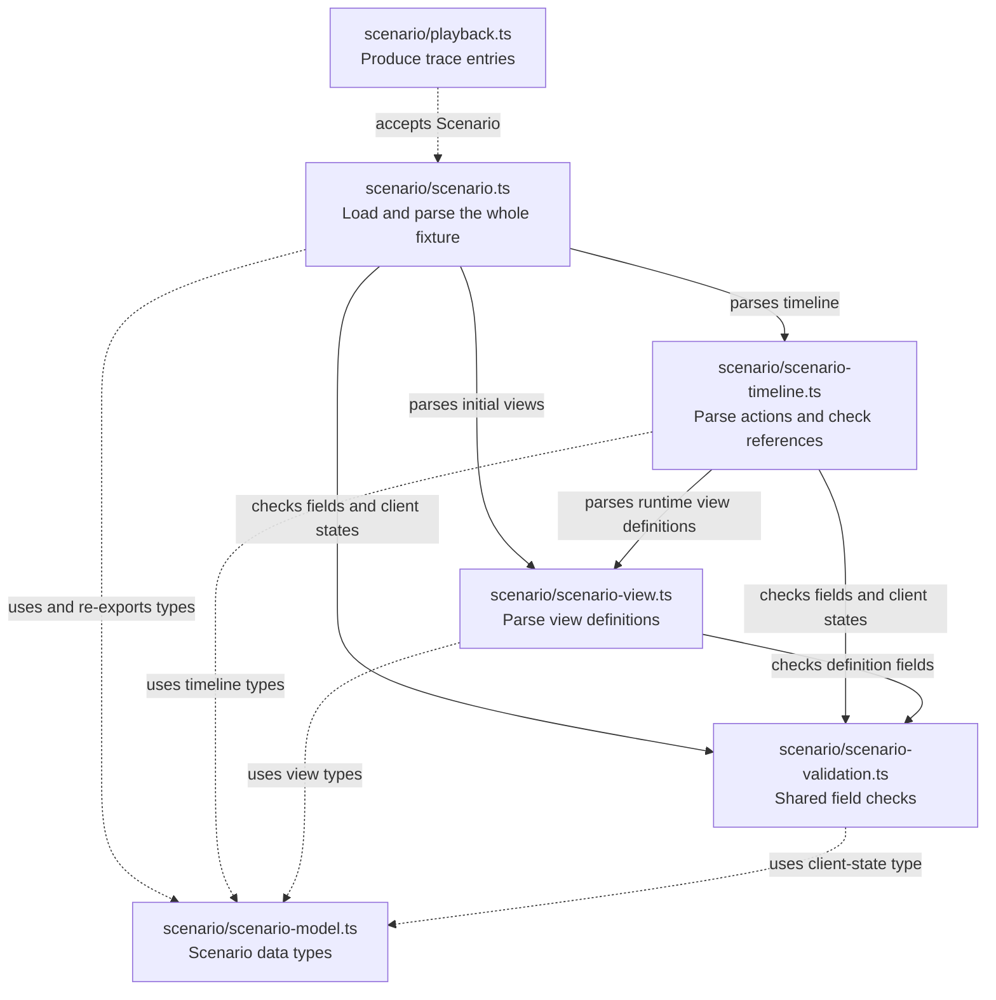

## Execute against ZooGlass

ZooGlass binds an OS-assigned loopback port and writes its number into the session directory. Workbench reads that file before checking service health.

[`service/zooglass-session.ts`](../src/service/zooglass-session.ts) owns the Java process, temporary
configuration, readiness checks and shutdown. Ordinary close ensures cleanup;
`close({ requireOrderly: true })` additionally rejects forced, unsuccessful or
pre-existing exits after cleanup. Repeated callers retain the original outcome.
This records observed termination, not proof that every shutdown hook succeeded.
It launches the already-built
`zooglass/target/zooglass.jar` directly with Java, without a shell or Maven.
[`scripts/prepare-service.js`](../scripts/prepare-service.js), outside `src/`, is
an explicit developer/CI preparation command. Session modules do not import or
call it; there is no runtime dependency from session startup to the build step.
[`execution/scenario-session.ts`](../src/execution/scenario-session.ts)
owns one scenario's connections and dispatches its trace entries. It does not
schedule delays or start a browser.

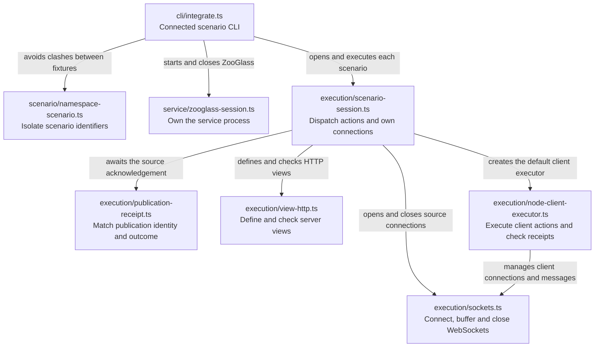

The session accepts a `ClientExecutor` factory. Normal connected runs use the
Node executor. Browser demo composition supplies an executor from the browser
host instead. This is the existing seam that keeps browser and vehicle details
out of scenario execution.

## Assemble the vehicle demo

[`control/demo-controller.ts`](../src/control/demo-controller.ts) controls stepping, playback,
reset and cancellation through the `DemoRun` contract. It does not import the
vehicle app or browser host. [`vehicle-demo.ts`](../src/demos/vehicle/vehicle-demo.ts) supplies
the concrete run and the vehicle-specific disconnect/reconnect actions.

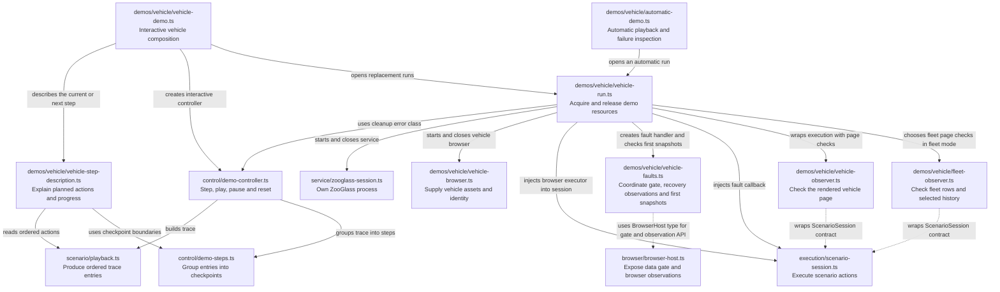

The arrow back to `control/demo-controller.ts` is a real import of `DemoCleanupError`.
The map shows the code as it exists, including small dependencies that are easy
to miss when reading a directory listing.

`vehicle-step-description.ts` describes planned actions without inferring results.
`vehicle-run.ts` publishes a demo activity notification only after a source-send
action succeeds. Neither changes the shared execution or control contracts.

`vehicle-faults.ts` arms recovery, controls the gate and waits for current-run
observations. After restoration it compares each view's first snapshot with the
scenario expectation. The shared session dispatches fault entries through an
injected callback and rejects unsupported scenarios before allocating resources;
it does not import the vehicle adapter.

The observers are optional demo verification assembled by `vehicle-run.ts`.
Fleet mode checks list rows and selected history without changing selection;
unselected histories are receipt-checked. The fleet browser test separately
selects each vehicle to check its detail.
It reads the rendered page independently of the vehicle app's rendering code.
The shared scenario session and client executors do not depend on it.

## Serve independent external viewers

The `--bind=<IPv4>` path selects external mode explicitly. The terminal owns the
demo lifetime; the demo composes shared playback with a source/HTTP-only scenario.
Viewer setup and targeted actions stay in the vehicle adapter. The external host
knows leases, roles, control connections and per-viewer run bindings, not vehicles.

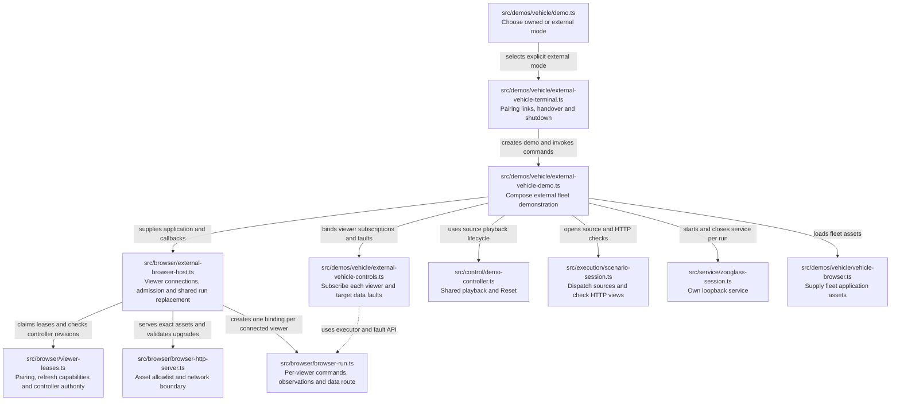

Browser `bridge.js` consumes pairing or session-storage credentials, then keeps
run-change handling independent of the demo. `vehicle-bootstrap.js` presents the
controller role and target-viewer selector. External observers remain optional;
owned-browser mode retains its required scripted client. See the
[external-viewer guide](external-viewers.md) for the runtime contract and limits.

## Host the browser and bind the app

[`browser/browser-session.ts`](../src/browser/browser-session.ts) composes an owned
browser and local host for existing verification. The independent lifetimes and
replacement handshake are described in [Browser host and run lifetimes](browser-lifetime.md).
The host owns assets and the control connection; each run owns its executor,
receipts and data fault gate. The launcher owns only Chromium.

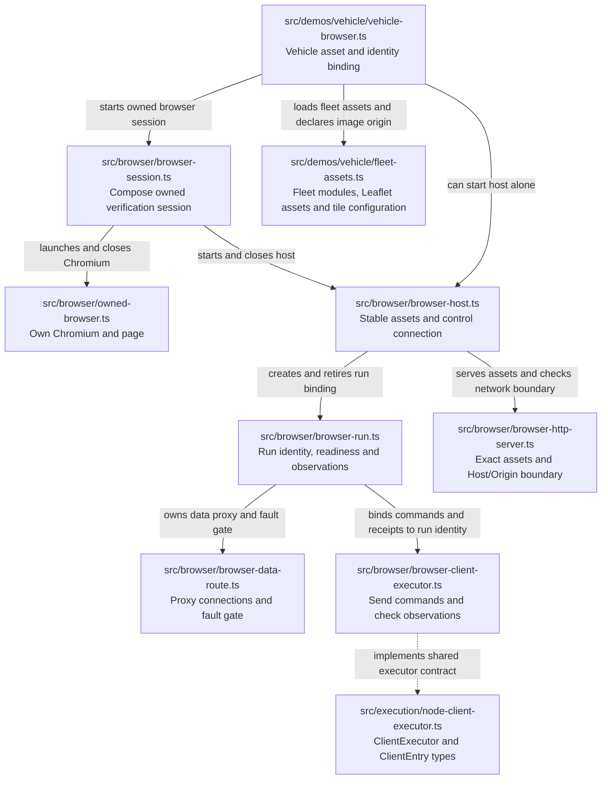

The host serves browser modules as assets; it does not import them into Node.
Applications may declare exact HTTPS image origins; scripts and data connections
remain local. Fleet composition supplies that declaration for the tile provider.
The demo CLI chooses interactive tile configuration; programmatic sessions default
to local synthetic tiles.
The next diagram crosses into the browser source, where the two `.js` modules
are authored JavaScript and the `.ts` modules compile to served JavaScript.

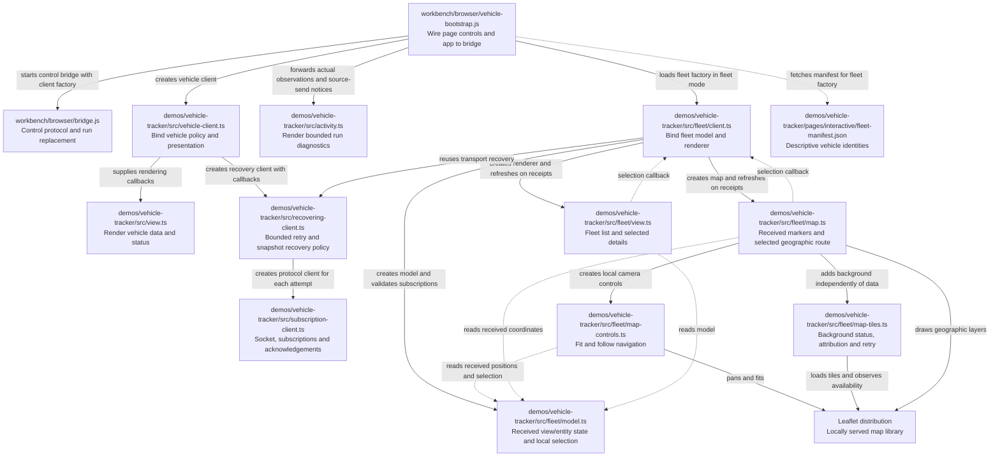

The browser bridge knows the supplied client interface. It does not import the
vehicle client. Likewise, the subscription client receives callbacks rather
than importing the vehicle renderer. These boundaries let the shared machinery
be read independently of the demo's presentation.

## Use the map while reading

For a first connected run, read `cli/integrate.ts`, then `execution/scenario-session.ts`,
then the executor or HTTP helper for the action you are interested in. For a
browser demo, start with `demo.ts`, then `vehicle-demo.ts` and `vehicle-run.ts`.
The controller explains interaction; the browser host explains transport; the
vehicle app explains presentation.

These diagrams cover the production TypeScript modules and the JavaScript
bootstrap needed to understand their browser boundary. Tests, fixtures, Java
implementation and external libraries are outside this map. See the
[verification map](../../docs/testing.md) for the test structure and
[Workbench README](../README.md) for commands and scenarios.

When a module is added or its responsibility or dependencies change, update the
relevant view here alongside the code. Keep labels about the purpose of each
relationship, rather than reducing them to “imports”.

For the adjacent components, see the [ZooGlass source map](../../zooglass/docs/source-map.md)
and [vehicle-tracker source map](../../demos/vehicle-tracker/docs/source-map.md).

## Continuous Gibraltar demonstration

`npm run demo -- vehicle-tracker --continuous` selects this small demo-specific composition through `demos/vehicle/demo.ts`. There is no
controller, pairing lease, browser command channel or dependence on a viewer's
presence. The static host exposes assets and the live subscription proxy only.

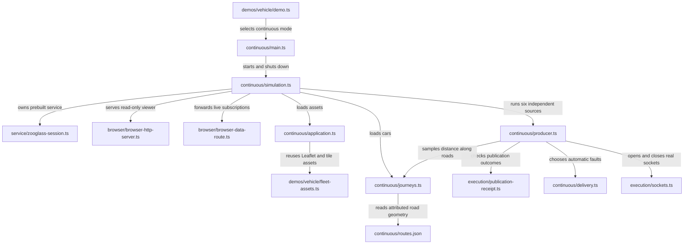

[Behaviour and limits](continuous-driving.md). The browser source map describes
its passive subscriber and map, separately from the scripted bridge.

## Order service and browser composition

The [order source guide](order-sources.md) explains the schedule and verification.
`npm run demo -- order-tracker --continuous` dispatches through `cli/demo.ts` to
`demos/orders/main.ts`. The browser composition owns a prepared service, producer,
exact static asset host and data proxy. Sources continue independently of viewers.
Shared Workbench infrastructure does not import this concrete demo.

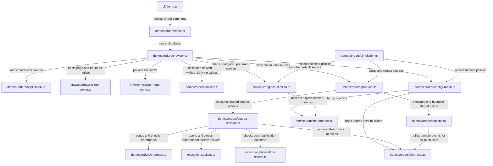

The final acceptance keeps its oracles outside the producer.
[`order-simulation.test.ts`](../test/scenarios/order-simulation.test.ts) checks
service snapshots over three cycles and inspects the stopped 50-cycle SQLite
image for retained row/receipt/range bounds.
[`order-browser.test.ts`](../test/browser/order-browser.test.ts) checks all twelve
first baselines for reconnecting and late viewers after three completed cycles.
[`order-extension.test.ts`](../test/scenarios/order-extension.test.ts) supplies an
extra entity, source and view through the real launcher's startup configuration,
without invoking the production event builder or adding projection code.
See the [acceptance record](../../docs/verification/2026-11-12-order-acceptance.md).

### Interactive Order walkthrough

`--interactive` keeps one page/control host while Reset replaces its service,
store, source sockets and view route. Same-origin controls are shared by up to 16
viewers; stale run-generation commands are rejected. Closing the terminal owner
retires all resources. `checkpoints.ts` owns domain expectations; shared playback
owns the cursor and cancellation, with its vehicle trace adapter preserved. The
prepared adapter publishes state through the stable host even between runs, so a
failed replacement startup remains visible and Reset can be retried.

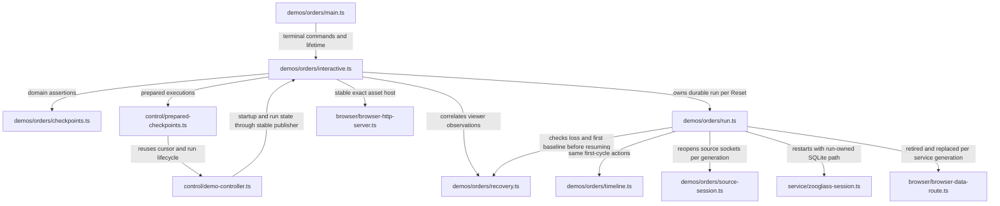

## Protected service acceptance

The existing service owner also accepts explicit protected deployment settings.
The browser acceptance fixture supplies the authority and exercises the basic
vehicle demo or Order-specific configured grants; it does not replace ZooGlass's
decision or delivery code. The finite Order case runs the actual protected renderer
through scoped subscription denial, revocation and fresh admission.

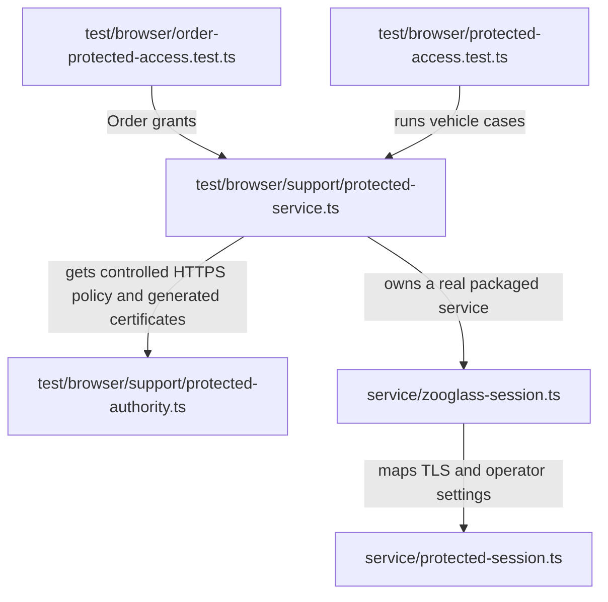

See [protected client acceptance](protected-client-acceptance.md) for the command
and the behaviours it verifies.

## Sports source foundation

`demos/sports/main.ts` runs sources without a browser. The typed Sports checkpoint
runner includes publication, watermark and fact-retirement actions; the older
print-only JSON scenario format is unchanged. Finite and repeating operation use
the same lazy schedule. See the [source guide](sports-sources.md) for commands,
observable outcomes and window-transition rules.

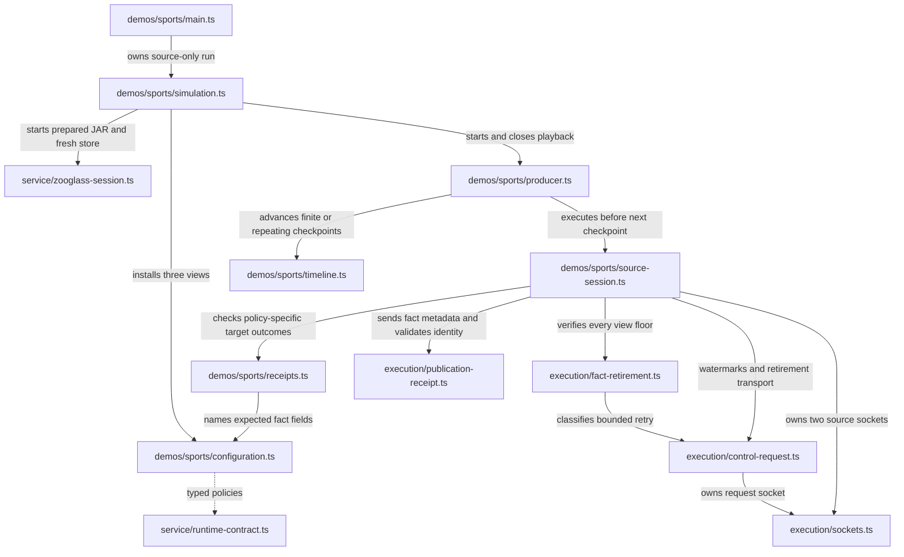

No shared execution module imports a Sports module. `configuration.ts` selects
existing ZooGlass strategies; `timeline.ts` supplies synthetic source facts and
market decisions. It does not project scores or reconcile revisions. Retirement
blocks the producer until every view's acknowledgement is verified. Observers
may await checkpoints for independent HTTP and live-subscriber assertions.

## Sports continuous browser

`cli/demo.ts` selects `live-sports --continuous`. The source-only `sports/main.ts`
entry remains available separately. This composition reuses the delivered source
schedule and shared service/host/data-route modules; viewers do not own the run.

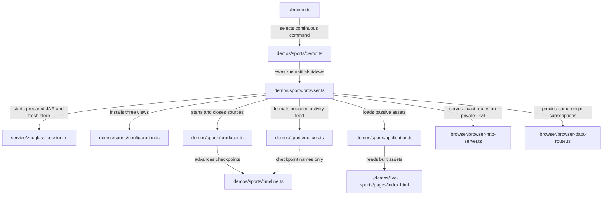

The host exposes viewer assets, a bounded activity JSON document and the live
subscription socket. It does not expose source/control or direct service HTTP
routes. `demo.ts` logs checkpoint failures and keeps the failed run available until
Ctrl+C or SIGTERM. `browser.ts` publishes run failures and owns cleanup of sources, data
route, HTTP host and service. Tests can block the data route or await source
checkpoints without adding controls to the passive page. The browser consumer has
its own [source map](../../demos/live-sports/docs/source-map.md).

## Sports interactive walkthrough

The interactive host keeps the page and controls alive while Reset replaces the
service, store, source sockets and data route. It uses the delivered prepared
checkpoint controller; no browser code reconciles scores or owns source state.

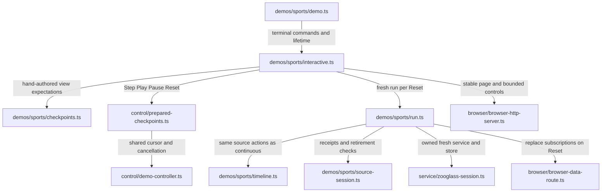

`checkpoints.ts` inspects real snapshots with independent expected totals, scorers,
gaps and floors. Its finite sequence covers the complete first cycle and the next
cycle's baselines. `run.ts` advances the same lazy timeline used by continuous
mode. Pause finishes pending verification; Reset cancels it and creates a fresh
store. Failed checkpoints and failed Reset startup remain visible through the
stable control connection. Terminal Quit/Ctrl+C retires the controller and host.

## Sports acceptance evidence

The runtime composition above is unchanged by final acceptance.
`test/scenarios/sports-simulation.test.ts` checks literal outcomes over three cycles;
`sports-bounds.test.ts` inspects the stopped 40-cycle SQLite image for retained
facts, tombstones, stream receipts and progress ranges. `sports-retirement.test.ts`
checks partial control failure and exact acknowledgement-loss retry.

`test/scenarios/sports-extension.test.ts` supplies independent match-4 events and
adds a score-only first-fact view through the same startup configuration. It uses
`service/zooglass-session.ts`, `execution/sockets.ts` and
`execution/publication-receipt.ts`, without the production timeline as its oracle.
`test/browser/sports-acceptance.test.ts` verifies all nine first returning/late baselines
after three completed cycles with no subsequent source publication. See the
[acceptance record](../../docs/verification/2026-11-13-sports-acceptance.md).

## Timeline artifact preparation

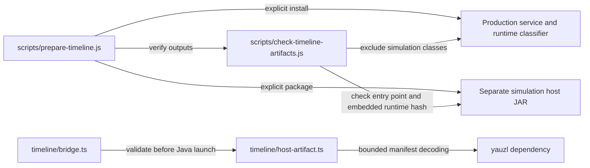

Preparation is the only path here that invokes Maven. The artifact checker verifies
production isolation and that the host embeds the freshly prepared runtime
classifier. At execution time, `host-artifact.ts` validates the bounded ZIP directory,
inflates only the manifest and requires the fixed host entry point before the
bridge launches Java.
It does not certify arbitrary JAR contents; executable hashes and replay admission
remain separate identity checks. Tests and scenario execution never prepare a JAR.

## Fixed-fixture timeline proof

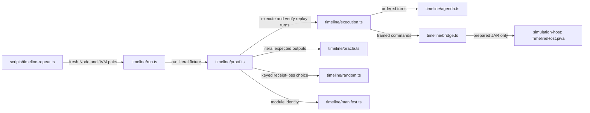

Wire payloads remain exact strings across Node. Java canonicalises object keys and
exact decimal values; the transcript retains ordered effects before comparison.
The fixture oracle compares complete client frames, receipts and state transitions
against hand-authored expectations, with exact wire checks for lossless payload
numbers. Replay compares each fresh turn before processing its effects and stops
at the first difference. No Java build is invoked by proof execution or tests.

## Experimental timeline contracts

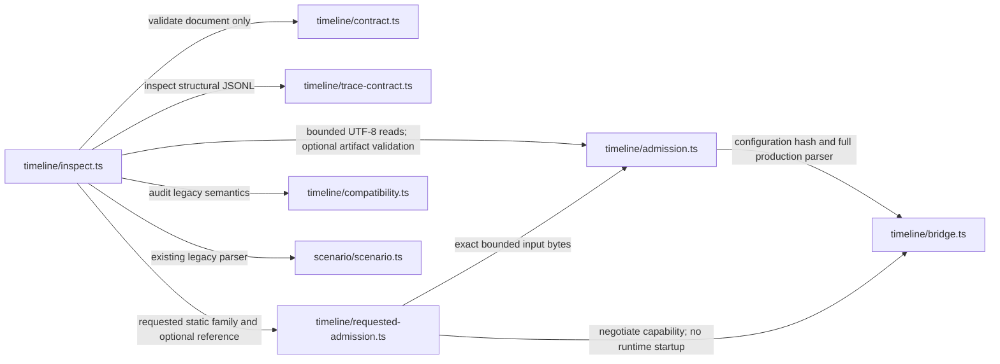

Document and trace admission share lossless values and explicit structural checks:

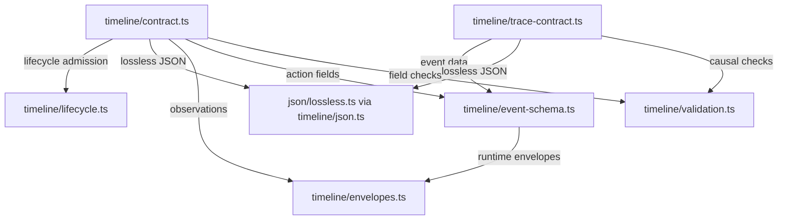

All inspection modes use bounded reads and reject malformed UTF-8. Ordinary
inspection does not invoke Java. Explicit admission inspection invokes
the prepared artifact solely for configuration validation, without runtime actions.
A valid document or configuration is not an executable-capability claim. See [contracts and compatibility](timeline-format.md).

## Explicit sequence profile identity

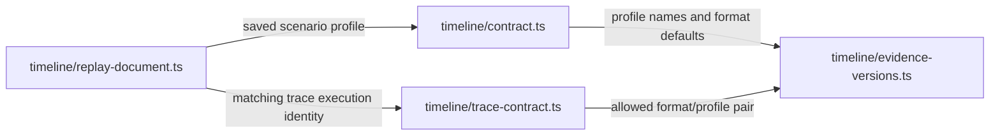

The v2 sequence profile is explicit; old documents retain their default identity.
Admission checks the host capability and configuration before initialization.
See [the bounded sequence profile](timeline-fleet-profile.md).

## Bounded document execution

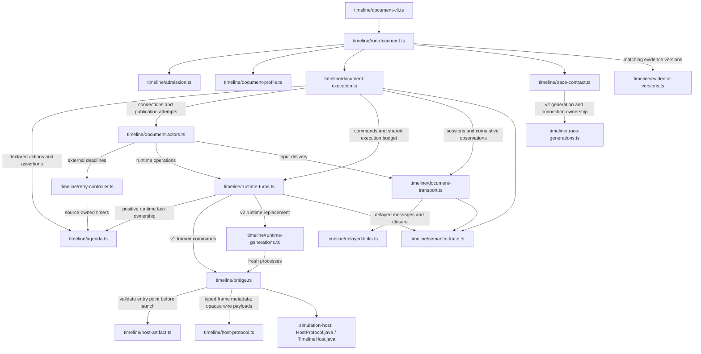

`DocumentExecution` preloads declared actions, handles runtime stop/start and
checks scenario assertions. `DocumentActors` owns connections, publication attempts
and external retry orchestration. `RuntimeTurns` owns bridge
responses, positive runtime task IDs and the shared execution-turn budget; transport
callbacks and assertions consume that same budget. `DocumentTransport` owns
session-bound effects, writer handoffs, receipt-loss decisions, delayed traffic and
cumulative delivered observations. The modules exchange explicit commands and
effect callbacks; they do not reconstruct runtime output from expected assertions.

The v2 memory generation owner retains command identity and budget while
replacing the JVM:

```mermaid
flowchart LR
  generations["timeline/runtime-generations.ts"] -->|fresh process and verified stop| bridge["timeline/bridge.ts"]
  bridge -->|explicit protocol 2 admission| protocol["timeline/host-protocol.ts"]
  bridge -->|derive command clocks and validate replies| command["timeline/bridge-command.ts"]
```

`bridge-command.ts` derives command clocks and encoded bytes, then checks reply
identity, clocks and requested snapshots without mutating bridge state. The bridge
retains command admission, overlap rejection, framing, process ownership and failure
handling. It advances epoch/turn before sending and commits wall offset, projection
mode and acknowledgment only after the complete reply passes validation.

The bridge decodes UTF-8 strictly and admits handshake/response metadata through
`host-protocol.ts`. Discriminated effect types tell each consumer which fields are
present; task ownership and causal-time checks remain with the execution owner.
Domain envelopes stay exact wire strings until the lossless domain parser reads them.

Trace records are appended as effects occur. Scheduling and handoff causes retain
their own event identities, and assertions wait for real scheduled work to settle.
The prepared host JAR is separate from the production service. See
[execution and limits](timeline-execution.md).

## Document verification replay

```mermaid
flowchart LR
  cli["timeline/replay-cli.ts"] --> replay["timeline/replay-document.ts"]
  replay -->|validate saved inputs and complete trace| contract["timeline/trace-contract.ts"]
  replay -->|retained inputs, fresh JVM| run["timeline/run-document.ts"]
  run --> environment["timeline/replay-environment.ts"]
  run --> trace["timeline/semantic-trace.ts"]
  trace -->|compare each freshly emitted record| replay
```

Saved output is comparison evidence only. Identity/environment admission precedes
runtime initialization; trace comparison stops at the first mismatch. See
[verification replay](timeline-replay.md) for result meanings and artifact bounds.

## Receipt-loss rules

```mermaid
flowchart LR
  contract["timeline/contract.ts"] -->|validate rule targets and probabilities| faults["timeline/receipt-faults.ts"]
  transport["timeline/document-transport.ts"] -->|derive keyed receipt-loss draws| faults
  transport -->|append decisions, closes and dropped receipts| trace["timeline/semantic-trace.ts"]
  validation["timeline/trace-contract.ts"] -->|validate draw and disconnect records| schema["timeline/event-schema.ts"]
```

`timeline/receipt-faults.ts` validates explicit rules and derives versioned integer
draws. `contract.ts` admits references; `document-transport.ts` invokes draws only
for actual runtime receipts, records decisions and schedules a real host disconnect
in the next causal round. Connection generations invalidate queued receipts and
later sends; declared reconnect actions establish fresh sessions.
`event-schema.ts` validates the draw record and sample/probability consistency.
The Java runtime does not implement these link faults. See [receipt loss](timeline-faults.md).

## Automatic receipt deadlines and retries

```mermaid
flowchart LR
  contract["timeline/contract.ts"] -->|admit actor ownership and policy bounds| policy["timeline/retry-policy.ts"]
  profile["timeline/document-profile.ts"] -->|reserve worst-case connection generations| policy
  execution["timeline/document-execution.ts"] -->|arm deadlines| retries["timeline/retry-controller.ts"]
  transport["timeline/document-transport.ts"] -->|actual delivered receipt via callback| retries
  retries -->|schedule and cancel virtual timers| agenda["timeline/agenda.ts"]
  retries -->|request fresh connection and identical ingress| execution
  execution -->|emit lifecycle and attempt records| trace["timeline/semantic-trace.ts"]
  retries -->|emit timer and status records via callback| trace
```

The controller decides when a retry is needed; the executor owns real connection
commands and retained publication bytes. Runtime receipts remain the sole transport
acknowledgement. See [bounded retry actors](timeline-retries.md).

## Delayed connection delivery

```mermaid
flowchart LR
  transport["timeline/document-transport.ts"] -->|queue exact requests and return envelopes| links["timeline/delayed-links.ts"]
  transport -->|invalidate old-generation packets on actual close| links
  links -->|allocate IDs, schedule arrivals, cancel closed packets| agenda["timeline/agenda.ts"]
  retries["timeline/retry-controller.ts"] -->|allocate distinct timer IDs| agenda
  links -->|emit sends, arrivals and causal drops through transport| transport
  schema["timeline/event-schema.ts"] -->|validate request and return envelopes| envelopes["timeline/envelopes.ts"]
```

Positive latency is transport transit after source send or completed writer handoff.
It does not replace the runtime's bounded writer or implement backpressure. See
[link ordering and interruption](timeline-links.md).

## Document repeatability evidence

```mermaid
flowchart LR
  campaign["scripts/document-repeat.ts"] -->|write independently specified seeded inputs| inputs["scripts/document-campaign-inputs.ts"]
  campaign -->|launch fresh Node process| child["scripts/document-campaign-child.ts"]
  child -->|execute prepared JVM with host-only perturbations| run["timeline/run-document.ts"]
  campaign -->|check literal vectors, trace equality and pause coverage| checks["timeline/campaign-checks.ts"]
  campaign -->|retain full runs, hashes and matrix| evidence["campaign output directory"]
```

See [document campaigns](timeline-campaign.md). Host timing diagnostics are separate
from semantic output and must not be used to choose runtime behaviour.

## Clock-leak detection control

```mermaid
flowchart LR
  prep["scripts/prepare-clock-leak.py"] -->|copy, mutate and explicitly build| mutant["isolated FreshnessRuntime mutant JAR"]
  check["scripts/clock-leak-check.ts"] -->|prepared normal and mutant artifacts| run["src/timeline/run-document.ts"]
  run -->|framed commands and measured Node pauses| bridge["src/timeline/bridge.ts"]
  check -->|normal trace and failing mutant qualification| checks["src/timeline/campaign-checks.ts"]
  check -->|full runs, outcomes and hashes| evidence["local clock-leak evidence"]
```

The preparation command is separate from the check. The mutant remains outside
the normal source tree and JAR; it deliberately lets host elapsed time affect
freshness expiry.

## Portable run bundles

```mermaid
flowchart LR
  cli["timeline/bundle-cli.ts"] -->|record or replay command| bundle["timeline/artifact-bundle.ts"]
  bundle -->|read exact admitted inputs| admission["timeline/admission.ts"]
  bundle -->|execute and append live records| execute["timeline/run-document.ts"]
  bundle -->|write result then completeness manifest| files["new evidence directory"]
  files -->|bounded files, hashes and consistency checks| bundle
  bundle -->|validated retained envelope| replay["timeline/replay-document.ts"]
  replay -->|fresh execution and record comparison| execute
```

The bundle loader checks completeness before the shared replay executor starts
Java. It passes the already parsed, validated in-memory envelope, avoiding a
second path read or decode after file-hash validation. Trace admission retains
canonical lines and parsed header/result metadata for replay. Failure-marker and
cleanup errors cannot replace the original recording failure.

## Environment qualification and evidence retention

```mermaid
flowchart TB
  image["scripts/linux-timeline.Dockerfile"] -->|separate checkout; explicit JAR preparation| linux["Linux Node/JVM environment"]
  linux -->|execute unchanged campaign| campaign["scripts/document-repeat.ts"]
  campaign -->|full runs, identities and hashes| raw["raw qualification directory"]
  raw -->|exact bytes and bounded inventory| archive["scripts/evidence-archive.py"]
  archive -->|pack or verify without extracting| retained["GitHub Release archive assets"]
  retained -->|downloaded bytes checked against| hashes["evidence/README.md and SHA256SUMS"]
```

The archive command operates on saved evidence only. It neither executes scenarios
nor rebuilds artifacts. Linux qualification has its own baselines and manifest.

## Restart qualification

```mermaid
flowchart TB
  campaign["scripts/lifecycle-repeat.ts"] -->|authored variants and expected outcomes| inputs["scripts/lifecycle-campaign-inputs.ts"]
  campaign -->|shared process and evidence ownership| runner["scripts/restart-campaign.ts"]
  sqlite["scripts/sqlite-repeat.ts"] -->|shared process and evidence ownership| runner
  sqlite -->|literal recovery expectations| sqlinputs["scripts/sqlite-campaign-inputs.ts"]
  sqlite -->|recovery, pauses and exact parity| sqlchecks["scripts/sqlite-campaign-checks.ts"]
  runner -->|fresh Node process per run| child["scripts/document-campaign-child.ts"]
  child -->|fresh runtime generations| run["timeline/run-document.ts"]
  campaign -->|independent semantics, pauses and exact parity| checks["scripts/lifecycle-campaign-checks.ts"]
  checks -->|load complete evidence| evidence["scripts/restart-campaign-evidence.ts"]
  sqlchecks -->|load complete evidence| evidence
  evidence -->|complete versioned evidence admission| replay["timeline/replay-document.ts"]
```

```mermaid
flowchart LR
  control["scripts/generation-clock-check.ts"] -->|normal and wrong-clock executions| run["timeline/run-document.ts"]
  control -->|capture inputs, inspect JARs and compare runs| evidence["scripts/control-evidence.ts"]
  evidence -->|validate retained semantic failure| replay["timeline/replay-document.ts"]
  prepare["scripts/prepare-generation-clock-mutation.py"] -->|copies committed source then changes one clock method| clock["simulation-host: runtime/ControlledReceiptClock.java"]
```

Campaign checking is outside the runtime executor. Authored expectations decide
correctness; exact within-group traces independently establish repeatability.
Shared control-evidence helpers have no CLI entry point. Clock, Fleet, Order,
Sports and static qualification import them directly. New control records pin the
helper separately while retaining existing hash-field meanings; historical evidence
remains tied to its original source.

The control checker consumes separately prepared JARs and verifies the mutation's
actual artifact contents. Only the explicit preparation script builds Java, in an
isolated copy. See [memory qualification](timeline-memory-qualification.md),
[SQLite qualification](timeline-sqlite-qualification.md), and the
[recovery-clock control](timeline-recovery-clock-control.md).

## SQLite host foundation

```mermaid
flowchart LR
  owner["timeline/runtime-generations.ts"] -->|caller-owned database path and copied targets| bridge["timeline/bridge.ts"]
  bridge -->|native capability and snapshot wire validation| protocol["timeline/host-protocol.ts"]
  bridge -->|initialize before ordinary commands| host["simulation/TimelineHost.java"]
  host -->|read installed recovery state| adapter["runtime/TimelineRuntime.java"]
```

This private boundary does not allocate scenario stores or admit SQLite documents.
The caller retains database files through replacement and owns cleanup. Paths are
operational parameters, not semantic trace data.

## SQLite document storage and observations

```mermaid
flowchart LR
  run["timeline/run-document.ts"] -->|complete admission before allocation| admission["timeline/admission.ts"]
  run -->|private store lifetime and retention| store["timeline/run-store.ts"]
  execution["timeline/document-execution.ts"] -->|read installed state| turns["timeline/runtime-turns.ts"]
  turns -->|observe-installed request| bridge["timeline/bridge.ts"]
  replay["timeline/replay-document.ts"] -->|fresh empty execution| run
```

Database files are local diagnostic state; only logical observations enter traces.
A portable bundle cannot select or carry a previous writable store.

## Wall-clock ownership

```mermaid
flowchart LR
  execution["timeline/document-execution.ts"] -->|declared phase-zero setting| turns["timeline/runtime-turns.ts"]
  turns -->|live or stopped clock update| owner["timeline/runtime-generations.ts"]
  owner -->|acknowledged clock-only command| bridge["timeline/bridge.ts"]
  replay["timeline/replay-document.ts"] -->|validate complete trace| contract["timeline/trace-contract.ts"]
  contract -->|bind authored clock and lifecycle order| trace["timeline/trace-generations.ts"]
```

The generation owner retains wall offset through downtime. Global agenda and
monotonic age are unchanged; production owns persisted rollback uncertainty.

## Authored fleet timeline fixture

```mermaid
flowchart LR
  author["scenarios/timeline-fleet/author.ts"] -->|serialize explicit configuration| config["scenarios/timeline-fleet/runtime.json"]
  author -->|serialize input and literal outcome tables| document["scenarios/timeline-fleet/scenario.json"]
  test["test/timeline/fleet-scenario.test.ts"] -->|verify generated bytes and intent coverage| author
  test -->|compare original publication and checkpoint intents| legacy["scenarios/vehicle-fleet-contracts.json"]
  test -->|execute independent assertions with prepared host| run["timeline/run-document.ts"]
```

The authoring module imports no runtime code and does not compute reconciliation.
The generated document runs through the existing executor; application-specific
expectations do not enter the shared runtime. See [the fleet scenario](timeline-fleet-scenario.md).

## Qualify the fleet scenario

The [fleet qualification guide](timeline-fleet-qualification.md) separates the
controlled repeatability campaign, wrong-strategy control and ordinary-service
parity. Each command consumes prepared artifacts; Java preparation is explicit.
Paths starting with `scripts/`, `scenarios/` or `test/` are relative to `workbench/`.

```mermaid
flowchart TB
  campaign["scripts/fleet-repeat.ts<br/>Fleet campaign entry point"]
  checks["scripts/fleet-campaign-checks.ts<br/>Authored semantics and pause checks"]
  runner["scripts/restart-campaign.ts<br/>Own fresh processes and evidence"]
  child["scripts/document-campaign-child.ts<br/>Execute one prepared-host run"]
  evidence["scripts/restart-campaign-evidence.ts<br/>Read complete runs and compare traces"]
  author["scenarios/timeline-fleet/author.ts<br/>Independent receipt and frame expectations"]
  execution["timeline/run-document.ts<br/>Execute the bounded document"]
  campaign -->|delegate process and evidence ownership| runner
  campaign -->|supply fleet validation callback| checks
  runner -->|launch each fresh Node process| child
  child -->|run with prepared host| execution
  checks -->|compare literal authored outcomes| author
  checks -->|load evidence and check trace equality| evidence
```

The campaign copies the generated scenario and exact runtime configuration into
its evidence directory. The checker compares complete receipts, frames, assertions
and traces, and checks measured host pauses separately from virtual time.

```mermaid
flowchart TB
  control["scripts/fleet-strategy-check.ts<br/>Normal and wrong-strategy comparison"]
  helpers["scripts/control-evidence.ts<br/>Shared input and JAR inspection helpers"]
  execution["timeline/run-document.ts<br/>Execute the unchanged fleet document"]
  prepare["scripts/prepare-fleet-strategy-mutation.py<br/>Explicit isolated artifact preparation"]
  preparation["scripts/prepare-generation-clock-mutation.py<br/>Shared archive and build helpers"]
  strategy["zooglass/src/main/java/io/zooglass/<br/>strategy/update/LatestBySequence.java"]
  control -->|capture exact inputs and inspect nested JARs| helpers
  control -->|execute normal and perturbed mutant runs| execution
  prepare -->|reuse isolated preparation helpers| preparation
  prepare -->|change only sequence replacement in copied source| strategy
```

The Java path above is repository-relative. Preparation changes a copied source
file and builds isolated artifacts. The control verifies that preparation's
provenance and class differences; it never invokes the preparation script.

```mermaid
flowchart TB
  parity["scripts/fleet-service-parity.ts<br/>Real WebSocket and HTTP comparison"]
  author["scenarios/timeline-fleet/author.ts<br/>Independent inputs and outcomes"]
  session["service/zooglass-session.ts<br/>Own service readiness and cleanup"]
  config["scenarios/timeline-fleet/runtime.json<br/>Exact bounded configuration bytes"]
  tests["test/zooglass-session.test.ts<br/>Configuration and lifecycle checks"]
  parity -->|serialize expected receipts and public snapshots| author
  parity -->|read and retain exact configuration| config
  parity -->|start with runtimeConfigurationPath| session
  tests -->|verify byte preservation and incompatible options| session
```

The parity command owns its observed sockets and receipt/state barriers. The
shared service session copies the supplied configuration bytes into its temporary
directory before launching the prepared service. Explicit configuration cannot be
combined with generated views, sources or protected-access settings. HTTP and
per-subscription comparisons preserve complete public snapshot semantics without
claiming deterministic socket arrival timing or cross-subscription frame order.

## Order controls and evidence

```mermaid
flowchart LR
  contract["timeline/contract.ts"] -->|admit explicit Order profile and progress actors| controls["timeline/progress-contract.ts"]
  admission["timeline/admission.ts"] -->|require sqliteOrder capability| bridge["timeline/bridge.ts"]
  actors["timeline/document-actors.ts"] -->|send control on its progress session| transport["timeline/document-transport.ts"]
  transport -->|delay and cancel requests and acknowledgements| links["timeline/delayed-links.ts"]
  transport -->|dispatch real progress command| turns["timeline/runtime-turns.ts"]
  turns -->|receive complete control effects| bridge
  schema["timeline/event-schema.ts"] -->|validate complete watermark envelopes| controls
  trace["timeline/trace-contract.ts"] -->|validate event shape| schema
  trace -->|bind controls and replies to their request and session| lineage["timeline/trace-controls.ts"]
```

The [Order document profile](timeline-order-controls.md) uses the existing actor,
transport and runtime ownership boundaries. Production ProgressIngress owns the
watermark outcome. Workbench validates evidence and controls delivery; it does not
calculate progress state. Profile/capability agreement prevents old hosts or other
profiles from silently accepting the endpoint. Broader Order qualification remains separate from this transport foundation.

## Authored Order scenario

```mermaid
flowchart LR
  author["scenarios/timeline-order/author.ts"] -->|declare inputs and connection actions| inputs["timeline-order/inputs.ts"]
  author -->|complete receipt and watermark expectations| receipts["timeline-order/receipts.ts"]
  author -->|named complete snapshots| checks["timeline-order/checkpoints.ts"]
  author -->|literal ordered client emissions| rows["timeline-order/order-one.ts"]
  checks -->|reuse explicit order-1 states| rows
  rows -->|serialize declared contributions and statuses| observations["timeline-order/observations.ts"]
  author -->|write reproducible runnable document| scenario["timeline-order/scenario.json"]
  tests["test/timeline/order-scenario.test.ts"] -->|check authored bytes and pinned input identity| author
  tests -->|evaluate positive and wrong expected outcomes| run["timeline/run-document.ts"]
  scenario -->|read exact configuration| config["timeline-order/runtime.json"]
  run -->|execute declared scenario against prepared host| scenario
```

[The Order fixture](timeline-order-scenario.md) keeps input generation, literal
outcome records and wire serialization separate. Expected selection, progress and
freshness are declared in the records; no helper runs reconciliation or consumes
recorded output. The existing executor and SQLite profile are unchanged. Runtime
snapshots cover twelve targets while one viewer follows both order-1 views.

## Order lifecycle profile

```mermaid
flowchart LR
  contract["timeline/contract.ts"] -->|admit explicit restart profile| admission["timeline/admission.ts"]
  admission -->|identify Order execution profiles| profiles["timeline/evidence-versions.ts"]
  run["timeline/run-document.ts"] -->|require lifecycle capability before allocation| bridge["timeline/bridge.ts"]
  run -->|own fresh JVMs and same database| generations["timeline/runtime-generations.ts"]
  generations -->|initialize requested profile and virtual time| bridge
  trace["timeline/trace-contract.ts"] -->|verify stop and connection ownership| controls["timeline/trace-controls.ts"]
  trace -->|validate generation availability| lineage["timeline/trace-generations.ts"]
```

[Order recovery](timeline-order-recovery.md) keeps the configuration classifier
separate from the explicit lifecycle execution profile. Existing generation and
database ownership are reused; control evidence accounts for abrupt stops without
requiring a host close callback. No reconciliation moves into Workbench.

```mermaid
flowchart LR
  author["scenarios/timeline-order-recovery/author.ts"] -->|fixed publications and restart boundaries| inputs["timeline-order-recovery/inputs.ts"]
  author -->|literal states and durable receipts| oracle["timeline-order-recovery/oracle.ts"]
  author -->|serialize three runnable variants| documents["timeline-order-recovery/before.json, at.json, after.json"]
  tests["test/timeline/order-recovery-scenario.test.ts"] -->|verify generated bytes and installed recovery observations| author
  tests -->|execute with prepared host| run["timeline/run-document.ts"]
```

## Authored Order retention boundary

```mermaid
flowchart LR
  author["scenarios/timeline-order-retention/author.ts"] -->|declare sparse sequence inputs and restart| inputs["timeline-order-retention/inputs.ts"]
  author -->|serialize literal receipts, progress and snapshots| oracle["timeline-order-retention/oracle.ts"]
  author -->|write runnable boundary case| scenario["timeline-order-retention/scenario.json"]
  tests["test/timeline/order-retention-scenario.test.ts"] -->|check authored bytes and retained identities| author
  tests -->|verify real runtime with prepared artifact| run["timeline/run-document.ts"]
```

[Order retention](timeline-order-retention.md) isolates sequence-window semantics
without widening the profile or implementing retention in Workbench. Sparse inputs
cross the configured numeric window; they do not claim receipt-count pressure or
long-running resource qualification.

## Order qualification

```mermaid
flowchart LR
  campaign["scripts/order-repeat.ts"] -->|reuse bounded fresh-process scheduling| runner["scripts/restart-campaign.ts"]
  campaign -->|check literal scenarios and measured perturbations| checks["scripts/order-campaign-checks.ts"]
  controls["scripts/order-control-check.ts"] -->|verify actual class changes and semantic failures| preparation["scripts/prepare-order-controls.py"]
  controls -->|reuse artifact and run comparison checks| evidence["scripts/control-evidence.ts"]
  parity["scripts/order-service-parity.ts"] -->|independent projected states| oracle["scripts/order-parity-oracle.ts"]
  parity -->|observe raw socket frames| socket["scripts/service-parity-socket.ts"]
  fleet["scripts/fleet-service-parity.ts"] -->|same observation helper| socket
  parity -->|own service with explicit SQLite path| session["service/zooglass-session.ts"]
```

[Order qualification](timeline-order-qualification.md) reuses the campaign owner
with explicit bounded workload settings. Preparation is a separate command;
execution never builds artifacts. Service parity preserves raw observations and
compares only declared common semantics, with spontaneous alarm evidence before
HTTP snapshots. The temporary SQLite path belongs to the parity runner.

## Sports retirement controls

```mermaid
flowchart LR
  contract["timeline/contract.ts"] -->|admit bounded Sports roles and actions| versions["timeline/evidence-versions.ts"]
  contract -->|validate complete observations| observations["timeline/envelopes.ts"]
  observations -->|validate control acknowledgements| envelope["timeline/control-contract.ts"]
  actors["timeline/document-actors.ts"] -->|dispatch retirement request| transport["timeline/document-transport.ts"]
  transport -->|preserve request and acknowledgement links| links["timeline/delayed-links.ts"]
  transport -->|validate production acknowledgement| envelope
  trace["timeline/trace-controls.ts"] -->|check request identity and normalized response| envelope
  replay["timeline/replay-document.ts"] -->|validate retained trace| parser["timeline/trace-contract.ts"]
  parser -->|check control lineage| trace
```

[Sports execution](timeline-sports-host.md) reuses connection ownership and delayed
links. `control-contract.ts` validates the two explicit control envelopes; it does
not implement progress or fact retirement.

## Sports qualification

```mermaid
flowchart LR
  ordinary["scenarios/timeline-sports/author.ts"] -->|serialize explicit versions, facts and observations| states["timeline-sports/states.ts"]
  ordinary -->|preserve pinned inputs with a fixed source clock| inputs["timeline-sports/inputs.ts"]
  retention["scenarios/timeline-sports-retention/author.ts"] -->|serialize independent boundary rows| oracle["timeline-sports-retention/oracle.ts"]
  oracle -->|share wire shape, not reconciliation| wire["timeline-sports/wire.ts"]
  campaign["scripts/sports-repeat.ts"] -->|fresh-process matrix| runner["scripts/restart-campaign.ts"]
  campaign -->|complete authored outcomes and measured pauses| checks["scripts/sports-campaign-checks.ts"]
  controls["scripts/sports-strategy-check.ts"] -->|inspect actual prepared class differences| preparation["scripts/prepare-sports-strategy-mutation.py"]
  parity["scripts/sports-service-parity.ts"] -->|independent public projections| serviceOracle["scripts/sports-parity-oracle.ts"]
  parity -->|retain real socket frames| socket["scripts/service-parity-socket.ts"]
```

The [Sports qualification guide](timeline-sports-qualification.md) separates the
pinned producer schedule, independent expected values and actual runtime evidence.

## Timeline command-line evidence tools

```mermaid
flowchart LR
  comparecli["timeline/compare-cli.ts"] -->|validate and compare saved evidence| compare["timeline/compare.ts"]
  compare -->|validate run| replay["timeline/replay-document.ts"]
  replay -->|validate recorded Node and JVM identity| environment["timeline/replay-environment.ts"]
  compare -->|validate bundle inventory| bundle["timeline/artifact-bundle.ts"]
  replaycli["timeline/replay-cli.ts"] -->|re-execute and compare| replay
  bundlecli["timeline/bundle-cli.ts"] -->|record or re-execute bundle| bundle
  replaycli -->|strict or verification-only exit| policy["timeline/replay-policy.ts"]
  bundlecli -->|same replay exit policy| policy
```

## Service configuration ownership

```mermaid
flowchart LR
  session["service/zooglass-session.ts"] -->|generate from scenario views and sources| generated["service/runtime-configuration.ts"]
  session -->|preserve protected startup settings| protected["service/protected-session.ts"]
  session -.->|accept complete typed configuration| contract["service/runtime-contract.ts"]
  parity["scripts/fleet-service-parity.ts<br/>scripts/order-service-parity.ts<br/>scripts/sports-service-parity.ts"] -->|use a session with exact file bytes and caller-owned database| session
```

Typed demo configuration, generated scenario configuration and exact-file parity
configuration have explicit admission rules. The session copies exact-file bytes
without reserializing them. Session-owned temporary SQLite state is cleaned with its
session; an explicitly supplied database remains caller-owned on close or startup
failure. Live demos and parity runners share process ownership without sharing
configuration serialization policy.

## Static conversion and projected assertions

```mermaid
flowchart LR
  cli["timeline/convert-cli.ts"] -->|explicit conversion only| conversion["timeline/conversion.ts"]
  conversion -->|lossless eligibility and finite resource bounds| eligibility["timeline/conversion-eligibility.ts"]
  conversion -->|deterministic transcription and report| document["timeline/conversion-document.ts"]
  conversion -->|production validation and comparison| admission["timeline/requested-admission.ts"]
  provenance["timeline/conversion-provenance.ts"] -->|regenerate claims without executing| document
  provenance -->|bounded exact input reads| files["timeline/file-input.ts"]
  run["timeline/run-document.ts"] -->|retain and validate declared provenance| provenance
  replay["timeline/replay-document.ts"] -->|validate embedded original and report| provenance
  bundle["timeline/artifact-bundle.ts"] -->|pin fixed extra members| provenance
```

```mermaid
flowchart LR
  contract["timeline/contract.ts"] -->|closed V3 actions and assertion references| static["timeline/static-contract.ts"]
  contract -->|V4 recovery action and availability boundaries| recovery["timeline/recovery-contract.ts"]
  recovery -->|same phase and declaration ordering as execution| lifecycle["timeline/lifecycle.ts"]
  execution["timeline/document-execution.ts"] -->|timestamp-scoped acceptance| assertions["timeline/projected-assertions.ts"]
  transport["timeline/document-transport.ts"] -->|retain delivery event IDs and full receipts| execution
  execution -->|same installed read: internal and public| turns["timeline/runtime-turns.ts"]
  turns -->|production projection| host["simulation-host: TimelineHost.java"]
```

```mermaid
flowchart LR
  trace["timeline/trace-contract.ts"] -->|receipt lineage and non-reuse| projections["timeline/trace-projections.ts"]
  projections -->|validate acceptance result| assertions["timeline/projected-assertions.ts"]
  trace -->|bind data assertion to its complete observation| generations["timeline/trace-generations.ts"]
```

The converter never runs a scenario or derives an expected outcome. V3 uses the
same agenda, transport and generation owner as existing documents. `manifest.ts`
hashes timeline modules plus the legacy parser and configuration compiler used by
conversion and provenance verification. Historical evidence retains its original
identity requirements. See [conversion and assertions](timeline-conversion.md).

The [static fixture corpus](../scenarios/timeline-static/README.md) contains five
converter outputs and one independently authored mixed-mode document. They all
use the execution path above; no domain-specific authoring or execution module is
added. `test/timeline/static-fixtures.test.ts` validates retained provenance,
executes and strictly replays the six cases, and checks maximum admitted shape.

## Static qualification ownership

```mermaid
flowchart TB
  campaign["scripts/static-campaign.ts"] -->|run and replay twelve modes| executor["timeline/run-document.ts + replay-document.ts"]
  campaign -->|check literals and pauses| checks["scripts/static-campaign-checks.ts"]
  campaign -->|pin clean source and inputs| evidence["scripts/static-evidence.ts"]
  control["scripts/static-selection-control.ts"] -->|check artifact inventory| preparation["scripts/fleet-strategy-check.ts"]
  control -->|execute normal and mutant| controlExecutor["timeline/run-document.ts"]
  parity["scripts/static-service-parity.ts"] -->|ordinary socket and HTTP observations| service["service/zooglass-session.ts"]
  parity -->|transcribe inputs and check retained observations| observations["scripts/static-service-observations.ts"]
  fixtures["scenarios/timeline-static/*"] -->|reviewed inputs and expectations| campaign
  fixtures -->|same configuration and barriers| parity
```

The [qualification](timeline-static-qualification.md) has a fixed 28-execution
matrix. Its scripts coordinate existing execution and service primitives; they
never select or compute view values. No domain-specific executor is added.

```mermaid
flowchart TB
  audit["scripts/static-audit.ts"] -->|recheck raw runs and pause evidence| campaign["scripts/static-campaign-checks.ts"]
  audit -->|recheck normal and wrong-selection outcomes| control["scripts/static-selection-control.ts"]
  audit -->|recheck raw service observations| service["scripts/static-service-observations.ts"]
```

The offline auditor verifies the fixed matrix, literal observations, retained
input hashes and executable identities. It never runs ZooGlass; archive inventory
verification additionally protects every retained file's bytes.

V4 static recovery reuses these projection and generation owners. Its validator
adds explicit lifecycle actions without changing V3. The requested host profile
selects shared static-field rules plus memory/SQLite recovery; no reconciliation
is implemented in Workbench. See [static recovery](timeline-static-recovery.md).

### Static recovery qualification checks

```mermaid
flowchart LR
  fixtures["scenarios/timeline-static-recovery/*"] -->|authored observations| checks["scripts/recovery-campaign-checks.ts"]
  checks -->|validate V4 evidence| replay["timeline/replay-document.ts"]
  checks -->|compare traces and per-generation pauses| timing["timeline/campaign-checks.ts"]
  tests["test/timeline/recovery-campaign.test.ts"] -->|exercise real runs and reject corrupted evidence| checks
```

The recovery checker owns fixed generation clock/pause expectations and counts
publication attempts, including explicit retries. It verifies every authored
observation. These focused checks prepare the separate recovery qualification;
they are not its completed campaign or retained release evidence.

```mermaid
flowchart TB
  campaign["scripts/recovery-campaign.ts"] -->|run six pairs and strict replay| executor["timeline/run-document.ts + replay-document.ts"]
  campaign -->|check all generations| checks["scripts/recovery-campaign-checks.ts"]
  campaign -->|compare common and SQLite identities| environment["scripts/recovery-environment.ts"]
  audit -->|enforce the same environment| environment
  campaign -->|pin committed tools and recovery inputs| identity["scripts/recovery-evidence.ts"]
  prepare["scripts/prepare-static-recovery-mutation.py"] -->|isolated explicit builds| control["scripts/recovery-control.ts"]
  control -->|verify mutation and artifact inventories| artifact["scripts/recovery-preparation.ts"]
  service["scripts/recovery-service-parity.ts"] -->|literal receipt and snapshot barriers| observations["scripts/recovery-service-observations.ts"]
  service -->|own service and require orderly close| session["service/zooglass-session.ts"]
  audit["scripts/recovery-audit.ts"] -->|recheck retained evidence| checks
  audit -->|verify named recovery failure| control
  audit -->|verify raw ordinary-service observations| observations
```

The recovery qualification tools have the same fixed 28-execution scope as the
[qualification guide](timeline-recovery-qualification.md). The isolated mutant
changes SQLite image installation only; it does not modify the production checkout.

## Offline timeline explanations

`timeline:explain` starts at `explanation/cli.ts`. Presentation consumes validated
trace associations and recorded production decisions; it does not evaluate update
strategies. Its modules live outside `timeline/`, so report-only changes do not
change the executor source identity used for replay.

```mermaid
flowchart TB
  cli["explanation/cli.ts"] -->|validate arguments and write new report| reader["explanation/reader.ts"]
  reader -->|validate complete retained bundle| bundle["timeline/artifact-bundle.ts"]
  bundle -->|validate saved run and trace| replay["timeline/replay-document.ts"]
  replay -->|validate event records| trace["timeline/trace-contract.ts"]
  replay -->|validate recorded environment without a local match| environment["timeline/replay-environment.ts"]
  replay -->|bind authored identities and configured fields| declarations["timeline/decision-declarations.ts"]
  trace -->|closed production reason schema| schema["timeline/decision-contract.ts"]
  bridge["timeline/bridge.ts"] -->|require opted-in complete ingress effects| effects["timeline/bridge-decisions.ts"]
  trace -->|bind exactly one decision to its receipt and source attempt| decisions["timeline/trace-decisions.ts"]
  reader -->|present validated evidence and hashes| model["explanation/model.ts"]
  model -->|select explicit linked event context| context["explanation/context.ts"]
  reader -->|render bounded JSON or escaped text| render["explanation/render.ts"]
```

The reader enforces exclusive output outside the bundle, including resolved
symlink parents. The model omits payload values and preserves runtime counters as
exact decimal strings. It labels missing legacy detail explicitly. The context
selector follows recorded edges and validated associations, never timestamp
adjacency. Rendering changes neither evidence nor replay identity.

## Explanation qualification

The fixed runner uses prepared artifacts only. The offline audit repeats the
independent evidence checks without running ZooGlass; preparation owns its isolated
builds and verifies the deliberately changed production class.

```mermaid
flowchart TB
  prepare["scripts/prepare-explanation-mutation.py"] -->|isolated normal and reason-mutant artifacts| preparation["scripts/explanation-preparation.ts"]
  campaign["scripts/explanation-campaign.ts"] -->|verify prepared source and artifact inventories| preparation
  campaign -->|record twelve fixed executions| bundle["timeline/artifact-bundle.ts"]
  campaign -->|literal reasons and recorded event references| checks["scripts/explanation-checks.ts"]
  campaign -->|source and retained file hashes| evidence["scripts/explanation-evidence.ts"]
  campaign -->|offline negative controls| safety["scripts/explanation-safety.ts"]
  audit["scripts/explanation-audit.ts"] -->|recheck expected reasons and unchanged mutant values| checks
  audit -->|recompute retained inventory| evidence
  audit -->|repeat safety controls on disposable copies| safety
```

## Performance driver

The single-execution driver uses ordinary service interfaces, outside virtual-time
execution and demo presentation. Campaign orchestration and resource reporting
remain a later increment.

```mermaid
flowchart LR
  cli["benchmark/cli.ts"] -->|runs one diagnostic and saves records| driver["benchmark/driver.ts"]
  driver -->|owns prepared service| service["service/zooglass-session.ts"]
  driver -->|fixed input and configuration| workload["benchmark/workload.ts"]
  driver -->|global open-loop slots| schedule["benchmark/schedule.ts"]
  driver -->|cancellable deadline waits| clock["benchmark/clock.ts"]
  driver -->|owns sockets and callback failures| connections["benchmark/connections.ts"]
  driver -->|checks receipt and viewer obligations| oracle["benchmark/oracle.ts"]
  oracle -->|bounded records and shared contracts| model["benchmark/model.ts"]
```

## Resumable performance campaigns

The campaign owns measurement sessions and retained evidence. It does not run
inside the deterministic timeline or change ZooGlass reconciliation.

```mermaid
flowchart TD
  cli["benchmark/campaign/cli.ts"] -->|exclusive POSIX ownership| lock["scripts/benchmark-lock.py"]
  lock -->|inherited lock descriptor| worker["campaign/worker.ts"]
  worker -->|frozen executable and host identity| identity["campaign/identity.ts"]
  worker -->|ordered finite schedule| plan["campaign/plan.ts"]
  worker -->|executes a resumable piece| runner["campaign/runner.ts"]
  runner -->|reserve and seal work| journal["campaign/journal.ts"]
  journal -->|strict state checks| validation["campaign/journal-validation.ts"]
  journal -->|atomic records and file inventories| files["campaign/journal-files.ts"]
  journal -->|verify inherited lock| ownership["campaign/ownership.ts"]
  journal -->|shared evidence types| model["campaign/model.ts"]
  journal -->|recompute saved outcomes| evidence["campaign/evidence.ts"]
  runner -->|real service and socket accounting| driver["benchmark/driver.ts"]
  runner -->|client-only qualification| diagnostic["benchmark/diagnostic.ts"]
  runner -->|per-process observations| resources["benchmark/resources.ts"]
  runner -->|conditional distributions and budgets| metrics["benchmark/metrics.ts"]
  evidence -->|same reproducible reduction| metrics
  runner -->|derived human-readable comparison| report["campaign/report.ts"]
```

### Sampling diagnostic

```mermaid
flowchart LR
  cli["benchmark/sampling-cli.ts"] -->|validates command| experiment["benchmark/sampling-diagnostic.ts"]
  experiment -->|same client workload in both arms| client["benchmark/diagnostic.ts"]
  experiment -->|on/off treatment| resources["benchmark/resources.ts"]
  experiment -->|owns idle prepared JVM| session["service/zooglass-session.ts"]
  experiment -->|records environment and executable inputs| identity["benchmark/campaign/identity.ts"]
  client -->|unchanged slot policy| schedule["benchmark/schedule.ts"]
  client -->|same deadline waits as service driver| clock["benchmark/clock.ts"]
  client -->|verifies generated protocol traffic| oracle["benchmark/oracle.ts"]
```

### Resource collection isolation

```mermaid
flowchart LR
  resources["benchmark/resources.ts"] -->|owns startup, stop and sample delivery| worker["benchmark/resource-worker.ts"]
  resources -->|sender-thread event-loop histogram| perf["node:perf_hooks"]
  worker -->|bounded probes outside sending thread| readings["benchmark/resource-readings.ts"]
  readings -->|CPU/RSS, process I/O and JVM heap| external["ps, procfs, jstat"]
  worker -->|readings on sender clock origin| resources
```

### SQLite persistence profiling

```mermaid
flowchart LR
  cli["benchmark/profile/cli.ts"] -->|holds exclusive output ownership| lock["scripts/benchmark-lock.py"]
  lock -->|inherited lock| worker["profile/worker.ts"]
  worker -->|finite pair and cancellation| runner["profile/runner.ts"]
  runner -->|capture each attempt| arm["profile/arm.ts"]
  arm -->|service lifecycle and input accounting| driver["benchmark/driver.ts"]
  arm -->|same sampling in both arms| resources["benchmark/resources.ts"]
  runner -->|retained executable identity| identity["campaign/identity.ts"]
  runner -->|raw results and hashes| evidence["campaign/evidence.ts + journal-files.ts"]
  runner -->|settings and offline cumulative timing analysis| recording["profile/recording.ts"]
  runner -->|matched event-time counts and backlog| interval["profile/interval.ts"]
```

The profiler changes observation only. It does not alter durability, retention,
publication sequencing or the campaign's qualification rules.

## HA reference client

These modules consume real HA service endpoints. They do not implement runtime
reconciliation or participate in the deterministic timeline. One shared ownership
object stops all roles on incarnation change while retaining unresolved producer
bytes. The timeline JSON entry point re-exports the same exact parser.

```mermaid
flowchart TB
  viewer["service/ha/viewer.ts"] -->|connection and request epochs| state["service/ha/viewer-state.ts"]
  viewer -->|verified HTTP and WebSocket I/O| transport["service/ha/transport.ts"]
  producer["service/ha/producer.ts"] -->|retry original retained bytes| transport
  state -->|shared incarnation and generation watermark| owner["service/ha/ownership.ts"]
  producer -->|pin retained work and reject replacement incarnation| owner
  viewer -->|finite steps and recovery episode| recovery["service/ha/recovery.ts"]
  producer -->|one bounded publication episode| recovery
  viewer -->|validate incoming envelopes| protocol["service/ha/protocol.ts"]
  producer -->|validate hello and exact receipt| protocol
  protocol -->|preserve numbers and reject ambiguous JSON| json["json/lossless.ts"]
  timeline["timeline/json.ts"] -->|compatibility export| json
```

## Two-process HA fault harness

[`ha-cases/run.ts`](../src/ha-cases/run.ts) is the `ha:run` command. It verifies
prepared inputs, runs the fixed manifest and records observations and cleanup.
It does not build Java or replace real service decisions with simulated results.
The [harness guide](ha-fault-harness.md) distinguishes one acceptance run from the
later repeated qualification.

```mermaid
flowchart TB
  run["ha-cases/run.ts"] -->|fixed cases and access modes| manifest["ha-cases/manifest.ts"]
  run -->|verify executable identities| prepared["ha-cases/prepared.ts"]
  run -->|bounded evidence and cleanup checks| support["ha-cases/runner-support.ts"]
  run -->|cases 1 to 6| process["ha-cases/process-cases.ts"]
  run -->|cases 7 and 8| ordering["ha-cases/ordering-cases.ts"]
  run -->|cases 9 to 12| semantic["ha-cases/semantic-cases.ts"]
  run -->|cases 13 and 14| proxy["ha-cases/proxy-cases.ts"]
  process -->|checked reads and retained publications| context["ha-cases/context.ts"]
  ordering -->|observe service database lock| database["ha-cases/database-barrier.ts"]
  semantic -->|authored semantic assertions| context
  semantic -->|observe expired lease and real acquisition rollback| binding["ha-cases/binding-observation.ts"]
  proxy -->|real TLS frames and delayed callbacks| wire["ha-cases/wire.ts"]
  proxy -->|require completed failed backend probes| health["ha-fixture/proxy-health.ts"]
  context -->|verified HTTP and WebSocket transport| transport["service/ha/transport.ts"]
  wire -->|real service socket observations| transport
  run -->|own two JVMs and supporting containers| cluster["ha-fixture/cluster.ts"]
```

```mermaid
flowchart TB
  cluster["ha-fixture/cluster.ts"] -->|owned resource creation and removal| docker["ha-fixture/docker.ts"]
  cluster -->|service and proxy settings| config["ha-fixture/configuration.ts"]
  cluster -->|ephemeral verified TLS| tls["ha-fixture/certificates.ts"]
  cluster -->|deadline-bound control requests| requests["ha-fixture/requests.ts"]
  cluster -->|arm and release prepared JVM hooks| barriers["ha-fixture/barriers.ts"]
  cluster -->|parse bounded backend health statistics| health["ha-fixture/proxy-health.ts"]
  run["ha-cases/run.ts"] -->|immutable container versions| images["ha-fixture/images.ts"]
  run -->|pass verified images and artifacts| cluster
  sidecar["ha-fixture/sidecar.ts"] -->|partition only its JVM database connection| gate["ha-fixture/tcp-gate.ts"]
  sidecar -->|trusted local source and retained retries| producer["service/ha/producer.ts"]
  sidecar -->|source hello and operator requests| transport["service/ha/transport.ts"]
  sidecar -->|bounded delayed policy replies and cancellation| policyDelay["ha-fixture/policy-delay.ts"]
```

`sidecar.ts` executes inside the owned Node container beside a JVM. Its controlled
policy service and local source adapter support the protected cases; its database
gate controls connectivity without inventing a database outcome. The cluster
launches this prepared entry point as a process, rather than importing it into the
runner. The barrier file protocol coordinates the separately prepared Java agent
shown in the [ZooGlass source map](../../zooglass/docs/source-map.md#ha-test-tooling).
