# ZooGlass source map

This guide explains how the current Java prototype fits together. Start with the
endpoint you are interested in, then follow the labelled dependencies to the
classes that own state and delivery.

Each rectangular box is a source file under `src/main/java/io/zooglass/`, unless
labelled otherwise. Solid arrows point from a caller to the class it uses.
Dotted arrows indicate framework wiring or data types, as labelled. Rounded
boxes represent external framework machinery. These are static relationships,
not a timeline of a request or a deployment diagram. Framework and library
dependencies are omitted except where needed to explain startup.

## Offline configuration inspection

The application dispatches `config` commands before Spring starts. Inspection uses
production decoding and validation without constructing a coordinator or storage.
The explanation module presents effective policies and identifies defaults from the
original declarations; it does not select strategies independently.

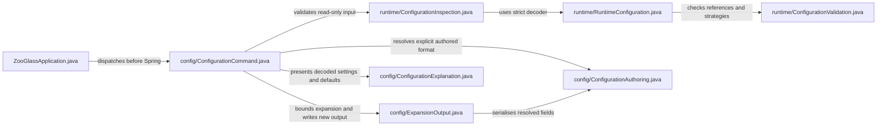

See [offline inspection](configuration-inspection.md) for commands and report fields.

## Access policy decisions

The `access/` modules implement policy decisions without depending on the view
coordinator. Admission, active WebSocket delivery and HTTP chunk release use these
primitives. `AccessGrant` contains process-local evidence, never durable state.

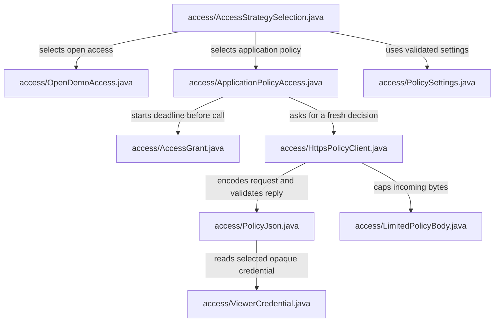

`ViewerAccess` defines only these access decisions. `AccessDecision`, `PolicyReply`
and `ViewResource` carry their results and resource identity; `PolicyClient`
is the I/O boundary used by the application strategy. See the
[policy protocol](access-policy.md) for settings, credentials and failure outcomes.

## Viewer admission

`AdmissionAccess` owns common credential/decision checks. `ProtectedSettings`
validates the complete startup configuration.
The protected viewer listener accepts only view reads and subscriptions.
Operators use a distinct loopback connector and credential.
Policy I/O happens outside the coordinator monitor.

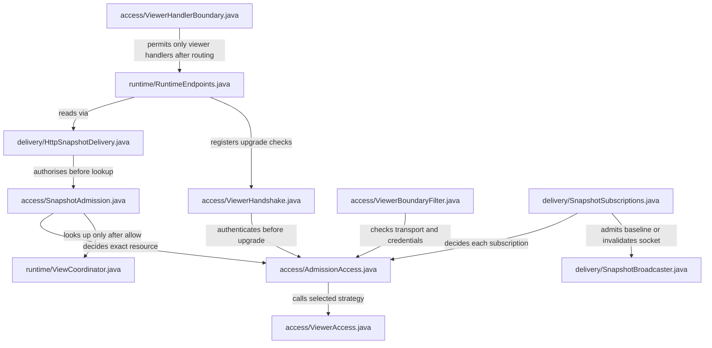

## Protected deployment

The connector valve marks operator requests using connector identity. The filter
checks the separate operator token and permits only source, registration and
health routes. Forwarded ports and hosts cannot select the operator role.

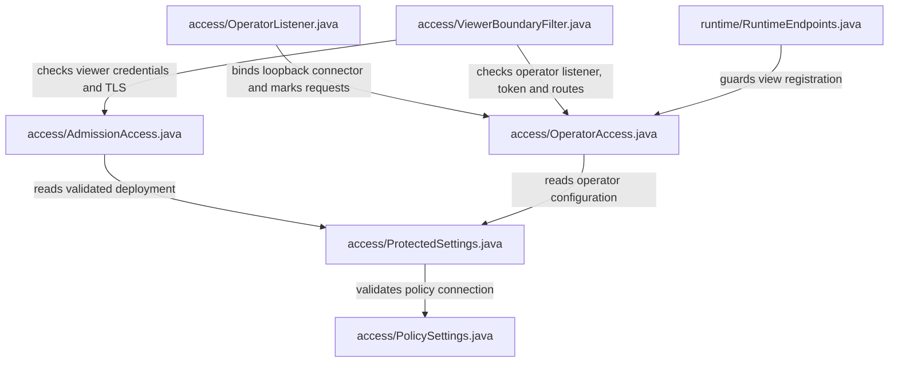

## Active subscription grants

`SnapshotBroadcaster` owns the grant registry and renewal service only for protected
connections. Its close operation stops renewal work. Policy I/O and access-loss
callbacks run outside the registry monitor; publication never waits for a policy
reply. The writer checks the same registry at final handoff.

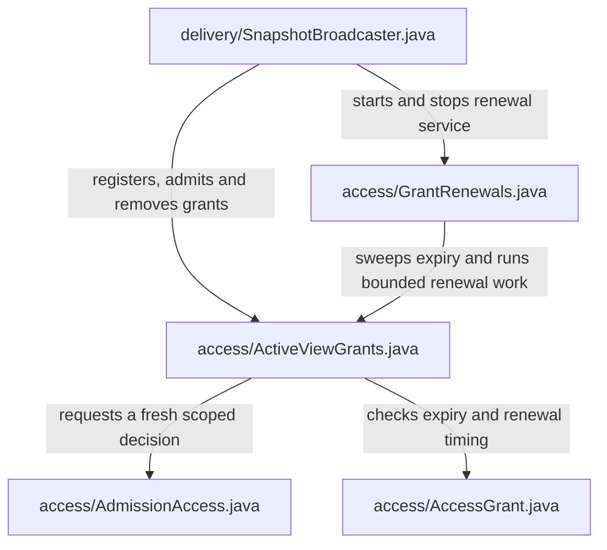

The registry invalidates grants first. Its access-loss callback dispatches cleanup
on the broadcaster's virtual-thread executor, which removes delivery memberships
and queued frames before requesting closure. Waiting for the coordinator therefore
does not block the expiry timer or policy workers. Each replacement has a distinct generation,
so a delayed reply cannot update or invalidate its successor.

## Protected socket release

A queued `OutboundQueue.Frame` shares its payload but holds a lease for its own
recipient and subscription generation. Superseded waiting frames are pruned before
new admission. The lease is also checked after `take`, so replacement, unsubscribe
or expiry cannot be bypassed by a frame already held by the writer.

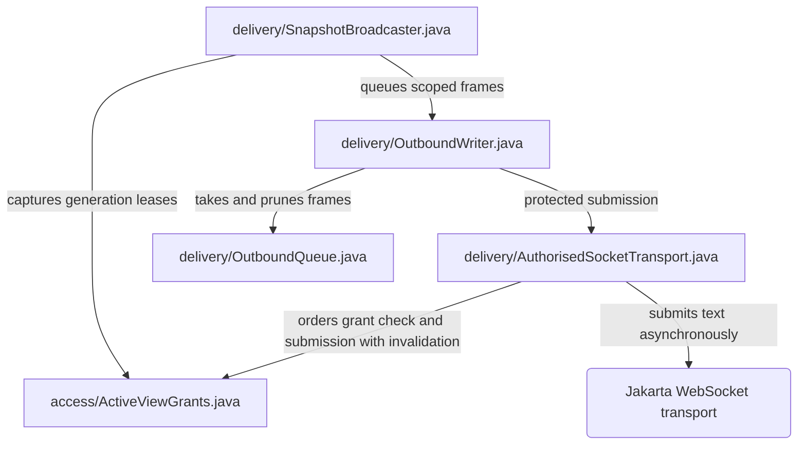

The adapter waits for completion outside grant and coordinator monitors. It does
not substitute the blocking Spring send when a native async transport is absent.
Open-demo writers retain their existing transport path.

## Protected HTTP release

`HttpSnapshotDelivery` preserves ordinary Spring responses in open-demo mode.
Protected reads require HTTP/1.1 before policy lookup, prepare JSON bytes, then
start an asynchronous servlet response. The writer checks readiness before each bounded, grant-checked submission. Its
short monitor also serialises timeout/error cleanup with those submissions.

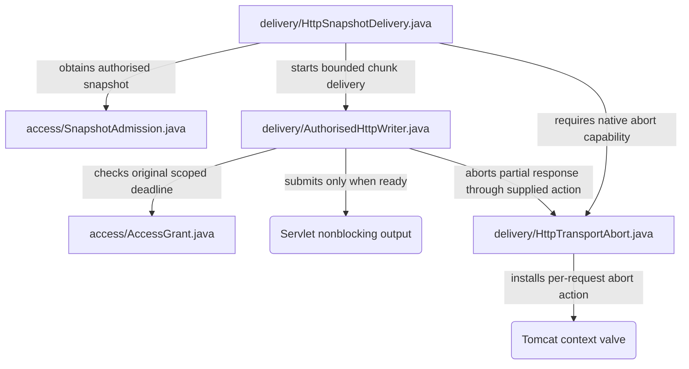

An uncommitted expired response becomes an empty 503. Empty authorised results
are explicitly committed by a checked nonblocking flush before async completion.
A committed response is aborted without a normal completion marker. HTTP grants are not renewed; snapshot
bytes are released on completion, error or timeout. No policy or network wait
holds the coordinator or a shared grant registry.

## Durable tenant ownership

`StoreTenant` verifies ownership before recovery. The offline adoption command
uses the same connection settings and row validation without starting Spring.
Protected startup supplies the configured tenant to the runtime and durable store.

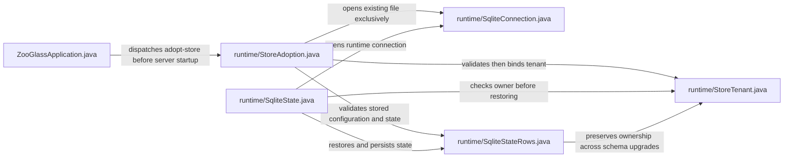

## Revise and retire facts

The `strategy/fact/` modules own revision and projection decisions. Their state is
retained per field in the store. `FactOrigins` checks birth/type ownership from
those bounded records; it does not own a second mutable ledger.

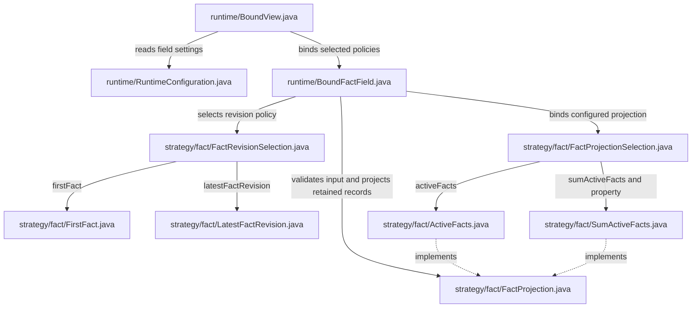

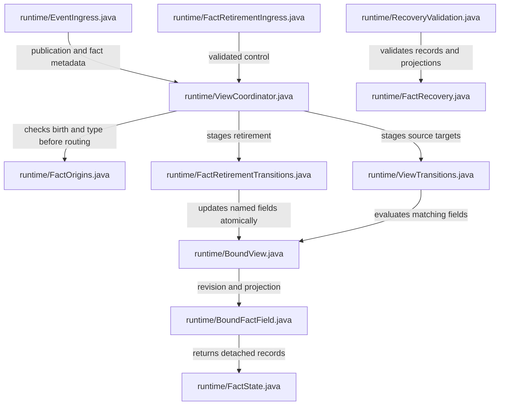

`FactEnvelope` separates publication identity from fact identity; `FactRecord`
retains the highest accepted revision and tombstone content. `FactRetirement`
parses floor controls and `FactRetirementOutcome` describes their results.
`StateImage.StoredView` owns the per-field records. `ViewStatus` exposes bounded
collection counts and floors. Existing `StateStore`/`SqliteStateRows` commit that
state with receipts, projections, source progress and clock metadata.

## Age a selected contribution

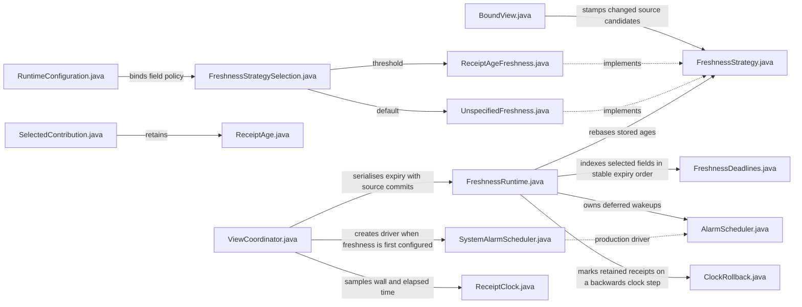

The coordinator accepts a receipt clock and an alarm-driver factory internally.
Ordinary service construction uses the system clock and a daemon scheduler; tests
can dispatch expiry explicitly without snapshot polling. The driver is created
only when receipt-age freshness is configured, including dynamic view registration,
and closed with the runtime. Due fields are enumerated by deadline, view, entity
and field before transitions and notifications. This seam is not yet a complete
deterministic simulator.

## Decide when to publish an entity

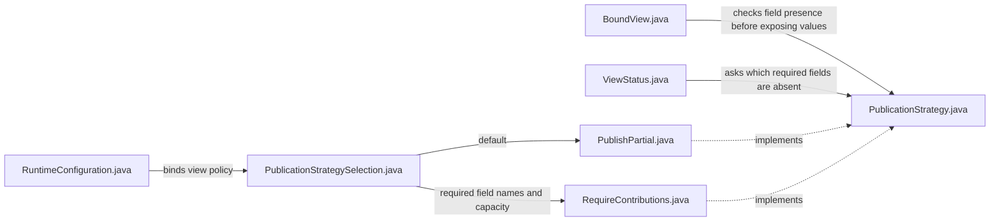

## Operational logging

The service owns a typed recorder; ordinary runtime and controlled-host constructors
keep a no-op recorder. Operational fields and suppression do not enter state,
receipts or replay identities. Storage loss is signalled once and emitted outside
the coordinator monitor. Ingress records distinguish processing from sending its
receipt. Viewer failures use a finite catalogue; callbacks under runtime locks
hand off bounded signals before any appender is called.

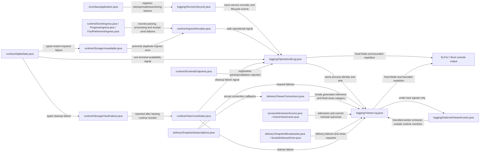

See the [operator guide](operational-logging.md) for event meanings and the explicit
boundary between ZooGlass records and framework/vendor logging.

## Application, snapshots and delivery

`ZooGlassApplication` starts Spring and WebSocket support. `runtime/RuntimeEndpoints`
registers source/control sockets, HTTP snapshots and dynamic view registration.
`delivery/SnapshotSubscriptions` validates subscription requests;
`delivery/SnapshotBroadcaster` admits them under the coordinator monitor and queues
committed snapshots. `api/ViewSnapshot` exposes selected values and separate
publication metadata without leaking retained storage envelopes.

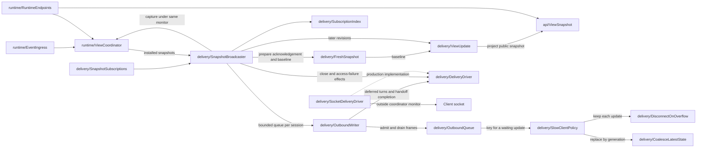

`OutboundWriter` selects one waiting frame per turn and owns it until the driver
reports completion or failure. Only waiting frames count towards the queue budget;
coalescing never replaces a frame already handed off. Stopping invalidates queued
turns and late completions. `SocketDeliveryDriver` runs turns on virtual threads,
uses the existing protected transport checks, and owns asynchronous session close.
The internal driver seam also permits explicit test turns and held handoffs without
blocking the coordinator. Subscription recipients retain admission order before
writer turns are scheduled; shutdown cancels writers in session registration order.
This is a delivery seam, not the complete simulator.

The coordinator owns state and installation. Delivery owns subscriptions and
writers, with no independent projection store. Registration uses
`RuntimeConfiguration` validation and updates the existing strategy bindings;
SQLite records the expanded configuration in its transaction. Stateless update
strategies remain in `strategy/update`, selected by `FieldStrategySelection`.

## Publication path

The `runtime/` package contains the single coordinator and its memory/SQLite
storage, plus [PostgreSQL ownership](postgresql-storage.md) for the explicit
[HA service profile](ha-service.md) on the integration branch. Standalone serving
remains memory/SQLite. See the [publication guide](publications.md) for ordinary
configuration and wire examples.

Each box below is a file in
[`src/main/java/io/zooglass/runtime/`](../src/main/java/io/zooglass/runtime/), except the
shared update selector and the identity strategy files shown with their paths.

```mermaid
flowchart TB
  endpoints["RuntimeEndpoints.java<br/>HTTP snapshots and socket registration"]
  ingress["EventIngress.java<br/>Source messages and acknowledgements"]
  parser["PublicationJson.java<br/>Strict parsing and canonical comparison"]
  publication["Publication.java<br/>Envelope and stream key"]
  outcome["PublicationOutcome.java<br/>Structured source result"]
  coordinator["ViewCoordinator.java<br/>Admit, stage and install"]
  config["RuntimeConfiguration.java<br/>Decode startup definitions"]
  configValidation["ConfigurationValidation.java<br/>References and strategy compatibility"]
  bound["BoundView.java<br/>Bind resolvers, updates and selectors"]
  entitySelection["strategy/identity/EntityStrategySelection.java"]
  entityStrategy["strategy/identity/EntityResolutionStrategy.java"]
  envelope["strategy/identity/EnvelopeEntity.java"]
  lookup["strategy/identity/LookupEntity.java"]
  resolution["strategy/identity/EntityResolution.java"]
  target["TargetOutcome.java<br/>Original per-view result"]
  provenance["Provenance.java<br/>Original source identity"]
  migration["SchemaMigration.java<br/>Migrate schema-1 and schema-2 state"]
  store["StateStore.java<br/>Current state and installation boundary"]
  state["InMemoryState.java<br/>Memory-only installation"]
  sqlite["SqliteState.java<br/>Commit before memory installation"]
  rows["SqliteStateRows.java<br/>Schema and changed-row persistence"]
  postgres["PostgresState.java<br/>Internal checked transactions"]
  profile["HaStaticProfile.java<br/>Static admission and immutable binding"]
  image["PostgresImage.java<br/>Typed image and recovery checks"]
  rowJson["StateRowJson.java<br/>Shared strict storage JSON"]
  coordinator -->|internal owned transition| postgres
  postgres -->|binds configuration| profile
  postgres -->|encodes and validates state| image
  image -->|strict decoding| rowJson
  rows -->|strict decoding| rowJson
  postgres -.->|implements| store
  storedJson["StoredJson.java<br/>UTF-8 validation and wrapped JSON depth"]
  rows -->|uses row encoding limits| storedJson
  publication -->|validates identifiers and payload| storedJson
  recovery["RecoveryValidation.java<br/>Definitions, streams and validation orchestration"]
  viewRecovery["ViewRecovery.java<br/>Candidates and exposed views"]
  targetRecovery["TargetRecovery.java<br/>Retained per-target outcomes"]
  image["StateImage.java<br/>Candidates, views, identities and versions"]
  health["StorageHealth.java<br/>Service health status"]
  selection["strategy/update/FieldStrategySelection.java"]

  endpoints -->|registers at /events| ingress
  endpoints -->|reads detached snapshots| coordinator
  ingress -->|parses input| parser
  parser -.->|constructs| publication
  ingress -->|applies publication| coordinator
  ingress -.->|serialises| outcome
  coordinator -->|loads definitions and limits| config
  config -->|checks decoded definitions| configValidation
  coordinator -->|compares retained content| parser
  transitions["ViewTransitions.java<br/>Stage values and status across views"]
  status["ViewStatus.java<br/>Project public metadata"]
  coordinator -->|stages one source transition| transitions
  transitions -->|evaluates matched fields| bound
  transitions -->|compares public status| status
  coordinator -->|selects storage at startup| store
  state -.->|implements| store
  sqlite -.->|implements| store
  store -.->|owns installed image| image
  sqlite -->|loads and saves rows in a transaction| rows
  rows -->|checks restored state and configuration| recovery
  recovery -->|validates selected values and provenance| viewRecovery
  recovery -->|validates receipt outcomes| targetRecovery
  health -->|checks storage availability| coordinator
  coordinator -.->|returns| outcome
  contributionSelection["strategy/contribution/ContributionStrategySelection.java"]
  contributionStrategy["strategy/contribution/ContributionSelectionStrategy.java"]
  independent["strategy/contribution/IndependentFields.java"]
  priority["strategy/contribution/SourcePriority.java"]
  selected["strategy/contribution/SelectedContribution.java"]
  bound -->|binds selector per field| contributionSelection
  contributionSelection -->|constructs| independent
  contributionSelection -->|constructs| priority
  independent -.->|implements| contributionStrategy
  priority -.->|implements| contributionStrategy
  bound -->|selects from retained source candidates| contributionStrategy
  contributionStrategy -.->|returns value and provenance| selected
  image -.->|retains candidates by field and source| selected
  selected -.->|records source identity| provenance
  bound -->|binds configured update strategy| selection
  bound -->|binds resolver per source| entitySelection
  entitySelection -->|constructs| envelope
  entitySelection -->|constructs| lookup
  envelope -.->|implements| entityStrategy
  lookup -.->|implements| entityStrategy
  bound -->|resolves original source key| entityStrategy
  entityStrategy -.->|returns| resolution
  transitions -.->|stages per-field and per-view outcomes| target
  bound -.->|records selected field source| provenance
  rows -->|migrates before readiness| migration
```

`ViewCoordinator` serialises admission, staging and snapshot reads under one
monitor. `ViewTransitions` stages value and status changes across views, while
`ViewStatus` projects immutable metadata without allocating retained entities.
The coordinator prepares all view changes and retained identity records before
installing one complete `StateImage` through `StateStore`. `InMemoryState` installs
it directly. `SqliteState` commits changed stream/view rows and the version first,
then installs the prepared image. `BoundView` holds configuration and strategy
bindings, never entity state. Each update evaluates only its source-local candidate;
the selected contribution module then chooses the visible value. Hidden changes
replace stored candidates without advancing the snapshot version when exposed
status is unchanged. Progress, source observation and floor changes are visible
metadata and can advance the version without changing selected values.

`SqliteStateRows` owns the schema and JSON row format. `RecoveryValidation`
checks stored definitions and stream receipts, delegates retained target outcomes
to `TargetRecovery`, and delegates candidate provenance and selected values to
`ViewRecovery` before the service becomes ready. `ConfigurationValidation` checks
references and compatible strategies after startup definitions are decoded. `SchemaMigration` enriches schema-1/2
rows in that same transaction;
old receipts retain unknown (`null`) target outcomes. `BoundView` invokes its
source resolver only after matching the source/type. Unknown mappings produce
view-local rejections; publication identity keeps the source's original key.
`SqliteState` owns one exclusive connection and closes it on shutdown or storage
failure. Failed storage blocks reads and writes; `StorageHealth` reports DOWN.

`EventIngress` sends the outcome after leaving the coordinator's monitor. A
transport failure cannot undo applied state; a retry can recover the retained
result. There are no live-subscription writers in this increment.

## Track source progress and apply late policy

The progress strategy binds per source; state remains per original stream key.
Late policy binds per field and uses the watermark from before this publication.
A source promise violation is recorded even if every target rejects its values.

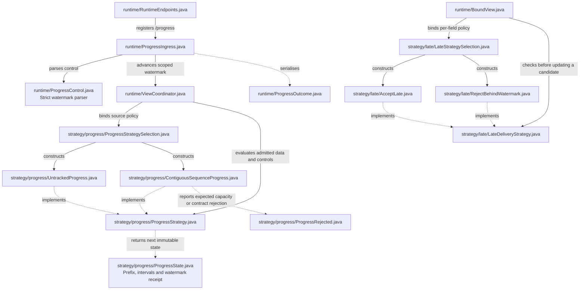

`ViewStatus` derives bounded missing ranges through the selected progress module;
received ranges and violation flags are persisted in `StateImage.StreamState`.
`RecoveryValidation` validates progress and retained field outcomes before readiness.
Schema 4 accepts control-only streams and migrates old rows with unknown field-level
outcomes rather than invented processing history. Both ingress handlers write socket
responses after the coordinator releases its lock.

## Suggested reading paths

For publication admission, start with `runtime/EventIngress.java`, then
`PublicationJson.java` and `ViewCoordinator.java`. Follow `ViewTransitions.java`
to the selected strategy modules. For persistence, read `StateStore.java`,
`SqliteState.java`, `SqliteStateRows.java` and the recovery validators.

For delivery, follow `delivery/SnapshotSubscriptions.java`,
`SnapshotBroadcaster.java` and `OutboundWriter.java`. `OutboundQueue.java`
applies the selected slow-client strategy and accounts for waiting bytes. For configuration and runtime
registration, read `RuntimeConfiguration.java`, `ConfigurationValidation.java`
and `ViewCoordinator.define`.

Replay and authorisation remain outside the implemented contracts.

## Controlled timeline proof host

The host-side files below live under
`simulation-host/src/main/java/io/zooglass/`; production files remain under
`src/main/java/io/zooglass/`. The projects share Java packages and one application
classloader, while the production artifacts exclude every simulation adapter.

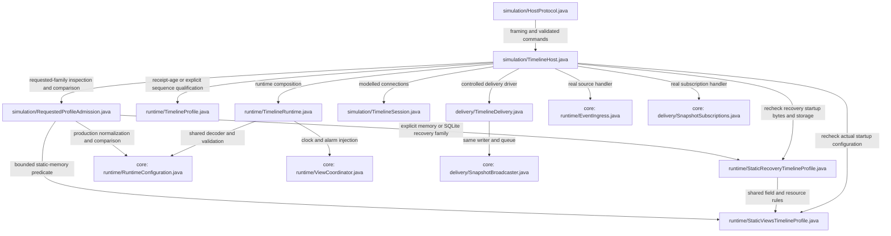

Boxes prefixed `core:` belong to the production runtime dependency; the others
belong to the host project. Controlled timing and delivery share one turn owner:

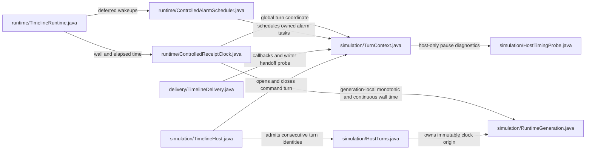

The prepared `simulation-host/target/zooglass-simulation.jar` uses framed
stdin/stdout. It does not start Spring, bind a network listener or expose controls
through normal endpoints. Production `target/zooglass.jar` and the ordinary
`target/zooglass-runtime.jar` contain no host, pause probe or simulation adapters.
The [host guide](../simulation-host/README.md) explains explicit preparation and
artifact checks.

The fixed memory/unprotected proofs and the explicitly qualified `memory-arrival-v1`
document profile are supported. Initial clocks are installed before runtime
construction; effects and callbacks require the owning thread's active turn.
Arbitrary configuration, restart and protected access remain outside this POC
capability boundary; unsupported command fields fail explicitly. The handshake
identifies the actual JVM environment for bounded replay admission.
The driver owns deferred lifecycle callbacks; each writer owns and cancels its
writer/transport callbacks, stall state and held handoff. Stopped writers leave
the registry. Deferred closure still identifies the original connection even if
a session name is later reused. Turn ownership and dispatch timing are checked
before state mutation; malformed UTF-8 is rejected before command dispatch.
Lifecycle changes run in phase 0, alarms and writer tasks in phase 1, and transport
completion in phase 2; released handoffs complete in a later causal round.

## Installed recovery observations

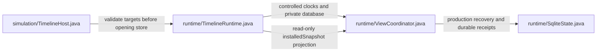

The package-private installed snapshot seam reads state without expiry, clock
samples or storage writes. Initialization reports it separately from ordinary
state-change callbacks, so observation cannot repair missing recovery.

## Controlled wall-clock updates

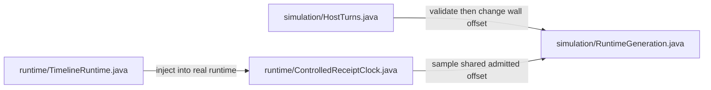

Only protocol-2 initialization and explicit wall-clock-set may install an offset.
Normal turn metadata must match it; the clock-only command does no reconciliation.

## Order host and progress boundary

```mermaid
flowchart TB
  host["simulation/TimelineHost.java"] -->|bounded configuration admission| profile["runtime/TimelineProfile.java"]
  profile -->|SQLite Order combinations| order["runtime/OrderTimelineProfile.java"]
  host -->|progress wire on typed session| progress["runtime/ProgressIngress.java (production)"]
  progress -->|advance watermark and commit| runtime["runtime/ViewCoordinator.java (production)"]
  host -->|check storage health after control| runtime
  progress -->|complete acknowledgement| session["simulation/TimelineSession.java"]
```

Simulation paths belong to `simulation-host/src/main/java/io/zooglass/`; production
paths belong to `src/main/java/io/zooglass/`. The session records a distinct
control-receipt effect. This is a private host capability, not Workbench document
progress/replay support. See [scope and gates](../../workbench/docs/timeline-order-host.md).

### Order lifecycle admission

```mermaid
flowchart LR
  protocol["simulation/HostProtocol.java"] -->|advertise SQLite Order lifecycle capability| host["simulation/TimelineHost.java"]
  host -->|inspect configuration separately from requested execution profile| profile["runtime/TimelineProfile.java"]
  host -->|validate generation and database boundary| generation["simulation/RuntimeGeneration.java"]
  host -->|recover retained production state| runtime["runtime/TimelineRuntime.java"]
```

These files belong to the separate simulation-host module. The explicit
`sqlite-order-restart-v1` execution profile reuses the bounded `sqlite-order-v1`
configuration and production SQLite recovery. Ordinary Order remains restricted
to a new database in generation 1. Both reject wall-clock adjustment.

### Sports fact and retirement admission

```mermaid
flowchart LR
  host["simulation/TimelineHost.java"] -->|require explicit profile agreement| profiles["runtime/TimelineProfile.java"]
  profiles -->|classify bounded Sports configuration| profile["runtime/SportsTimelineProfile.java"]
  host -->|dispatch control under virtual turn| retirement["runtime/FactRetirementIngress.java (production)"]
  host -->|verify storage health after dispatch| runtime["runtime/TimelineRuntime.java"]
  retirement -->|complete normalized acknowledgement| session["simulation/TimelineSession.java"]
```

The simulation-host module owns admission and controlled dispatch; the production
retirement handler owns parsing and per-view atomicity. Sports admits a new SQLite
database in generation 1, with no restart or wall-clock adjustment. See the
[Sports execution boundary](../../workbench/docs/timeline-sports-host.md).

### V3 public data projection

```mermaid
flowchart LR
  host["simulation/TimelineHost.java"] -->|one side-effect-free installed read| runtime["core: runtime/ViewCoordinator.java"]
  host -->|project that same snapshot| public["core: api/ViewSnapshot.java"]
```

The static profile returns both internal and production public snapshots. The
separate `publicSnapshots:1` capability prevents an admission-only host from being
mistaken for a V3 execution host. Existing profiles retain their raw response shape.


## Optional publication decision results

`applyExplained` shares ordinary publication processing and checks production
semantic coverage before mutation. The collector is attempt-local; it freezes the
result before installation and returns it only after success. The ordinary receipt
and storage records remain unchanged. Explained ingress shares ordinary parsing,
processing failures and receipt delivery; the controlled host records a separate
effect only when decision collection is explicitly enabled.

```mermaid
flowchart TB
  host["simulation/TimelineHost.java"] -->|opt-in explained ingress| ingress["runtime/EventIngress.java"]
  ingress -->|shared processing with optional result| coordinator["runtime/ViewCoordinator.java"]
  ingress -->|unchanged receipt bytes| session["simulation/TimelineSession.java"]
  coordinator["runtime/ViewCoordinator.java"] -->|checks coverage before processing| support["runtime/PublicationExplanationSupport.java"]
  coordinator -->|same staging path| transitions["runtime/ViewTransitions.java"]
  transitions -->|evaluates matched fields| bound["runtime/BoundView.java"]
  bound -->|actual strategy result| update["strategy/update/FieldUpdate.java"]
  bound -->|collects optional update reasons| collector["runtime/PublicationExplanation.java"]
  transitions -->|finishes matched targets| collector
  collector -->|compares existing public projection| projection["api/ViewSnapshot.java"]
  coordinator -->|freezes before install| collector
  collector -->|immutable current attempt| decision["runtime/PublicationDecision.java"]
  collector -->|pairs with ordinary outcome| result["runtime/ExplainedPublication.java"]
```


## Internal PostgreSQL ownership

These files live in `runtime/`. `OwnedRuntime` is constructed through the private
coordinator factory; it exposes captures and checked handoff, never a raw
coordinator. The explicit HA service profile below owns this path; standalone
service configuration cannot enable PostgreSQL.

```mermaid
flowchart LR
  owner["OwnedRuntime.java<br/>Acquire, recover, activate and hand off"]
  runtime["ViewCoordinator.java<br/>Real reconciliation, privately owned"]
  state["PostgresState.java<br/>Transactions and cache invalidation"]
  authority["PostgresAuthority.java<br/>Locked generation, lease and revision checks"]
  schema["PostgresSchema.java<br/>Pinned schema and bootstrap"]
  image["PostgresImage.java<br/>Complete state validation"]
  owner -->|construct and apply| runtime
  owner -->|checked capture and output permit| state
  runtime -->|install detached transition| state
  state -->|lock and check shared authority row| authority
  state -->|initialise namespace| schema
  state -->|restore validated cache| image
```

Handoff callbacks run after runtime and database locks are released. Immutable
content stays opaque until its single-use authority check succeeds. See the
[storage and ownership guide](postgresql-storage.md) for boundaries and tests.


## HA service transport

The conditional HA components replace the standalone coordinator and routes.
Policy I/O stays outside the owner gate; recipient captures and final native
authorisation remain separate checks. Readiness owns only its reserved operation.

```mermaid
flowchart TB
  settings["runtime/HaSettings.java"] -->|validate immutable profile and connection settings| owner["runtime/HaOwner.java"]
  endpoints["runtime/HaEndpoints.java"] -->|checked snapshot and bounded readiness| owner
  sockets["runtime/HaSockets.java"] -->|route publication and subscription commands| peer["runtime/HaPeer.java"]
  handshake["runtime/HaHandshake.java"] -->|negotiate and authenticate| sockets
  peer -->|serialise captures and membership changes| owner
  owner -->|acquire, recover, renew and retire| runtime["runtime/OwnedRuntime.java"]
  peer -->|retain bounded recipient captures| delivery["delivery/HaDelivery.java"]
  delivery -->|consume checked authority before release| owner
  delivery -->|recheck native identity, grant and membership| native["delivery/AuthorisedSocketTransport.java"]
  endpoints -->|recheck each HTTP chunk| http["delivery/HttpSnapshotDelivery.java"]
  commands["runtime/HaCommand.java"] -->|validate exact command shape| peer
```
