# ZooGlass source map

This guide explains how the current Java prototype fits together. Start with the
endpoint you are interested in, then follow the labelled dependencies to the
classes that own state and delivery.

Each rectangular box is a source file under `src/main/java/io/zooglass/`, unless
labelled otherwise. Solid arrows point from a caller to the class it uses.
Dotted arrows indicate framework wiring or data types, as labelled. Rounded
boxes represent external framework machinery. These are static relationships,
not a timeline of a request or a deployment diagram. Framework and library
dependencies are omitted except where needed to explain startup.

## Access policy decisions

The `access/` modules implement policy decisions without depending on the view
coordinator. Admission, active WebSocket delivery and HTTP chunk release use these
primitives. `AccessGrant` contains process-local evidence, never durable state.

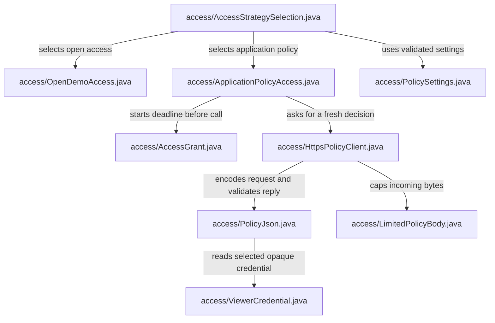

`ViewerAccess` defines only these access decisions. `AccessDecision`, `PolicyReply`
and `ViewResource` carry their results and resource identity; `PolicyClient`
is the I/O boundary used by the application strategy. See the
[policy protocol](access-policy.md) for settings, credentials and failure outcomes.

## Viewer admission

`AdmissionAccess` owns common credential/decision checks. `ProtectedSettings`
validates the complete startup configuration.
The protected viewer listener accepts only view reads and subscriptions.
Operators use a distinct loopback connector and credential.
Policy I/O happens outside the coordinator monitor.

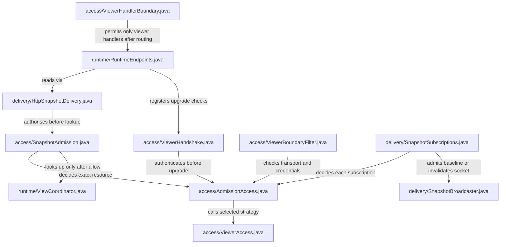

## Protected deployment

The connector valve marks operator requests using connector identity. The filter
checks the separate operator token and permits only source, registration and
health routes. Forwarded ports and hosts cannot select the operator role.

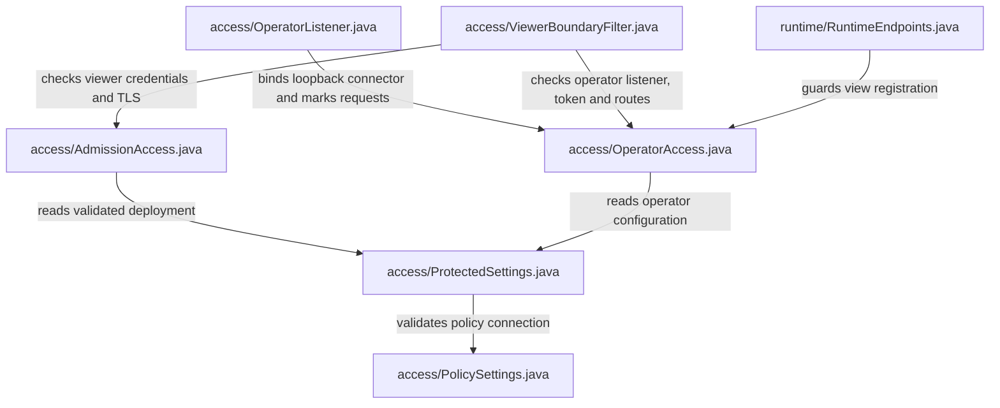

## Active subscription grants

`SnapshotBroadcaster` owns the grant registry and renewal service only for protected
connections. Its close operation stops renewal work. Policy I/O and access-loss
callbacks run outside the registry monitor; publication never waits for a policy
reply. The writer checks the same registry at final handoff.

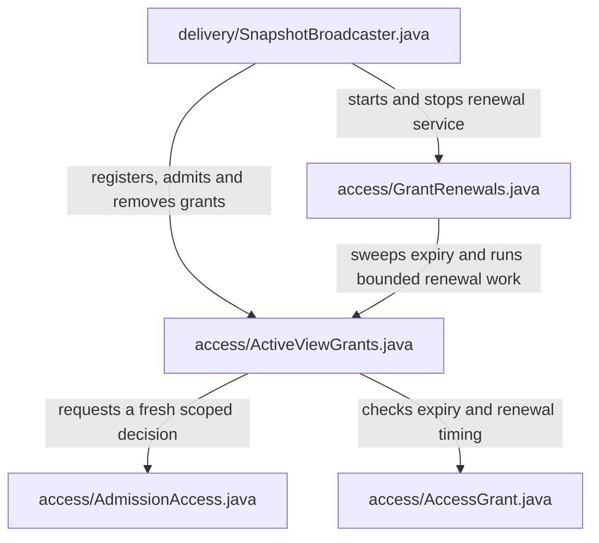

The registry invalidates grants first. Its access-loss callback dispatches cleanup
on the broadcaster's virtual-thread executor, which removes delivery memberships
and queued frames before requesting closure. Waiting for the coordinator therefore
does not block the expiry timer or policy workers. Each replacement has a distinct generation,
so a delayed reply cannot update or invalidate its successor.

## Protected socket release

A queued `OutboundQueue.Frame` shares its payload but holds a lease for its own
recipient and subscription generation. Superseded waiting frames are pruned before
new admission. The lease is also checked after `take`, so replacement, unsubscribe
or expiry cannot be bypassed by a frame already held by the writer.

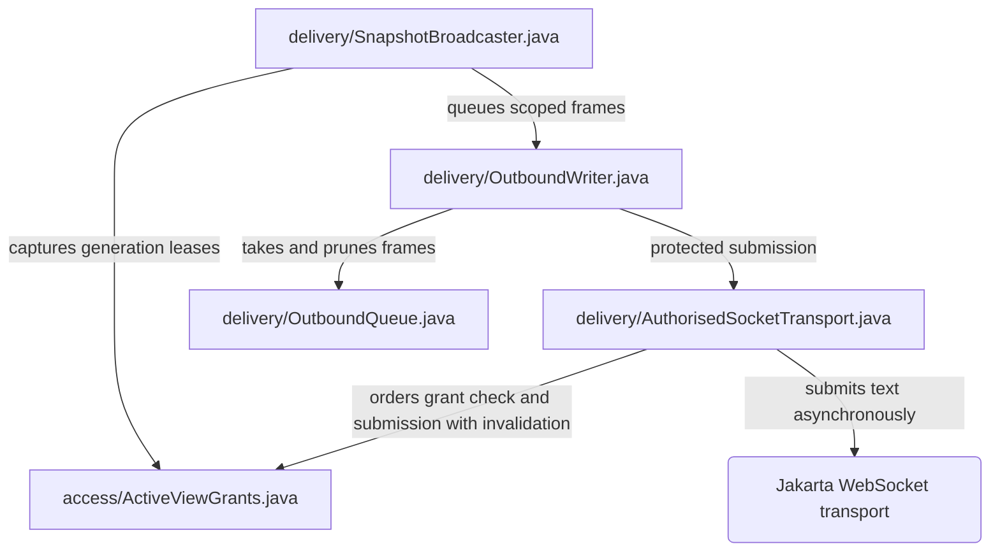

The adapter waits for completion outside grant and coordinator monitors. It does
not substitute the blocking Spring send when a native async transport is absent.
Open-demo writers retain their existing transport path.

## Protected HTTP release

`HttpSnapshotDelivery` preserves ordinary Spring responses in open-demo mode.
Protected reads require HTTP/1.1 before policy lookup, prepare JSON bytes, then
start an asynchronous servlet response. The writer checks readiness before each bounded, grant-checked submission. Its
short monitor also serialises timeout/error cleanup with those submissions.

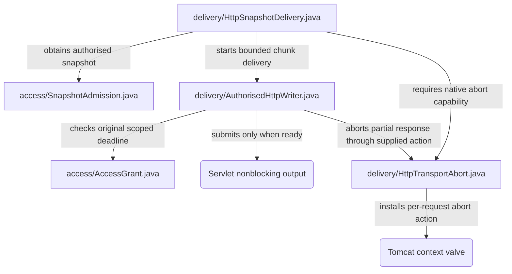

An uncommitted expired response becomes an empty 503. Empty authorised results
are explicitly committed by a checked nonblocking flush before async completion.
A committed response is aborted without a normal completion marker. HTTP grants are not renewed; snapshot
bytes are released on completion, error or timeout. No policy or network wait
holds the coordinator or a shared grant registry.

## Durable tenant ownership

`StoreTenant` verifies ownership before recovery. The offline adoption command
uses the same connection settings and row validation without starting Spring.
Protected startup supplies the configured tenant to the runtime and durable store.

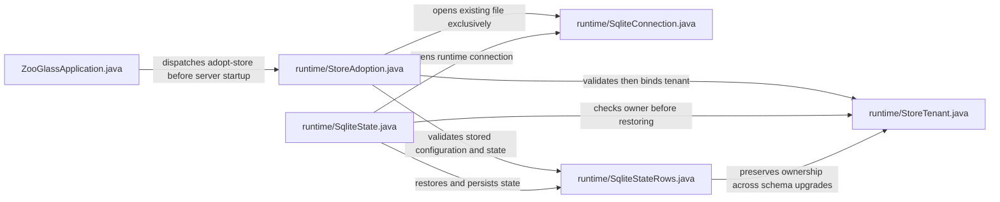

## Revise and retire facts

The `strategy/fact/` modules own revision and projection decisions. Their state is
retained per field in the store. `FactOrigins` checks birth/type ownership from
those bounded records; it does not own a second mutable ledger.

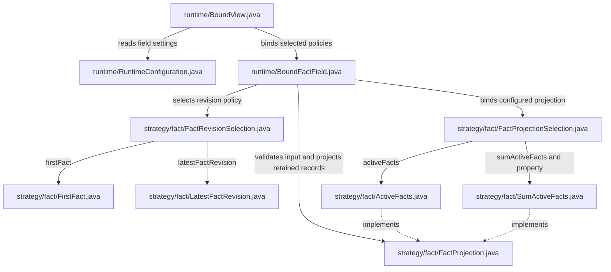

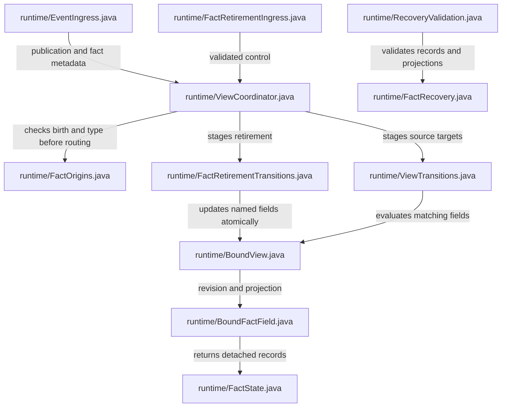

`FactEnvelope` separates publication identity from fact identity; `FactRecord`
retains the highest accepted revision and tombstone content. `FactRetirement`
parses floor controls and `FactRetirementOutcome` describes their results.
`StateImage.StoredView` owns the per-field records. `ViewStatus` exposes bounded
collection counts and floors. Existing `StateStore`/`SqliteStateRows` commit that
state with receipts, projections, source progress and clock metadata.

## Age a selected contribution

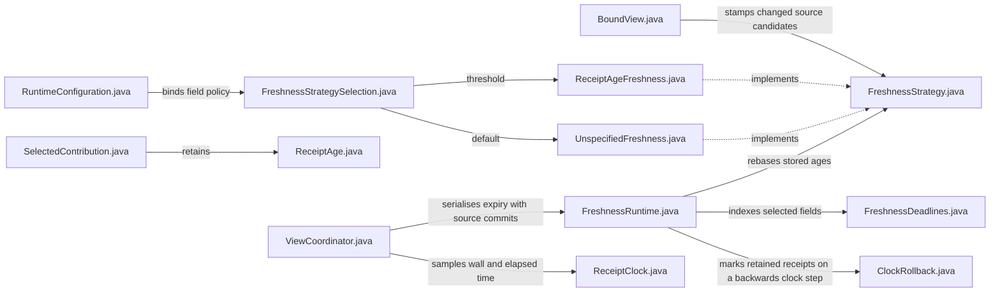

## Decide when to publish an entity

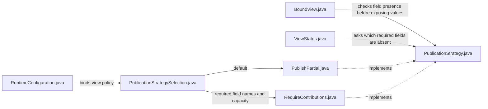

## Application, snapshots and delivery

`ZooGlassApplication` starts Spring and WebSocket support. `runtime/RuntimeEndpoints`
registers source/control sockets, HTTP snapshots and dynamic view registration.
`delivery/SnapshotSubscriptions` validates subscription requests;
`delivery/SnapshotBroadcaster` admits them under the coordinator monitor and queues
committed snapshots. `api/ViewSnapshot` exposes selected values and separate
publication metadata without leaking retained storage envelopes.

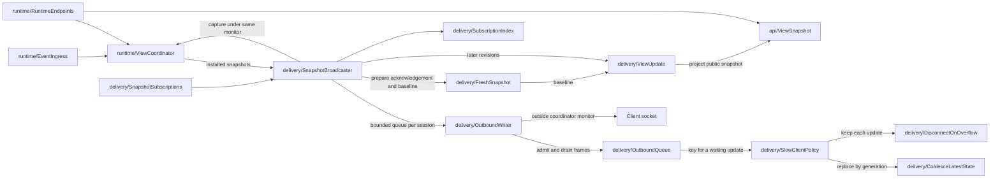

The coordinator owns state and installation. Delivery owns subscriptions and
writers, with no independent projection store. Registration uses
`RuntimeConfiguration` validation and updates the existing strategy bindings;
SQLite records the expanded configuration in its transaction. Stateless update
strategies remain in `strategy/update`, selected by `FieldStrategySelection`.

## Publication path

The `runtime/` package contains the single coordinator and its memory/SQLite
storage. See the [publication guide](publications.md) for configuration and wire examples.

Each box below is a file in
[`src/main/java/io/zooglass/runtime/`](../src/main/java/io/zooglass/runtime/), except the
shared update selector and the identity strategy files shown with their paths.

```mermaid
flowchart TB
  endpoints["RuntimeEndpoints.java<br/>HTTP snapshots and socket registration"]
  ingress["EventIngress.java<br/>Source messages and acknowledgements"]
  parser["PublicationJson.java<br/>Strict parsing and canonical comparison"]
  publication["Publication.java<br/>Envelope and stream key"]
  outcome["PublicationOutcome.java<br/>Structured source result"]
  coordinator["ViewCoordinator.java<br/>Admit, stage and install"]
  config["RuntimeConfiguration.java<br/>Decode startup definitions"]
  configValidation["ConfigurationValidation.java<br/>References and strategy compatibility"]
  bound["BoundView.java<br/>Bind resolvers, updates and selectors"]
  entitySelection["strategy/identity/EntityStrategySelection.java"]
  entityStrategy["strategy/identity/EntityResolutionStrategy.java"]
  envelope["strategy/identity/EnvelopeEntity.java"]
  lookup["strategy/identity/LookupEntity.java"]
  resolution["strategy/identity/EntityResolution.java"]
  target["TargetOutcome.java<br/>Original per-view result"]
  provenance["Provenance.java<br/>Original source identity"]
  migration["SchemaMigration.java<br/>Migrate schema-1 and schema-2 state"]
  store["StateStore.java<br/>Current state and installation boundary"]
  state["InMemoryState.java<br/>Memory-only installation"]
  sqlite["SqliteState.java<br/>Commit before memory installation"]
  rows["SqliteStateRows.java<br/>Schema and changed-row persistence"]
  storedJson["StoredJson.java<br/>UTF-8 validation and wrapped JSON depth"]
  rows -->|uses row encoding limits| storedJson
  publication -->|validates identifiers and payload| storedJson
  recovery["RecoveryValidation.java<br/>Definitions, streams and validation orchestration"]
  viewRecovery["ViewRecovery.java<br/>Candidates and exposed views"]
  targetRecovery["TargetRecovery.java<br/>Retained per-target outcomes"]
  image["StateImage.java<br/>Candidates, views, identities and versions"]
  health["StorageHealth.java<br/>Service health status"]
  selection["strategy/update/FieldStrategySelection.java"]

  endpoints -->|registers at /events| ingress
  endpoints -->|reads detached snapshots| coordinator
  ingress -->|parses input| parser
  parser -.->|constructs| publication
  ingress -->|applies publication| coordinator
  ingress -.->|serialises| outcome
  coordinator -->|loads definitions and limits| config
  config -->|checks decoded definitions| configValidation
  coordinator -->|compares retained content| parser
  transitions["ViewTransitions.java<br/>Stage values and status across views"]
  status["ViewStatus.java<br/>Project public metadata"]
  coordinator -->|stages one source transition| transitions
  transitions -->|evaluates matched fields| bound
  transitions -->|compares public status| status
  coordinator -->|selects storage at startup| store
  state -.->|implements| store
  sqlite -.->|implements| store
  store -.->|owns installed image| image
  sqlite -->|loads and saves rows in a transaction| rows
  rows -->|checks restored state and configuration| recovery
  recovery -->|validates selected values and provenance| viewRecovery
  recovery -->|validates receipt outcomes| targetRecovery
  health -->|checks storage availability| coordinator
  coordinator -.->|returns| outcome
  contributionSelection["strategy/contribution/ContributionStrategySelection.java"]
  contributionStrategy["strategy/contribution/ContributionSelectionStrategy.java"]
  independent["strategy/contribution/IndependentFields.java"]
  priority["strategy/contribution/SourcePriority.java"]
  selected["strategy/contribution/SelectedContribution.java"]
  bound -->|binds selector per field| contributionSelection
  contributionSelection -->|constructs| independent
  contributionSelection -->|constructs| priority
  independent -.->|implements| contributionStrategy
  priority -.->|implements| contributionStrategy
  bound -->|selects from retained source candidates| contributionStrategy
  contributionStrategy -.->|returns value and provenance| selected
  image -.->|retains candidates by field and source| selected
  selected -.->|records source identity| provenance
  bound -->|binds configured update strategy| selection
  bound -->|binds resolver per source| entitySelection
  entitySelection -->|constructs| envelope
  entitySelection -->|constructs| lookup
  envelope -.->|implements| entityStrategy
  lookup -.->|implements| entityStrategy
  bound -->|resolves original source key| entityStrategy
  entityStrategy -.->|returns| resolution
  transitions -.->|stages per-field and per-view outcomes| target
  bound -.->|records selected field source| provenance
  rows -->|migrates before readiness| migration
```

`ViewCoordinator` serialises admission, staging and snapshot reads under one
monitor. `ViewTransitions` stages value and status changes across views, while
`ViewStatus` projects immutable metadata without allocating retained entities.
The coordinator prepares all view changes and retained identity records before
installing one complete `StateImage` through `StateStore`. `InMemoryState` installs
it directly. `SqliteState` commits changed stream/view rows and the version first,
then installs the prepared image. `BoundView` holds configuration and strategy
bindings, never entity state. Each update evaluates only its source-local candidate;
the selected contribution module then chooses the visible value. Hidden changes
replace stored candidates without advancing the snapshot version when exposed
status is unchanged. Progress, source observation and floor changes are visible
metadata and can advance the version without changing selected values.

`SqliteStateRows` owns the schema and JSON row format. `RecoveryValidation`
checks stored definitions and stream receipts, delegates retained target outcomes
to `TargetRecovery`, and delegates candidate provenance and selected values to
`ViewRecovery` before the service becomes ready. `ConfigurationValidation` checks
references and compatible strategies after startup definitions are decoded. `SchemaMigration` enriches schema-1/2
rows in that same transaction;
old receipts retain unknown (`null`) target outcomes. `BoundView` invokes its
source resolver only after matching the source/type. Unknown mappings produce
view-local rejections; publication identity keeps the source's original key.
`SqliteState` owns one exclusive connection and closes it on shutdown or storage
failure. Failed storage blocks reads and writes; `StorageHealth` reports DOWN.

`EventIngress` sends the outcome after leaving the coordinator's monitor. A
transport failure cannot undo applied state; a retry can recover the retained
result. There are no live-subscription writers in this increment.

## Track source progress and apply late policy

The progress strategy binds per source; state remains per original stream key.
Late policy binds per field and uses the watermark from before this publication.
A source promise violation is recorded even if every target rejects its values.

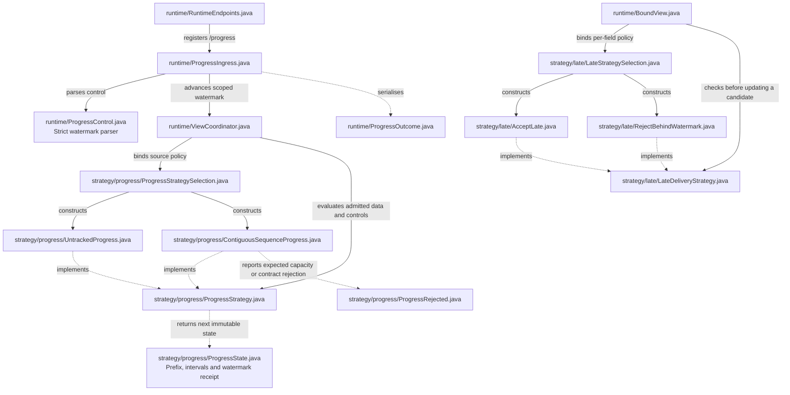

`ViewStatus` derives bounded missing ranges through the selected progress module;
received ranges and violation flags are persisted in `StateImage.StreamState`.
`RecoveryValidation` validates progress and retained field outcomes before readiness.
Schema 4 accepts control-only streams and migrates old rows with unknown field-level
outcomes rather than invented processing history. Both ingress handlers write socket
responses after the coordinator releases its lock.

## Suggested reading paths

For publication admission, start with `runtime/EventIngress.java`, then
`PublicationJson.java` and `ViewCoordinator.java`. Follow `ViewTransitions.java`
to the selected strategy modules. For persistence, read `StateStore.java`,
`SqliteState.java`, `SqliteStateRows.java` and the recovery validators.

For delivery, follow `delivery/SnapshotSubscriptions.java`,
`SnapshotBroadcaster.java` and `OutboundWriter.java`. `OutboundQueue.java`
applies the selected slow-client strategy and accounts for waiting bytes. For configuration and runtime
registration, read `RuntimeConfiguration.java`, `ConfigurationValidation.java`
and `ViewCoordinator.define`.

Replay and authorisation remain outside the implemented contracts.
