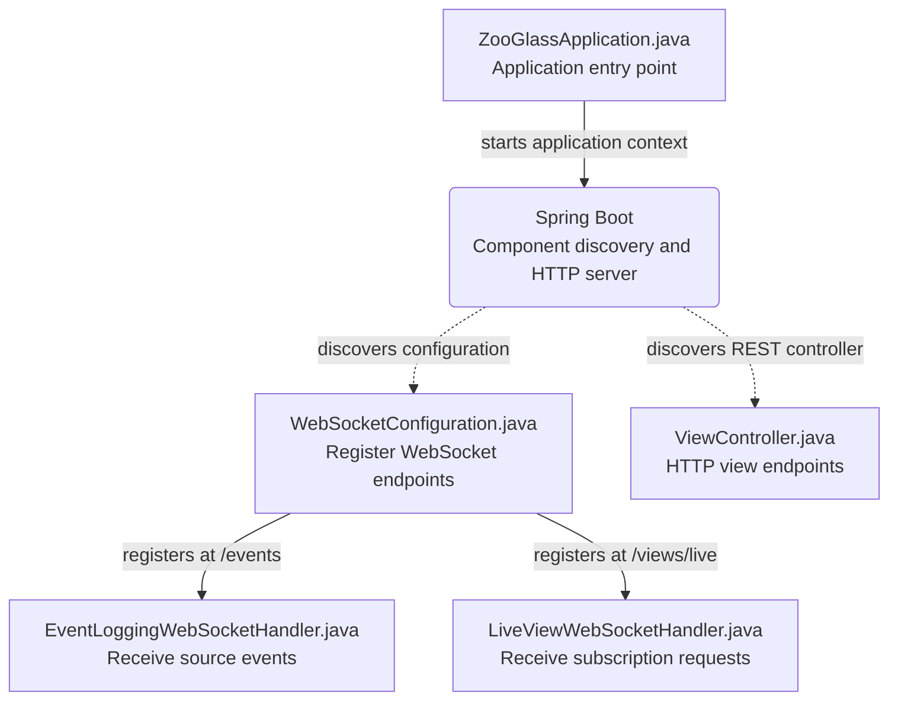
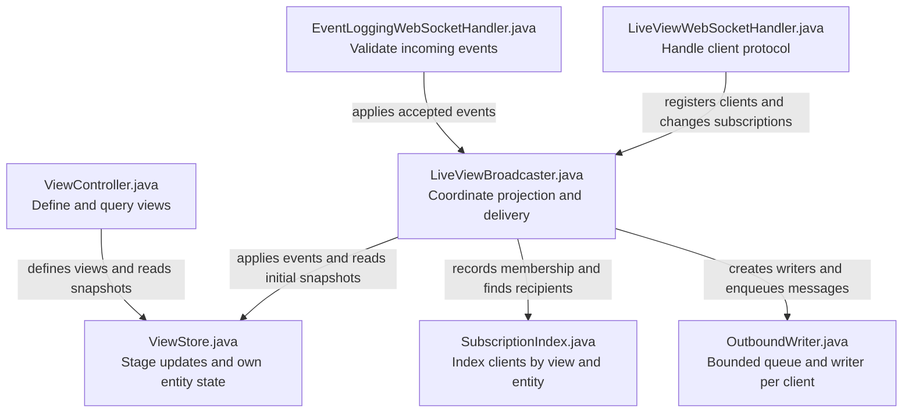
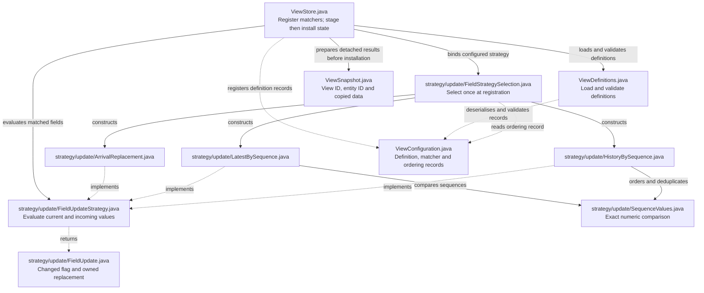
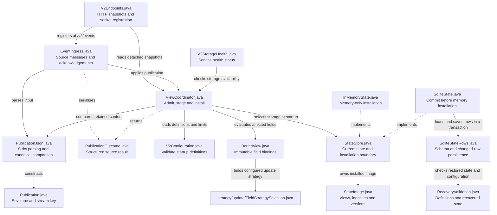

# ZooGlass source map

This guide explains how the current Java prototype fits together. Start with the
endpoint you are interested in, then follow the labelled dependencies to the
classes that own state and delivery.

Each rectangular box is a source file under `src/main/java/io/zooglass/`, unless
labelled otherwise. Solid arrows point from a caller to the class it uses.
Dotted arrows indicate framework wiring or data types, as labelled. Rounded
boxes represent external framework machinery. These are static relationships,
not a timeline of a request or a deployment diagram. Framework and library
dependencies are omitted except where needed to explain startup.

## Start at the application or an endpoint

[`ZooGlassApplication.java`](../src/main/java/io/zooglass/ZooGlassApplication.java)
starts Spring Boot. Spring discovers the annotated components and supplies their
constructor dependencies. The application class does not manually construct the
handlers, controller or store.

| Entry point                                                                                           | What it is for                                                                                                                     |
| ----------------------------------------------------------------------------------------------------- | ---------------------------------------------------------------------------------------------------------------------------------- |
| [`EventLoggingWebSocketHandler.java`](../src/main/java/io/zooglass/EventLoggingWebSocketHandler.java) | Parse and validate source event envelopes, then pass valid events to the broadcaster. Despite the name, it does more than logging. |
| [`LiveViewWebSocketHandler.java`](../src/main/java/io/zooglass/LiveViewWebSocketHandler.java)         | Handle client registration, subscribe/unsubscribe requests, protocol errors and connection closure.                                |
| [`ViewController.java`](../src/main/java/io/zooglass/ViewController.java)                             | Define a view through `POST /views`, or read one entity snapshot through `GET /views/{viewId}/{entityId}`.                         |

## Coordinate projection and live delivery

[`LiveViewBroadcaster.java`](../src/main/java/io/zooglass/LiveViewBroadcaster.java)
coordinates view changes, subscription membership and outbound queue insertion.
Those operations share its monitor so an initial snapshot and subsequent updates
are queued consistently with subscription changes.

[`SubscriptionIndex.java`](../src/main/java/io/zooglass/SubscriptionIndex.java)
maintains both directions of the lookup: recipients for a view/entity pair and
subscriptions belonging to a session. It owns no socket-writing tasks.

[`OutboundWriter.java`](../src/main/java/io/zooglass/OutboundWriter.java) owns a
bounded queue and a writer task for one session. Socket writes happen outside the
broadcaster's monitor. The broadcaster supplies a failure callback and removes
failed or slow clients; the writer does not depend directly on the broadcaster
class. HTTP snapshot reads use the store directly and do not enter this delivery
queue.

## Define and update view state

[`ViewStore.java`](../src/main/java/io/zooglass/ViewStore.java) owns registered
matchers and in-memory entity state. It indexes source/event pairs to the fields
they can update. Configuration validation and individual field-update policies
are delegated to smaller classes.

[`ViewDefinitions.java`](../src/main/java/io/zooglass/ViewDefinitions.java) loads
configuration from the configured resource, defaulting to
[`src/main/resources/views.json`](../src/main/resources/views.json), and validates
startup and runtime definitions. It does not own registered state.

The [`strategy/update/`](../src/main/java/io/zooglass/strategy/update/) package
contains arrival replacement, latest-by-sequence and history-by-sequence modules.
`FieldStrategySelection` binds the configured choice once per field. Each strategy
reads the current value and incoming payload without mutating either, returning
an owned replacement or an unchanged result. `ViewStore` installs replacements
under its existing lock, after all affected fields and result snapshots have been
prepared successfully. An evaluation or snapshot-copy failure installs nothing.
Strategy instances hold settings, never entity state.

[`ViewConfiguration.java`](../src/main/java/io/zooglass/ViewConfiguration.java)
defines the records shared by configuration loading, registration and update
policy. [`ViewSnapshot.java`](../src/main/java/io/zooglass/ViewSnapshot.java)
is the snapshot representation used by the store, HTTP controller and broadcaster;
the store copies values before returning them.

## Versioned publication path

The `v2/` package provides a separate identity-aware path with memory or SQLite storage. It reuses the
update strategies above, while keeping v2 state and endpoints separate from the
legacy demo APIs. See the [ingestion guide](v2-ingestion.md) for configuration and
wire examples.

Each box below is a file in
[`src/main/java/io/zooglass/v2/`](../src/main/java/io/zooglass/v2/), except the
shared strategy selector.

`ViewCoordinator` serialises admission, staging and snapshot reads under one
monitor. It prepares all view changes and retained identity records before
installing one complete `StateImage` through `StateStore`. `InMemoryState` installs
it directly. `SqliteState` commits changed stream/view rows and the version first,
then installs the prepared image. `BoundView` holds configuration and strategy
bindings, never entity state.

`SqliteStateRows` owns the schema and JSON row format. `RecoveryValidation`
checks stored definitions and state before the service becomes ready.
`SqliteState` owns one exclusive connection and closes it on shutdown or storage
failure. Failed storage blocks reads and writes; `V2StorageHealth` reports DOWN.

`EventIngress` sends the outcome after leaving the coordinator's monitor. A
transport failure cannot undo applied state; a retry can recover the retained
result. There are no v2 live-subscription writers in this increment.

## Suggested reading paths

For an incoming event, read `EventLoggingWebSocketHandler.java`,
`LiveViewBroadcaster.java`, `ViewStore.java`, then the selected module in `strategy/update/`. For client
delivery, start with `LiveViewWebSocketHandler.java`, then the broadcaster,
subscription index and outbound writer. For view definitions, start with
`ViewController.java`, then the store and `ViewDefinitions.java`.

For v2 ingestion, start with `v2/EventIngress.java`, then `PublicationJson.java`,
`ViewCoordinator.java`, `BoundView.java` and the selected `StateStore` implementation.

This map covers all 34 production Java files. SQLite persistence applies to v2 only;
legacy endpoints retain their memory-only behaviour. Replay and authorisation
features are separate delivery work.
Tests are described in the [verification map](../../docs/testing.md). For the
clients and orchestration around the service, see the
[Workbench source map](../../workbench/docs/source-map.md) and
[vehicle-tracker source map](../../demos/vehicle-tracker/docs/source-map.md).

Update the relevant diagram when class responsibilities or dependencies change.
Keep framework wiring distinct from direct code dependencies.
