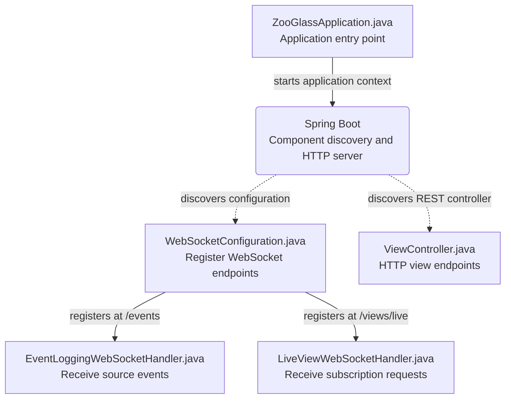
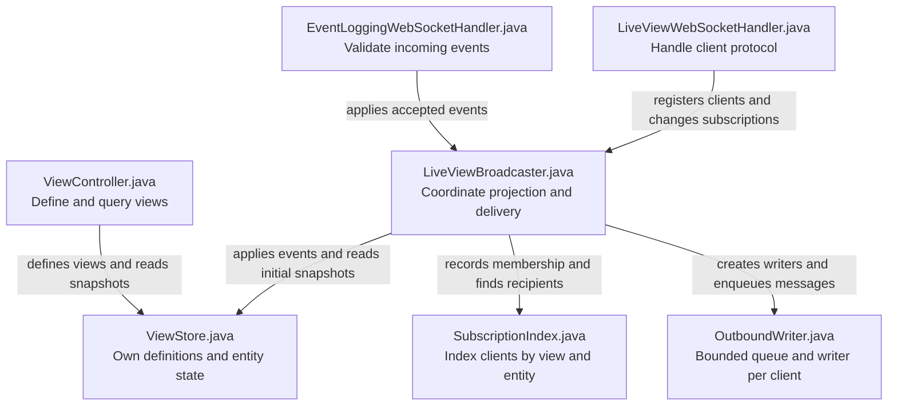
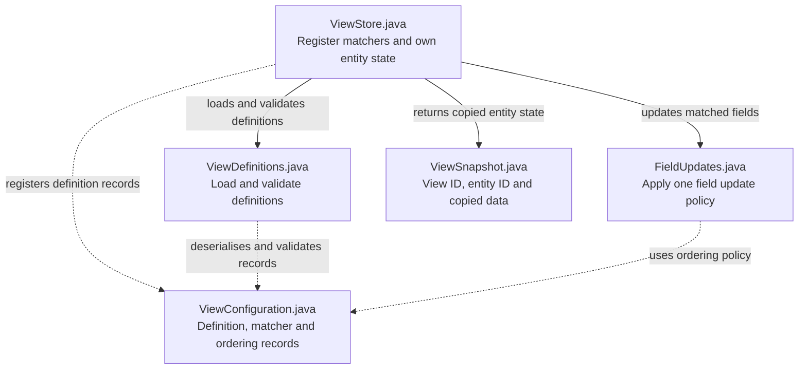

# ZooGlass source map

This guide explains how the current Java prototype fits together. Start with the
endpoint you are interested in, then follow the labelled dependencies to the
classes that own state and delivery.

Each rectangular box is a source file under `src/main/java/io/zooglass/`, unless
labelled otherwise. Solid arrows point from a caller to the class it uses.
Dotted arrows indicate framework wiring or data types, as labelled. Rounded
boxes represent external framework machinery. These are static relationships,
not a timeline of a request or a deployment diagram. Framework and library
dependencies are omitted except where needed to explain startup.

## Start at the application or an endpoint

[`ZooGlassApplication.java`](../src/main/java/io/zooglass/ZooGlassApplication.java)
starts Spring Boot. Spring discovers the annotated components and supplies their
constructor dependencies. The application class does not manually construct the
handlers, controller or store.

| Entry point                                                                                           | What it is for                                                                                                                     |
| ----------------------------------------------------------------------------------------------------- | ---------------------------------------------------------------------------------------------------------------------------------- |
| [`EventLoggingWebSocketHandler.java`](../src/main/java/io/zooglass/EventLoggingWebSocketHandler.java) | Parse and validate source event envelopes, then pass valid events to the broadcaster. Despite the name, it does more than logging. |
| [`LiveViewWebSocketHandler.java`](../src/main/java/io/zooglass/LiveViewWebSocketHandler.java)         | Handle client registration, subscribe/unsubscribe requests, protocol errors and connection closure.                                |
| [`ViewController.java`](../src/main/java/io/zooglass/ViewController.java)                             | Define a view through `POST /views`, or read one entity snapshot through `GET /views/{viewId}/{entityId}`.                         |

## Coordinate projection and live delivery

[`LiveViewBroadcaster.java`](../src/main/java/io/zooglass/LiveViewBroadcaster.java)
coordinates view changes, subscription membership and outbound queue insertion.
Those operations share its monitor so an initial snapshot and subsequent updates
are queued consistently with subscription changes.

[`SubscriptionIndex.java`](../src/main/java/io/zooglass/SubscriptionIndex.java)
maintains both directions of the lookup: recipients for a view/entity pair and
subscriptions belonging to a session. It owns no socket-writing tasks.

[`OutboundWriter.java`](../src/main/java/io/zooglass/OutboundWriter.java) owns a
bounded queue and a writer task for one session. Socket writes happen outside the
broadcaster's monitor. The broadcaster supplies a failure callback and removes
failed or slow clients; the writer does not depend directly on the broadcaster
class. HTTP snapshot reads use the store directly and do not enter this delivery
queue.

## Define and update view state

[`ViewStore.java`](../src/main/java/io/zooglass/ViewStore.java) owns registered
matchers and in-memory entity state. It indexes source/event pairs to the fields
they can update. Configuration validation and individual field-update policies
are delegated to smaller classes.

[`ViewDefinitions.java`](../src/main/java/io/zooglass/ViewDefinitions.java) loads
configuration from the configured resource, defaulting to
[`src/main/resources/views.json`](../src/main/resources/views.json), and validates
startup and runtime definitions. It does not own registered state.

[`FieldUpdates.java`](../src/main/java/io/zooglass/FieldUpdates.java) implements
replacement, latest-by-sequence and history-by-sequence field updates.
[`ViewConfiguration.java`](../src/main/java/io/zooglass/ViewConfiguration.java)
defines the records shared by configuration loading, registration and update
policy. [`ViewSnapshot.java`](../src/main/java/io/zooglass/ViewSnapshot.java)
is the snapshot representation used by the store, HTTP controller and broadcaster;
the store copies values before returning them.

## Suggested reading paths

For an incoming event, read `EventLoggingWebSocketHandler.java`,
`LiveViewBroadcaster.java`, `ViewStore.java`, then `FieldUpdates.java`. For client
delivery, start with `LiveViewWebSocketHandler.java`, then the broadcaster,
subscription index and outbound writer. For view definitions, start with
`ViewController.java`, then the store and `ViewDefinitions.java`.

This map covers all 13 production Java files. It describes the current in-memory
prototype; it does not imply persistent storage, replay or authorisation features.
Tests are described in the [verification map](../../docs/testing.md). For the
clients and orchestration around the service, see the
[Workbench source map](../../workbench/docs/source-map.md) and
[vehicle-tracker source map](../../demos/vehicle-tracker/docs/source-map.md).

Update the relevant diagram when class responsibilities or dependencies change.
Keep framework wiring distinct from direct code dependencies.
